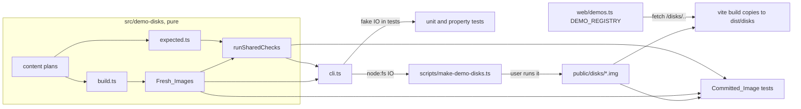

# Design Document

## Overview

This design delivers the three demo floppy images of Exhume (`writers-disk.img`, `office-disk.img`, `damaged-disk.img`), the deterministic generator that produces them, the in-memory content checks that prove their contents, and the `DEMO_REGISTRY` entries that put them one click away on the page.

The design is a thin layer over finished modules. Nothing under `src/core/` or `src/test-support/` changes.

- The FAT12 image comes from `writeFat12Image` in `src/test-support/fat12/index.ts`.
- File bytes come from `writeWordStar`, `writeDbf` and `encodePcx` in `src/test-support/formats/index.ts`.
- Verification uses `openDisk` from `src/core/fat12/index.ts` and `convertAuto` from `src/core/formats/index.ts`.

Seven rules shape the design:

1. **One pure core, three thin shells.** Content, build and checks live in `src/demo-disks/` and use no Node API. The CLI, the tests and the script are the shells. Vitest already includes `src/**/*.test.ts`, so every test runs under `npm test` without a config change.
2. **Content is data.** Each disk has one authored plan: a file tree, a damage list and a map of source bytes. The build function and the checks read the same plan, so a check compares the Reader's answer with the author's intent and never with a copy of the Reader's logic.
3. **The checks run on bytes.** `runSharedChecks(id, image)` takes any image bytes. The same function runs on the Fresh_Image (in memory, always passes) and on the Committed_Image (may fail until the user generates the files).
4. **The agent never writes `public/disks/`.** The CLI is built so that tests drive it with a fake I/O object. No test touches the real folder except to read it.
5. **No new dependency.** The script runs through a second Vite SSR config, the same mechanism as `build:mcp`.
6. **Verify before write.** The CLI runs the Shared_Checks on the three Fresh_Images and writes nothing if any check fails. This is an addition to Requirement 2, criterion 8, which only demands "all three built before any write".
7. **Honest names.** Everything the Reader reports is checked under the name the Reader reports (see Finding F1).

### Findings that touch the requirements (for your review)

These came out of reading the real code. None changes a decision you made. Items F1 to F4 need your attention before tasks are written.

| # | Finding | How the design handles it |
|---|---|---|
| F1 | The Reader shows a deleted entry with its first character replaced by `_` (`src/core/fat12/directory.ts`, `PLACEHOLDER`). The deleted files are therefore listed as `/_RAFT1.WS`, `/_RAFT2.WS` and `/_LDCUST.DBF`, not `/DRAFT1.WS` etc. | The author-side names stay `DRAFT1.WS`, `DRAFT2.WS`, `OLDCUST.DBF` (as in the requirements). Checks use the Reader-side paths and the converter name hints `_RAFT1.WS`, `_RAFT2.WS` (the extension is what the hint is used for). Requirements 5.5, 5.6, 5.8, 5.9, 6.8 and 6.9 are read as naming the files by their author-side names. |
| F2 | A cyclic chain on a file whose declared size is covered by its own clusters is **not visible** to the Reader. `walkChain` stops with `enough` before it follows the last link back (`src/core/fat12/chain.ts`). The existing test `reader.examples.test.ts` says the same. `cyclic-chain` alone gives zero warnings and an `alive` file. | `LETTER.WS` gets two damage specs: `cyclic-chain` and `size-exceeds-chain` (declared size = chain bytes + 1,024). Together they are one defect: a looping chain that the file needs to follow. Requirement 7, criteria 4 and 10 say "exactly two defects"; I read the pair as the second defect. Please confirm, or reword 7.4 and 7.10 to say "cyclic-chain damage, plus the size-exceeds-chain damage that makes the cycle observable". The README names two defects (bad BPB field, cyclic chain) as Requirement 11.4 asks. |
| F3 | The writer gives deleted files with no `placement` their own clusters (FAT left free), and live files are packed from cluster 2 upward. So a "free cluster followed by a live cluster" needs a hole, and a hole needs a deleted file. A third deleted file would break Requirement 5.10 (exactly two). | `DRAFT2.WS` is its own hole: it is a deleted file with no placement, two clusters long, followed in the tree by a live file. Its declared size is raised by the `size-exceeds-chain` damage to three clusters. Result: two free clusters, then `CHAPTER3.WS`, which is allocated. The Reader grades it `partial`. This is also how a real overwritten draft looks: the entry remembers the original size, the disk only holds the surviving part. |
| F4 | Two existing tests assume an empty registry: `src/web/demos.test.ts` ("ships with an empty registry") and `src/web/dom/demo-slot.dom.test.ts` ("hides everything with the default empty registry", which calls `createDemoSlot(vi.fn())` with the default registry). Filling `DEMO_REGISTRY` breaks both. Requirement 9.5 limits the change to `demos.ts`, and 9.6 wants existing tests to pass. | The design edits those two tests minimally: the first asserts the three entries instead; the second passes an explicit empty array `[]` as the registry argument. The tasks must include both edits. |
| F5 | `tsconfig.json` includes only `src`. `scripts/make-demo-disks.ts` would not be type-checked. | Add `"scripts"` to `include` in the root `tsconfig.json` (a one-word change). Please confirm. |
| F6 | The forbidden-name list of Requirement 1.6 holds both `node:http` and `node:https`. A plain substring scan reports both on a `node:https` line, so Requirement 1.7 ("one violation for each name") would count 15, not 14. | The scanner uses longest-match at each position. A line with `node:https` yields one violation. |
| F7 | `package.json` has no `engines` field. The local Node is 24.10; the project rule is Node 22+. | The Vite config targets `node22`, as `vite.mcp.config.ts` does. No `engines` change. |

### Decisions and their rationale

| Open point | Decision | Why |
|---|---|---|
| (1) How the TypeScript script runs | `vite build --config vite.demos.config.ts` bundles `scripts/make-demo-disks.ts` (SSR, ES module, Node 22 target) into `node_modules/.cache/exhume-demos/make-demo-disks.mjs`; `node` runs it. `npm run make:demos -- --check` appends `--check` to the `node` command. | Same mechanism as `build:mcp`, so it adds no dependency and resolves the extensionless imports. The output sits under `node_modules`, which is git-ignored, so no tracked file changes. Rejected: `vite-node` (it exists only as a transitive dependency of `vitest`; relying on it is fragile) and `node scripts/make-demo-disks.ts` (cannot resolve the extensionless imports in `src/`). |
| (2) Where code and checks live | `src/demo-disks/` holds content, build, checks and the CLI core. `scripts/make-demo-disks.ts` is the only Node shell. The Node-using tests sit next to the code as `src/demo-disks/*.test.ts`. | Vitest includes only `src/**/*.test.ts`. No config change. |
| (3) Cluster placement | See "Disk plans" below. Recovered: a deleted file with free clusters. Partial: the deleted file as its own hole plus `size-exceeds-chain`. Lost: `placement` onto the first cluster of a live file. | Only options the writer really has (`deleted`, `placement`, `damage`), verified in `layout.ts` and `damage.ts`. |
| (4) Module layout | See "Architecture". | Pure functions over `Uint8Array`, one result shape. |
| (5) Scanner | One left-to-right pass, no regular expression, a 1,048,576-character cap. | Requirement 8.9, rule three. |
| (6) Source scan | A pure scanner in `src/test-support/demo-source-scan.ts`, a test file that runs it over the Generator files. | The scanner holds the forbidden names as string literals. If it lived in the Generator, it would scan itself and fail. |
| (7) Registry | Three literal entries in `src/web/demos.ts`. A test compares them with the generator specs. | `src/web/` must not import the writer, which would pull it into the page bundle. |

### Research notes

Facts verified by reading the code in this session. I ran no command that changes files and did not run the generator or the tests.

- **Writer** (`src/test-support/fat12/layout.ts`): nodes are laid out depth-first in tree order. A node with `placement` takes no clusters and no FAT entry; its bytes are written first and are then overwritten by any live node that covers the same clusters. A deleted node without `placement` keeps its clusters (FAT entries stay `0x000`) and its bytes. The directory entry of a deleted node gets `0xE5` as its first byte. `serial` and per-node `modified` are explicit; the default date is 1980-01-01 and the default serial is a constant.
- **Geometry** (`measure.ts`): `360K` is 2 sectors per cluster (1,024 bytes), 112 root entries, 354 data clusters. `720K` is also 2 sectors per cluster, 112 root entries, 713 data clusters. `360K` is 368,640 bytes and `720K` is 737,280 bytes, both unique sizes in `FALLBACK_GEOMETRIES`.
- **Damage** (`damage.ts`): `invalid-bpb` with `sectorsPerCluster` writes 0 into that one field. `cyclic-chain` links the last cluster to the first in both FAT copies. `size-exceeds-chain` sets the declared size to chain bytes + `extraBytes`. Each touches nothing else, and none requires a live chain except `cyclic-chain`. `size-exceeds-chain` works on a deleted file.
- **Grader** (`grade.ts`): a deleted file is `recovered` when every cluster of its run is free and unclaimed, `partial` when the run is cut short by an allocated or claimed cluster, `lost` when the start cluster is not free. A live file whose chain ends in anything but `end` or `enough` is `partial` (or `lost` with zero clusters). Deleted-file grading adds no warning.
- **Reader** (`disk.ts`): `readBytes` of a `lost` grave returns `{ ok: false, error: 'data is not recoverable' }`. For a `partial` deleted grave it returns the free run only, so fewer bytes than declared. A live read follows the chain and stops at the first repeated cluster.
- **Warnings**: a cycle adds `chain-cycle` with the file path, once per walk. An invalid BPB with a standard image length adds `bpb-invalid` and sets `geometrySource` to `fallback`.
- **Converters** (`convertAuto`): result is `{ ok, output, mime, extension, warnings }`. The WordStar converter skips `0x00` bytes, so zero padding after a partial file is harmless. Dot lines are recognised only at line start. `.PA` becomes a horizontal rule; any other dot command only adds a `dot-commands-ignored` warning. `0x02` toggles bold (`**`); `0x13` and `0x19` toggle emphasis (`*`). The DBF converter trims C and N cells, turns D cells `YYYYMMDD` into `YYYY-MM-DD`, decodes CP437, and guards text cells that start with `=`, `+`, `-` or `@`. The PCX converter writes alpha 255 for every pixel and takes an 8-bit palette from the VGA trailer without scaling.
- **Fixture writers**: `writeWordStar` takes printable ASCII only and sets the high bit on the last character of each word. A paragraph whose whole text is `.PA` therefore becomes a valid dot-command line. `wrapAt` produces soft returns (`0x8D 0x0A`). `writeDbf` takes raw field bytes, already padded. `encodePcx` in `indexed256` mode writes a 769-byte VGA trailer.
- **Existing tests that matter**: `purity.test.ts` and `formats-purity.test.ts` pin `package.json` dependencies and scan `src/core` and `src/test-support/{fat12,formats}`. `src/web/sources.scan.test.ts` and `page.static.test.ts` scan `src/web` and `index.html`; they do not read `public/`. `demo-validate.ts` accepts the three planned entries.
- **Not verified**: I did not run `vite build --config vite.demos.config.ts` (the config mirrors `vite.mcp.config.ts` but is new). I did not confirm that `npm run` puts the working directory at the package root on every platform; the script therefore checks for `package.json` in `process.cwd()` and fails clearly if it is absent. I did not run the converters over the authored prose. The tasks must run the in-memory tests first and fix the authored content, not the checks.

## Architecture

### Module layout

```
scripts/
  make-demo-disks.ts           Node shell: node:fs adapter, calls runCli, sets process.exitCode
vite.demos.config.ts           SSR bundle config (mirrors vite.mcp.config.ts)
src/
  demo-disks/                  PURE: Uint8Array in, Uint8Array out, no Node API, no clock
    specs.ts                   DemoDiskId, DemoDiskSpec, DEMO_DISK_SPECS (file names, labels, geometry, serial)
    errors.ts                  DemoBuildError(diskFile, message)
    content/
      dates.ts                 fixed DosDateTime constants
      cp437.ts                 small ASCII + CP437 letter table for the table builder
      table.ts                 AuthoredTable, tableToDbf (generic builder, Property 3)
      logo.ts                  AuthoredLogo, logoToPcx (generic builder, Property 4)
      prose.ts                 authored WordStar paragraphs (chapters, drafts, letter, memo)
      readme.ts                README.TXT texts and the two required marker phrases
      writers.ts  office.ts  damaged.ts      one DiskPlan builder per disk
    build.ts                   buildDemoDisk(id), buildAllDemoDisks()
    checks/
      types.ts                 CheckFailure
      expected.ts              expectation tables per disk (built from the plans)
      shape.ts                 length, geometry, serial, volume label, boot sector, extensions
      graves.ts                exact (path, state, kind, size, date, reason) table and warning set
      reads.ts                 readBytes and converter checks, no-throw sweep
      text-scan.ts             scanPhones, scanLinks (Properties 1 and 2)
      texts.ts                 collects the text of a disk and applies text-scan
      index.ts                 runSharedChecks(id, image)
    cli.ts                     runCli(args, io, root, deps): 0 | 1
    index.ts                   public barrel
    *.test.ts                  tests (see Testing Strategy)
  test-support/
    demo-source-scan.ts        FORBIDDEN_NAMES, scanGeneratorSource (Property 5)
  web/demos.ts                 DEMO_REGISTRY content only
public/disks/                  written by the user's run of the generator, never by the agent
```

Layering rules, enforced by a test (see "Source and import scans"):

- `content/` and `build.ts` import only `src/test-support/fat12/index` and `src/test-support/formats/index` and each other.
- `checks/` may also import `src/core/fat12/index` and `src/core/formats/index`, and `parseCsv` and `decodePng` from the formats test-support barrel. Nothing else from `src/core`.
- `cli.ts` imports `build.ts` and `checks/index.ts`. It imports no `node:` module.
- Only `scripts/make-demo-disks.ts` imports `node:fs`.

### Data flow



### How the script runs

`package.json` gets one new script:

```json
"make:demos": "vite build --config vite.demos.config.ts && node node_modules/.cache/exhume-demos/make-demo-disks.mjs"
```

`npm run make:demos -- --check` passes `--check` to the last command, which is the `node` call. `&&` stops on a failed build and passes the exit status of the `node` process through, so exit codes work as Requirement 2 asks. `npm run build` is untouched and does not call the script (Requirement 2.9).

`vite.demos.config.ts` mirrors `vite.mcp.config.ts`:

```ts
import { builtinModules } from 'node:module';
import { defineConfig } from 'vite';

export default defineConfig({
  publicDir: false,
  logLevel: 'warn',
  build: {
    ssr: 'scripts/make-demo-disks.ts',
    outDir: 'node_modules/.cache/exhume-demos',
    emptyOutDir: false,
    copyPublicDir: false,
    target: 'node22',
    minify: false,
    sourcemap: false,
    reportCompressedSize: false,
    rollupOptions: {
      external: [/^node:/, ...builtinModules],
      output: { format: 'es', entryFileNames: 'make-demo-disks.mjs', inlineDynamicImports: true },
    },
  },
  ssr: { noExternal: true, target: 'node' },
});
```

The script (shape only):

```ts
// scripts/make-demo-disks.ts
import { existsSync, mkdirSync, readFileSync, writeFileSync } from 'node:fs';
import { runCli } from '../src/demo-disks/cli';

const root = process.cwd();
if (!existsSync(`${root}/package.json`)) { /* print "run from the repository root", exit 1 */ }
process.exitCode = runCli(process.argv.slice(2), nodeIo, root);
```

`nodeIo.readFile` returns `undefined` only for a missing file (`ENOENT`); any other error propagates to a top-level `try/catch` that prints the message and sets exit status 1. The working directory decides only where files go, never what bytes they hold (Requirement 3.2 concerns the bytes).

### The CLI core

```ts
export interface CliIo {
  readFile(path: string): Uint8Array | undefined; // undefined = missing
  writeFile(path: string, bytes: Uint8Array): void;
  makeDir(path: string): void;
  out(line: string): void;
  err(line: string): void;
}
export interface CliDeps {
  build(): FreshDisk[];                 // default: buildAllDemoDisks
  verify(disks: FreshDisk[]): CheckFailure[]; // default: runs runSharedChecks on each
}
export const DISKS_DIR = 'public/disks';
export const USAGE = 'usage: make-demo-disks [--check]';
export function runCli(args: readonly string[], io: CliIo, root: string, deps?: CliDeps): 0 | 1;
```

Control flow, in order:

1. `args` is `[]` → write mode. `args` is `['--check']` → check mode. Anything else → `io.err(USAGE)`, return 1. Nothing was built and nothing was written (Requirement 2.6).
2. `deps.build()` inside `try/catch`. A `DemoBuildError` (also any `FitError` or other `Error` the writers throw, which `build.ts` wraps into `DemoBuildError`) prints `failed to build <file>: <message>` and returns 1 (Requirements 2.7, 4.8). No write happened yet.
3. Check mode: for each Fresh_Image read the committed file; print `missing: <file>` or `differs: <file>` for each problem; return 1 if any, else 0. No write, no `makeDir` (Requirements 2.4, 2.5).
4. Write mode: run `deps.verify`. If it returns failures, print each as `check failed: <check>: <message>` and return 1 with no write. Otherwise `makeDir(root/public/disks)` and `writeFile` the three exact Fresh_Image byte arrays (Requirements 2.2, 2.3, 2.8, 3.8). A failed write is caught, reported, and returns 1; files already written stay (the writer cannot be atomic without a temp file, and Requirement 2.3 forbids any other path).

Paths are built with `/` joins on `root`, so `cli.ts` needs no `node:path`.

## Components and Interfaces

### Specs

```ts
export type DemoDiskId = 'writers-disk' | 'office-disk' | 'damaged-disk';
export interface DemoDiskSpec {
  id: DemoDiskId;
  fileName: string;                 // 'writers-disk.img' ...
  label: string;                    // 'WRITER DEMO' | 'OFFICE DEMO' | 'DAMAGE DEMO'
  geometry: StandardGeometryName;   // '360K' | '720K' | '360K'
  serial: number;                   // fixed, distinct per disk
}
export const DEMO_DISK_SPECS: readonly DemoDiskSpec[]; // order: writers, office, damaged
```

### Plans and the build function

```ts
export interface DiskPlan {
  tree: FileTree;                                     // volumeLabel, children with explicit `modified`
  damage: DamageSpec[];                               // [] except the damaged disk
  sources: ReadonlyMap<string, Uint8Array>;           // author path -> bytes from the Fixture_Writer
}
export function planOf(id: DemoDiskId): DiskPlan;     // pure, no arguments besides the id
export interface FreshDisk { spec: DemoDiskSpec; image: Uint8Array }
export function buildDemoDisk(id: DemoDiskId): FreshDisk;  // writeFat12Image(plan.tree, spec.geometry, { serial, damage })
export function buildAllDemoDisks(): FreshDisk[];          // three disks, spec order, or throws DemoBuildError
export class DemoBuildError extends Error { constructor(readonly diskFile: string, message: string) }
```

`buildDemoDisk` wraps the whole body in `try/catch` and rethrows any error as `DemoBuildError(spec.fileName, message)`. The messages come from our own writers and never contain disk text.

### Disk plans (Requirement 5, 6, 7 placement)

Cluster size is 1,024 bytes for all three geometries. Cluster numbers are shown to explain the placement. The checks do not hard-code them; they compare relations (see "Shared_Checks").

#### Writer's disk, `360K`, label `WRITER DEMO`

Tree order is allocation order (the writer allocates in order). Each deleted entry is listed by its author-side name.

| Tree order | Author name | State in tree | Content target | Clusters | Expected Reader path | Expected state |
|---|---|---|---|---|---|---|
| 1 | `CHAPTER1.WS` | live | 2,300 to 3,072 bytes | 2 to 4 | `/CHAPTER1.WS` | `alive` |
| 2 | `DRAFT1.WS` | `deleted: true`, no placement | 3,073 to 4,096 bytes | 5 to 8 (free) | `/_RAFT1.WS` | `recovered` |
| 3 | `CHAPTER2.WS` | live | 3,073 to 4,096 bytes | 9 to 12 | `/CHAPTER2.WS` | `alive` |
| 4 | `DRAFT2.WS` | `deleted: true`, no placement | 1,100 to 2,048 bytes | 13 to 14 (free) | `/_RAFT2.WS` | `partial` |
| 5 | `CHAPTER3.WS` | live | 4,097 to 5,120 bytes | 15 to 19 | `/CHAPTER3.WS` | `alive` |
| 6 | `README.TXT` | live | under 1,024 bytes | 20 | `/README.TXT` | `alive` |

- **Recovered.** `DRAFT1.WS` sits in a hole of four free clusters. The grader walks all four, finds them free and unclaimed, and returns `recovered` ("4 clusters are contiguous and unallocated"). Its size spans at least three clusters (Requirement 5.5).
- **Partial.** `DRAFT2.WS` has two free clusters (13 and 14). Damage `size-exceeds-chain` with `extraBytes: 1024` raises its declared size to 3,072 bytes, so the grader needs three clusters. Cluster 15 belongs to `CHAPTER3.WS`, so the grader stops there and returns `partial` ("2 of 3 clusters still free; cluster 15 is allocated"). `readBytes` returns the two free clusters, 2,048 bytes, which is fewer than 3,072. The bytes beyond the authored text are zeros, which the converter skips. This satisfies "first one or two clusters are free and unclaimed and the next cluster is allocated to a live file" (Requirement 5.6) and gives exactly two recovered or partial files and no lost file (5.10).
- `DRAFT1.WS` comes before `DRAFT2.WS` and uses different clusters, so `claimed` marks of the first never block the second.
- Damage list: `[{ type: 'size-exceeds-chain', path: '/DRAFT2.WS', extraBytes: 1024 }]`. This is the only use of damage on this disk. The disk has no defect: zero warnings, `geometrySource` `bpb`.

Chapter content (Requirement 5.3): `prose.ts` exports paragraphs for the three chapters, the two drafts, a letter and a memo, written by the project in a fictional setting (a small-town ferry office, for example). The three live chapters together use at least one `bold`, one `underline`, one `italic` span; at least one chapter has a `.PA` paragraph (the converter turns it into a rule) and at least one paragraph uses `wrapAt` long enough text to produce soft returns. No paragraph starts with `#`, `-`, `+`, a digit followed by `.`, or contains `*`, `_`, `<`, `>`, `[`, `]`, backtick or backslash, so the Markdown stays easy to read. Text avoids `@` and the substrings `http://`, `https://`, `www.`.

#### Small-business disk, `720K`, label `OFFICE DEMO`

| Tree order | Author name | State in tree | Clusters | Expected Reader path | Expected state |
|---|---|---|---|---|---|
| 1 | `CUSTOMER.DBF` | live | about 1,220 bytes, 2 clusters (2 to 3) | `/CUSTOMER.DBF` | `alive` |
| 2 | `LOGO.PCX` | live | 1 or 2 clusters | `/LOGO.PCX` | `alive` |
| 3 | `INVOICES` | live directory with `modified` | 1 cluster | `/INVOICES` (`kind` `directory`) | `alive` |
| 3a | `INVOICES/INV8903.TXT` | live, plain ASCII | 1 cluster | `/INVOICES/INV8903.TXT` | `alive` |
| 4 | `OLDCUST.DBF` | `deleted: true`, `placement: { startCluster: 2 }` | 0 (placed) | `/_LDCUST.DBF` | `lost` |
| 5 | `README.TXT` | live | 1 cluster | `/README.TXT` | `alive` |

- **Lost.** `OLDCUST.DBF` is an older, smaller customer table (about 200 bytes, within one cluster). `placement.startCluster: 2` is the first cluster of `CUSTOMER.DBF`. The writer writes the placed bytes first and the live file then overwrites them, so nothing of the old table remains and the FAT entry of cluster 2 is allocated. The grader finds the start cluster in use and returns `lost` ("start cluster 2 has been reused"). The placed node takes no clusters, so the layout of the other files does not depend on it. The check asserts `OLDCUST` start cluster equals the start cluster of `CUSTOMER.DBF` in the report.
- **Customer table** (Requirement 6.2, 6.3): fields `CUSTNO` N(5,0), `NAME` C(24), `CITY` C(16), `PHONE` C(8), `SINCE` D(8), `BALANCE` N(9,2). Fourteen records. Phones are `555-0100` to `555-0199`. At least two names or cities hold CP437 letters above `0x7F` (for example `é`, `ñ`, `ü`). No text cell starts with `=`, `+`, `-` or `@`.
- **Logo** (Requirement 6.5): 64 by 40 pixels, `indexed256`, a palette of five authored colors, drawn by integer arithmetic in `logo.ts` (a lantern or a stack of ledger lines on a colored background; nothing that resembles a real brand).
- **Invoices**: `INV8903.TXT` is plain ASCII, a short fictional invoice. It contains no `.xx` line at its start (so it is not read as WordStar) and no phone-like digit group.
- Names, businesses and cities are invented. The tasks should have you glance at the authored lists once; the code can only check phone numbers, links and e-mail shapes.
- Damage list: none. Zero warnings, `geometrySource` `bpb`.

#### Damaged disk, `360K`, label `DAMAGE DEMO`

| Tree order | Author name | Clusters | Expected Reader path | Expected state |
|---|---|---|---|---|
| 1 | `LETTER.WS` | 2,049 to 3,072 bytes, 3 clusters (2 to 4) | `/LETTER.WS` | `partial` |
| 2 | `MEMO.WS` | 1 or 2 clusters | `/MEMO.WS` | `alive` |
| 3 | `README.TXT` | 1 cluster | `/README.TXT` | `alive` |

Damage list, in this order:

```ts
[
  { type: 'invalid-bpb', field: 'sectorsPerCluster' },          // BPB defect (writes 0 into that one field)
  { type: 'cyclic-chain', path: '/LETTER.WS' },                 // cluster 4 links back to cluster 2
  { type: 'size-exceeds-chain', path: '/LETTER.WS', extraBytes: 1024 }, // makes the loop observable (Finding F2)
]
```

- The BPB field `sectorsPerCluster` is 0, which fails `isValidBpb`. The image is 368,640 bytes, which matches the 360K fallback, so the Reader reports `geometrySource: 'fallback'` and one `bpb-invalid` warning. The fallback geometry equals the real one, so the rest reads normally.
- The declared size of `LETTER.WS` becomes 4,096 bytes (four clusters). The chain walk collects clusters 2, 3, 4, follows the link from 4 back to 2, sees a repeat and reports `chain-cycle` with path `/LETTER.WS`. The grade is `partial` ("cluster chain is damaged (cycle) after 3 clusters"). `readBytes` returns 3,072 bytes, which is at most the declared size.
- Expected warnings: exactly `bpb-invalid` and `chain-cycle` (path `/LETTER.WS`). No `chain-short` (that code needs an `end` result), no `size-exceeds-disk` (4,096 is far below the disk capacity), no `fat-copies-differ` (the damage writes both FAT copies).
- `README.TXT` names both defects: "the boot sector field for sectors per cluster is set to zero" and "the cluster chain of LETTER.WS loops back on itself" (Requirement 7.7).

### Shared_Checks

```ts
export interface CheckFailure { check: string; message: string }
export function runSharedChecks(id: DemoDiskId, image: Uint8Array): CheckFailure[]; // [] means all pass
```

`runSharedChecks` opens the image once with `openDisk`, obtains `planOf(id)` for the sources, and runs these groups. A group never throws; an unexpected exception is returned as a failure naming the group. No group reads the clock or the file system.

| Group | What it checks | Requirements |
|---|---|---|
| `shape` | image length equals the geometry capacity, is at most `MAX_IMAGE_BYTES` and is at most 1,474,560; geometry name is at most `1440K`; `volume.geometrySource` is `bpb` (writers, office) or `fallback` (damaged); `volume.label` equals the spec label; the volume serial at offset `0x27` equals the spec serial; boot sector bytes 62 to 509 are all zero and bytes 0 to 2 are `EB 3C 90` (no boot code); at most 64 graves, no path deeper than two parts, no declared size above 65,536 | 3.3, 4.1 to 4.4, 4.6, 5.1, 6.1, 7.1, 8.5, 8.8 |
| `graves` | the exact table of `(path, kind, state)`; each `size` equals the source length (or source length + 1,024 for `/_RAFT2.WS`, and chain bytes + 1,024 for `/LETTER.WS`); each `date` equals the authored date; `reason` is absent for `alive` and non-empty otherwise; the relations: `/_RAFT2.WS` start cluster + 2 equals the start cluster of `/CHAPTER3.WS`; `/_LDCUST.DBF` start cluster equals the start cluster of `/CUSTOMER.DBF`; `/_RAFT1.WS` spans at least three clusters; exactly two recovered or partial files and no lost file on the writers disk | 3.3, 5.2, 5.5 to 5.7, 5.10, 5.11, 6.7, 6.8, 6.10, 6.11, 7.5, 7.6, 10.1, 10.2 |
| `warnings` | the sorted list of warning codes equals the expected list: `[]`, `[]`, and `['bpb-invalid', 'chain-cycle']`; the `chain-cycle` warning has path `/LETTER.WS` | 4.5, 7.2 to 7.5, 7.10, 10.3 |
| `reads` | for every non-lost grave: `readBytes` returns without throwing; `ok` is true except for files in the explicit list `EXPECT_NO_CONVERTER` (the README and invoice text files, which `convertAuto` rejects) and for the lost file; for live files the read bytes equal the source bytes; `/_RAFT1.WS` read bytes equal the source and convert to the same Markdown as the source; `/_RAFT2.WS` returns fewer bytes than declared and converts with `ok` true and non-empty output; `/LETTER.WS` returns at most the declared size; `/_LDCUST.DBF` returns the Reader's lost result and no conversion is attempted; `/CHAPTER1.WS` converts to Markdown with authored text and `*`; `/CUSTOMER.DBF` converts to CSV whose `parseCsv` result equals the expected rows of the table builder; `/LOGO.PCX` converts to a PNG whose `decodePng` result has the authored width, height and rgba | 5.4, 5.8, 5.9, 6.4, 6.6, 6.9, 7.8, 7.9, 10.4, 10.5 |
| `features` | the source bytes of the three live chapters together contain `0x02`, `0x13`, `0x19`, a `0x8D 0x0A` pair and a line that starts with `.` plus two letters; `CUSTOMER.DBF` has at least five fields, at least twelve records, one C field named with `PHONE`, one N field, one D field and at least one byte above `0x7F`; `LOGO.PCX` is at most 256 by 256 with at least four distinct palette indices used | 5.2, 5.3, 6.2, 6.3, 6.5 |
| `markers` | each `README.TXT` is plain ASCII and contains the phrase `generated by the Exhume demo-disk script` and the phrase `written for the demo`; the damaged README also names both defects; no grave has an extension in `EXE COM BAT SYS SCR PIF VBS JS` (case-insensitive, deleted entries included) | 7.7, 8.4, 8.5, 8.8 |
| `texts` | `scanLinks` finds nothing in any disk text (every converted source, every DBF cell and header, every plain text file, and the source bytes of the lost file converted too); `scanPhones` matches within the Phone_Scope are all reserved; every value of the column whose header contains `PHONE` is a full-string reserved phone; a text longer than the cap is a failure | 6.2, 8.2, 8.9 |

Why the `graves` group compares against sources and a fixed state table: the sources make sizes and bytes independent of the Reader; the state table is typed in the group and is not derived from the writer or the Reader. A change in the grader that moves a file to another state fails the check.

The text of a disk is gathered by `texts.ts`:

- Plain text files (`README.TXT`, `INV8903.TXT`): the bytes mapped one-to-one to characters.
- WordStar sources: the Markdown from `convertAuto(source, name)`.
- DBF sources (`CUSTOMER.DBF` and `OLDCUST.DBF`): the CSV from `convertAuto`; the header row and every cell are scanned for links; only columns whose header contains `PHONE` are in the Phone_Scope.
- PCX: skipped (binary).

Phone_Scope applies to the PHONE columns, all WordStar Markdown and each `README.TXT`. Dates (`1989-03-14`), amounts and invoice numbers are outside it, and the scanner skips digit groups that touch a hyphen that touches another digit.

### Text scanners (Property 1 and 2)

```ts
export const TEXT_SCAN_CAP = 1_048_576;
export interface PhoneMatch { index: number; text: string; reserved: boolean }
export type PhoneScan = { ok: true; matches: PhoneMatch[] } | { ok: false; reason: 'too-long' };
export function scanPhones(text: string): PhoneScan;

export interface LinkFinding { index: number; kind: 'http' | 'https' | 'www' | 'email' }
export type LinkScan = { ok: true; findings: LinkFinding[] } | { ok: false; reason: 'too-long' };
export function scanLinks(text: string): LinkScan;
```

`scanPhones` is one forward loop over the string, with no regular expression and no backtracking:

```
if text.length > CAP: return too-long
for i in 0 .. n-1:
  if t[i] is not an ASCII digit: continue
  if i > 0 and t[i-1] is a digit: continue            // inside a longer digit run
  shape: t[i..i+2] digits, t[i+3] == '-', t[i+4..i+7] digits   // 8 characters, else continue
  if i+8 < n and t[i+8] is a digit: continue          // followed by another digit
  if i >= 2 and t[i-1] == '-' and t[i-2] is a digit: continue          // hyphen touching a digit before
  if i+9 < n and t[i+8] == '-' and t[i+9] is a digit: continue         // hyphen touching a digit after
  reserved = t[i..i+2] == '555' and t[i+4] == '0' and t[i+5] == '1'   // 0100 to 0199
  record match
```

Each position looks at no more than ten characters, so the cost is linear. `scanLinks` is one loop with the same bound: at each index it compares up to eight characters, ASCII case-insensitively, against `http://`, `https://` and `www.`, and treats `@` with an ASCII letter on both sides as an e-mail shape. Both functions return `too-long` for a text longer than `TEXT_SCAN_CAP`; the check turns that into a failure (Requirement 8.9, rule three). Only ASCII digits and letters count, so non-ASCII digits never match.

### Generic builders (Property 3 and 4)

```ts
// content/table.ts
export interface AuthoredField { name: string; type: 'C' | 'N' | 'D'; length: number; decimals: number }
export interface AuthoredTable { fields: AuthoredField[]; rows: string[][] } // D values are 'YYYYMMDD'
export function tableToDbf(t: AuthoredTable): { bytes: Uint8Array; expectedCsv: string[][] };
```

`tableToDbf` validates its input (field name 1 to 10 characters of `A-Z0-9_`, value fits the field, characters are ASCII printable or in the CP437 table of `cp437.ts`, no C value starts with `=`, `+`, `-`, `@`, no tab or control character, no trailing space, no `\r`), then pads: C left-justified with spaces, N right-justified, D as given. It calls `writeDbf`. `expectedCsv` is the header row of field names plus one row per record: C as written, N trimmed, D as `YYYY-MM-DD`. Invalid input throws `DemoBuildError`.

```ts
// content/logo.ts
export interface AuthoredLogo {
  width: number; height: number;
  palette: ReadonlyArray<readonly [number, number, number]>; // 1 to 256 colors
  pixel(x: number, y: number): number;                       // palette index
}
export function logoToPcx(l: AuthoredLogo): { bytes: Uint8Array; expectedRgba: Uint8Array };
```

`logoToPcx` fills a 256-entry palette (unused entries black), builds `indices`, calls `encodePcx({ mode: 'indexed256', ... })`, and returns `expectedRgba` (palette color, alpha 255, row-major).

## Data Models

### Expectation tables (`checks/expected.ts`)

```ts
export interface ExpectedGrave {
  path: string;                       // Reader-side path, e.g. '/_RAFT1.WS'
  kind: 'file' | 'directory';
  state: 'alive' | 'recovered' | 'partial' | 'lost';
  size: number;                       // files: derived from sources; directories: 0
  date: string;                       // 'YYYY-MM-DDTHH:MM:SS' from content/dates.ts
}
export interface Expectation {
  id: DemoDiskId;
  geometrySource: 'bpb' | 'fallback';
  graves: ExpectedGrave[];            // exact set, in directory order
  warningCodes: string[];             // sorted
  noConverter: string[];              // paths whose conversion is expected to fail (README, invoice text)
}
export function expectationOf(id: DemoDiskId, plan: DiskPlan): Expectation;
```

`size` comes from `plan.sources` (`+ 1,024` for `/_RAFT2.WS`; for `/LETTER.WS` chain bytes + 1,024). Directories have size 0.

### Fixed values (`specs.ts`, `content/dates.ts`)

| Item | Value |
|---|---|
| Volume labels | `WRITER DEMO`, `OFFICE DEMO`, `DAMAGE DEMO` |
| Serials | three distinct constants (for example `0x45584831`, `0x45584832`, `0x45584833`) |
| Dates | an explicit `DosDateTime` per node, between 1988 and 1993, never the writer default of 1980-01-01 |
| Line endings in `README.TXT` and `INV8903.TXT` | CR LF, ASCII only |

### Registry entries (`src/web/demos.ts`)

```ts
/** Filled by the demo-disks spec. The images are generated by scripts/make-demo-disks.ts. */
export const DEMO_REGISTRY: readonly DemoDisk[] = [
  {
    id: 'writers-disk',
    title: "The writer's disk",
    description: 'Three WordStar chapters and two deleted drafts: one comes back whole, one only in part.',
    url: '/disks/writers-disk.img',
  },
  {
    id: 'office-disk',
    title: 'The small-business disk',
    description: 'A customer table, a logo and an invoice folder, plus one deleted file that is truly lost.',
    url: '/disks/office-disk.img',
  },
  {
    id: 'damaged-disk',
    title: 'The damaged disk',
    description: 'A broken disk with a bad boot sector and a looping file chain. It produces warnings and still shows what it can read.',
    url: '/disks/damaged-disk.img',
  },
];
```

Only the comment and this array change; `loadDemoBytes` and the imports stay as they are (Requirement 9.5). All lengths fit `validateDemoDisk` (title at most 80, description at most 200, no line break, URL `/disks/<file>`).

### Source scan names (`src/test-support/demo-source-scan.ts`)

```ts
export const FORBIDDEN_NAMES: readonly string[]; // the 14 names of Requirement 1.6, in that order
export interface Violation { file: string; line: number; name: string } // line is 1-based
export function scanGeneratorSource(file: string, text: string): Violation[];
```

The scanner splits the text into lines, and at each character position finds the longest forbidden name that starts there. It records one violation per name per line and continues after the matched name. Matching is a raw substring match, as Requirement 1.6 says ("the text contains"). Generator authors must therefore avoid those substrings anywhere, including in comments.

## Correctness Properties

*A property is a characteristic or behavior that should hold true across all valid executions of a system-essentially, a formal statement about what the system should do. Properties serve as the bridge between human-readable specifications and machine-verifiable correctness guarantees.*

Requirement 10, criterion 8 makes the disk contents example-based because the input set is three fixed files. The six properties below cover only the parts of this design that have a real input space: the text scanners, the two generic builders, the source scanner and the CLI argument rule. After reflection, the phone-model property and the totality property stay separate (one checks correctness against a model, the other checks bounds on arbitrary text), and the two builder round trips stay separate (different converters).

### Property 1: Phone scan agrees with a token model

*For any* sequence of tokens joined by single spaces, where each token is a phone-shaped number (`DDD-DDDD`, with any prefix and any four digits) or a non-phone token (a date `YYYY-MM-DD`, an amount such as `-1250.00`, a word of ASCII letters, or a code such as `AB-12`), `scanPhones` SHALL return exactly the phone-shaped tokens, in order, and mark a match `reserved` if and only if its prefix is `555` and its four-digit part is between `0100` and `0199`.

**Validates: Requirements 8.2, 8.9**

### Property 2: Text scans are total, ordered and bounded

*For any* string of at most `TEXT_SCAN_CAP` characters (including arbitrary Unicode), `scanPhones` and `scanLinks` SHALL return without throwing, the same result on a second call, and indexes that lie inside the string, in increasing order, with phone matches that do not overlap; *for any* string longer than `TEXT_SCAN_CAP` both SHALL return `too-long`.

**Validates: Requirements 8.9**

### Property 3: Table builder round trip

*For any* valid authored table (fields of type C, N and D with names, lengths and values that satisfy the builder's rules), converting the bytes from `tableToDbf` with the DBF converter SHALL succeed, and parsing the CSV output SHALL give exactly `expectedCsv`: one header row of the field names and one row per record, with values equal to the authored values (D shown as `YYYY-MM-DD`).

**Validates: Requirements 6.4, 10.8**

### Property 4: Logo builder round trip

*For any* authored logo with width and height from 1 to 24 and a palette of 1 to 16 colors, converting the bytes from `logoToPcx` with the PCX converter SHALL succeed, and decoding the PNG output SHALL give the authored width, the authored height and exactly `expectedRgba`.

**Validates: Requirements 6.6, 10.8**

### Property 5: Source scan reports exactly the inserted names

*For any* list of filler lines made only of upper-case letters, digits and spaces, and *for any* choice of forbidden names inserted into chosen lines (one or more per line, separated by spaces), `scanGeneratorSource` SHALL return exactly one violation for each inserted name on each line, with the right 1-based line number and the file path given, and SHALL return no violation for the filler alone. A line holding `node:https` SHALL yield one violation for `node:https` and none for `node:http`.

**Validates: Requirements 1.6, 1.7**

### Property 6: Unknown arguments are refused before any work

*For any* array of strings that is neither `[]` nor `['--check']`, `runCli` SHALL return 1, call neither `build` nor `verify`, call neither `writeFile` nor `makeDir`, and print the usage line.

**Validates: Requirements 2.6**

## Error Handling

| Situation | Behavior |
|---|---|
| Unknown argument | usage line on `err`, exit 1, nothing built or written (Requirement 2.6) |
| A writer throws (`FitError`, a plain `Error` from damage, `FixtureError`, `DemoBuildError` from a builder) | `build.ts` rethrows it as `DemoBuildError(fileName, message)`; the CLI prints `failed to build <file>: <message>`, exit 1, nothing written (Requirements 2.7, 2.8, 4.8) |
| A Shared_Check fails during write mode | each failure printed as `check failed: <check>: <message>`, exit 1, nothing written (design addition, rule 6) |
| `--check` finds a missing or different file | `missing: <file>` or `differs: <file>` per file on `err`, exit 1, nothing written (Requirement 2.4) |
| `--check`, all equal | exit 0 (Requirement 2.5) |
| A write fails midway | the error is printed and the exit status is 1; already-written files stay. A second run rewrites all three files |
| The script is started outside the repository root | message "run it from the repository root", exit 1, nothing written |
| A Shared_Check throws unexpectedly | the group returns a `CheckFailure` naming the group and the message; `runSharedChecks` itself does not throw |
| A text is longer than 1,048,576 characters | `too-long` from the scanners, reported as a failure by the `texts` group |
| A Committed_Image is missing or differs | the test fails with: "Committed image public/disks/<file> is missing or differs from the generated one. Run `npm run make:demos` and commit the result." (Requirements 3.7, 10.12) |

Error text never includes bytes from a disk image. The only strings that reach messages are our own file names, paths and numbers.

## Testing Strategy

### Approach

Tests are Vitest files in `src/demo-disks/`, `src/test-support/` and `src/web/`, so `npm test` runs all of them. Property tests use fast-check 4 and `numRuns(100)` from `src/test-support/runs.ts` (the global default set in `setup.ts` is already `numRuns(100)`; each `fc.assert` passes an explicit `numRuns(100)`). No `expect` call is made inside a property callback; the callback returns a boolean. Each property test sits under a comment `// Feature: demo-disks, Property N: <title>`. The disk contents are example-based (Requirement 10.8). No test writes a file anywhere (Requirement 10.7); CLI tests use a fake `CliIo`, and Committed_Image tests only read.

### In-memory tests (always pass, even with an empty `public/disks/`)

| File | Content |
|---|---|
| `build.test.ts` | `buildAllDemoDisks()` twice gives byte-identical images per disk (3.4, 3.6); the sum of the three lengths is at most 4,423,680 and each length is at most 1,474,560 and at most `MAX_IMAGE_BYTES` (4.2, 4.7); a throwing writer becomes a `DemoBuildError` naming the file (2.7, 4.8) |
| `shared-checks.test.ts` | `runSharedChecks(id, buildDemoDisk(id).image)` returns `[]` for each disk (10.9, 10.11). The reader call is wrapped in `timed(fn, SCAN_TIME_BUDGET_MS)` for the damaged disk (7.9). Mutation tests prove the checks bite: (a) set the FAT entry of the first cluster of `CHAPTER3.WS` to free, so `/_RAFT2.WS` is no longer `partial`; (b) swap the label bytes; (c) clear one byte of a `README.TXT` phrase; (d) flip the cyclic link of `LETTER.WS`; (e) append a boot-code byte at offset 100. Each must return at least one failure naming the right group |
| `text-scan.test.ts` | example cases: `1989-03-14`, `-1250.00`, `INV-8903-12`, `555-0123`, `555-0200`, `123-4567`, `12-555-0123`, `555-0123-45`; the cap edge at exactly 1,048,576 and at 1,048,577 characters; the links `HTTP://x`, `www.`, `a@b` and non-matches such as `@` at the start |
| `text-scan.props.test.ts` | Property 1 and Property 2. Property 1 generates token lists, builds the text, and compares with the expected list built from the tokens. Property 2 uses `fc.string` and `fc.fullUnicodeString` |
| `builders.props.test.ts` | Property 3 and Property 4, plus example tests that reject bad tables (a C value starting with `=`, a value too long, an unknown character) |
| `cli.test.ts` | with a fake `CliIo` and fake `CliDeps`: write mode writes exactly the three paths, in order, with the exact bytes and creates the folder (2.2, 2.3, 3.8); `--check` with all equal exits 0 and writes nothing (2.5); with one differing, one missing, all differing exits 1, prints the right names, writes nothing (2.4); a build failure on the first, second and third disk writes nothing and names the disk (2.7, 2.8); a verify failure writes nothing. Property 6 lives here |
| `generator-sources.scan.test.ts` | runs `scanGeneratorSource` over `scripts/make-demo-disks.ts` and every non-test `.ts` file under `src/demo-disks/` and expects no violation (1.5, 1.6); the fixture tests of 1.7 (all names once each gives 14 violations; a clean text gives zero); the import scan (below); the `package.json` examples: `make:demos` exists, `build` does not mention it, no dependency field changed (2.1, 2.9, 1.3) |
| `src/test-support/demo-source-scan.test.ts` | Property 5 and the `node:http`/`node:https` example |
| `src/web/demos.registry.test.ts` | the registry has three entries in order, ids and URLs match `DEMO_DISK_SPECS`, lengths are within limits, `validateDemoDisk` returns `ok`, descriptions contain the keywords of Requirement 9.3 (`WordStar`, `deleted drafts` or `two deleted`; `customer table`, `logo`, `lost`; `broken`, `warnings`) (9.1 to 9.4, 9.9) |
| `readme.test.ts` | the README names `scripts/make-demo-disks.ts`, `public/disks/`, `npm run make:demos`, `npm run make:demos -- --check`, the three file names with the states `recovered`, `partial`, `lost`, the two defects, the determinism sentence, and contains "not recovered archive material"; it still contains `disk-peek` and none of the phrases "first browser" or "first in the browser" (8.6, 8.7, 11.1 to 11.4) |

### Committed_Image tests (`committed.test.ts`)

These are the only tests that may fail before you run the generator. They read `public/disks/<file>` with `node:fs` (relative to the repository root, via `import.meta.url`) and do nothing else:

- committed bytes equal the Fresh_Image bytes (3.7);
- committed length equals the Fresh_Image length and is at most `MAX_IMAGE_BYTES` (4.7, 9.7, 10.10);
- `runSharedChecks(id, committedBytes)` returns `[]` (4.7, 10.10);
- every `DEMO_REGISTRY` URL resolves to a file under `public/` with that length (9.7).

A missing file or a difference fails with the message quoted under Error Handling (10.12). The helper that produces the message takes an injected reader, so a small in-memory test can assert the message text without touching the real folder.

### Source and import scans

The import scan reuses `moduleRefs` and `isRelative` from `src/test-support/scan.ts`, plus a direct walk for dynamic `import(` and `require(` calls. For each non-test file of the Generator (`scripts/make-demo-disks.ts` and `src/demo-disks/**`) it asserts:

- every specifier is `node:`-prefixed (only in the script, and only `node:fs`) or relative;
- relative specifiers resolve inside the Generator, or to one of `src/test-support/fat12/index`, `src/test-support/formats/index`, `src/core/fat12/index`, `src/core/formats/index`;
- files outside `checks/` and `cli.ts` import nothing from `src/core`;
- no dynamic `import()` and no `require`.

### Not covered by automated tests

- Requirement 1.2 (no change under `src/core` or `src/test-support`): reviewed in the diff.
- Requirement 2.10 and 11.5: process rules for the agent.
- Requirement 8.3 (no secrets) and the fictional-name part of 8.2: reviewed by you when you look over the authored content before the first run.
- Requirement 9.8 (`dist/disks/*.img` byte-identical after `npm run build`): you run the build; the agent does not.
- The Vite bundling of the script (`vite.demos.config.ts`): first exercised when you run `npm run make:demos`. If the bundle fails, the CLI tests still prove the logic.

### Property test configuration

Every property test runs at least 100 iterations with `numRuns(100)`, uses an existing arbitrary style from `src/test-support/` where one fits, and carries the tag `Feature: demo-disks, Property N: <title>` above the `it`. Properties are implemented with fast-check only; none is hand-rolled.
