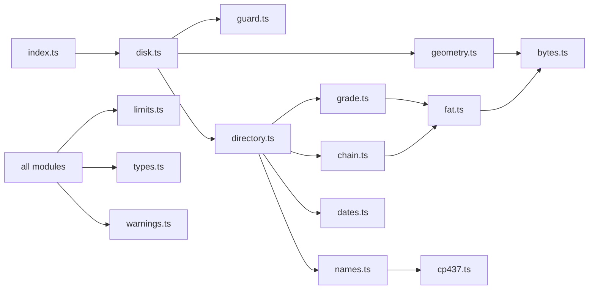
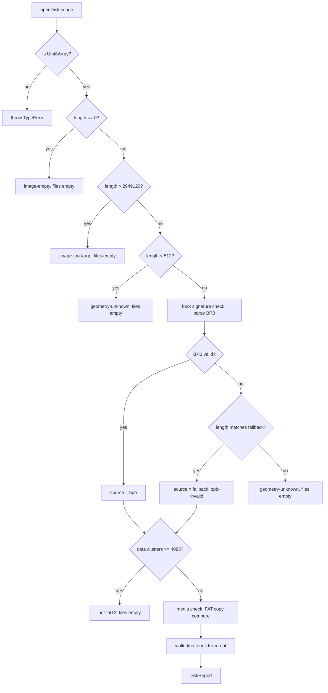
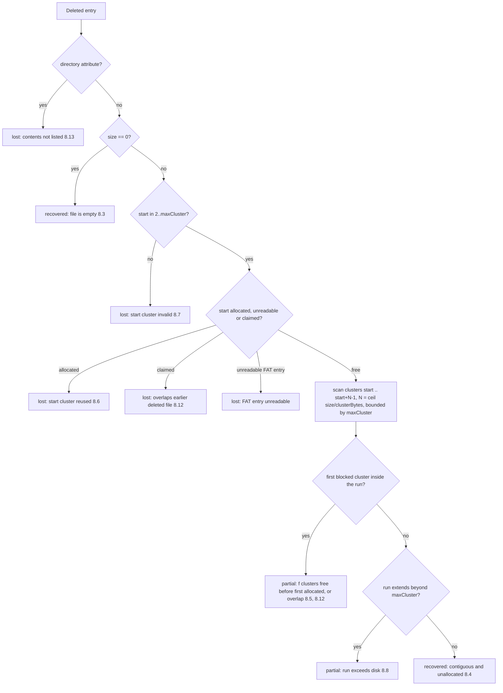

# Design Document

## Overview

The FAT12 core turns a `Uint8Array` holding a floppy disk image into a `DiskReport`, and returns the bytes of individual files on request. It lives in `src/core/fat12/`. The web page, the MCP server and the Crew app all consume the same `DiskReport`, so this module is the single source of truth for what is on a disk and how recoverable it is.

The disk is untrusted. Every name, size, date and cluster number is attacker-controlled. The design therefore rests on four rules:

1. **Bounds-checked access only.** All reads go through one `ByteView` that returns `undefined` for out-of-range reads. No code indexes the image directly.
2. **Named limits, hard caps.** Every loop has a counter capped by a constant from one `limits.ts` module or by the image length. There is no unbounded recursion. Directories are walked with an explicit stack.
3. **Warnings, not exceptions.** A defect stops the item it affects, adds a structured `Warning`, and the scan continues. The only exception the public API throws is a `TypeError` for an input that is not a `Uint8Array`.
4. **Pure and deterministic.** No DOM, Node API, network, clock or randomness. The same bytes always give the same report.

A test-only image writer lives outside `src/core/` in `src/test-support/fat12/`. It builds FAT12 images from a `FileTree`, can inject specific defects, and has no test-runner dependency, so `scripts/make-demo-disks.ts` can reuse it unchanged.

### Reference material

The design follows the Microsoft "FAT: General Overview of On-Disk Format" specification (fatgen103) for the BPB layout, the 12-bit FAT packing, the 4085-cluster FAT12 threshold, the directory entry layout, and the VFAT long-name checksum. CP437 follows the standard IBM PC table. I wrote this from existing knowledge of those documents and did not re-fetch them in this session. fast-check's `configureGlobal` is used to set run counts, and its default failure message already includes the seed and shrunk counterexample (Requirement 11.15).

## Architecture

### Module layout

```
src/core/fat12/
  index.ts          public API and type re-exports (only entry point used by consumers)
  limits.ts         every numeric Limit as a named exported constant
  types.ts          DiskReport, Volume, Grave, Warning, WarningCode, ReadResult, ...
  bytes.ts          ByteView: bounds-checked u8/u16/u32/copy over a Uint8Array
  warnings.ts       WarningSink: ordered warning collector, message helpers
  geometry.ts       BPB parse + validation, FALLBACK_GEOMETRIES table, derived layout
  fat.ts            12-bit FAT decode, classification, FAT-copy comparison
  chain.ts          cluster chain walker (cycle, range, bad, truncated detection)
  cp437.ts          CP437 table (0x80..0xFF) and decodeCp437
  names.ts          8.3 name decoding, sanitising, VFAT LFN state machine + checksum
  dates.ts          DOS date/time word decoding to ISO 8601 or null
  directory.ts      directory walker (explicit stack, depth counter, visited sets)
  grade.ts          undelete grader (free-run analysis, overlap claims)
  disk.ts           openDisk(): orchestrates scan, owns EntryRecord[] and file reads
  guard.ts          last-resort try/catch wrapper (see "Never-throw strategy")

src/test-support/
  runs.ts           numRuns(base) using FC_RUNS_MULTIPLIER
  setup.ts          vitest setup file: fc.configureGlobal
  purity.test.ts    static purity / dependency / limit-duplication checks
  meta.test.ts      config checks (exhumed/ excluded, run multiplier, failure message)
  fat12/
    index.ts        writer public API (no fast-check, no vitest imports)
    types.ts        FileTree, TreeNode, DosDateTime, WriteOptions, DamageSpec
    errors.ts       FitError
    encode.ts       independent encoders: FAT entry, DOS date, 8.3 name, LFN + checksum
    layout.ts       deterministic cluster allocation and directory sizing
    damage.ts       one function per injectable defect
    measure.ts      measureTree(), pickGeometry(), capacityOf()
    arbitraries.ts  fast-check arbitraries (NOT exported from index.ts)
```

Dependency direction: `index → disk → {directory, grade, chain} → {fat, geometry, names, dates, cp437} → {bytes, warnings, limits, types}`. `src/test-support/` imports from `src/core/fat12/index.ts`, never the reverse.



### Scan flow



The length checks come first, so an oversized image is rejected without parsing a byte (Requirement 2.2).

### Design decisions and interpretations

The requirements leave a few points open. These are the choices this design makes. Please confirm or change them at review.

1. **Grave carries extra fields.** `Grave` is the tech.md shape plus `id`, `attributes` and `startCluster`. `attributes` is required by 7.10. `id` (index in `files`) and `startCluster` let `readBytes` find the entry again without trusting the caller. All three are plain JSON data.
2. **Damaged chains map to states.** A live entry with any chain warning (5.2 to 5.6, 5.8, 5.9) is reported `partial` with a reason when at least one cluster was read, and `lost` when none was. The requirements say "report the file as damaged" but the four states have no `damaged` value. A zero-length file is never damaged.
3. **Live directories that are not descended** because of depth, a loop or a duplicate are reported `partial` with reason "contents not listed". A directory with an invalid start cluster is `lost`.
4. **Depth.** A directory whose own path has 16 components is listed but not read, because its children would have 17 components and 11.7 forbids that. This gives `depth-exceeded` exactly for nesting of 16 or more directories. Root entries have path depth 1.
5. **Entry limit.** Every 32-byte record that is examined counts, including long-name, deleted, `.`, `..` and volume-label records. The warning fires when a 4,097th read is attempted, so a disk with exactly 4,096 records and a clean end gets no warning.
6. **Media check** compares the first FAT byte to the media descriptor of the selected Geometry (the BPB value, or the table value for a fallback).
7. **Size versus chain.** A chain longer than the declared size is normal slack and is not flagged. When the declared size exceeds the disk's data capacity, `size-exceeds-disk` is reported and `chain-short` is suppressed. Because the data capacity of any accepted image is below 4 MB, `output-capped` always appears together with `size-exceeds-disk`.
8. **Deleted long names.** Long-name records that are themselves deleted are ignored, and a deleted entry uses its 8.3 name only (first character replaced by `_`).
9. **Extra name sanitising.** Beyond 7.4, a path component made only of dots, or an empty component, becomes `_`, and byte `0x7F` becomes `_`. This keeps `.`/`..` out of paths.
10. **Orphan long-name records** (no 8.3 entry follows before a deleted entry, volume label, `.`/`..` or the end of the directory) produce one `lfn-invalid` warning carrying the directory path.
11. **`not-fat12`** is checked after geometry selection for both `bpb` and `fallback` sources.

### Never-throw strategy

- `ByteView` returns `undefined` on out-of-range reads. Callers must handle it (the type forces this under `strict`). No module uses `DataView` or unchecked typed-array indexing on the image.
- All index math is on plain numbers, with explicit caps before any allocation. Allocations are sized from the validated geometry only (for example `Uint8Array(maxCluster + 1)`), never from a raw disk field.
- The only deliberate throw in the public API is `TypeError("invalid input type: expected Uint8Array")`, raised before any state is created. The check uses `Object.prototype.toString.call(x) === "[object Uint8Array]"`, which accepts Node `Buffer` and cross-realm arrays, and rejects everything else.
- **Last-resort guard (documented exception to "no catch").** `guard.ts` exports `guarded(label, fn, onError)`. `openDisk` wraps the directory walk in it. If an unexpected internal error occurs, the guard adds a `Warning` with code `internal-error`, keeps every `Grave` collected so far, and returns the report. It is not a design path for hostile input; the property tests assert that `internal-error` never appears. The guard itself is unit-tested by calling `guarded` with a function that throws.

## Components and Interfaces

### Public API (`index.ts`)

```ts
export interface DiskHandle {
  readonly report: DiskReport;
  /** Bytes of one file. Never throws; failures are `{ ok: false }`. */
  readBytes(grave: Grave): ReadResult;
}

/** Scan once, read many. Throws TypeError only if `image` is not a Uint8Array. */
export function openDisk(image: Uint8Array): DiskHandle;

/** Convenience: openDisk(image).report */
export function readDisk(image: Uint8Array): DiskReport;

/** Convenience: openDisk(image).readBytes(grave) */
export function readGraveBytes(image: Uint8Array, grave: Grave): ReadResult;

export { FALLBACK_GEOMETRIES } from './geometry';
export * from './limits';
export type { DiskReport, Volume, Grave, GraveState, GraveKind, Attributes,
              Warning, WarningCode, ReadResult, GeometryInfo, GeometrySource } from './types';
```

`readBytes(grave)` does not trust the `Grave` it is given. It looks up internal record `grave.id`, checks that `path`, `size` and `startCluster` equal the record's values, and returns `{ ok: false, error: 'grave not found in this disk image' }` otherwise. The handle holds a reference to `image`; callers must not mutate the image while the handle is in use.

### `limits.ts`

```ts
export const MAX_IMAGE_BYTES = 2_949_120;            // 2.88 MB (2.1, 2.2)
export const MIN_IMAGE_BYTES = 512;                  // boot sector (3.7)
export const MAX_DIR_DEPTH = 16;                     // path components (6.5)
export const MAX_TOTAL_ENTRIES = 4_096;              // records read (6.8)
export const MAX_FILE_OUTPUT_BYTES = 4_194_304;      // 4 MB (5.7, 5.8)
export const MAX_NAME_UTF16 = 255;                   // long name (7.7)
export const MAX_LFN_ENTRIES = 20;                   // ceil(255 / 13)
export const MAX_REASON_CHARS = 200;                 // (1.6)
export const FAT12_MAX_DATA_CLUSTERS = 4_084;        // 4085 or more is not FAT12 (3.9)
export const DIR_ENTRY_BYTES = 32;
export const SCAN_TIME_BUDGET_MS = 2_000;            // asserted by tests only (2.5)
```

No other module defines these values. The purity test scans for the literals `2949120` and `4194304` outside this file.

### `bytes.ts`

```ts
export interface ByteView {
  readonly length: number;
  u8(offset: number): number | undefined;
  u16(offset: number): number | undefined;   // little endian
  u32(offset: number): number | undefined;   // little endian, as unsigned number
  /** Fresh copy, so callers never alias the disk image. undefined when any byte is out of range. */
  copy(offset: number, length: number): Uint8Array | undefined;
}
export function makeByteView(image: Uint8Array): ByteView;
```

Offsets that are not non-negative safe integers return `undefined`. Reads index the array one byte at a time, so `Buffer` pool offsets cannot change the result (10.4).

### `geometry.ts`

```ts
export interface Geometry {
  bytesPerSector: number; sectorsPerCluster: number; reservedSectors: number;
  fatCount: number; rootEntryCount: number; totalSectors: number;
  sectorsPerFat: number; mediaDescriptor: number;
}
export interface Layout extends Geometry {
  fatStart: number;        // byte offset of FAT 1
  fatBytes: number;        // sectorsPerFat * bytesPerSector
  rootStart: number;       // byte offset of root directory
  rootSectors: number;
  dataStart: number;       // byte offset of cluster 2
  clusterBytes: number;
  dataClusters: number;    // floor((totalSectors - dataStartSector) / sectorsPerCluster)
  maxCluster: number;      // dataClusters + 1
}
export const FALLBACK_GEOMETRIES: ReadonlyMap<number, Geometry>; // keyed by image length

export function parseBpb(view: ByteView): Geometry | undefined;     // undefined if fields unreadable
export function isValidBpb(g: Geometry, imageLength: number): boolean;
export function deriveLayout(g: Geometry): Layout;
export function chooseGeometry(view: ByteView, sink: WarningSink):
  { source: GeometrySource; layout: Layout } | { source: 'none' };
```

`parseBpb` reads bytes per sector (0x0B), sectors per cluster (0x0D), reserved sectors (0x0E), FAT count (0x10), root entries (0x11), 16-bit total sectors (0x13) falling back to the 32-bit field at 0x20 when zero, media descriptor (0x15) and sectors per FAT (0x16).

`isValidBpb` implements the nine conditions of 3.2 as one pure predicate. The "data area starts inside the image" test is `dataStartSector < totalSectors` together with `totalSectors * bytesPerSector <= imageLength`.

The fallback table is expressed in sector counts, not byte literals:

| Image | Bytes/sec | Sec/clu | Reserved | FATs | Root entries | Total sectors | Sec/FAT | Media |
|---|---|---|---|---|---|---|---|---|
| 160 KB | 512 | 1 | 1 | 2 | 64 | 320 | 1 | 0xFE |
| 180 KB | 512 | 1 | 1 | 2 | 64 | 360 | 2 | 0xFC |
| 320 KB | 512 | 2 | 1 | 2 | 112 | 640 | 1 | 0xFF |
| 360 KB | 512 | 2 | 1 | 2 | 112 | 720 | 2 | 0xFD |
| 720 KB | 512 | 2 | 1 | 2 | 112 | 1440 | 3 | 0xF9 |
| 1.2 MB | 512 | 1 | 1 | 2 | 224 | 2400 | 7 | 0xF9 |
| 1.44 MB | 512 | 1 | 1 | 2 | 224 | 2880 | 9 | 0xF0 |
| 2.88 MB | 512 | 2 | 1 | 2 | 240 | 5760 | 9 | 0xF0 |

The map key is `totalSectors * bytesPerSector`, so the table has no byte-size literals. The example tests assert the table against independently written literal values.

`chooseGeometry` order: parse BPB, validate; on success use it (`bpb`). On failure, look up the image length in the table (`fallback` plus `bpb-invalid`). Otherwise return `none`, and the caller adds `geometry-unknown`. After selection the caller checks `dataClusters > FAT12_MAX_DATA_CLUSTERS` (`not-fat12`).

### `fat.ts`

```ts
export const FatClass = { Free: 'free', Reserved: 'reserved', Next: 'next', Bad: 'bad', End: 'end' } as const;
export type FatClassName = typeof FatClass[keyof typeof FatClass];

export function readFatEntry(view: ByteView, layout: Layout, n: number): number | undefined;
export function classifyFat(value: number): FatClassName;
export function fatCopiesDiffer(view: ByteView, layout: Layout): boolean;
```

`readFatEntry` reads bytes at `floor(n*3/2)` and `+1` from the first FAT copy. It returns `undefined` unless both bytes lie inside `[fatStart, fatStart + fatBytes)`. The word is `lo | hi << 8`. An even `n` takes `word & 0xFFF`, an odd `n` takes `word >> 4`. `classifyFat` follows 4.2 (`0x001` and `0xFF0..0xFF6` reserved, `0xFF7` bad, `0xFF8..0xFFF` end). `as const` objects are used instead of `enum` because `tsconfig` sets `erasableSyntaxOnly`.

### `chain.ts`

```ts
export type ChainEnd = 'end' | 'enough' | 'cycle' | 'range' | 'bad' | 'truncated' | 'oob';
export interface ChainResult { clusters: number[]; end: ChainEnd; }

export function walkChain(ctx: ScanContext, start: number, wantClusters: number, path: string): ChainResult;
```

`ScanContext` holds the `ByteView`, `Layout`, the `WarningSink` and a reusable `Uint32Array` of visit stamps (`stamp[c] === walkId` means visited in this walk), so a walk allocates nothing. The loop runs at most `layout.dataClusters` times:

1. If `current` is outside `2..maxCluster`, stop with `range` and warn `cluster-out-of-range`.
2. If `stamp[current] === walkId`, stop with `cycle` and warn `chain-cycle`. Otherwise stamp it and append it.
3. If `clusters.length >= wantClusters`, stop with `enough`. Directories pass `Infinity`.
4. Read `fat[current]`. `undefined` stops with `oob` and warns `out-of-bounds-read`. `free` stops with `truncated` and warns `chain-truncated`. `reserved` or `bad` stops with `bad` and warns `chain-bad-cluster`. `end` stops with `end`. `next` sets `current` and loops.

A step counter also enforces the iteration cap, as a second guard behind the stamp check. Callers translate `end === 'end'` with too few bytes into `chain-short` (5.6), and the size checks (`size-exceeds-disk`, `output-capped`) are done by the caller from the declared size and layout, before the walk.

### `cp437.ts`, `names.ts`

```ts
export function decodeCp437(bytes: Uint8Array): string;               // 0x00..0x7F ASCII, 0x80..0xFF table
export function decodeShortName(entry: Uint8Array): { name: string; isDotEntry: boolean };
export function sanitizeComponent(raw: string): string;

export interface LfnState { /* expected sequence, checksum, collected code units, pending */ }
export function lfnReset(s: LfnState): void;
export function lfnFeed(s: LfnState, entry: Uint8Array): void;        // one 0x0F record
export function lfnTake(s: LfnState, shortName11: Uint8Array):
  { kind: 'none' } | { kind: 'name'; name: string } | { kind: 'invalid' };
export function lfnChecksum(shortName11: Uint8Array): number;
```

`decodeShortName` trims trailing spaces from the 8-byte base and 3-byte extension, adds `.` only for a non-empty extension, maps a leading `0x05` to `0xE5` before decoding, and passes the result through `sanitizeComponent` (control characters below `0x20`, `/`, `\` and `0x7F` become `_`; a component of only dots or an empty one becomes `_`).

The long-name state machine accepts records in the order the spec defines: first record has bit `0x40` set and a sequence number 1 to `MAX_LFN_ENTRIES`; each next record has sequence one lower; all carry the same checksum; the sequence ends at 1. Each record contributes 13 UTF-16 code units from offsets 1 to 10, 14 to 25 and 28 to 31. `lfnTake` is called with the following 8.3 entry. It returns `name` only if the sequence is complete, in order, and the checksum equals `lfnChecksum(shortName11)`. The assembled name is cut at the first `0x0000`, must have 1 to `MAX_NAME_UTF16` code units, has lone surrogates replaced by U+FFFD, then goes through `sanitizeComponent`. Anything else returns `invalid` and the caller adds one `lfn-invalid` warning.

`lfnChecksum` is the standard rotate-and-add over 11 bytes: `sum = ((sum & 1) ? 0x80 : 0) + (sum >> 1) + byte`, kept to 8 bits. The patterns in this module are character-level state machines; no regular expression is applied to disk text (2.7).

### `dates.ts`

```ts
export function decodeDosDateTime(dateWord: number, timeWord: number): string | null;
```

Fields are `year = 1980 + (date >> 9)`, `month = (date >> 5) & 15`, `day = date & 31`, `hour = time >> 11`, `minute = (time >> 5) & 63`, `second = (time & 31) * 2`. It returns `null` when the month is outside 1 to 12, the day is invalid for the month (Gregorian leap-year rule), the hour is above 23, the minute is above 59 or the double-second value is above 29. Otherwise it returns `YYYY-MM-DDTHH:MM:SS` with no time zone suffix. Years run 1980 to 2107 by construction. The caller adds `date-invalid` when the result is `null`.

### `directory.ts`

```ts
export interface EntryRecord {          // internal; indexed by Grave.id
  path: string; size: number; startCluster: number;
  kind: GraveKind; state: GraveState;
  deleted: boolean;
  readPlan: ReadPlan;                   // how to fetch bytes, decided during the scan
}
export function walkDirectories(ctx: ScanContext): { graves: Grave[]; records: EntryRecord[] };
```

The walker keeps an explicit `stack: DirFrame[]`:

```ts
interface DirFrame {
  path: string; depth: number;           // depth = number of components in path (root = 0)
  startCluster: number;                  // 0 for the root
  parent: DirFrame | null;               // used for the on-path (loop) check
  source: RootRegion | ClusterList;
  index: number;                         // next record index
  lfn: LfnState;
}
```

Each loop iteration takes the top frame, reads its next record, and either finishes the frame (pop) or handles the record. A live subdirectory pushes a new frame after its own `Grave` has been appended, which gives depth-first pre-order: a directory is listed, then its contents, then the next sibling. A global `recordsRead` counter enforces `MAX_TOTAL_ENTRIES`. The outer `while` has a hard bound of `MAX_TOTAL_ENTRIES + number of frames pushed`, which is itself bounded because each frame is pushed at most once per start cluster (see below).

Per-record order:

1. **Budget.** If `recordsRead === MAX_TOTAL_ENTRIES`, add one `entry-limit` warning and stop the whole scan.
2. **Fetch.** Copy the 32 bytes. If unavailable, add `out-of-bounds-read` with the directory path and pop the frame.
3. **End marker.** First byte `0x00` flushes any pending long name (orphan warning) and pops the frame.
4. **Long-name record** (`attr & 0x3F === 0x0F`). If deleted, ignore it. Otherwise feed the state machine. Continue.
5. **Volume label** (`attr & 0x08`, not a directory): flush pending long name, skip.
6. **`.` / `..`**: skip without reporting. (Counted against the budget in step 1, not reported.)
7. **Build the entry:** deleted flag, name (long name if `lfnTake` returns `name` and the entry is not deleted, otherwise the 8.3 name; a deleted entry replaces its first character with `_`), `size` (u32 at 28), `startCluster` (u16 at 26), date (`decodeDosDateTime` on u16 at 24 and u16 at 22; `date-invalid` on null), attributes from byte 11, and `path` joined to the parent path.
8. **Grade and descend.** See below.

Descent rules for a live directory entry, in this order: start cluster outside `2..maxCluster` gives `cluster-out-of-range` and state `lost`. Then `parent.depth + 1 >= MAX_DIR_DEPTH` gives `depth-exceeded`. Then a `startCluster` equal to that of any frame on the `parent` chain, or to the entry's own parent, gives `directory-loop`. Then membership in the global `readDirs: Set<number>` gives `directory-duplicate`. Otherwise add the start cluster to `readDirs`, call `walkChain` with `Infinity`, and push the frame. The `parent` chain is at most 16 frames long, so the loop check is a bounded walk. Depth, loop and duplicate outcomes report the directory as `partial`; a chain defect while reading the directory chain follows decision 2.

### `grade.ts`

```ts
export interface GradeInput {
  size: number; startCluster: number; isDirectory: boolean;
}
export interface Grade { state: GraveState; reason: string; run: number[] /* clusters usable for recovery */ }
export function gradeDeleted(ctx: ScanContext, claimed: Uint8Array, e: GradeInput, path: string): Grade;
export function gradeLive(chain: ChainResult, size: number, ctx: ScanContext): Grade | undefined;
```

**Grading algorithm for a deleted entry.** The order matters and is the contract tested by the reference-model property.



Details:

- A cluster is *blocked* when its FAT value is not `0x000`, when the FAT entry is unreadable, or when it is set in the `claimed` bitmap. The reason text distinguishes allocated from claimed.
- The scan loop bound is `min(N, maxCluster - start + 1)`, so a huge declared size never makes a long loop (and `N` is never used to allocate).
- The usable run `run` is the free, unclaimed prefix. For `recovered` and `partial` results the run is added to `claimed`. An earlier entry keeps its grade (8.12). A later entry whose start is claimed becomes `lost`; one whose later cluster is claimed becomes `partial` and names the overlap.
- The `lost` branch of 8.8 ("no cluster of the run lies within the disk and is unallocated") is unreachable once the start cluster is known to be valid and free. The code does not implement it; the design notes it so the requirement is not read as missing.
- Reasons are built from templates using numbers only, for example `"2 of 3 clusters still free; cluster 41 is allocated"`. They never include disk text and are at most 200 characters.
- `gradeDeleted` reads only the FAT and the directory entry (8.11), so it is deterministic.

**Live entries.** `gradeLive` returns `undefined` for a clean file (state `alive`, no reason). It returns `partial` when a chain warning was raised and at least one cluster was collected, and `lost` when none was (decision 2). A zero-length file is never walked.

### `disk.ts`

`openDisk` runs the flow shown in the scan diagram, builds `Volume`, runs `walkDirectories` inside `guarded`, and returns a `DiskHandle`. `readBytes(grave)` works from the stored `EntryRecord`:

1. Record missing or fields differ: `{ ok: false, error: 'grave not found in this disk image' }`.
2. `kind === 'directory'`: `{ ok: false, error: 'directory has no file bytes' }`.
3. `state === 'lost'`: `{ ok: false, error: 'data is not recoverable' }`.
4. `state === 'recovered'` or `'partial'` from a deleted entry: copy the clusters of the stored `run`, truncated to `min(size, MAX_FILE_OUTPUT_BYTES)`.
5. Live entry: re-run `walkChain` with a local `WarningSink`, concatenate cluster data (the last cluster is cut to the remaining size), apply the size caps, and return `{ ok: true, bytes, warnings }`.

The result length is always `min(declared size, bytes reachable, MAX_FILE_OUTPUT_BYTES)` (1.7, 5.7, 8.9). The output buffer is allocated only after this minimum is known, and the minimum can never exceed the image length. A file with a chain defect returns the bytes before the defect with `ok: true` and its warnings (5.2 to 5.6). A live entry graded `lost` because nothing was readable returns the same failure as in step 3.

### Test-only image writer (`src/test-support/fat12/index.ts`)

```ts
export function writeFat12Image(
  tree: FileTree,
  geometry: StandardGeometryName | Geometry,
  options?: WriteOptions,
): Uint8Array;

export function measureTree(tree: FileTree, geometry: Geometry): Measure;
export function capacityOf(geometry: Geometry): Capacity;
export function pickGeometry(tree: FileTree): StandardGeometryName | undefined;
export function standardGeometry(name: StandardGeometryName): Geometry;
export class FitError extends Error { /* limit, limitValue, requestedValue */ }
```

The writer takes plain objects and returns a `Uint8Array`. It imports no vitest or fast-check, no Node API, and no clock, so `scripts/make-demo-disks.ts` can call `writeFat12Image` directly and write the bytes to disk.

**Layout (deterministic, 9.1, 9.3, 9.4, 9.10).**
- Boot sector: jump bytes, OEM name `EXHUME  `, BPB from the geometry, extended BPB with the volume label at offset 43, signature `0x55 0xAA` at 510.
- Two identical FAT copies, then the root directory, then the data area, at the offsets implied by the BPB. FAT[0] is `0xF00 | media`, FAT[1] is `0xFFF`.
- Allocation is a bump allocator from cluster 2 in depth-first pre-order of the tree: a directory takes its own clusters first, then its children in listed order. A directory needs `ceil((2 + children + lfnRecords) * 32 / clusterBytes)` clusters, minimum 1 (the `.` and `..` records come first; the root has none). Files take `ceil(size / clusterBytes)` clusters, none for an empty file. Chains are contiguous and end with `0xFFF`.
- Dates come only from the tree. The default is 1980-01-01 00:00:00.
- A deleted node keeps its clusters reserved in the allocator (so later files do not reuse them), writes `0xE5` as the first name byte, and sets its FAT entries to `0x000` in both copies (9.5). A node may carry `placement: { startCluster }` to put a deleted file's clusters on top of clusters that live files use, which is how tests build `partial` and `lost` cases. Placed deleted data is written first, so live data wins, as on a real disk.

**Fit errors (9.7).** `FitError` has `limit: 'root-entry-count' | 'data-cluster-count' | 'file-name-format'`, `limitValue` and `requestedValue`, and a message naming the limit. Invalid or duplicate 8.3 names raise `file-name-format`. The writer checks everything before writing any byte, so it returns either a complete image or throws.

**Damage options (9.6).** `options.damage` is a list of `DamageSpec`, one variant per defect, each applied after a clean layout and touching only its own target:

| `type` | Effect |
|---|---|
| `cyclic-chain` (`path`) | Last cluster of the file points back to its first cluster. |
| `cluster-out-of-range` (`path`) | A link in the chain is set to a value above `maxCluster`. |
| `self-referencing-directory` (`path`) | The directory's start cluster in its parent entry is set to the parent's own start cluster (or the root's first child). |
| `invalid-bpb` (`field`) | One BPB field is set to an invalid value (for example bytes per sector 513). |
| `size-exceeds-chain` (`path`, `extraBytes`) | Directory entry size is raised above the chain size. |

## Data Models

### Report types (`types.ts`)

```ts
export type GraveState = 'alive' | 'recovered' | 'partial' | 'lost';
export type GraveKind = 'file' | 'directory';
export type GeometrySource = 'bpb' | 'fallback' | 'none';

export interface Attributes {
  readOnly: boolean; hidden: boolean; system: boolean; archive: boolean;
}

export interface Grave {
  id: number;                 // index in DiskReport.files
  path: string;               // absolute, '/' separated, sanitised
  size: number;               // declared size, integer 0..4_294_967_295
  date: string | null;        // 'YYYY-MM-DDTHH:MM:SS' or null
  state: GraveState;
  kind: GraveKind;
  reason?: string;            // 1..200 chars, present for non-alive states
  attributes: Attributes;
  startCluster: number;
}

export interface GeometryInfo {
  bytesPerSector: number; sectorsPerCluster: number; reservedSectors: number;
  fatCount: number; rootEntryCount: number; totalSectors: number;
  sectorsPerFat: number; mediaDescriptor: number; dataClusters: number;
}

export interface Volume {
  label: string;                  // CP437, trailing spaces removed, control chars -> '_'
  geometrySource: GeometrySource;
  geometry: GeometryInfo | null;  // null when source is 'none'
}

export type WarningCode =
  | 'image-too-large' | 'image-empty' | 'geometry-unknown' | 'bpb-invalid'
  | 'boot-signature-missing' | 'media-mismatch' | 'not-fat12' | 'fat-copies-differ'
  | 'out-of-bounds-read' | 'chain-cycle' | 'cluster-out-of-range' | 'chain-bad-cluster'
  | 'chain-truncated' | 'chain-short' | 'output-capped' | 'size-exceeds-disk'
  | 'depth-exceeded' | 'directory-loop' | 'directory-duplicate' | 'entry-limit'
  | 'lfn-invalid' | 'date-invalid' | 'internal-error';

export interface Warning {
  code: WarningCode;
  message: string;            // template text, numbers only, no disk text
  path?: string;              // sanitised path of the affected item, when one exists
}

export interface DiskReport {
  volume: Volume;
  files: Grave[];
  warnings: Warning[];
}

export type ReadResult =
  | { ok: true; bytes: Uint8Array; warnings: Warning[] }
  | { ok: false; error: string };
```

`DiskReport` contains only strings, numbers, booleans, null, arrays and plain objects, so `JSON.parse(JSON.stringify(report))` deep-equals the original (1.9). Messages and reasons use fixed templates with numbers only; the only disk text that reaches a report is in `path` and `volume.label`, and both are sanitised. For the early exits the report is `{ volume: { label: '', geometrySource: 'none', geometry: null }, files: [], warnings: [...] }`.

### Internal scan state

```ts
interface ScanContext {
  view: ByteView; layout: Layout; sink: WarningSink;
  stamp: Uint32Array;            // length maxCluster + 1, visit stamps for chain walks
  nextWalkId: number;
}
interface WarningSink { add(code: WarningCode, message: string, path?: string): void; list(): Warning[]; }
```

`ScanContext` is created only after the geometry is validated, so every array length comes from `Layout` and is bounded by the 2.88 MB image cap. Worst-case work is `MAX_TOTAL_ENTRIES` entries times `dataClusters` chain steps, about 4,096 x 2,847, which is roughly 11.7 million simple steps and well inside the 2-second budget; the hostile tests assert this.

### Writer types (`src/test-support/fat12/types.ts`)

```ts
export type StandardGeometryName =
  '160K' | '180K' | '320K' | '360K' | '720K' | '1200K' | '1440K' | '2880K';

export interface DosDateTime { year: number; month: number; day: number;
                               hour: number; minute: number; second: number; }

interface NodeBase {
  name: string;                         // 8.3, e.g. 'README.TXT'
  longName?: string;                    // emits VFAT records (up to 255 UTF-16 units)
  modified?: DosDateTime;
  attributes?: Partial<Attributes>;
  deleted?: boolean;
  placement?: { startCluster: number }; // deleted nodes only
}
export interface FileNode extends NodeBase { kind: 'file'; content: Uint8Array; }
export interface DirNode extends NodeBase { kind: 'directory'; children: TreeNode[]; }
export type TreeNode = FileNode | DirNode;
export interface FileTree { volumeLabel?: string; children: TreeNode[]; }

export type DamageSpec =
  | { type: 'cyclic-chain'; path: string }
  | { type: 'cluster-out-of-range'; path: string }
  | { type: 'self-referencing-directory'; path: string }
  | { type: 'invalid-bpb'; field: 'bytesPerSector' | 'sectorsPerCluster' | 'fatCount' | 'rootEntryCount' | 'sectorsPerFat' | 'totalSectors' }
  | { type: 'size-exceeds-chain'; path: string; extraBytes: number };

export interface WriteOptions { damage?: DamageSpec[]; /* long-name corruption hooks for LFN tests */ lfn?: 'corrupt-checksum' | 'swap-order' | 'drop-last'; }
export interface Measure { rootEntries: number; clusters: number; }
export interface Capacity { rootEntries: number; dataClusters: number; clusterBytes: number; }
```

### Keeping the round-trip generator inside the geometry

The generator in `arbitraries.ts` builds a `FileTree` in three steps so the writer never throws during property 7:

1. **Generate within the requirement's ranges.** 0 to 64 files, nesting depth 0 to 4, at most 32 directories in total, names of 1 to 8 characters from `[A-Z0-9_]` plus an optional extension of 1 to 3 characters, names unique per directory (`fc.uniqueArray`), file sizes 0 to 65,536 bytes. The file contents come from a seed-and-length pair expanded by a small deterministic PRNG, so shrinking stays fast.
2. **Choose the geometry from the measured tree.** `pickGeometry(tree)` calls `measureTree` for each standard geometry from smallest to largest and returns the first whose root entry count and data cluster count fit.
3. **Shrink sizes if nothing fits.** If even `2880K` does not fit (64 files of 64 KiB is about 4 MB, more than 2.88 MB), `fitTree(tree)` halves every file size (rounding down) and re-measures until it fits. This terminates because sizes reach 0 and the remaining load is at most 96 root entries and about 100 directory clusters, which `2880K` (240 root entries, 2,847 clusters) always holds. The round-trip property compares the reader's output with the tree **after** `fitTree`.

## Correctness Properties

*A property is a characteristic or behavior that should hold true across all valid executions of a system-essentially, a formal statement about what the system should do. Properties serve as the bridge between human-readable specifications and machine-verifiable correctness guarantees.*

**Reflection on redundancy.** The prework produced many testable criteria. These were merged to remove overlap:

- Criteria 1.1 to 1.6, 1.9, 6.8 (cap on reported entries), 6.12 and 11.7 all check invariants of one `DiskReport`, so they form one report-invariants property.
- 5.7, 1.7, 8.9 and 11.6 all bound the bytes returned for a file, so they form one bounded-read property. 1.8, 8.10 and 8.13 all concern failed reads, so they form one failure-result property.
- 5.2, 5.3, 5.6, 5.9, 5.10 and 2.11 are one damage-isolation property: a defect in one file yields the matching warning and leaves other files byte-identical.
- 8.3 to 8.8, 8.11 and 8.12 are checked against one reference grading model, instead of one property per branch. 8.14 and 9.5 are separate because they run through the real writer.
- 4.1 and 4.5 are one codec round-trip property. 4.2 is a separate partition property.
- 7.8 and 7.9 are one date-oracle property. 7.1 to 7.4 are one name-safety property.
- 3.1, 3.3 and 3.10 fold into the tree round trip (geometry and label read back equal what was written). 3.2, 3.4 and 3.6 are one BPB-validation property with an oracle.
- Totality (2.1) and time bound (2.5) are one property over hostile input families. 5.1 is covered by it, since a chain longer than the cluster count would exceed the time bound or break the cap check.
- 9.1, 9.3, 9.4 and 9.10 are one writer-layout property.

### Property 1: Totality on hostile input

*For any* byte array of length 0 to 2,949,120, including random bytes, byte-mutated valid images, valid images with a randomized FAT region, and valid images with a randomized directory region, `readDisk` returns a `DiskReport` without throwing, in under 2,000 ms, and no warning has the code `internal-error`.

**Validates: Requirements 2.1, 2.5, 2.10, 5.1, 11.3, 11.5**

### Property 2: Report invariants

*For any* disk image (hostile or built by the writer), the `DiskReport` has exactly the members `volume`, `files` and `warnings`; every `path` starts with `/`, has no trailing `/` except the root, contains no control characters and no component equal to `.` or `..`, and has at most 16 components; every child path begins with its directory's path plus `/`; every `size` is an integer from 0 to 4,294,967,295; `state` and `kind` are members of their unions; every non-`alive` Grave has a `reason` of 1 to 200 characters; `files` has at most 4,096 entries; and `JSON.parse(JSON.stringify(report))` deep-equals the report.

**Validates: Requirements 1.1, 1.2, 1.3, 1.4, 1.5, 1.6, 1.9, 6.8, 6.10, 6.12, 7.4, 11.7, 11.8**

### Property 3: Input is not modified and `Buffer` is equivalent

*For any* disk image, a copy of the bytes taken before `readDisk` and `readGraveBytes` equals the bytes afterwards, and the report built from a `Buffer` holding the same bytes deep-equals the report built from a plain `Uint8Array`.

**Validates: Requirements 2.8, 10.3, 10.4**

### Property 4: Oversized images are rejected unparsed

*For any* length above 2,949,120 bytes, an image of that length yields an empty `files` array and a single `image-too-large` warning, whatever its content.

**Validates: Requirements 2.2**

### Property 5: FAT12 entry codec round trip

*For any* FAT buffer, cluster index within it and 12-bit value, writing the value with the test encoder and decoding that index returns the value, and the entries at the neighboring indexes that share a byte are unchanged.

**Validates: Requirements 4.1, 4.5**

### Property 6: FAT value classification partitions the 12-bit range

*For any* value from 0x000 to 0xFFF, `classifyFat` returns exactly one class, and the class matches the ranges free `0x000`, reserved `0x001` and `0xFF0..0xFF6`, next `0x002..0xFEF`, bad `0xFF7`, end `0xFF8..0xFFF`.

**Validates: Requirements 4.2**

### Property 7: BPB validation and geometry selection

*For any* BPB field values (valid or invalid) written into an image of any length, `isValidBpb` agrees with an independent oracle of the nine conditions; a valid BPB gives `geometrySource: 'bpb'` with matching `volume.geometry`; an invalid BPB on an image whose length is one of the eight standard sizes gives `'fallback'` and a `bpb-invalid` warning; and an invalid BPB on any other length gives `'none'`, an empty `files` array and a `geometry-unknown` warning.

**Validates: Requirements 3.1, 3.2, 3.3, 3.4, 3.6, 3.7**

### Property 8: File tree round trip

*For any* file tree that fits a standard geometry (0 to 64 files, nesting 0 to 4, unique 8.3 names, sizes 0 to 65,536, valid dates, random attribute flags, optional volume label), writing it with the image writer and reading it back returns every file with the same path, size, bytes, date (ISO form), attribute flags and `state: 'alive'`; the file count equals the number generated; directories are reported with `kind: 'directory'`; no `.`, `..` or volume-label entry appears; traversal is depth-first in on-disk order; and `volume.label` equals the written label.

**Validates: Requirements 1.7, 3.10, 6.1, 6.2, 6.4, 6.10, 6.11, 7.1, 7.8, 7.10, 7.11, 8.2, 11.2**

### Property 9: Single file content round trip up to capacity

*For any* standard geometry and any file size from 0 to that geometry's data capacity (with boundary sizes around cluster multiples and the capacity itself weighted in), writing one file and reading it back returns bytes equal to the content.

**Validates: Requirements 5.11**

### Property 10: DOS date decoding matches an oracle

*For any* 16-bit date word and 16-bit time word, `decodeDosDateTime` returns an ISO string equal to the oracle's when the fields are valid (month 1 to 12, day valid for the month and year, hour 0 to 23, minute 0 to 59, double-second 0 to 29), and `null` otherwise; and the reader reports `date: null` with a `date-invalid` warning for the null case.

**Validates: Requirements 7.8, 7.9**

### Property 11: Short-name decoding is safe

*For any* 11 name bytes, `decodeShortName` returns a non-empty string with no control character, `/` or `\`, at most 12 characters, with a `.` only when the extension is non-empty, and a leading `0x05` decodes the same as a leading `0xE5`.

**Validates: Requirements 7.1, 7.2, 7.3, 7.4**

### Property 12: Valid VFAT names are used and invalid ones fall back

*For any* long name of 1 to 255 UTF-16 code units, an entry written with correct long-name records is reported under the sanitised long name; and *for any* such entry whose long-name records are corrupted (wrong checksum, swapped order, missing last record, or a name of 256 or more units), the 8.3 name is used and one `lfn-invalid` warning with that entry's path is added.

**Validates: Requirements 7.5, 7.6, 7.7**

### Property 13: Undelete restores contiguous deleted files

*For any* file tree in which some files are marked deleted and their clusters stay contiguous and unallocated, each deleted file is reported with state `recovered`, kind matching its attribute, and a path equal to the original with the first character replaced by `_`; and its bytes from `readGraveBytes` equal the original content.

**Validates: Requirements 8.1, 8.14, 9.5**

### Property 14: Grading matches the reference model and is deterministic

*For any* FAT occupancy pattern, any list of deleted entries (random start cluster including invalid ones, sizes from 0 to beyond the disk, files and directories, with overlapping claims), the state of each entry equals the state computed by an independent reference model that applies the grading rules in the stated order, the reason names the facts of the rule that fired, and grading the same image twice gives identical results.

**Validates: Requirements 8.3, 8.4, 8.5, 8.6, 8.7, 8.8, 8.11, 8.12**

### Property 15: File reads are bounded

*For any* disk image and any Grave in its report, `readGraveBytes` does not throw, and when it succeeds the length of the bytes is at most `min(size, 4,194,304)`; for `recovered` and `partial` Graves the bytes come only from the contiguous unallocated run.

**Validates: Requirements 1.7, 5.7, 8.9, 11.6**

### Property 16: Failed reads are failures, not exceptions

*For any* disk image, reading a directory Grave, a `lost` Grave, or a forged Grave (random id, path, size or start cluster) returns `{ ok: false, error }` with a non-empty fixed-template error, does not throw, and leaves the report and the image bytes unchanged.

**Validates: Requirements 1.8, 8.10, 8.13**

### Property 17: A damaged file is isolated

*For any* file tree with at least two files and any single damage option applied to one of them (cyclic chain, link out of range, declared size above the chain size, or size above the whole disk), the damaged file's path appears in at least one warning with the code matching the defect (`chain-cycle`, `cluster-out-of-range`, `chain-short`, or `size-exceeds-disk`), it is reported `partial` or `lost`, and every other file is reported with the same state and byte-identical content as in the undamaged image.

**Validates: Requirements 2.4, 2.11, 5.2, 5.3, 5.6, 5.8, 5.9, 5.10, 9.6, 11.4**

### Property 18: Directory structure limits hold

*For any* directory nesting depth d from 1 to 24 with one file in the deepest directory, no reported path has more than 16 components; the file is reported iff d is at most 15; and a `depth-exceeded` warning with a path exists iff d is at least 16. *For any* image where a directory entry points to its own directory or to an ancestor, a `directory-loop` warning is added and the scan finishes; and *for any* two entries pointing to the same start cluster, the second adds `directory-duplicate` and its contents are listed only once.

**Validates: Requirements 2.6, 6.5, 6.6, 6.7, 9.6, 11.4**

### Property 19: Entry limit

*For any* directory structure containing N records, the report holds at most 4,096 entries, and it contains exactly one `entry-limit` warning iff a read of record number 4,097 was attempted (N above 4,096), and none otherwise.

**Validates: Requirements 6.8, 11.8**

### Property 20: Writer layout is valid and deterministic

*For any* file tree and standard geometry that fit, the image length equals the geometry's total size; bytes 510 and 511 are `0x55 0xAA`; the BPB matches the geometry; the two FAT copies are byte-identical; and writing the same tree, geometry and options twice gives identical bytes.

**Validates: Requirements 9.1, 9.3, 9.4, 9.10**

### Property 21: The writer refuses trees that do not fit

*For any* file tree that exceeds the root entry count, the data cluster count, or the 8.3 name format of the chosen geometry, `writeFat12Image` throws a `FitError` naming the exceeded limit with the limit value and the requested value, and returns no image.

**Validates: Requirements 9.7**

## Error Handling

### Defects and their warnings

| Situation | Behavior | Warning code | Entry state |
|---|---|---|---|
| Length 0 | Empty report | `image-empty` | n/a |
| Length above 2,949,120 | Empty report, no parsing | `image-too-large` | n/a |
| Length below 512, or invalid BPB and no matching size | Empty report | `geometry-unknown` | n/a |
| Invalid BPB, standard size | Fallback geometry | `bpb-invalid` | n/a |
| 4085 or more data clusters | Empty files, volume still reported | `not-fat12` | n/a |
| Missing `0x55 0xAA` | Continue | `boot-signature-missing` | n/a |
| Media byte differs | Continue | `media-mismatch` | n/a |
| FAT copies differ | Use first FAT, once | `fat-copies-differ` | n/a |
| Read outside image or FAT | Treat bytes as unavailable, stop that chain or directory | `out-of-bounds-read` | partial or lost |
| Cluster link outside `2..maxCluster`, or directory start invalid | Stop that chain, keep earlier bytes | `cluster-out-of-range` | partial or lost |
| Chain repeats a cluster | Stop at first repeat | `chain-cycle` | partial or lost |
| Chain hits reserved or bad value | Stop | `chain-bad-cluster` | partial or lost |
| Chain hits free value | Stop | `chain-truncated` | partial or lost |
| Chain ends early | Return available bytes | `chain-short` | partial |
| Declared size above 4 MB | Cap output | `output-capped` | partial |
| Declared size above disk data | Read reachable bytes | `size-exceeds-disk` | partial |
| Directory deeper than 16 | Do not read it | `depth-exceeded` | partial |
| Directory start on current path | Do not read it | `directory-loop` | partial |
| Directory start already read | Do not read it | `directory-duplicate` | partial |
| 4,097th record | Stop all reading, once | `entry-limit` | n/a |
| Bad long-name records | Use 8.3 name | `lfn-invalid` | unchanged |
| Invalid date or time | `date: null` | `date-invalid` | unchanged |
| Unexpected internal error | Keep results so far | `internal-error` | unchanged |

Rules that apply to all rows:

- A warning stops only the item it names (file, directory or chain). Items already read stay as they are and the scan continues (2.4, 5.10).
- A warning's `message` is a fixed template with numbers only (cluster number, limit value). It never contains text from the disk, so the MCP layer can pass warnings to an agent without carrying instructions. The `path` field is the only disk-derived text and is always sanitised.
- Per-walk dedupe: a chain walk adds at most one warning. `fat-copies-differ`, `media-mismatch`, `boot-signature-missing` and `entry-limit` are added at most once per scan.
- Total warnings are bounded by the 4,096 entry cap times a small constant per entry.

### Read failures

`readBytes` returns `{ ok: false, error }` with one of three fixed strings: `grave not found in this disk image`, `directory has no file bytes`, `data is not recoverable`. A chain defect on a live file is not a failure: the bytes before the defect are returned with `ok: true` and the warnings.

### Input type

A non-`Uint8Array` argument to `openDisk`, `readDisk` or `readGraveBytes` throws `TypeError("invalid input type: expected Uint8Array")` before any work or state is created (10.9).

### Writer errors

`FitError` (limit name, limit value, requested value) is thrown before any byte is produced. A damage spec that names a path not in the tree throws a plain `Error` naming the path; the writer is test and script tooling, so it may throw.

## Testing Strategy

PBT applies here. The reader is a set of pure functions over byte arrays with large input spaces (parsers, codecs, a grader), and the requirements ask for round-trip and hostile-input properties. The infrastructure checks (purity, dependencies, config) are smoke tests, not properties.

### Libraries and configuration

- **Vitest 3.2.4** and **fast-check 4.3.0**, both already installed. `package.json` currently lists them with caret ranges (`^3.2.4`, `^4.3.0`); change both to the exact versions `3.2.4` and `4.3.0` to follow the pinning rule. Add `@types/node` as a devDependency, pinned to an exact version of the Node 22 line, because the test-support and purity tests use Node APIs (`node:fs`, `node:module`) and `tsc` compiles `src/**/*.test.ts`. No runtime dependency is added; `dependencies` stays empty.
- `tsconfig.json`: add `"node"` to `types` so test files type-check. To keep `src/core/` honest, add `src/core/tsconfig.json` with `lib: ["ES2022"]`, `types: []`, `strict: true`, including `src/core/**/*.ts` and excluding `**/*.test.ts`. With no DOM and no Node types, any use of `document`, `window`, `fetch`, `Buffer` or `process` in core fails to compile. A `typecheck` script runs `tsc --noEmit && tsc -p src/core/tsconfig.json --noEmit`, and `build` runs it first.
- `vitest.config.ts` (a function of `mode`):
  - `test.include: ['src/**/*.test.ts']`
  - `test.exclude: ['**/node_modules/**', '**/dist/**', '**/exhumed/**']` (11.13)
  - `test.setupFiles: ['src/test-support/setup.ts']`
  - `test.testTimeout: 60_000` for the large hostile properties
- `src/test-support/runs.ts` exports `numRuns(base: number): number`. It returns `base * m`, where `m` is `Number(process.env.FC_RUNS_MULTIPLIER)` when that is an integer from 1 to 100 and 1 otherwise. Every property passes `{ numRuns: numRuns(100) }`, so the default is at least 100 runs (11.2) and the multiplier scales all of them.
- `setup.ts` calls `fc.configureGlobal({ numRuns: numRuns(100) })` so any property without an explicit count still gets 100 runs.
- `package.json` scripts: `"test": "vitest run"` (existing), `"test:fuzz": "FC_RUNS_MULTIPLIER=10 vitest run hostile"`, `"typecheck"` as above. The `hostile` filter selects files named `*.hostile.test.ts`, which hold Properties 1, 17, 18 and 19. A multiplier of 10 gives at least 1,000 runs for those, meeting 11.14. The inline environment variable works on macOS and Linux; Windows users can set the variable in the shell first. No `cross-env` dependency is added.

### Property test rules

- Each property is one `fc.assert(fc.property(...))` and is tagged with a comment `// Feature: fat12-core, Property N: <title>`.
- Callbacks return nothing or a boolean and never call `expect(...)`. For diagnostics a callback may compute a boolean and return it, or throw a plain `Error` with a message; fast-check reports both as a failure.
- On failure fast-check's message includes the seed and the shrunk counterexample (11.15). `meta.test.ts` runs a deliberately failing `fc.assert` inside a `try`/`catch` and checks that the message contains `seed` and `Counterexample`.
- Large inputs are generated as `{ seed, length }` pairs that a small deterministic PRNG expands, not as `fc.uint8Array` of 2 MB, so runs are fast and shrinking stays small. Smaller structured inputs (BPB fields, FAT values, names, dates) use native arbitraries.

### Hostile input families (Properties 1, 17, 18, 19)

- **Random bytes**, length 0 to 2,097,152 (and a few lengths just above and below each fallback size), which mostly exercise the early exits (11.3).
- **Mutated valid images**: a writer-built image with 1 to 64 random byte writes anywhere. This reaches deep into the directory and chain code, which pure random bytes almost never do.
- **FAT-randomized and directory-randomized images**: a valid BPB with the FAT region or the directory region replaced by random bytes, which gives cyclic chains, out-of-range links and bad cluster values in bulk.
- **Targeted defects** from the writer's `damage` option: cyclic chain, link out of range, self-referencing directory, oversized declared size, invalid BPB field (11.4).
- Every case runs inside a `timed()` helper that asserts the call took under 2,000 ms (11.5).

### Unit and example tests

Example tests cover behavior that is not a universal property (11.10 and the edge cases from the prework):

- One test per fallback geometry size, with literal expected values written independently of the table in `geometry.ts`.
- Grading: one fixture each for `recovered` (contiguous), `partial` (run cut by a live file, with the free count in the reason), `lost` (start cluster reused), empty deleted file, invalid start cluster, run beyond the disk, and a deleted directory.
- A VFAT fixture: "Long File Name.txt" with a known checksum computed by a test-side function, asserting the decoded name.
- CP437 spot checks (for example `0x80` is `Ç`, `0xE1` is `ß`) and a check that all 128 high entries are non-control characters.
- `image-empty`, `media-mismatch`, `not-fat12`, `boot-signature-missing`, `fat-copies-differ`, a truncated FAT (`out-of-bounds-read`), `chain-bad-cluster`, `chain-truncated`, `output-capped` (declared size `0xFFFFFFFF`), entries after a `0x00` terminator being ignored, `directory-duplicate`, a directory with start cluster 0 or above the maximum, and a volume label entry being omitted.
- 17-level nesting built by the writer (9.2).
- `guarded()` converting a thrown error into an `internal-error` warning while keeping earlier results.
- `openDisk` throws `TypeError` for `null`, `undefined`, a string, a number, a plain array, an `ArrayBuffer` and a `DataView`.

### Smoke tests (`src/test-support/purity.test.ts`)

The test parses sources with the `typescript` compiler API (already a devDependency), so comments and strings cannot cause false matches. It lives outside `src/core/` so it can use Node APIs without flagging itself. The file walker skips `exhumed/` and `node_modules/`.

- Collect every `.ts` file under `src/core/`. Fail on any import of a Node built-in (`module.builtinModules`, with or without the `node:` prefix), any reference to the identifiers `document`, `window` or `fetch`, any `eval` call or `new Function` (11.11, 2.9, 10.2, 10.5).
- Fail if a non-test file under `src/core/fat12/` imports anything other than a relative path (10.2). For test files, allow `vitest` and `fast-check`, and fail if `package.json` `dependencies` lists any package imported by any file under `src/core/` (11.12).
- Fail on any `any` keyword type in non-test files under `src/core/fat12/` (10.1).
- Fail if the literals `2949120` or `4194304` appear in `src/core/fat12/` outside `limits.ts` (10.8). The small limits (16, 4096, 255) also occur legitimately as unrelated numbers (for example 4096 bytes per sector), so they are checked by a unit test that asserts the behavior at the boundaries, not by a literal scan.
- Fail if `src/test-support/fat12/index.ts` or anything it imports transitively imports `vitest` or `fast-check`, and fail if any file under `src/core/` imports from `src/test-support/` (9.8, 9.9).
- Fail if `names.ts` contains a regular expression literal or a `RegExp` construction (2.7).
- `meta.test.ts` imports the Vitest config and asserts `exclude` contains `**/exhumed/**` and `include` is `src/**/*.test.ts` (11.1, 11.13), and checks `numRuns` for multiplier values `undefined`, `'abc'`, `'0'`, `'10'` and `'1000'`.
- A compile-time import test (`index.test.ts`) imports every public name from `src/core/fat12/index.ts`, which fails to compile if one is missing (10.6). `tsc` in `build` covers 10.7.

### Mapping from properties to test files

| File | Properties |
|---|---|
| `fat.test.ts` | 5, 6 |
| `geometry.test.ts` | 7 |
| `dates.test.ts` | 10 |
| `names.test.ts` | 11, 12 |
| `reader.roundtrip.test.ts` | 8, 9, 13, 20, 21 |
| `grade.test.ts` | 14 |
| `reader.reads.test.ts` | 15, 16, 3 |
| `reader.hostile.test.ts` | 1, 2, 4, 17, 18, 19 |
