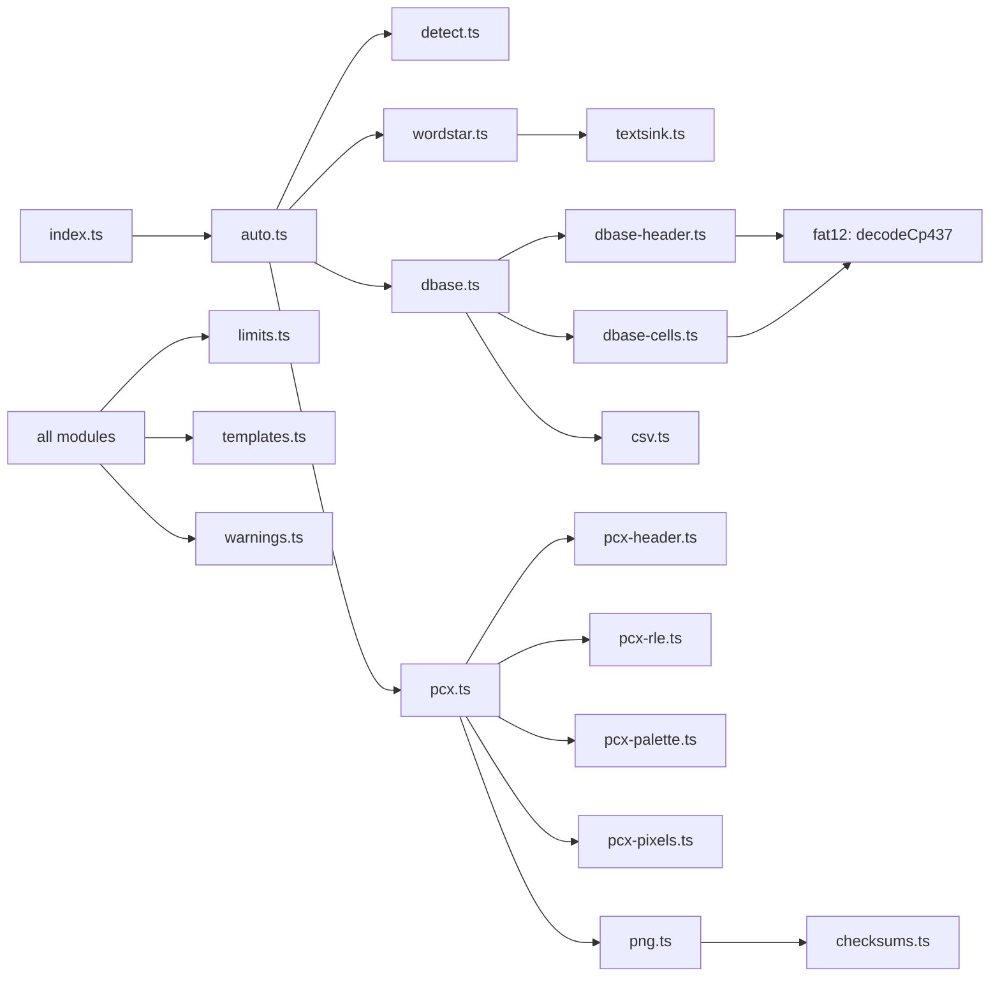
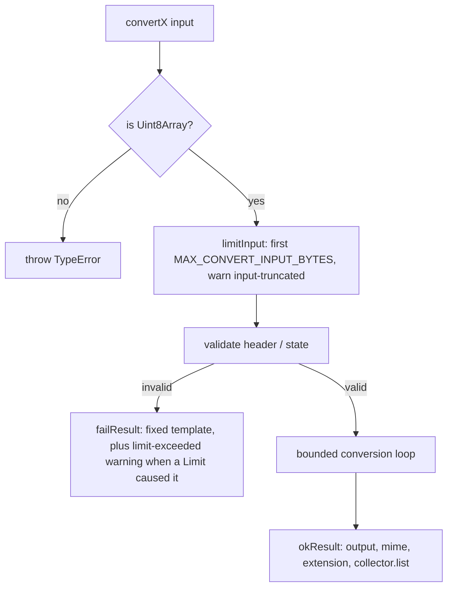

# Design Document

## Overview

The format resurrection module turns the bytes of one recovered file into a format people use today. It lives in `src/core/formats/` and has three converters, one encoder and one detector:

| Piece | Input | Output |
|---|---|---|
| `convertWordStar` | WordStar document bytes | Markdown text, `text/markdown`, `.md` |
| `convertDBase` | dBase III `.dbf` bytes | CSV text (RFC 4180, CRLF), `text/csv`, `.csv` |
| `convertPcx` | PCX image bytes | PNG file, `image/png`, `.png` |
| `encodePng` | `RgbaImage` | PNG file made of stored deflate blocks, no compression library |
| `detectFormat` | bytes + optional file name | `{ format, source }` |
| `convertAuto` | bytes + optional file name | detector, then the matching converter |

The input is untrusted. Every header field, record length, run length, dimension and text byte is attacker-controlled. The design reuses the conventions that `fat12-core` already proved:

1. **Pure and dependency-free.** No DOM, Node API, network, clock or randomness. The only import from outside `src/core/formats/` is `decodeCp437` from `src/core/fat12/`.
2. **Named limits in one module.** `src/core/formats/limits.ts` holds every number. `MAX_PNG_BYTES` is computed from its inputs, not typed in.
3. **Warnings and failure results, not exceptions.** A defect stops the item it affects and adds a `ConversionWarning`, or returns `{ ok: false, error }`. The only exception the public API throws is `TypeError('invalid input type: expected Uint8Array')` for a non-`Uint8Array` argument.
4. **Fixed-template text.** Every warning `message` and failure `error` comes from a table of templates that hold numbers only. No byte of the input reaches a message an agent might read.
5. **Bounded everything.** Every loop has a cap taken from the input length or from a limit. No recursion. No regular expression is applied to input text; text is parsed with character-level state machines.
6. **Allocate after validate.** No buffer is sized from a header field before that field has passed its checks.

### Scope of this document

In scope: `src/core/formats/` and the test-only fixture writers in `src/test-support/formats/`. Out of scope, as in the requirements: the web page, the MCP server, the demo-disk script, reading files out of a disk image, WordStar 2000 and Windows variants, dBase memo/index files, dBase II/IV, 2-bit PCX and PNG decoding in production code.

### Reference material

I wrote this design from existing knowledge of these documents and did not re-fetch them in this session. I did check two facts in the repository: `node_modules/@types/node/zlib.d.ts` declares `zlib.crc32(data, value?)`, and the installed Node is v24.10.0 (the repository targets Node 22+; `zlib.crc32` exists from Node 22.2).

- PNG specification (W3C / RFC 2083): chunk layout, CRC-32 over type plus data, IHDR fields, filter type 0.
- RFC 1950 (zlib): 2-byte header, Adler-32 trailer. RFC 1951 (deflate): stored block layout `BFINAL/BTYPE`, `LEN`, `NLEN`.
- RFC 4180: CSV quoting and CRLF rows.
- ZSoft PCX technical reference: 128-byte header, RLE with the `0xC0` run flag, 256-colour palette trailer introduced by `0x0C`, version 3 meaning "no palette in the header".
- dBase III file structure: 32-byte header, 32-byte field descriptors, `0x0D` terminator, 1-byte deletion flag, `0x1A` end marker.
- WordStar 3.x/4.x file conventions: high bit set on the last letter of a word, soft carriage return `0x8D 0x0A`, control-character styles, dot commands.

## Architecture

### Module layout

```
src/core/formats/
  index.ts          public API: converters, detector, encoder, types, limits
  limits.ts         every numeric Limit; computed MAX_PNG_BYTES and pngBytesForFiltered()
  types.ts          ConversionResult, ConversionWarning(+code), RgbaImage, DetectResult, OUTPUT_KINDS
  templates.ts      every warning/error message template and fill()
  warnings.ts       bounded WarningCollector (MAX_WARNINGS + warnings-capped)
  guard.ts          assertUint8Array(), limitInput() (input-truncated)
  result.ts         okResult(), failResult()
  chars.ts          ASCII helpers: isAsciiLetter, asciiUpper, isDigit
  textsink.ts       AsciiSink: chunked byte buffer that builds a one-byte string
  detect.ts         detectFormat()
  wordstar.ts       convertWordStar(): character-level state machine
  dbase-header.ts   parseDbfHeader()
  dbase-cells.ts    per-type cell formatters
  csv.ts            csvCell(), csvRow(), formulaGuard(), utf8Length()
  dbase.ts          convertDBase(): header + record loop + CSV assembly
  pcx-header.ts     parsePcxHeader(): ordered validation
  pcx-rle.ts        decodeRle(): bounded RLE decoder
  pcx-palette.ts    palette selection (header, VGA trailer, EGA, grayscale)
  pcx-pixels.ts     expandToRgba(): one tight loop per pixel format
  pcx.ts            convertPcx(): header -> RLE -> palette -> RGBA -> PNG
  checksums.ts      crc32Update(), adler32Update() (table CRC, deferred-modulus Adler)
  png.ts            encodePng(): one-allocation PNG writer
  auto.ts           convertAuto()

src/test-support/formats/            (never imported by src/core)
  index.ts            barrel: writers and parsers only (no vitest, no fast-check, no Node)
  errors.ts           FixtureError (names the offending field)
  wordstar-writer.ts  writeWordStar(paragraphs)
  dbase-writer.ts     writeDbf(table)
  pcx-encoder.ts      encodePcx(source)
  csv-parser.ts       parseCsv(text), serializeCsvRow(cells) (independent serializer)
  png-decoder.ts      decodePng(bytes): stored blocks, filter 0, colour type 6; pure
  oracles.ts          independent models: expected cells, date/number/logical rules, PCX header rules,
                      markdown style-per-character check, balanced-marker check, pngSizeFromFirstPrinciples
  invariants.ts       checkResultInvariants(result): string[] of violations (contract, caps, templates)
  png-oracle.ts       Node-only: zlib.inflateSync / zlib.crc32 cross-checks (imports node:zlib; tests only)
  arbitraries.ts      fast-check arbitraries (NOT exported from index.ts)
  hostile.ts          hostile-input families per format (random, grammar-aware, mutated, header-fuzzed)

src/test-support/
  scan.ts             scanner helpers extracted from purity.test.ts (see "Purity enforcement")
  formats-purity.test.ts   smoke test for src/core/formats (forbidden imports, regex, literals, any)
```

Dependency direction: `index -> auto -> {detect, wordstar, dbase, pcx} ; pcx -> {pcx-*, png} ; dbase -> {dbase-header, dbase-cells, csv} ; everything -> {limits, types, templates, warnings, guard, result, chars}`. `dbase-header.ts` and `dbase-cells.ts` import `decodeCp437` from `../fat12`. Nothing in `src/core/fat12/` imports from `formats`, so there is no cycle.



### Prerequisite: `decodeCp437` is not exported from `fat12/index.ts`

I read `src/core/fat12/cp437.ts` and `src/core/fat12/index.ts`. `decodeCp437(bytes: Uint8Array): string` exists and is exported from `cp437.ts`, but `fat12/index.ts` does not re-export it, and its header comment says consumers import only from that index. Requirement 12.8 allows an import from `src/core/fat12/` only for this decoder, and Requirement 6.9 forbids a second CP437 table.

**Decision:** add one line to `src/core/fat12/index.ts`:

```ts
export { decodeCp437 } from './cp437';
```

and add `decodeCp437` to the import list in `src/core/fat12/index.test.ts` with one assertion (`decodeCp437(Uint8Array.of(0x80))` is `Ç`). This is a one-line change to a completed spec. Formats code then imports `import { decodeCp437 } from '../fat12';`. The alternative, a deep import of `../fat12/cp437`, would bypass the index contract, so I do not use it. The first implementation task must make this change before any formats code compiles.

Two properties of the existing decoder shape the converters: it maps bytes `0x00..0x7F` to the ASCII code point, including control characters (so the converters must replace controls themselves), and it builds its result by string concatenation, which is fine for field-sized slices (at most 255 bytes).

### Conversion pipeline (all three converters)



### Purity enforcement

The existing `src/test-support/purity.test.ts` already scans every non-test file under `src/core/` for Node built-ins, `document`/`window`/`fetch`/`eval`/`new Function`, non-relative imports, imports from `test-support`, and the literals `2949120` and `4194304`. That last scan applies to `src/core/formats/` too, because it only exempts `fat12/limits.ts`. The requirements list `MAX_CONVERT_INPUT_BYTES` and `MAX_IMAGE_PIXELS` as 4,194,304. **Decision:** write those limits as arithmetic (`4 * MIB`, `2048 * 2048`) so no numeric literal with a forbidden value appears, and leave the existing test unchanged. The values are identical; only the spelling differs.

A new `formats-purity.test.ts` adds the checks that are specific to Requirement 12 and 14.11 (regular expressions anywhere in `formats`, `any`, `XMLHttpRequest`/`WebSocket`, dynamic `import()`, `createElement`, imports outside `formats` other than `decodeCp437`, and duplicated limit values). It reuses the scanners from `purity.test.ts`, which will be moved unchanged into `src/test-support/scan.ts` and imported by both tests. This is a behavior-preserving refactor and is the only change to an existing test file other than the `decodeCp437` assertion.

### Performance and memory design

The time budget is `CONVERT_TIME_BUDGET_MS = 2000` for every input up to 4 MiB, with no special case for large images. The design rests on four rules:

1. **Typed-array loops only.** Hot loops index `Uint8Array` values by integer and write into preallocated typed arrays. No per-pixel or per-byte object, closure, string or array allocation. Strings are built from chunked byte buffers (`AsciiSink`) or from one string per CSV row.
2. **Table-driven checksums.** CRC-32 uses a 256-entry `Uint32Array` built once at module load. Adler-32 defers the modulus: it adds up to `ADLER_NMAX = 5552` bytes into 32-bit-safe accumulators, then reduces. `5552` is the largest n for which `255*n*(n+1)/2 + (n+1)*(65521-1) <= 2^32 - 1`.
3. **Bulk copies for PNG.** The encoder copies each image row with `Uint8Array.prototype.set(subarray)`, so the cost per row is one call, not one per pixel. The per-image segment count is at most `height + blocks`, about 4,353 in the worst case.
4. **Output sized once.** `pngBytesForFiltered()` gives the exact PNG length before the single allocation. WordStar and CSV output are capped while building, so they cannot grow without bound.

Estimated cost of the worst accepted image (1024 x 4096, 24-bit, 3 x 1024 x 4096 = 12,582,912 decoded bytes):

| Stage | Work | Order of magnitude (estimate, not measured) |
|---|---|---|
| RLE decode | up to 4 Mi input bytes, up to 12.6 Mi output bytes | tens of ms |
| Expand to RGBA | 4,194,304 pixels, 4 byte writes each | tens of ms |
| PNG copy | 257 stored blocks, 4,096 row copies | a few ms |
| CRC-32 | 16.78 MB through one table lookup per byte | tens of ms |
| Adler-32 | 16.78 MB, two additions per byte | tens of ms |

These are estimates from the shape of the loops. The tests measure the real time with `timed()` against 2,000 ms (Requirements 1.16, 12.5, 14.5(a)/(b)); if a CI machine is slow, the first remedy is slice-by-4 CRC, which is a local change in `checksums.ts`.

**Peak memory (browser).** Input bytes are owned by the caller and are not copied (`limitInput` uses `subarray`).

| Converter | Live at peak | Peak above the input |
|---|---|---|
| WordStar | 8 KiB chunk buffer + string pieces up to 8 MiB, then a joined 8 MiB one-byte string | at most about 16 MiB while joining |
| dBase | row strings (CSV bytes at most 16 MiB; strings of Latin-1 characters use 1 byte per char, others 2 bytes per char, which is no more than 1 byte per UTF-8 byte) + joined string | at most about 32 MiB while joining |
| PCX | decoded planes (at most 12,582,912 for 24-bit; `MAX_PCX_DECODED_BYTES` bounds any case at 16 MiB) + RGBA 16,777,216 + PNG up to `MAX_PNG_BYTES` | at most about 50 MiB if nothing is collected, about 34 MiB if the decoded planes are released before encoding |
| `encodePng` | caller's RGBA + one output buffer of `MAX_PNG_BYTES` at most | 16.8 MiB |

`convertPcx` decodes and expands inside one helper function, so the decoded-planes array is unreachable when the PNG encoder allocates. The worst case therefore stays near 34 MiB above the 4 MiB input, which a desktop or mobile browser tab handles. The MCP server holds the same transient memory in Node.

## Components and Interfaces

### `limits.ts`

Every number lives here. Values that look like literals in the requirements are spelled so the existing core-wide purity scan (`2949120`, `4194304`) stays green.

```ts
const MIB = 1024 * 1024;
export const U16_MAX = 0xffff;                              // 16-bit mask / maximum

export const MAX_CONVERT_INPUT_BYTES = 4 * MIB;             // 4,194,304 (equals fat12 MAX_FILE_OUTPUT_BYTES; test-checked)
export const DETECT_SAMPLE_BYTES = 4096;
export const MAX_WARNINGS = 100;
export const MAX_MARKDOWN_OUTPUT_BYTES = 8 * MIB;           // 8,388,608
export const MAX_DBF_FIELDS = 128;
export const MAX_DBF_RECORDS = 100_000;
export const MAX_CSV_OUTPUT_BYTES = 16 * MIB;               // 16,777,216
export const MAX_IMAGE_DIMENSION = 4096;
export const MAX_IMAGE_PIXELS = 2048 * 2048;                // 4,194,304
export const MAX_PCX_BYTES_PER_LINE = 4096;
export const MAX_PCX_DECODED_BYTES = 16 * MIB;              // 16,777,216
export const PNG_STORED_BLOCK_MAX = U16_MAX;                // 65,535
export const PNG_SIGNATURE_BYTES = 8;
export const PNG_CHUNK_OVERHEAD_BYTES = 12;                 // length + type + CRC
export const PNG_IHDR_DATA_BYTES = 13;
export const PNG_STORED_BLOCK_OVERHEAD_BYTES = 5;           // BFINAL/BTYPE byte + LEN + NLEN
export const PNG_ZLIB_WRAPPER_BYTES = 6;                    // 2-byte header + 4-byte Adler-32
export const CONVERT_TIME_BUDGET_MS = 2_000;                // tests only

/** Exact PNG length for a filtered data length (single IDAT, stored blocks). */
export function pngBytesForFiltered(filteredBytes: number): number { /* see below */ }

/** 8 + 25 + (12 + 6 + F + 5*ceil(F/65535)) + 12 with F = pixels*4 + height at the worst case. */
export const MAX_PNG_BYTES = pngBytesForFiltered(MAX_IMAGE_PIXELS * 4 + MAX_IMAGE_DIMENSION);
```

`pngBytesForFiltered(F)` is `PNG_SIGNATURE_BYTES + (PNG_CHUNK_OVERHEAD_BYTES + PNG_IHDR_DATA_BYTES) + (PNG_CHUNK_OVERHEAD_BYTES + PNG_ZLIB_WRAPPER_BYTES + F + PNG_STORED_BLOCK_OVERHEAD_BYTES * ceil(F / PNG_STORED_BLOCK_MAX)) + PNG_CHUNK_OVERHEAD_BYTES`.

I re-derived the requirement's number: `F = 16,777,216 + 4,096 = 16,781,312`; `ceil(F / 65,535) = 257`; stored-block overhead `1,285`; IDAT data `6 + 16,781,312 + 1,285 = 16,782,603`; file `8 + 25 + (12 + 16,782,603) + 12 = 16,782,660`. That equals the figure in Requirements 1.2 and 1.17. It is the true worst case because `F = 4wh + h` is maximal at `wh = MAX_IMAGE_PIXELS` and `h = MAX_IMAGE_DIMENSION`, which gives a 1024-wide, 4096-tall image, and the stored-block count grows with `F`.

Internal constants that are not in the requirements' list but still belong in this module:

```ts
export const MARKDOWN_CLOSE_RESERVE_BYTES = 3;   // closing `**` + `*` must always fit under the cap
export const TEXT_CHUNK_BYTES = 8 * 1024;        // AsciiSink chunk (String.fromCharCode.apply argument limit)
export const MAX_MESSAGE_CHARS = 200;            // Requirement 1.5
export const DBF_FIXED_HEADER_BYTES = 32;
export const DBF_DESCRIPTOR_BYTES = 32;
export const DBF_MAX_FIELD_LENGTH = 255;
export const DBF_NAME_BYTES = 11;
export const DBF_MIN_HEADER_BYTES = DBF_FIXED_HEADER_BYTES + DBF_DESCRIPTOR_BYTES + 1;                 // 65
export const DBF_MAX_HEADER_BYTES = DBF_FIXED_HEADER_BYTES + DBF_DESCRIPTOR_BYTES * MAX_DBF_FIELDS + 1; // 4,129
export const PCX_HEADER_BYTES = 128;
export const PCX_VGA_PALETTE_BYTES = 769;        // 0x0C marker + 256 * 3
```

`LimitName` is the union of the string names of the exported limits (`'MAX_DBF_FIELDS' | 'MAX_IMAGE_DIMENSION' | ...`). Parsers return it in failures so the converter can add `limit-exceeded` with the right fixed template.

Algorithm constants (CRC polynomial `0xEDB88320`, Adler modulus `65521`, `ADLER_NMAX`) live in `checksums.ts` because they are not limits.

### `types.ts`

```ts
export const ConversionWarningCode = {
  InputTruncated: 'input-truncated',
  OutputCapped: 'output-capped',
  LimitExceeded: 'limit-exceeded',
  WarningsCapped: 'warnings-capped',
  ControlCodesDropped: 'control-codes-dropped',
  DotCommandsIgnored: 'dot-commands-ignored',
  RecordLengthMismatch: 'record-length-mismatch',
  FieldTypeUnknown: 'field-type-unknown',
  RecordsTruncated: 'records-truncated',
  RecordLimit: 'record-limit',
  DeletedRecordsSkipped: 'deleted-records-skipped',
  RecordFlagUnknown: 'record-flag-unknown',
  FieldValueInvalid: 'field-value-invalid',
  MemoNotAvailable: 'memo-not-available',
  PcxDataTruncated: 'pcx-data-truncated',
  PcxPaletteMissing: 'pcx-palette-missing',
} as const;
export type ConversionWarningCode = (typeof ConversionWarningCode)[keyof typeof ConversionWarningCode];

export interface ConversionWarning { code: ConversionWarningCode; message: string; }

export type OutputMime = 'text/markdown' | 'text/csv' | 'image/png';
export type OutputExtension = '.md' | '.csv' | '.png';

export interface ConversionSuccess<O extends string | Uint8Array, M extends OutputMime, E extends OutputExtension> {
  ok: true; output: O; mime: M; extension: E; warnings: ConversionWarning[];
}
export interface ConversionFailure { ok: false; error: string; warnings: ConversionWarning[]; }

export type MarkdownResult = ConversionSuccess<string, 'text/markdown', '.md'> | ConversionFailure;
export type CsvResult      = ConversionSuccess<string, 'text/csv', '.csv'> | ConversionFailure;
export type PngResult      = ConversionSuccess<Uint8Array, 'image/png', '.png'> | ConversionFailure;
export type ConversionResult = MarkdownResult | CsvResult | PngResult;

export interface RgbaImage { width: number; height: number; rgba: Uint8Array; }

export type DetectedFormat = 'wordstar' | 'dbase' | 'pcx' | 'unknown';
export type DetectSource = 'content' | 'extension' | 'none';
export interface DetectResult { format: DetectedFormat; source: DetectSource; }
```

Same `as const` object plus type pattern as fat12 (`erasableSyntaxOnly` forbids `enum`). A result contains only strings, numbers, booleans, null, arrays, plain objects and `Uint8Array`, which meets Requirement 1.14. Successful `output` for Markdown and CSV is a JavaScript string (Requirement 8.7), for PNG a `Uint8Array`.

### `templates.ts`

All message text lives in one table, with `{0}`, `{1}` placeholders and no other digits. `fill(template, ...values)` replaces placeholders with `split/join` (no regular expression). Because the table is the only source of message text, a test can check every observed message against it.

| Key | Template |
|---|---|
| `inputTruncated` | `input truncated to {0} bytes (MAX_CONVERT_INPUT_BYTES)` |
| `outputCappedMarkdown` | `output capped at {0} bytes (MAX_MARKDOWN_OUTPUT_BYTES)` |
| `outputCappedCsv` | `output capped at {0} bytes (MAX_CSV_OUTPUT_BYTES)` |
| `limitExceeded` | `{limit name} exceeded` where the limit name is a constant name chosen from a fixed list; the digit-free name is baked into one template per limit |
| `warningsCapped` | `warnings capped at {0}` |
| `controlCodesDropped` | `{0} control bytes dropped` |
| `dotCommandsIgnored` | `{0} dot command lines ignored` |
| `recordLengthMismatch` | `record length {0} is larger than the fields need ({1})` |
| `fieldTypeUnknown` | `field {0} has an unknown type, read as text` |
| `recordsTruncated` | `declared {0} records, read {1}` |
| `recordLimit` | `record count above MAX_DBF_RECORDS` |
| `deletedRecordsSkipped` | `{0} deleted records skipped` |
| `recordFlagUnknown` | `record with an unknown deletion flag read as active` |
| `fieldValueInvalid` | `field {0} holds an invalid value, written empty` |
| `memoNotAvailable` | `memo fields are not available, written empty` |
| `pcxDataTruncated` | `pixel data ended after {0} complete rows` |
| `pcxPaletteMissing` | `no 256-colour palette found, grayscale used` |
| `errDbfInvalid` | `dBase header invalid: condition {0}` |
| `errDbfVersion` | `unsupported dBase version {0}` |
| `errPcxShort` | `PCX header too short: {0} bytes` |
| `errPcxLarge` | `PCX image too large: {0}x{1}` |
| `errPcxFormat` | `PCX format not supported: {0} bits, {1} planes` |
| `errPcxInvalid` | `PCX header invalid: condition {0}` |
| `errPngInput` | `PNG input invalid` |
| `errNoConverter` | `no converter for this format` |
| `errInternal` | `conversion failed` (last-resort guard only, see Error Handling) |

Limit names (`MAX_*`) are digit-free identifiers, so the "numbers only" property still holds: after replacing every run of digits with `#`, every message is one of a closed set of skeletons.

### `warnings.ts`

```ts
export interface WarningCollector {
  /** Adds a warning. After MAX_WARNINGS stored warnings, the first further add stores one
   *  `warnings-capped` warning and every later add is ignored. */
  add(code: ConversionWarningCode, message: string): void;
  /** Adds at most one warning for (code, key). Duplicates do not count toward the cap. */
  addOnce(code: ConversionWarningCode, message: string, key?: number): void;
  list(): ConversionWarning[];          // copies; length <= MAX_WARNINGS + 1
}
export function makeWarningCollector(): WarningCollector;
```

Exactly 100 adds give 100 warnings with no `warnings-capped`; 101 adds give 100 plus one `warnings-capped` (Requirement 1.12). `addOnce` backs "at most once per conversion" and "once per field" rules (Requirements 6.8, 7.4, 7.13, 7.14) with a `Set<string>` keyed by `code:key`; at most 128 keys exist per code.

### `guard.ts` and `result.ts`

```ts
export function assertUint8Array(x: unknown): asserts x is Uint8Array;   // Object.prototype.toString check, same as fat12/disk.ts
export function limitInput(input: Uint8Array, w: WarningCollector): Uint8Array;
// -> input.subarray(0, MAX_CONVERT_INPUT_BYTES) plus one input-truncated warning when longer
export function okResult<O, M, E>(output: O, mime: M, extension: E, w: WarningCollector): ConversionSuccess<O, M, E>;
export function failResult(error: string, w: WarningCollector): ConversionFailure;
```

The `toString` check accepts Node `Buffer` and cross-realm arrays and rejects `ArrayBuffer`, `DataView`, arrays and strings, exactly as `openDisk` does. Converters index the array with `input[i]` and `input.length` only. They never touch `.buffer` or `.byteOffset`, so a pooled `Buffer` and a plain `Uint8Array` with equal bytes give equal results (Requirement 1.10).

### `detect.ts`

```ts
export function detectFormat(input: Uint8Array, fileName?: unknown): DetectResult;
```

The input is checked with `assertUint8Array`. `fileName` is used only if it is a string of at most 255 characters (Requirements 2.10, 2.12). The sample is `input.subarray(0, DETECT_SAMPLE_BYTES)`; the full `input.length` is used only in the dBase header-length comparison.

Rules run in this order, and the first match wins (Requirement 2.3 to 2.8):

1. **PCX.** `sample.length >= 4`, `b0 == 0x0A`, `b1` in `{0,2,3,4,5}`, `b2 == 1`, `b3` in `{1,2,4,8}`.
2. **dBase.** `sample.length >= 12`, `b0` in `{0x03, 0x83}`, `headerLength = u16le(8)` in `[DBF_MIN_HEADER_BYTES, DBF_MAX_HEADER_BYTES]`, `recordLength = u16le(10) >= 2`, and `headerLength < input.length` (the full length).
3. **WordStar.** A single pass over the sample, at most 4,096 steps, sets three booleans: a soft return (raw `0x8D` followed by `0x0A` or `0x8A`), a Dot_Command line (`.` plus two ASCII letters at the start of the sample or right after a hard return `0x0D 0x0A`), and a style toggle (raw `0x02`, `0x13` or `0x19`) together with at least one hard return. Any of the three matches.
4. **Extension.** Only when no content rule matched and a usable file name exists: take the text after the last `.`, fold ASCII letters to upper case by code point (no `toUpperCase`, so `U+017F` cannot fold to `S`), and compare with `WS WS4 WS5 WS6 WS7 WSD` (wordstar), `DBF` (dbase) and `PCX` (pcx). A name with no `.` has no extension.
5. Otherwise `{ format: 'unknown', source: 'none' }`.

Rule 7 of Requirement 2 (content beats extension) follows from the order. Inputs shorter than a rule needs make that rule not match and never throw (Requirement 2.9).

### `auto.ts`

```ts
export function convertAuto(input: Uint8Array, fileName?: unknown): ConversionResult;
```

Runs `detectFormat`, then `convertWordStar`, `convertDBase` or `convertPcx`. For `unknown` it returns `{ ok: false, error: 'no converter for this format', warnings: [] }` (Requirement 2.11).

### `chars.ts` and `textsink.ts`

`chars.ts` holds `isAsciiLetter(c)`, `asciiUpper(c)` and `isDigit(c)` on numeric code points. `textsink.ts`:

```ts
export interface AsciiSink {
  readonly length: number;                 // bytes written so far
  push(code: number): void;                // code in 0x20..0x7E or 0x0A
  pushString(s: string): void;             // ASCII only
  finish(): string;
}
export function makeAsciiSink(): AsciiSink;
```

It writes into a `Uint8Array(TEXT_CHUNK_BYTES)`; when full it converts the chunk with `String.fromCharCode.apply` and stores the piece. `finish()` joins the pieces. The 8 KiB chunk keeps the call far below engine argument limits and the join keeps peak memory at about twice the output (see the memory table).

### `wordstar.ts`

```ts
export function convertWordStar(input: Uint8Array): MarkdownResult;
/** Test seam: same code, caller-chosen cap (<= MAX_MARKDOWN_OUTPUT_BYTES). Not exported from index.ts. */
export function runWordStar(input: Uint8Array, outputCap: number): MarkdownResult;
```

`runWordStar` exists so the output-cap rules (Requirement 3.10) can be property-tested with small inputs and a small cap. The public function passes `MAX_MARKDOWN_OUTPUT_BYTES`. One example test also drives the real cap with a 4 MiB input.

#### Tokenizer

One pass over `input` with index `i`, at most `input.length` iterations because every step consumes at least one byte. Each step yields one token:

- **Pair tokens.** If `raw` is `0x8D` or `0x0D` and the next byte is `0x0A` or `0x8A`, consume both: `0x8D` gives `SOFT`, `0x0D` gives `HARD`.
- **Other bytes.** `c = raw & 0x7F`, consume one byte. `c` of `0x0D` or `0x0A` gives `HARD` (a bare CR, a bare LF, or a lone `0x8D`, as Requirement 3.4 says). Everything else is handled as `c`.

This resolves one detail the glossary leaves open: the glossary defines a Soft_Return as `0x8D 0x0A`, while Requirement 3.4 speaks of `0x8D` "not followed by `0x0A` or `0x8A`". The design treats `0x8D 0x8A` as a Soft_Return and `0x0D 0x8A` as a Hard_Return. See Open Questions.

#### Character classes (after high-bit clearing)

| `c` | Action |
|---|---|
| `0x00`, `0x1F` | nothing, not counted as dropped (3.7) |
| `0x1A` | stop reading; no warning for the ignored tail (3.5). This also applies to `0x9A`, because clearing precedes classification (3.1) |
| `0x02` | toggle `wantBold` |
| `0x13`, `0x19` | toggle `wantEm` (one shared emphasis state, 4.2) |
| `0x09`, `0x20` | one space (3.6) |
| `0x21..0x7E` | printable text |
| `0x7F` | dropped, counted (3.13) |
| other below `0x20` | dropped, counted (3.8) |

#### State

```ts
interface WsState {
  pendingSpaces: number;      // spaces read but not yet written (kept outside style markers)
  wantBold: boolean; wantEm: boolean;      // from the toggles
  open: number[];             // markers currently open on this output line, outermost first; 0 = bold, 1 = emphasis
  textCol: number;            // text characters written on this output line (markers do not count)
  lineStart: boolean;         // next token begins a document line (for dot commands)
  atBreak: boolean;           // logical output is empty or ends with a space or '\n' (for soft returns)
  leadingDigit: boolean;      // the only text char so far on this line is one digit (for "1." escape)
  dropped: number; dotIgnored: number;
  capped: boolean;
}
```

#### Writing printable text: lazy markers

Style markers are written lazily, only when a visible non-space character is about to be written. This gives the required marker behavior without a separate clean-up pass:

1. Find the lowest index `k` in `open` whose style is no longer wanted. Everything from `k` up is closed, innermost first.
2. Write the pending spaces (after the closing markers, so a closing marker is always preceded by a non-space; before the opening markers, so an opening marker is always followed by a non-space).
3. Open, in order, the styles that were popped but are still wanted, then the newly wanted styles (bold before emphasis). Nesting is always proper because the stack discipline never leaves two markers crossing (Requirement 4.9).
4. Write the escaped character.

Consequences, all required: a toggle sequence with no visible text writes no marker (4.8); a span of only spaces writes no marker (4.5); leading and trailing spaces of a span sit outside its markers (4.6); a span that is turned off and on again with no text between stays one run, so no `****` appears.

At a `HARD` token and at the end of input, the converter closes all open markers, innermost first, then writes any pending spaces, then (for `HARD`) the line feed. Because `wantBold`/`wantEm` persist across the line feed and opening is lazy, the next output line that has a non-space character reopens the markers (4.3). At end of input, open markers are closed (4.4). Trailing spaces are kept so that the pass-through property holds (3.12).

A `SOFT` token writes one pending space unless `atBreak` is true (3.3). A `HARD` token writes exactly one `\n` (3.2). A tab or space adds one pending space and sets `atBreak`.

#### Escaping

A text character is escaped with a backslash when it is one of `\ ` * _ < > [ ]`, or when `textCol == 0` and it is `#`, `+` or `-`. For a digit at `textCol == 0` followed immediately by `.` or `)`, the punctuation character is escaped (`1\.`), because backslash-escaping a digit has no effect in Markdown. This uses the document-text position, not the output position: a bold line `**- item**` still gets `\-`, which is harmless and keeps the rule independent of the style state. Style markers are written by the marker code and are never escaped. No `<` or `>` can appear unescaped in any output (4.11).

#### Dot commands

At a token boundary with `lineStart` true, the converter looks at the next three bytes after clearing the high bit. If the first is `.`:

- second is `.` -> Dot_Comment, remove the line, no count (5.2).
- second and third are ASCII letters (compared without regard to case, 5.7) -> Dot_Command.
- otherwise it is document text (5.6).

A matched line is skipped by running the same tokenizer until a `HARD` token (consumed) or end of input (5.9). A Soft_Return inside a dot line does not end it. `0x1A` inside a dot line stops reading like anywhere else. For a Dot_Command whose two letters are `PA` and whose third byte is not an ASCII letter, the line is replaced by `\n---\n\n` (a blank line, `---`, a blank line) and is not counted (5.3). Any other Dot_Command increments `dotIgnored`. `lineStart` is set after every `HARD` token and at the start; it is cleared by any other token, including dropped bytes, so a `.` after a leading control byte is plain text (5.5, 5.8). Bytes inside a skipped dot line are not counted as dropped control codes.

#### Output cap

All writes go through one `emit(chunk)` that computes the length of the whole group (closing markers, spaces, opening markers, escaped character, or the line feed, or the `.PA` block) and the length of the markers still open afterwards. It refuses the group if `written + groupLength + closeReserve > outputCap`, where `closeReserve` is the length of the markers that would still need closing. Refusal sets `capped` and ends the loop. The final flush then closes the open markers, which fits because of the reserve (`MARKDOWN_CLOSE_RESERVE_BYTES = 3`), and writes trailing pending spaces only if they fit. The result is at most `outputCap` bytes with exactly one `output-capped` warning (3.10).

#### Warnings at the end

One `control-codes-dropped` warning with the total if it is above zero (3.8). One `dot-commands-ignored` warning with the count if it is above zero (5.4, 5.10). One `output-capped` warning if the cap was hit. An empty input gives `ok: true`, empty text and no warnings (3.11).

### `dbase-header.ts`

```ts
export interface DbfField {
  name: string;               // CP437, controls -> '_'
  type: 'C' | 'N' | 'F' | 'D' | 'L' | 'M';   // unknown letters are stored as 'C'
  length: number;             // 1..255
  decimals: number;
  offset: number;             // byte offset inside a record, after the deletion flag (starts at 1)
  unknownType: boolean;
}
export interface DbfHeader {
  declaredRecords: number;    // u32
  headerLength: number;
  recordLength: number;
  fields: DbfField[];
  lengthMismatch: boolean;    // recordLength > 1 + sum(lengths)
}
export type DbfHeaderResult =
  | { ok: true; header: DbfHeader }
  | { ok: false; error: string; limit?: LimitName };
export function parseDbfHeader(input: Uint8Array): DbfHeaderResult;
```

Checks run in the order of Requirement 6.3, each reading only bytes already proven in range:

1. `input.length < 32` -> `dBase header invalid: condition 2`, nothing else read (6.4, literal reading; see Open Questions).
2. Version byte not `0x03` or `0x83` -> `unsupported dBase version N`; conditions 2 to 5 are not evaluated (6.5).
3. Condition 2: `DBF_MIN_HEADER_BYTES <= headerLength <= DBF_MAX_HEADER_BYTES` and `headerLength <= input.length`.
4. Condition 3: walk descriptors from offset 32 while the byte at `32 + 32*n` is not `0x0D`; stop with failure if `n` would exceed `MAX_DBF_FIELDS`, or if a descriptor or the terminator would lie at or beyond `headerLength`. The loop runs at most `MAX_DBF_FIELDS + 1` times. Zero descriptors also fails.
5. Condition 4: every field length is 1 to 255.
6. Condition 5: `recordLength >= 1 + sum(lengths)`.

The lowest failed condition number is reported (6.6). A failure caused by the descriptor count or header size also gets a `limit-exceeded` warning naming `MAX_DBF_FIELDS`. Field names are 11 bytes cut at the first `0x00`, decoded with `decodeCp437`, with each byte below `0x20` and `0x7F` replaced by `_` (6.2, 6.9, 6.10). An unknown type letter is read as `C`; `parseDbfHeader` records `unknownType` and `convertDBase` adds one `field-type-unknown` warning per such field with the 1-based field number (6.8). No array is sized from `declaredRecords`, `headerLength` or `recordLength` before conditions 1 to 5 pass (6.14).

### `dbase.ts` and record reading

```ts
export function convertDBase(input: Uint8Array): CsvResult;
export function runDBase(input: Uint8Array, outputCap: number): CsvResult;   // test seam, not in index.ts
```

After the header is accepted:

- `physical = floor((input.length - headerLength) / recordLength)`; `count = min(declaredRecords, MAX_DBF_RECORDS, physical)` (6.11). A trailing `0x1A` byte or partial record is left over by the floor and ignored.
- `declaredRecords > count` adds one `records-truncated` warning with both numbers (6.12). `declaredRecords > MAX_DBF_RECORDS` also adds one `record-limit` warning (6.13).
- `lengthMismatch` adds one `record-length-mismatch` warning. The stride is always `recordLength` (6.7).
- Record `r` starts at `headerLength + r * recordLength`. The flag byte `0x2A` is a deleted record: skip it and count it. `0x20` is active. Any other flag is read as active and adds one `record-flag-unknown` warning at most once (7.2, 7.4).
- The header row is written first, then one row per active record in file order (7.1). With no active records the output is the header row only (7.16, 8.8).
- After the loop: one `deleted-records-skipped` warning with the count if above zero (7.3).

Each row is built as an array of formatted cells, joined by commas and ended with `\r\n`. Rows are appended to an array of strings, and the UTF-8 byte total is kept with `utf8Length(row)`. If adding the next row would pass `outputCap`, the loop stops after the last complete row and adds one `output-capped` warning (7.15). The header row is always written; at the real cap it is far smaller than the limit.

### `dbase-cells.ts`

```ts
export interface CellContext { warnings: WarningCollector; fieldIndex: number /* 1-based */; }
export function formatCell(field: DbfField, input: Uint8Array, start: number, ctx: CellContext): { text: string; guard: boolean };
```

`guard` tells the CSV writer whether the formula-prefix rule applies (true only for text columns). Each formatter reads `field.length` bytes at `start` (always in range because `recordLength >= 1 + sum`, and the record itself lies inside the input by construction of `count`).

| Type | Rule (Requirement 7) |
|---|---|
| `C` (and unknown) | Trim trailing `0x20` and `0x00` bytes, `decodeCp437` the rest, replace each char below `0x20` or equal to `0x7F` with a space. `guard = true`. |
| `N`, `F` | Trim leading and trailing `0x20`. Accept only `-? digit+ ( '.' digit+ )?`, checked by a four-state character machine. Valid: write unchanged. Invalid or empty: empty cell and `field-value-invalid` once for this field. |
| `D` | If all bytes are `0x20`: empty. Else require exactly eight ASCII digits (the field length must be 8) forming a real Gregorian date, year 0001 to 9999 (leap-year rule: divisible by 4, not by 100 unless by 400): write `YYYY-MM-DD`. Anything else: empty and `field-value-invalid` once. |
| `L` | Trim `0x20` at both ends. Exactly one byte left: `T t Y y` -> `TRUE`, `F f N n` -> `FALSE`, `?` -> empty. All spaces -> empty. Anything else: empty and `field-value-invalid` once. For the normal length-1 field this is exactly Requirement 7.11 and 7.12. |
| `M` | Empty cell, `memo-not-available` once per conversion (7.13). |

`field-value-invalid` uses `addOnce(code, message, fieldIndex)` so a table of damaged values cannot exhaust `MAX_WARNINGS` (7.14).

### `csv.ts`

```ts
export function formulaGuard(text: string): string;      // prefix "'" if text starts with = + - @ TAB CR
export function csvCell(text: string): string;           // quote when it holds , " CR LF; double the quotes
export function csvRow(cells: readonly string[]): string; // joined by ',', ends with CRLF
export function utf8Length(s: string): number;           // code-unit ranges: <0x80 -> 1, <0x800 -> 2, else 3 (no surrogates can occur)
```

For a text column or a header name the writer applies `formulaGuard` first and `csvCell` second, so the apostrophe is inside the enclosing quotes (8.4, 8.5). Numeric, date, logical and memo cells are written only in the forms from Requirement 7, so they never begin with a formula prefix character other than the `-` of a negative number (8.6). `utf8Length` is exact for the output alphabet: `decodeCp437` yields only BMP code points that are not surrogates, so every code unit maps to 1, 2 or 3 UTF-8 bytes. The output cap counts these bytes, which is what Requirement 14.7 measures.

The tab and CR members of the formula-prefix set cannot occur at the start of a text cell or a field name, because Requirement 7.5 replaces control characters with spaces and 6.10 replaces them with `_`. The rule is kept anyway; it is two comparisons, and it protects against a future change of the sanitising step.

### `pcx-header.ts`

```ts
export interface PcxHeader {
  version: number; bitsPerPixel: number; planes: number;
  width: number; height: number; bytesPerLine: number;
  headerPalette: Uint8Array;   // 48 bytes copied from offset 16
  rowBytes: number;            // planes * bytesPerLine
  totalBytes: number;          // rowBytes * height  (<= MAX_PCX_DECODED_BYTES once accepted)
}
export type PcxHeaderResult = { ok: true; header: PcxHeader } | { ok: false; error: string; limit?: LimitName };
export function parsePcxHeader(input: Uint8Array): PcxHeaderResult;
```

Conditions are evaluated in the order of Requirement 9.2 and the first failure decides the error (9.7). The error template depends on the condition:

| Failed condition | Error |
|---|---|
| 1 (fewer than 128 bytes) | `PCX header too short: N bytes`, no header field read |
| 2, 3, 4, 5, 9, 10 | `PCX header invalid: condition N` |
| 6 or 7 (width/height above the dimension limit, or pixels above the pixel limit) | `PCX image too large: WxH`, plus `limit-exceeded` naming `MAX_IMAGE_DIMENSION` or `MAX_IMAGE_PIXELS` |
| 8 (bits/planes combination) | `PCX format not supported: B bits, P planes` |

Width and height are `xmax - xmin + 1` and `ymax - ymin + 1`, computed from 16-bit values as plain numbers, so no overflow is possible. Condition 9 uses `ceil(width * bitsPerPixel / 8)`; condition 10 uses `planes * bytesPerLine * height` against `MAX_PCX_DECODED_BYTES`. A failure of 9 or 10 caused by a limit also adds `limit-exceeded` for `MAX_PCX_BYTES_PER_LINE` or `MAX_PCX_DECODED_BYTES`. DPI and screen-size fields are never read (9.9). `totalBytes` is the only size used to allocate, and only after all ten conditions pass (9.8).

### `pcx-rle.ts`

```ts
export interface RleResult { data: Uint8Array; filled: number; consumed: number; }
export function decodeRle(input: Uint8Array, start: number, limit: number, totalBytes: number): RleResult;
```

`data` is `new Uint8Array(totalBytes)`, zero-filled, so missing bytes are zero for free (10.4). The loop:

```
pos = start; w = 0
while (w < totalBytes && pos < limit):
    b = input[pos++]
    if (b >= 0xC0):
        if (pos >= limit) break                  // lone run byte at the end: discard (10.5)
        count = b & 0x3F; v = input[pos++]
        end = min(w + count, totalBytes)         // a run may cross a scanline boundary, never the total (10.2, 10.3)
        while (w < end) data[w++] = v
    else:
        data[w++] = b
```

Every iteration consumes at least one input byte, so it ends within `limit - start` iterations; no run can write past `totalBytes`, so a run-length bomb is bounded by the header-derived size (10.3). A run of count 0 consumes two bytes and writes none. `consumed` is the position after the last byte read; it is needed for the palette overlap test.

### `pcx-palette.ts`

```ts
export interface PaletteChoice { rgb: Uint8Array /* 256*3 or 16*3 */; missing: boolean; }
export function choosePalette(header: PcxHeader, input: Uint8Array, consumed: number): PaletteChoice;
```

| Format | Palette |
|---|---|
| 1 bit, 1 plane | fixed: index 0 black, index 1 white (10.6) |
| 1 bit x 4 planes, 4 bit x 1 plane | version 3: fixed EGA palette; otherwise the 16 entries from the header (10.7, 10.8, 10.12) |
| 8 bit, 1 plane | VGA trailer if `input.length - 769 >= 128`, the byte at `input.length - 769` is `0x0C`, and `consumed <= input.length - 769`; else grayscale `(i, i, i)` and `missing = true` (10.9, 10.10) |
| 8 bit, 3 planes | none |

The overlap test uses the decoder's own `consumed` position, as Requirement 10.9 words it ("the RLE_Stream does not overlap them"). For a valid file the decoder stops exactly at the end of pixel data, before the trailer. For a truncated stream the decoder reaches the end of input, `consumed` equals the input length, and the trailer test fails, so the grayscale palette is used and both `pcx-data-truncated` and `pcx-palette-missing` appear. The fixed EGA palette values are not given in the requirements; the design uses the standard sixteen: `000000 0000AA 00AA00 00AAAA AA0000 AA00AA AA5500 AAAAAA 555555 5555FF 55FF55 55FFFF FF5555 FF55FF FFFF55 FFFFFF`. See Open Questions.

### `pcx-pixels.ts`

```ts
export function expandToRgba(header: PcxHeader, data: Uint8Array, palette: Uint8Array): Uint8Array;
```

`rgba = new Uint8Array(width * height * 4)`. One outer loop over rows, with the pixel-format switch outside the inner loops, so each of the five formats has its own tight loop:

| Format | Per-pixel index or colour |
|---|---|
| 1 bit, 1 plane | `(row[x >> 3] >> (7 - (x & 7))) & 1`, black or white |
| 1 bit, 4 planes | `idx = b0 \| b1<<1 \| b2<<2 \| b3<<3`, `bk = (plane_k[x>>3] >> (7 - (x&7))) & 1`, then the 16-colour palette |
| 4 bit, 1 plane | high nibble first: `x` even uses `byte >> 4`, odd uses `byte & 15` |
| 8 bit, 1 plane | `palette[row[x]]` |
| 8 bit, 3 planes | R from plane 0, G from plane 1, B from plane 2 |

Row `y` starts at `y * rowBytes`; plane `p` starts at `+ p * bytesPerLine`. Only the first `ceil(width * bitsPerPixel / 8)` bytes of each plane are read, so padding is ignored (10.13). Alpha is 255. Every read index is below `totalBytes` by construction of `bytesPerLine >= ceil(width * bpp / 8)`, so no bounds check is needed in the loop; a unit test with the maximum-size header confirms this for the extreme geometries.

### `pcx.ts`

```ts
export function convertPcx(input: Uint8Array): PngResult;
```

Order: `assertUint8Array`, `limitInput`, `parsePcxHeader` (failure -> `failResult`), then a helper `decodeToRgba(input, header, warnings)` that runs `decodeRle`, adds `pcx-data-truncated` with `floor(filled / rowBytes)` complete rows when `filled < totalBytes` (10.4), calls `choosePalette`, adds `pcx-palette-missing` if needed, and returns the RGBA array. The decoded-planes array is local to that helper, so it is unreachable before the PNG buffer is allocated. `encodePng` then produces the file and `convertPcx` returns it with the merged warnings, mime `image/png` and extension `.png` (10.14). If `encodePng` fails (it cannot after header validation) the result is a failure with `PNG input invalid`.

### `checksums.ts`

```ts
export function crc32Update(crc: number, buf: Uint8Array, start: number, end: number): number;   // pass 0 to start; returns finalised value
export function crc32(buf: Uint8Array): number;
export function adler32Update(adler: number, buf: Uint8Array, start: number, end: number): number; // pass 1 to start
export function adler32(buf: Uint8Array): number;
```

- **CRC-32.** Polynomial `0xEDB88320`, table of 256 `Uint32Array` entries built at module load by the standard shift loop. `crc32Update` keeps the working value un-finalised internally by taking and returning the finalised value (`crc ^ 0xFFFFFFFF` on entry and exit, `>>> 0`), so it can be chained across segments. `crc32` of ASCII `123456789` is `0xCBF43926`.
- **Adler-32.** `a = adler & 0xFFFF`, `b = adler >>> 16`. The byte loop runs in runs of at most `ADLER_NMAX = 5552` bytes with `a += byte; b += a;` and reduces `a %= 65521; b %= 65521` once per run. This is the deferred modulus: two modulo operations per 5,552 bytes, not two per byte. `adler32` of ASCII `Wikipedia` is `0x11E60398`.

### `png.ts`

```ts
export function encodePng(image: RgbaImage): PngResult;
```

**Validation (11.8).** `image` must be an object, `width` and `height` integers in `[1, MAX_IMAGE_DIMENSION]`, `width * height <= MAX_IMAGE_PIXELS` (computed only after both dimensions are in range), `rgba` a `Uint8Array` (same `toString` check), and `rgba.length === width * height * 4`. Any failure returns `{ ok: false, error: 'PNG input invalid' }` with no allocation and no throw; a limit-caused failure also adds `limit-exceeded`. This function is the one place where a non-`Uint8Array` is not a `TypeError`, because Requirement 11.8 says the encoder never throws.

**Layout (11.1 to 11.5), written into one buffer.**

```
offset 0      89 50 4E 47 0D 0A 1A 0A                      signature (8)
8             00 00 00 0D | "IHDR" | W(4) H(4) 08 06 00 00 00 | CRC(4)   (25)
33            L(4) | "IDAT" | 78 01 | block* | Adler-32(4) | CRC(4)        (12 + 6 + F + 5*B)
              block = BFINAL/BTYPE byte (0x00, or 0x01 for the last) | LEN(2, LE) | NLEN(2, LE) | LEN bytes
end - 12      00 00 00 00 | "IEND" | AE 42 60 82                          (12)
```

- `F = height * (4 * width + 1)`; `B = ceil(F / PNG_STORED_BLOCK_MAX)`; total length `pngBytesForFiltered(F)`, computed from the validated width and height before the single `new Uint8Array(total)` (11.10).
- The zlib header is `78 01`, which satisfies `(0x78 * 256 + 0x01) mod 31 == 0`.
- `NLEN = LEN ^ U16_MAX`. Every block except the last has `LEN = 65,535` and the final-flag byte `0x00`; the last has the remainder and `0x01` (11.14). `F` is at least 5, so there is always at least one block.
- The filtered stream is virtual: row `y` is a `0x00` filter byte followed by `rgba.subarray(y*4w, (y+1)*4w)`. The writer walks the blocks and a row cursor, copying with `out.set(...)` for each segment, so a block boundary may fall inside a row without any special case (11.3, 11.15).
- After the data is in place, `adler32Update` runs over each block's data region (contiguous in `out`) and `crc32Update` runs once over `type + data` of the IDAT chunk. IHDR and IEND CRCs use the same function.
- Identical input gives identical bytes, and `rgba` is never written (11.11).

### `index.ts`

Exports: `convertWordStar`, `convertDBase`, `convertPcx`, `encodePng`, `detectFormat`, `convertAuto`; `* from './limits'`; the `ConversionWarningCode` value and the types `ConversionResult`, `MarkdownResult`, `CsvResult`, `PngResult`, `ConversionSuccess`, `ConversionFailure`, `ConversionWarning`, `RgbaImage`, `DetectResult`, `DetectedFormat`, `DetectSource` (Requirement 1.3). `runWordStar` and `runDBase` stay internal.

### Test-only fixture writers and parsers (`src/test-support/formats/`)

None of these import `src/core`, `vitest`, `fast-check` or a Node module, except `png-oracle.ts` (Node `zlib`) and `oracles.ts` (imports `decodeCp437` to turn expected CP437 bytes into strings, because the CP437 table itself is tested by the fat12 spec). `index.ts` re-exports only the writers and parsers, so `scripts/make-demo-disks.ts` can import it unchanged (Requirement 13.8). A new isolation test, modelled on the existing writer-isolation test, walks the import graph from `index.ts` and fails on `vitest`, `fast-check`, `src/core` and `node:` imports.

```ts
// wordstar-writer.ts
export type WsStyle = 'bold' | 'underline' | 'italic';
export interface WsSpan { text: string /* printable ASCII */; styles?: WsStyle[] }
export interface WsParagraph { spans: WsSpan[]; wrapAt?: number /* soft-wrap column */ }
export function writeWordStar(paragraphs: WsParagraph[]): Uint8Array;   // 0..1000 paragraphs

// dbase-writer.ts
export type DbfType = 'C' | 'N' | 'F' | 'D' | 'L' | 'M';
export interface DbfFieldSpec { name: string /* 1..10 chars */; type: DbfType; length: number /* 1..254 */; decimals: number /* 0..15 */ }
export interface DbfRecordSpec { deleted: boolean; values: Uint8Array[] /* raw field bytes, already padded */ }
export interface DbfTable { fields: DbfFieldSpec[]; records: DbfRecordSpec[] /* 0..65535 */ }
export function writeDbf(table: DbfTable): Uint8Array;                  // header, 0x0D, records, 0x1A

// pcx-encoder.ts
export type PcxMode = 'mono' | 'planar16' | 'packed16' | 'indexed256' | 'rgb24';
export interface PcxSource { mode: PcxMode; width: number; height: number;
  indices?: Uint8Array; rgb?: Uint8Array; palette?: Uint8Array; version?: number; padding?: number }
export function encodePcx(source: PcxSource): Uint8Array;               // RLE, 769-byte trailer for 256 colours

// csv-parser.ts
export function parseCsv(text: string): string[][];                      // RFC 4180 subset; throws on unterminated quote
export function serializeCsvRow(cells: readonly string[]): string;       // independent of core/csv.ts

// png-decoder.ts
export interface DecodedPng { width: number; height: number; rgba: Uint8Array;
  idat: Uint8Array; storedBlocks: Array<{ final: boolean; len: number }>;
  adler32: number; crcs: Array<{ type: string; stored: number }> }
export function decodePng(bytes: Uint8Array): DecodedPng;                // stored blocks, filter 0, colour type 6 only
```

Each writer takes plain objects, reads no clock or random value, and returns identical bytes for identical descriptions (13.7). Each validates its input bounds and throws `FixtureError` naming the offending field before producing any byte (13.10). The parser and decoder throw `FixtureError` naming the unsupported feature (13.11): a compressed deflate block, a filter other than 0, a colour type other than 6, an unterminated quoted cell. The PCX encoder run-length encodes the whole plane stream as one continuous sequence of bytes (so a run may cross a scanline boundary, matching the converter), optionally adds `padding` random-but-deterministic bytes per plane row, and appends the `0x0C` + 768 palette trailer for 256-colour images. The WordStar writer sets the high bit on the last character of each word, writes `0x8D 0x0A` soft returns at wrap points and `0x0D 0x0A` hard returns at paragraph ends, and brackets styled spans with the toggle bytes.

## Data Models

### Result and warning types

Defined in `types.ts` above. A success carries `output` (string or `Uint8Array`), `mime`, `extension` and `warnings`. A failure carries `error` (1 to 200 characters, fixed template) and `warnings`. `warnings` has at most `MAX_WARNINGS + 1` entries, and a `warnings-capped` entry is always last.

| Output | `output` | `mime` | `extension` | Size cap |
|---|---|---|---|---|
| Markdown | `string` | `text/markdown` | `.md` | `MAX_MARKDOWN_OUTPUT_BYTES` (ASCII, so bytes = characters) |
| CSV | `string` | `text/csv` | `.csv` | `MAX_CSV_OUTPUT_BYTES` (UTF-8 bytes) |
| PNG | `Uint8Array` | `image/png` | `.png` | `MAX_PNG_BYTES` |

### Error and warning code table

Failure results (`ok: false`). A failure caused by a Limit also carries one `limit-exceeded` warning that names the constant (Requirement 1.15).

| Source | Error template | Requirement |
|---|---|---|
| `convertDBase`, input under 32 bytes | `dBase header invalid: condition 2` | 6.4 |
| `convertDBase`, bad version | `unsupported dBase version N` | 6.5 |
| `convertDBase`, conditions 2 to 5 | `dBase header invalid: condition N` | 6.3, 6.6 |
| `convertPcx`, under 128 bytes | `PCX header too short: N bytes` | 9.3 |
| `convertPcx`, conditions 2 to 5, 9, 10 | `PCX header invalid: condition N` | 9.6, 9.7 |
| `convertPcx`, conditions 6, 7 | `PCX image too large: WxH` | 9.4 |
| `convertPcx`, condition 8 | `PCX format not supported: B bits, P planes` | 9.5, 10.15 |
| `encodePng`, bad image | `PNG input invalid` | 11.8 |
| `convertAuto`, unknown format | `no converter for this format` | 2.11 |

Warnings (`ok: true` or on a failure result):

| Code | Added by | When | Frequency |
|---|---|---|---|
| `input-truncated` | all converters | input longer than `MAX_CONVERT_INPUT_BYTES` | once |
| `output-capped` | WordStar, dBase | output reaches its cap | once |
| `limit-exceeded` | dBase, PCX, PNG | a Limit caused a failure | once per limit |
| `warnings-capped` | collector | more than 100 warnings | once, last |
| `control-codes-dropped` | WordStar | dropped control bytes above zero | once, with count |
| `dot-commands-ignored` | WordStar | removed non-`.PA`, non-comment Dot_Command lines above zero | once, with count |
| `record-length-mismatch` | dBase | record length above what fields need | once |
| `field-type-unknown` | dBase | unknown type letter | once per field |
| `records-truncated` | dBase | declared count above records read | once |
| `record-limit` | dBase | declared count above `MAX_DBF_RECORDS` | once |
| `deleted-records-skipped` | dBase | deleted records left out | once, with count |
| `record-flag-unknown` | dBase | flag other than `0x20`/`0x2A` | once |
| `field-value-invalid` | dBase | N/F/D/L value does not match its form | once per field |
| `memo-not-available` | dBase | any `M` field | once |
| `pcx-data-truncated` | PCX | RLE ended early; value is complete rows read | once |
| `pcx-palette-missing` | PCX | 8-bit image without a valid trailer | once |

### Internal models

`DbfHeader`, `DbfField`, `PcxHeader`, `RleResult`, `PaletteChoice` and `WsState` are defined in their sections above. They hold numbers, strings and typed arrays only and never leave the module that creates them, except that `DbfHeader` and `PcxHeader` are passed between the parser and the converter of the same format.

### Fixture models

`WsParagraph`, `DbfTable`, `PcxSource` and `DecodedPng` are defined in the fixture section. Generators in `arbitraries.ts` keep the writer inside its bounds so property tests never trigger `FixtureError`:

1. Dimensions: PCX sources 1 to 64 pixels per side for round trips (up to 300 x 100 for the PNG block-boundary property).
2. dBase tables: 1 to 12 fields, names `[A-Z][A-Z0-9_]{0,9}`, field lengths 1 to 40 (a separate large-field family goes to 254), 0 to 60 records, values generated per type from the same rules the converter documents, plus a "needs repair" family with invalid numbers, dates and logicals.
3. WordStar paragraphs: 0 to 40 paragraphs of 0 to 8 spans, printable ASCII text, random style subsets, and a wrap column.
4. Large byte inputs are `{ seed, length }` pairs expanded by `expandContent` from `src/test-support/fat12/arbitraries.ts`, so shrinking stays small.

## Correctness Properties

*A property is a characteristic or behavior that should hold true across all valid executions of a system-essentially, a formal statement about what the system should do. Properties serve as the bridge between human-readable specifications and machine-verifiable correctness guarantees.*

PBT applies to this feature. The converters are pure functions over byte arrays with very large input spaces (parsers, serializers, a decoder, an encoder), and the requirements ask for round-trip, pass-through, balance and hostile-input properties. Static rules (purity, no `any`, no regular expressions, limit literals), configuration and fixed vectors are smoke or example tests, not properties.

**Reflection on redundancy.** The prework found about 195 criteria. These were merged to remove overlap:

- All checks on the shape of one result (1.4, 1.5, 1.13, 1.14, 8.7, 10.14, 12.7, 14.7, 14.8) form one result-contract property.
- 1.7, 1.9, 12.3, 12.5, 12.11, 14.3 and 14.4 all say "hostile input in bounded time without a throw", so they form one totality property that also checks that the input is unchanged.
- 1.10, 1.11 and 11.11 form one determinism property.
- The WordStar text and style criteria (3.2, 3.3, 3.6, 4.1 to 4.3, 13.4, 13.9) are checked together against an independent style-per-character model. Balance, hugging and nesting (4.4 to 4.6, 4.8 to 4.10) are checked on arbitrary bytes, where no model is needed. Escaping (4.7, 4.11) is separate because it needs a different scanner.
- The dBase header criteria (6.3, 6.5, 6.6) and the PCX header criteria (9.2, 9.4 to 9.7, 10.15) are each one oracle comparison. The dBase table criteria (6.1, 6.2, 6.7, 6.8, 6.10, 7.1 to 7.4, 7.16, 8.1, 8.9, 13.2) are one round trip.
- The cell rules for N/F, D and L differ in generators, so they stay separate. Formula-prefix rules (8.4 to 8.6) are one property.
- The PCX decoding criteria split into the RLE model (10.1 to 10.5), the round trip over all formats (10.6 to 10.8, 10.11, 10.13, 10.16, 9.9, 13.3) and palette selection (10.9, 10.10, 10.12).
- The PNG criteria split into round trip, the independent zlib oracle, exact size, block boundaries, invalid input, and checksums against a reference.

### Property 1: Result contract

*For any* byte array passed to any converter, `convertAuto`, or any RGBA image passed to `encodePng`, the returned value is either a success with `mime` and `extension` that form one of the pairs `text/markdown`/`.md`, `text/csv`/`.csv`, `image/png`/`.png` and an `output` of the matching type, or a failure whose `error` has 1 to 200 characters; `warnings` has at most `MAX_WARNINGS + 1` entries, every `message` and `error` equals a known template skeleton once each run of digits is replaced by `#`, the value contains only strings, numbers, booleans, null, arrays, plain objects and `Uint8Array`, Markdown and CSV output contain no NUL character, and each output is within its cap (Markdown at most `MAX_MARKDOWN_OUTPUT_BYTES`, CSV at most `MAX_CSV_OUTPUT_BYTES` in UTF-8 bytes, PNG at most `MAX_PNG_BYTES`, PNG dimensions at most `MAX_IMAGE_DIMENSION`).

**Validates: Requirements 1.4, 1.5, 1.13, 1.14, 8.7, 10.14, 12.7, 14.7, 14.8**

### Property 2: Totality on hostile input

*For any* byte array of length 0 to 2,097,152, whether random bytes, grammar-aware random bytes for the format, a valid fixture file with 1 to 64 changed bytes, a valid fixture file truncated to a shorter length, or a file with a fuzzed header, `detectFormat`, `convertWordStar`, `convertDBase`, `convertPcx` and `convertAuto` return a result without throwing, within `CONVERT_TIME_BUDGET_MS`, and leave the input bytes identical to their value before the call.

**Validates: Requirements 1.7, 1.9, 12.3, 12.5, 12.11, 14.3, 14.4**

### Property 3: Determinism and Buffer equivalence

*For any* byte array and any converter, calling the converter twice returns deeply equal results, and calling it with a Node `Buffer` holding the same bytes returns a result deeply equal to the one for a plain `Uint8Array`; `encodePng` called twice on the same image returns identical bytes.

**Validates: Requirements 1.10, 1.11, 11.11**

### Property 4: The warning collector is bounded

*For any* sequence of N warning additions with N from 0 to 300, the collector lists `N` warnings when `N <= MAX_WARNINGS`; otherwise it lists the first `MAX_WARNINGS` additions followed by exactly one `warnings-capped` warning, so the list never has more than `MAX_WARNINGS + 1` entries.

**Validates: Requirements 1.12**

### Property 5: Content detection matches the rule oracle

*For any* byte array and no usable file name, `detectFormat` returns `{ format, source: 'content' }` exactly when an independent oracle of the PCX, dBase and WordStar content rules matches, in the order PCX, dBase, WordStar; and returns `{ format: 'unknown', source: 'none' }` when no rule matches, including for every length from 0 to 12 bytes.

**Validates: Requirements 2.1, 2.3, 2.4, 2.5, 2.8, 2.9**

### Property 6: Extension fallback, content precedence and file-name hygiene

*For any* byte array that matches no content rule and any file name whose extension is a listed extension in any mix of upper and lower case, `detectFormat` returns the listed format with `source: 'extension'`; *for any* byte array that matches a content rule and any file name, the result is the content format; and *for any* file name that is absent, not a string, or longer than 255 characters, the result equals the result with no file name; changing the part of the file name before the last `.` never changes the result.

**Validates: Requirements 2.6, 2.7, 2.10, 2.12**

### Property 7: Detection looks only at the sample window

*For any* two byte arrays of equal length whose first `DETECT_SAMPLE_BYTES` bytes are equal, `detectFormat` returns the same result for both.

**Validates: Requirements 2.2**

### Property 8: WordStar pass-through and high-bit invariance

*For any* Plain_ASCII_Text, `convertWordStar` of its bytes with each line feed written as `0x0D 0x0A` returns exactly that text with Hard_Returns replaced by line feeds and no warnings; and *for any* such text, setting the high bit on any subset of its printable bytes does not change the output.

**Validates: Requirements 3.1, 3.12**

### Property 9: `0x1A` ends the document

*For any* WordStar byte array D and any tail T, `convertWordStar(D + [0x1A] + T)` returns the same output and warnings as `convertWordStar(D + [0x1A])`, and adds no warning for T.

**Validates: Requirements 3.5**

### Property 10: Dropped control bytes are counted exactly

*For any* byte array without dot-command lines, the `control-codes-dropped` warning is present exactly when an oracle count of the bytes that fall in the dropped classes (cleared value below `0x20` other than `0x00`, `0x1F`, tab, line feed, carriage return, the three style toggles and `0x1A`, plus `0x7F`), counted before the first `0x1A`, is above zero, and its number equals that count.

**Validates: Requirements 3.7, 3.8, 3.13**

### Property 11: WordStar output alphabet and output cap

*For any* byte array and *for any* output cap from 0 to 200 given to the internal `runWordStar`, every output character is in `U+0020..U+007E` or is a line feed; the output has at most `cap` characters; and an `output-capped` warning is present exactly when conversion stopped because the next group of characters did not fit.

**Validates: Requirements 3.9, 3.10**

### Property 12: WordStar styles agree with the fixture description

*For any* list of 0 to 40 paragraphs of printable-ASCII spans with random bold, underline and italic styles, soft-wrap columns and tab characters, the converter output split into lines satisfies: removing escapes and markers gives the paragraphs' text with soft-wrap points as single spaces and paragraphs ended by line feeds; and for each text character there is a decomposition of the markers in its line under which the character lies inside a bold pair exactly when its span is bold and inside an emphasis pair exactly when its span is underlined or italic.

**Validates: Requirements 3.2, 3.3, 3.6, 4.1, 4.2, 4.3, 13.4, 13.9**

### Property 13: Markers are balanced, nested and hug the text

*For any* byte array of 0 to 1,048,576 bytes, in each output line there is a decomposition of the runs of unescaped `*` characters into `**` and `*` markers under which every marker is opened and closed in properly nested order, each opening marker is followed by a non-space character, each closing marker is preceded by a non-space character, and the numbers of `**` markers and of `*` markers are each even; and an input whose bytes are only style toggles, spaces and ignorable control bytes produces no marker.

**Validates: Requirements 4.4, 4.5, 4.6, 4.8, 4.9, 4.10**

### Property 14: Markdown specials are escaped

*For any* byte array, scanning each output line from the left and treating a backslash as escaping the next character, no `<`, `>`, `[`, `]`, `` ` `` or `_` is unescaped; a `*` is unescaped only inside a run that the balance decomposition accepts as markers; `#`, `+` and `-` are unescaped only when they are not the first text character of the line; and the document text recovered by removing escapes and markers equals the text the state machine read.

**Validates: Requirements 4.7, 4.11**

### Property 15: Dot-command lines are removed and counted

*For any* WordStar document made of text lines, Dot_Command lines (random case, random high bits, random parameters), Dot_Comment lines, `.PA` lines and lines with a `.` in a later position, optionally ending without a terminator, the output equals the output for the document with every Dot_Command line and every Dot_Comment line deleted and every `.PA` line replaced by `\n---\n\n`; the `dot-commands-ignored` warning is present exactly when at least one Dot_Command line other than `.PA` exists and its number equals the count of those lines.

**Validates: Requirements 5.1, 5.2, 5.4, 5.5, 5.7, 5.8, 5.10**

### Property 16: dBase header acceptance matches the oracle

*For any* dBase header built from random version, header length, record length, descriptor count (0 to 130) with or without terminator, field lengths (0 to 255) and 32 or more bytes, `convertDBase` accepts it exactly when an independent oracle of the five conditions accepts it, and otherwise returns the failure whose template names the lowest failed condition, or the unsupported-version template when the version is not `0x03` or `0x83` and the input is at least 32 bytes.

**Validates: Requirements 6.3, 6.5, 6.6**

### Property 17: dBase to CSV round trip

*For any* table of 1 to 12 fields (types `C N F D L M` plus unknown letters), 0 to 60 records with active, deleted and unknown flags, record padding, and values that need no repair, `parseCsv(convertDBase(writeDbf(table)).output)` returns a header row equal to the sanitised field names and one row per active record in file order whose cells equal the oracle's Cell_Text; the row count equals the number of CRLF terminators; deleted records are absent with a `deleted-records-skipped` warning carrying their count; unknown field letters are read as text with one `field-type-unknown` warning each; extra record bytes keep the stride and give one `record-length-mismatch` warning; an unknown flag gives at most one `record-flag-unknown` warning; and a table with no active record yields the header row only.

**Validates: Requirements 6.1, 6.2, 6.7, 6.8, 6.10, 7.1, 7.2, 7.3, 7.4, 7.16, 8.1, 8.8, 8.9, 13.2**

### Property 18: Record count arithmetic

*For any* dBase file whose header declares D records (0 to 4,294,967,295) and which holds P whole physical records, possibly truncated at any byte, the number of data rows is at most `min(D, MAX_DBF_RECORDS, P)` (equal when no deleted record is among them), the total number of rows is at most `1 + MAX_DBF_RECORDS`, a `records-truncated` warning is present exactly when `D` is greater than the number of records read, and a `record-limit` warning is present exactly when `D > MAX_DBF_RECORDS`.

**Validates: Requirements 6.11, 6.12, 8.11**

### Property 19: Character cells follow the text rule

*For any* byte string of a `C` field, the cell equals the oracle: trailing `0x20` and `0x00` bytes removed, CP437 decoded, each control character below `0x20` and `0x7F` replaced by a space.

**Validates: Requirements 7.5**

### Property 20: Numeric cells are validated

*For any* byte string of an `N` or `F` field, the cell equals the trimmed value when the trimmed value has the form optional `-`, digits, optional `.` and digits, and is empty otherwise; and over a table with many bad values in one field, exactly one `field-value-invalid` warning is present for that field.

**Validates: Requirements 7.6, 7.7, 7.14**

### Property 21: Date cells are validated

*For any* eight-byte `D` field value, the cell is `YYYY-MM-DD` when the bytes are eight digits forming a real Gregorian date from year 0001 to year 9999 (checked against an independent calendar), is empty when all bytes are spaces, and is empty with one `field-value-invalid` warning otherwise.

**Validates: Requirements 7.8, 7.9, 7.10**

### Property 22: Logical cells map as specified

*For any* single byte value 0 to 255 in an `L` field, the cell is `TRUE` for `T t Y y`, `FALSE` for `F f N n`, empty for `?` and space, and empty with a `field-value-invalid` warning for every other byte.

**Validates: Requirements 7.11, 7.12**

### Property 23: CSV output cap

*For any* table and *for any* CSV cap from the header length to 2,000 bytes given to the internal `runDBase`, the output ends with CRLF, consists of the header row and a prefix of the data rows, has at most `cap` UTF-8 bytes, and carries an `output-capped` warning exactly when a further row was available but did not fit.

**Validates: Requirements 7.15**

### Property 24: CSV serialization round trip

*For any* list of rows of 1 to 10 cells whose text may contain commas, double quotes, carriage returns, line feeds and non-ASCII characters, `parseCsv(rows.map(csvRow).join(''))` returns the original rows; each row ends with exactly one CRLF; and a cell is enclosed in double quotes exactly when it contains a comma, double quote, carriage return or line feed.

**Validates: Requirements 8.2, 8.3, 8.10**

### Property 25: Formula prefixes are neutralised

*For any* dBase table whose field names and `C` values may start with `=`, `+`, `-`, `@`, tab or carriage return (the last two before sanitising), no parsed cell of the header row or of a `C` column starts with one of those characters; a cell whose original value starts with one of `= + - @` equals `'` followed by the original; a value that also contains a comma is a quoted cell whose first character inside the quotes is `'`; and every `N`, `F`, `D` and `L` cell starts with a digit, `T`, `F`, a minus sign followed by a digit, or is empty.

**Validates: Requirements 8.4, 8.5, 8.6**

### Property 26: PCX header acceptance matches the oracle

*For any* 128-byte PCX header with random manufacturer, version, encoding, bits per pixel, plane count, coordinates and bytes per line (including large 16-bit values), followed by a short body, `convertPcx` accepts it exactly when an independent oracle of the ten conditions accepts it; otherwise it returns exactly one failure chosen by the lowest failed condition, with the template `too short` for fewer than 128 bytes, `too large` for conditions 6 or 7, `not supported` for condition 8, and `header invalid` with the condition number otherwise; and no failure is produced by an exception.

**Validates: Requirements 9.1, 9.2, 9.4, 9.5, 9.6, 9.7, 10.15**

### Property 27: The RLE decoder agrees with a reference model

*For any* byte stream and *for any* target length from 1 to 4,096, `decodeRle` returns exactly `target` bytes equal to the output of a simple reference decoder (literal below `0xC0`, run of `byte & 0x3F` copies of the next byte, a lone final run byte discarded, output cut at the target and zero-filled), `filled` equals the number of bytes the reference produced, no byte beyond the target is written, and a run may start in one scanline and end in the next.

**Validates: Requirements 10.1, 10.2, 10.3, 10.4, 10.5**

### Property 28: PCX to PNG round trip

*For any* source image of 1 to 64 pixels per side in any of the five supported modes (1-bit, 4-plane 1-bit, 4-bit, 8-bit indexed, 24-bit), with random palettes, random padding bytes after each plane row, random DPI header bytes, and RLE runs that cross scanline boundaries, `decodePng(convertPcx(encodePcx(source)).output)` returns the expected RGBA pixels with alpha 255, and `convertPcx` returns `image/png`, `.png` and no warning.

**Validates: Requirements 9.9, 10.6, 10.7, 10.8, 10.11, 10.13, 10.16, 13.3**

### Property 29: Palette selection

*For any* 8-bit indexed image encoded with a valid trailer, the trailer palette is used; *for any* such image without a trailer, with a trailer whose first byte is not `0x0C`, or with pixel data that reaches into the last 769 bytes, a grayscale palette is used and one `pcx-palette-missing` warning is present; *for any* 16-colour image of version 3 the fixed EGA palette is used regardless of the header palette, and for other versions the header palette is used; and *for any* image whose pixel data is cut short, the missing bytes are zero, one `pcx-data-truncated` warning carries the number of complete rows read (0 to `height - 1`), and the rows already read are unchanged.

**Validates: Requirements 10.4, 10.9, 10.10, 10.12**

### Property 30: PNG round trip

*For any* RGBA image with width and height from 1 to 64, `decodePng(encodePng(image).output)` equals the source image; the file starts with the PNG signature, has exactly one IHDR, one IDAT and one IEND chunk in that order and no other bytes; the IHDR holds bit depth 8, colour type 6 and zero compression, filter and interlace methods; and the input `rgba` bytes are unchanged.

**Validates: Requirements 11.1, 11.2, 11.12, 11.15**

### Property 31: PNG agrees with Node zlib

*For any* RGBA image with width and height from 1 to 64, `zlib.inflateSync` of the IDAT payload returns exactly the filtered rows (a zero filter byte followed by the row's RGBA bytes, top to bottom), the stored Adler-32 equals the Adler-32 of that data, every chunk's stored CRC equals `zlib.crc32` of its type and data, and every chunk's length field equals its data length.

**Validates: Requirements 11.3, 11.4, 11.5, 11.13**

### Property 32: PNG size is exact and bounded

*For any* valid width and height whose product is at most 262,144, the PNG length equals `pngBytesForFiltered(height * (4 * width + 1))` computed independently from the stored-block layout, and is at most `MAX_PNG_BYTES`.

**Validates: Requirements 11.9, 11.10**

### Property 33: Stored-block boundaries

*For any* RGBA image whose filtered data is longer than `PNG_STORED_BLOCK_MAX` bytes (dimensions up to 300 by 100), the IDAT stream holds `ceil(F / PNG_STORED_BLOCK_MAX)` stored blocks, every block except the last has length `PNG_STORED_BLOCK_MAX` and a clear final flag, the last block has the final flag set, and every block's `NLEN` is the one's complement of its `LEN`.

**Validates: Requirements 11.14**

### Property 34: Invalid PNG input is rejected without allocation

*For any* image object whose width or height is not an integer, is below 1, is above `MAX_IMAGE_DIMENSION`, whose pixel count is above `MAX_IMAGE_PIXELS`, or whose `rgba` length is not `width * height * 4` (including huge dimensions paired with a short `rgba`), `encodePng` returns the failure `PNG input invalid` without throwing and leaves `rgba` unchanged.

**Validates: Requirements 11.8**

### Property 35: Checksums match references

*For any* byte array, including all-`0xFF` arrays longer than 5,552 bytes and arrays split at any point, `crc32` equals `zlib.crc32` and chaining `crc32Update` over the two parts equals the one-shot value; `adler32` equals a reference that reduces modulo 65521 after every byte, and chaining `adler32Update` over the two parts equals the one-shot value.

**Validates: Requirements 11.5, 11.6, 11.7**

### Property 36: Fixture writers are deterministic

*For any* description accepted by the WordStar, dBase or PCX writer, writing it twice returns identical bytes.

**Validates: Requirements 13.7**

## Error Handling

### Precedence and general rules

For every public function the order is: argument type check (`TypeError`), then input truncation, then header validation (failure result), then the bounded conversion (warnings). Rules that apply everywhere:

- A defect stops only the item it affects. A WordStar byte is dropped, a dBase cell is written empty, a PCX palette falls back to grayscale. Output already produced is kept.
- Every message is a template from `templates.ts` with numbers only. No byte of the input, no file name, and no field name reaches a message.
- A failure caused by a Limit adds one `limit-exceeded` warning naming the constant, so Requirement 1.15 holds for failures as well as for partial results.
- `at most once` rules use `addOnce`. Total warnings are bounded by `MAX_WARNINGS + 1` through the collector.
- Only the argument type check throws. Out-of-memory or an unexpected internal error is caught by a last-resort `guarded()` wrapper around each converter body (the same pattern as `fat12/guard.ts`): it returns `{ ok: false, error: 'conversion failed' }` (template `errInternal`, added to the template table) and keeps any warnings already collected. It is not a design path for hostile input; the totality property asserts that the error never appears for generated input, and a unit test calls `guarded` with a throwing function. This covers `RangeError` on a failed 16 MiB allocation in a low-memory tab, which Requirement 1.7 would otherwise leave uncovered.

### Defect table

| Situation | Behavior | Result |
|---|---|---|
| Input not a `Uint8Array` | throw `TypeError('invalid input type: expected Uint8Array')` before any state is created | exception |
| Input over `MAX_CONVERT_INPUT_BYTES` | process the first 4 MiB | `input-truncated`, success continues |
| WordStar: bytes `0x00`, `0x1F` | write nothing | silent |
| WordStar: other control bytes, `0x7F` | write nothing | one `control-codes-dropped` with count |
| WordStar: `0x1A` | stop reading | silent |
| WordStar: dot lines | remove | one `dot-commands-ignored` with count (not `.PA`, not comments) |
| WordStar: output would pass the cap | stop, close open markers | `output-capped` |
| dBase: input under 32 bytes | fail | `dBase header invalid: condition 2` |
| dBase: version not `03`/`83` | fail | `unsupported dBase version N` |
| dBase: header conditions 2 to 5 | fail with the lowest failed number | `dBase header invalid: condition N` (+ `limit-exceeded` when a Limit caused it) |
| dBase: unknown type letter | read as `C` | `field-type-unknown` per field |
| dBase: record length above need | keep stride | `record-length-mismatch` |
| dBase: fewer records than declared | read what exists | `records-truncated` |
| dBase: declared above `MAX_DBF_RECORDS` | read up to the limit | `record-limit` |
| dBase: deleted / unknown flag | skip / read as active | `deleted-records-skipped` / `record-flag-unknown` |
| dBase: bad N/F/D/L value | empty cell | `field-value-invalid` once per field |
| dBase: memo field | empty cell | `memo-not-available` once |
| dBase: CSV cap | end after last complete row | `output-capped` |
| PCX: header conditions | fail with the lowest failed condition | see error table |
| PCX: RLE ends early | zero-fill, keep image | `pcx-data-truncated` |
| PCX: no valid 256-colour trailer | grayscale | `pcx-palette-missing` |
| PNG: invalid image | fail, no allocation | `PNG input invalid` |
| Unknown format in `convertAuto` | fail | `no converter for this format`, empty `warnings` |
| Allocation failure or internal error | fail | `conversion failed` |

### Why no partial PNG

A PCX with a failed header returns no pixels (Requirement 9.7). A PCX that passes the header but has a short RLE stream returns a full-size image with zero-filled rows and a warning (Requirement 10.4). There is no state in which a partial or oversized PNG is returned.

## Testing Strategy

### Libraries and configuration

- Vitest 3.2.4 and fast-check 4.3.0 are already installed and pinned. No dependency is added. `package.json` `dependencies` stays empty.
- `vitest.config.ts`, `src/test-support/setup.ts`, `runs.ts` and `timed.ts` are used as they are. `include` is `src/**/*.test.ts`, `exclude` already has `**/exhumed/**`, `fc.configureGlobal({ numRuns: numRuns(100) })` runs in the setup file, and `npm run test:fuzz` already runs every file whose name contains `hostile` at 10 times the run count.
- Every property is one `fc.assert(fc.property(...), { numRuns: numRuns(100) })`, tagged with a comment `// Feature: format-resurrection, Property N: <title>`. Callbacks return nothing or a boolean, or throw a plain `Error` with a message; they never call `expect(...)`. For diagnostics, helpers such as `checkResultInvariants` return a list of violation strings and the callback throws an `Error` that joins them. fast-check's failure message includes the seed and the shrunk counterexample (Requirement 14.15, already covered by `meta.test.ts`).
- `timed()` wraps only the converter call, never generation or shrinking.
- **Cap seams.** `runWordStar(input, cap)` and `runDBase(input, cap)` take the output cap as an argument and clamp it to the real limit. Properties 11 and 23 use small caps so they run on small inputs. One example test per converter drives the real cap (a 4 MiB input of `<` bytes for WordStar, which grows to more than 8 MiB; a large generated table for CSV) and checks `output-capped`.
- **Node-only oracle.** `zlib.inflateSync` and `zlib.crc32` are used only in `png-oracle.ts`, which is imported only by test files and is not reachable from the fixture barrel. Production code never sees `node:zlib`.
- Large inputs are `{ seed, length }` pairs expanded with `expandContent` from `src/test-support/fat12/arbitraries.ts`. Length generators are weighted like `hostile.ts`: mostly under 4 KiB, some near format boundaries, a few up to 2,097,152.

### Property-to-file mapping

| File (all under `src/core/formats/` unless noted) | Properties |
|---|---|
| `contract.test.ts` | 1, 3 |
| `warnings.test.ts` | 4 |
| `detect.test.ts` | 5, 6, 7 |
| `wordstar.properties.test.ts` | 8, 9, 10, 11, 12, 13, 14, 15 |
| `dbase.header.test.ts` | 16 |
| `dbase.roundtrip.test.ts` | 17, 18, 23, 25 |
| `dbase.cells.test.ts` | 19, 20, 21, 22 |
| `csv.test.ts` | 24 |
| `pcx.header.test.ts` | 26 |
| `pcx.roundtrip.test.ts` | 27, 28, 29 |
| `png.test.ts` | 30, 31, 32, 33, 34 |
| `checksums.test.ts` | 35 |
| `formats.hostile.test.ts` | 2 (and the targeted cases below) |
| `src/test-support/formats/writers.test.ts` | 36 |

### Generators and oracles

All oracles live in `src/test-support/formats/oracles.ts` and are written independently of the production code (different structure, no shared helper):

- `expectedCell(field, bytes)` for Properties 17 and 19 to 22, with its own calendar and number-form check.
- `detectOracle(bytes)` for Property 5, `dbfHeaderOracle(bytes)` for 16, `pcxHeaderOracle(bytes)` for 26.
- `markdownLineDecompositions(line)` returns every valid decomposition of the unescaped `*` runs into `**` and `*` markers with a stack of at most two distinct kinds. Property 13 passes if one exists and the hugging rule holds. Property 12 passes if one exists that also gives the intended style per character. A run such as `****` can be read in more than one way (close emphasis, close bold, reopen emphasis versus close bold, close emphasis, reopen emphasis), which is why the check searches for a decomposition and does not guess one.
- `pngSizeFromFirstPrinciples(w, h)` for Properties 32 and the recomputation test: it writes out the block layout step by step with literals, not by importing `limits.ts`.
- `referenceAdler32` reduces after every byte; `referenceRle` is the plain two-branch decoder.

Generators in `arbitraries.ts` follow the bounds in "Fixture models". Hostile families in `hostile.ts`, one set per format:

1. **Random bytes** with planted format prefixes (a PCX header start, a dBase version byte, a WordStar `0x8D 0x0A`).
2. **Grammar-aware bytes**: WordStar from an alphabet of toggles, `0x0D`, `0x0A`, `0x8D`, `0x1A`, `.`, letters, `* _ < > [ ] \ # + -` and spaces; dBase headers with valid structure and random numeric fields; PCX headers with valid structure and random sizes and RLE bodies with long runs.
3. **Mutated fixture files**: a valid file from the writers with 1 to 64 changed bytes, or truncated to a random shorter length (Requirement 14.4 allows exactly one mutation per run).
4. **Fuzzed headers**: counts, lengths and dimensions drawn from boundary values (0, 1, limit - 1, limit, limit + 1, 65,535, 4,294,967,295).

### Targeted hostile cases (`formats.hostile.test.ts`)

Each checks no throw, `timed()` within the budget, and the result invariants. All except (a) and (b) check for a failure or at least one warning.

- PCX 65,535 x 65,535 header; PCX with bytes per line 65,535; a 4 MiB RLE stream of `0xFF 0x00` pairs behind a small valid header; a PCX with the 769-byte trailer overlapping pixel data.
- dBase header with record count 4,294,967,295; record length 65,535 and header length 65,535; 255 descriptors with no terminator; field names and `C` values starting with `=`, `+`, `-` and `@`, additionally checked by the formula property.
- WordStar: 4 MiB of style-toggle bytes; 100,000 dot-command lines.
- (a) valid 24-bit PCX 2048 x 2048 and (b) valid 24-bit PCX 4096 x 1024, each with content that RLE-encodes below `MAX_CONVERT_INPUT_BYTES`: `ok: true`, no warnings, within the budget, PNG within `MAX_PNG_BYTES`. A third case, 1024 x 4096, is added because it is the worst case for the PNG size and is the one whose output length equals `MAX_PNG_BYTES`.
- (c) PCX 2049 x 2048 and PCX 4097 wide: `PCX image too large`, nothing decoded.

### Example and edge-case tests

- Limits: every value from Requirement 1.2 asserted; `MAX_CONVERT_INPUT_BYTES === MAX_FILE_OUTPUT_BYTES` imported from fat12 (Requirement 14.12).
- `MAX_PNG_BYTES` recomputed from first principles with the five overhead constants written as literals (8, 12, 13, 5, 6) and the pixel cap, dimension cap and block size written as literals; the same test encodes 1024 x 4096 (length equals `MAX_PNG_BYTES`), 4096 x 1024 and 2048 x 2048 (at most `MAX_PNG_BYTES`) (Requirement 14.16).
- `crc32('123456789') === 0xCBF43926`, `adler32('Wikipedia') === 0x11E60398`, 1 x 1 PNG with a 5-byte filtered stream.
- WordStar: soft versus hard return, bare CR, bare LF, `0x8D` alone, `0x0D 0x8A`, `.PA`, `.5` and `. x` as text, input over 4 MiB gets `input-truncated` and equals the result for the first 4 MiB.
- dBase: each field type once including a negative number, a date, a logical value and a memo field; the `warnings-capped` path with a table that has 130 distinct problems (using fields of unknown type).
- PCX: each of the five modes once with a known small image; version 3 EGA; lengths 0 to 127 give `too short`.
- Detector: one valid sample of each format; `ws`, `Ws`, `WS7` extensions; a name with no dot.
- Type errors: `null`, `undefined`, string, number, array, `ArrayBuffer`, `DataView` for each public function; `encodePng` is the exception and returns a failure for bad objects.
- `guarded()` converts a throwing function into `conversion failed` and keeps earlier warnings.
- Index test: imports every public name, as `fat12/index.test.ts` does.
- Fixture error cases: out-of-bounds descriptions throw `FixtureError` naming the field; a compressed deflate block, a filter other than 0, colour type other than 6 and an unterminated quoted cell are rejected by the decoder and parser.

### Smoke tests

`src/test-support/formats-purity.test.ts`, using the scanners from `scan.ts`:

- Under `src/core/formats/` (non-test files): no import of a Node built-in; no `document`, `window`, `fetch`, `XMLHttpRequest`, `WebSocket`, `eval`, `new Function`, `createElement` or dynamic `import()`; no `any` type; no regular expression literal and no `RegExp`; no `TextDecoder`/`TextEncoder` (the core tsconfig has no DOM or Node types, so `tsc` already fails on them).
- The only imports outside `src/core/formats/` are `decodeCp437` from `../fat12`; no import from `src/test-support/`.
- No numeric literal equal to any exported limit value of 4,096 or more appears outside `limits.ts`, taken from the live exports of `limits.ts` so the list cannot drift. Smaller limits (such as 128, 100 and 65) are covered by boundary tests, because they collide with ordinary numbers.
- `package.json` `dependencies` is empty (already checked by `purity.test.ts`).
- Import-graph test for `src/test-support/formats/index.ts`: no `vitest`, `fast-check`, `src/core` or `node:` module in the transitive closure, and `arbitraries.ts`, `oracles.ts` and `png-oracle.ts` are not reachable.
- Static check that no `expect(` call appears inside an `fc.property(...)` callback in `src/core/formats/**/*.test.ts` and `src/test-support/formats/**/*.test.ts`.

### What is not tested with properties, and why

Purity and import rules are static and tested by scanning. Fixed vectors (checksums, `MAX_PNG_BYTES`, the 1 x 1 PNG) are examples. Timing for the three largest images is an example with `timed()`, because 100 repetitions of a 16 MiB conversion add cost and no new coverage. The real output caps are examples; the cap logic is covered by properties through the cap seams.

## Open Questions

These are inconsistencies or gaps found while designing. The requirements were not changed. Each item says what the design does until it is resolved.

1. **Requirement 6.4 versus 6.3 and 6.5.** For an input of 1 to 31 bytes the version byte can be read, but 6.4 requires `dBase header invalid` with "condition 2", and condition 2 is about the header length, which cannot be read. The design follows 6.4 literally: the length check comes first, then the version check. Suggested wording: "report condition 2 for any input under 32 bytes, before the version check".
2. **"Unescaped" in Requirements 8.4 and 14.5.** The `'` prefix is not an escape in the RFC 4180 sense, and criterion 8.4 does not use the word. The design tests the observable rule: after parsing, no cell of the header row or of a text column begins with `=`, `+`, `-`, `@`, tab or carriage return, and a cell whose original value starts with one of the first four equals `'` followed by the original. Suggested wording for 14.5: "no parsed cell begins with a Formula_Prefix_Character".
3. **Tab and carriage return in the formula-prefix set.** Requirement 7.5 turns control characters in `C` values into spaces and 6.10 turns them into `_` in names, so a text cell or name can never start with a tab or carriage return. The rule is implemented anyway (two comparisons) but its tab/CR branch is unreachable. Keep or drop?
4. **Requirement 14.8 cannot be tested as written.** "No `message` or `error` contains any character from the Input_Bytes other than the digits" would also reject template letters that happen to occur in the input. The design checks that each message equals a known template skeleton with digit runs replaced by `#`, which is the intent of 1.13.
5. **Requirement 1.15 versus failure results.** 1.15 says a limit violation adds a warning that names the constant and then returns partial output or a failure. Requirements 6.6, 9.4 and 9.6 define failure errors that name numbers, not constants. The design adds a `limit-exceeded` warning to limit-caused failures so both hold. If that is not wanted, 1.15 should be limited to partial-output cases.
6. **Soft and hard return pairs with `0x8A`.** The glossary defines Soft_Return as `0x8D 0x0A` and Hard_Return as `0x0D 0x0A`; Requirement 3.4 calls `0x0D` or `0x8D` "not followed by `0x0A` or `0x8A`" a bare carriage return. The design reads `0x8D 0x8A` as a Soft_Return and `0x0D 0x8A` as a Hard_Return, and applies the same rule in the detector. Please confirm or amend the glossary.
7. **Dot-command boundaries.** A line such as `.Hello` starts with `.` and two letters, so it is removed as a Dot_Command (as written); ordinary prose that starts a line with such a word would be lost. The design also treats `.PA` as the page break only when the third byte is not an ASCII letter, so `.PAGE` is an ordinary (counted) Dot_Command. Confirm both readings.
8. **Markdown escaping gaps.** (a) For a leading digit followed by `.` or `)` the design escapes the punctuation (`1\.`), because escaping the digit has no effect in Markdown, although the glossary names the digit. (b) Only a single leading digit is covered, as written, so `12. item` stays a list item. (c) The line-start rule uses the first text character, so indented list markers and a four-space code-block indent are not neutralised. (d) `&` entity text is not escaped. None of these can produce HTML, and the web page renders through DOM nodes, but they are not the same as "no Markdown markup at all".
9. **EGA palette values.** Requirement 10.12 says "the fixed 16-color EGA palette" without values. The design uses the standard sixteen listed under `pcx-palette.ts` and applies it for version 3 only. Please confirm the values, and say whether versions 0 and 2 should also use it.
10. **Detector versus converter on header length.** Detection (2.4) requires the header length to be less than the input length; the converter (6.3, condition 2) accepts equal. A header-only `.dbf` converts fine but is detected only by extension. Align the two, or accept the difference?
11. **CSV size in bytes.** Requirements 7.15 and 14.7 count bytes, but `output` is a JavaScript string (8.7). The design counts UTF-8 bytes of the rows while building. Confirm that UTF-8 is the intended unit.
12. **Blank lines from single-column tables.** An empty cell in a one-column table is written as an empty line (8.3 forbids quoting), which some spreadsheet importers skip. The test parser keeps empty lines as rows, but real tools may not.
13. **Field-value readings the requirements leave open.** `D` fields must be exactly eight bytes (a longer padded field is invalid); `L` fields of length above 1 are read after trimming spaces and must leave exactly one byte; `N`/`F` values such as `.5`, `5.`, `+5` and `1e5` are invalid under 7.6 and become empty cells with a warning. Confirm these, in particular for `.5`, which real dBase files can contain.
14. **High bit on control bytes.** Because clearing the high bit comes first (3.1), `0x9A` ends the document and `0x82`, `0x93` and `0x99` toggle styles. Text in other encodings can contain such bytes. Confirm that this is wanted.
15. **Last-resort catch.** The requirements say converters never throw but define no code for an internal error or an allocation failure. The design adds the failure template `conversion failed` and a `guarded()` wrapper. Confirm.
16. **Prerequisite changes outside this spec.** (a) `src/core/fat12/index.ts` must re-export `decodeCp437` (one line plus a test assertion). (b) `src/test-support/purity.test.ts` scanners move to `scan.ts` without behavior change. (c) The existing core-wide literal scan forbids the values 2949120 and 4194304 outside `fat12/limits.ts`, so Requirement 1.2's `4,194,304` limits are written as `4 * MIB` and `2048 * 2048`; the values are identical.
