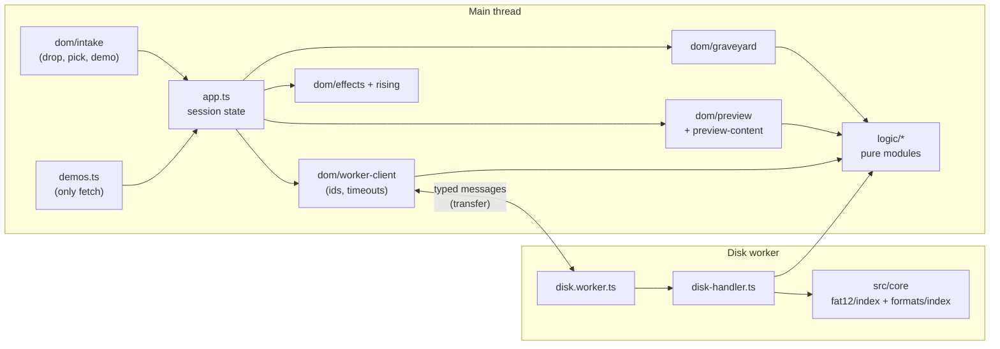
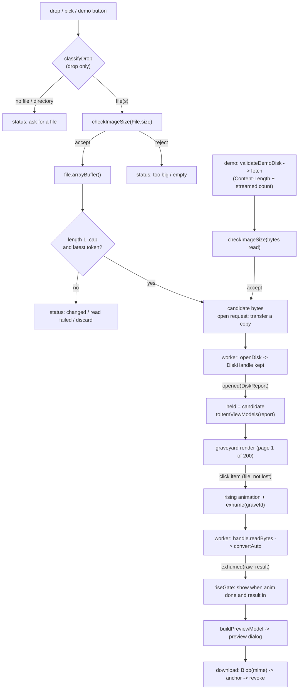
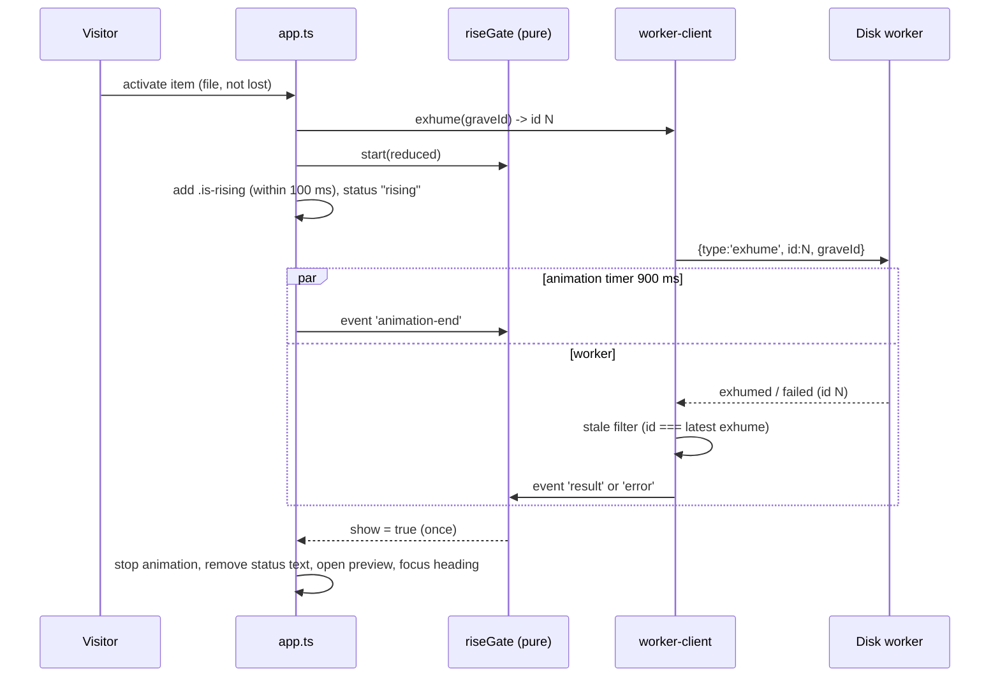

# Design Document

## Overview

The graveyard UI is the web page of Exhume. It is a static Vite page, written in strict TypeScript with no UI framework, that lives in `src/web/` (plus the boot file `src/main.ts`, `src/style.css` and `index.html`). A visitor drops or picks a FAT12 floppy image. A Web Worker parses it with the FAT12 core and returns a `DiskReport`. The page renders every `Grave` as a tombstone (alive) or an open grave (recovered, partial, lost). Activating a grave plays a short "rising" animation while the worker reads and converts the file, then a modal preview shows Markdown, a CSV table, a PNG or a hex view, and offers downloads.

The design rests on five rules, in priority order:

1. **Disk text is data, never markup.** Every string that came from the image reaches the DOM through `textContent`, `Text` nodes or `createElement`. All DOM building goes through one helper module with an attribute allow-list, and a source scan proves no HTML sink exists anywhere in the web sources.
2. **The core runs in a worker.** `openDisk`, `convertAuto` and friends run only in `src/web/worker/`. The main thread talks to it through a typed, validated, structured-clone-safe protocol with request ids, a stale-response filter and timeouts.
3. **Pure logic, thin DOM.** Everything that can be decided without a DOM (validation, formatting, paging, view models, parsers, hex, sanitizer, contrast, rise sequencing, demo validation) is a pure module in `src/web/logic/` and runs under Vitest's default Node environment. DOM modules only translate pure results into nodes.
4. **Strict CSP, one network file.** A meta CSP with `connect-src 'self'`, no `unsafe-*`, no `data:`. Only `src/web/demos.ts` may call `fetch`; scans enforce that.
5. **Never a blank screen.** Every failure ends as a plain-text message in a live region, the drop zone stays usable, and a hostile disk can at worst produce an empty graveyard with warnings.

### Decisions and their rationale

| Decision | Choice | Why |
|---|---|---|
| Core API in the worker | `DiskHandle.readBytes(grave)` on a kept handle (settled; matches Req 3.1, 3.9, 3.10, 9.15 and the glossary) | The standalone whole-image reader would call `openDisk(image)` on every call (verified in `src/core/fat12/disk.ts`), so each click would rescan the whole directory tree. See "Worker design". |
| Preview container | `div` with `role="dialog"` and `aria-modal="true"`, own focus trap, `inert` on the page behind | Needs a trap that wraps Tab (Req 12.8), which a native modal `<dialog>` does not do anyway; behaves the same in DOM test libraries (no `showModal` support needed); easy to sequence with the rising animation. |
| Styling at run time | Class toggles only; no `style.setProperty` anywhere | Removes the CSSOM-under-CSP risk of Req 2.8 from the design. The manual check still runs to confirm. |
| Worker loading | `new Worker(new URL('./worker/disk.worker.ts', import.meta.url), { type: 'module' })`, created at boot | Vite bundles it as a same-origin chunk under `worker-src 'self'`; creating it at boot keeps the chunk request inside the initial page load (Req 2.6). |
| Image bytes after worker loss | Main thread keeps one copy (`held`) and transfers a copy to the worker | Transfer detaches the sender's buffer; the copy lets "Reopen disk" work after a timeout (Req 3.8, 3.14, 14.3). Cost: at most 2.88 MB extra. |
| DOM tests | Written only after the user approves `jsdom` or `happy-dom` | Req 15.8, 15.9. Until then the project has no `*.dom.test.ts` file and no DOM dependency; the DOM test files are a final optional task group blocked on approval. |
| `img` attributes | `alt` and `src` are set only by `setSrcBlob(img, blobUrl, safeName)` in `dom/h.ts` | Req 1.3 allows `alt` only as a Safe_File_Name through that single helper. A scan proves no other place sets them. |
| Raw download | Every `exhumed` response carries the raw bytes; every result offers a raw `.bin` download | Req 9.13. Costs up to 4 MiB extra per preview, accepted. |
| Hosting | Domain root (Vercel or Netlify style); Vite `base` stays `'/'` | Root-relative `/assets/` and `/disks/` URLs are correct there. A sub-path host is out of scope. |
| Phrase scan scope | Visible text of `index.html` plus string and template literals in Web_Sources; comments are not scanned | Req 13.4, 13.6. A small comment-aware tokenizer extracts the literals. |

### Scope

In scope: `src/web/**`, `src/main.ts`, `src/style.css`, `index.html`, a new `vite.config.ts`, two small tsconfig files, a `typecheck` script extension, and test-support helpers under `src/test-support/web/`. Out of scope, as in the requirements: any change under `src/core/`, steering files, `package.json` dependencies, demo disk generation (spec 5), hosting and CI.

### Research notes

I checked these facts in the repository during design (not from memory):

- The whole-image reader is `openDisk(image).readBytes(grave)`; `DiskHandle.readBytes` reuses the scan and validates the grave fields against the stored record (`lookup`).
- `readBytes` already caps output at `MAX_FILE_OUTPUT_BYTES` (4,194,304) and returns a fresh `Uint8Array(total)` that owns its buffer.
- `convertAuto(input, fileName?)` returns a `ConversionResult`; the "unknown" case is `{ ok: false, error, warnings: [] }`, not a separate variant. `MAX_CONVERT_INPUT_BYTES` is 4 MiB, equal to the file cap.
- `src/core/formats/index.ts` does not export `csvCell`/`csvRow` (they live in the unexported `csv.ts`). The CSV round-trip test therefore writes its own reference writer in `src/test-support/web/`.
- Vite is 7.3.7. The built placeholder `dist/index.html` has no inline script: the module-preload polyfill is inside the entry JavaScript (`dist/assets/index-*.js` begins with it). `modulePreload: { polyfill: false }` removes it anyway.
- The root `tsconfig.json` includes `src` with `lib: ["ES2022","DOM","DOM.Iterable"]` and `types: ["vite/client","node"]`. `npm run typecheck` is `tsc --noEmit && tsc -p src/core/tsconfig.json --noEmit`. There is no `vite.config.ts` today; `vitest.config.ts` includes `src/**/*.test.ts`.
- Not fetched this session: browser CSP behavior and Vite worker-bundling details come from existing knowledge, so the first task includes a build smoke check and the manual checks below close the gap.

### Safe_Markdown_Subset re-verification (Req 5.1)

I read `src/core/formats/wordstar.ts` end to end. The converter emits exactly these constructs, which matches Req 5.1 with no additions:

| Converter behavior | Output | Subset item |
|---|---|---|
| Hard return (`CR`, `LF`, `CR LF`) | `\n` (markers closed first, pending spaces written) | line feed; two or more in a row are a blank line |
| Soft return (`0x8D 0x0A`) | one space | plain text, no construct |
| Bold toggle `^B` | `**` open and close | `strong` |
| Underline `^S` and italic `^Y` | `*` open and close | `emphasis` |
| Dot command `.PA` | `\n---\n\n` | thematic break |
| Other dot commands and `..` comments | skipped | none |
| Characters `\` `` ` `` `*` `_` `<` `>` `[` `]` | `\` before the character, anywhere | escape |
| `#` `+` `-` at output column 0 | `\` before the character | escape |
| `.` or `)` right after one leading digit at column 0 | `\` before it | escape |

Differences and cautions, flagged:

- **Spaces-only lines can occur.** `writeHard` writes pending spaces before the line feed, so a line of only spaces is possible. The parser treats only a truly empty line as blank (so no input character is lost); a spaces-only line is ordinary text.
- **`***x***` is valid output.** Bold plus emphasis open as `**` then `*`, and close as `*` then `**`. A parser that tokenizes `***` the same way in both positions gets the close order wrong; the algorithm below resolves a star run against the open-marker stack.
- **The PA block can directly follow a text line** (`text\n---\n\n`). In CommonMark that would make a heading; here a line that is exactly `---` is always a `thematic-break`. The converter escapes a literal `-` at column 0, so a `---` line never comes from document text.
- **Markers never span lines in converter output** (`writeHard` closes all markers). The parser still pairs markers across line breaks inside one paragraph, as Req 5.4 says "same paragraph".

## Architecture

### Module layout

```
index.html                       CSP meta, static layout, privacy + honesty notes
vite.config.ts                   NEW: build settings (see "Build and script changes")
src/main.ts                      boot only: import './style.css'; startApp()
src/style.css                    tokens, layout, layers, grave visuals (one file)
src/web/
  app.ts                         wiring + session state (DOM module)
  demos.ts                       DemoDisk, DEMO_REGISTRY (empty), loadDemoBytes: the ONLY file that calls fetch
  logic/                         PURE: no DOM global, no Worker. ES2022 lib only
    limits.ts  protocol.ts  validate.ts  requests.ts  size.ts  text.ts
    viewmodel.ts  paging.ts  preview-model.ts  markdown.ts  csv-display.ts
    hex.ts  filename.ts  contrast.ts  demo-validate.ts  drop.ts
    rise-gate.ts  focus-order.ts  effects-math.ts  tsconfig.json
  dom/                           DOM modules (built on logic/)
    h.ts  status.ts  intake.ts  demo-slot.ts  graveyard.ts  preview.ts
    preview-content.ts  focus-trap.ts  blob-urls.ts  download.ts
    effects.ts  rising.ts  worker-client.ts  errors.ts
  worker/
    disk-handler.ts              request handler as a pure function over a session object
    disk.worker.ts               glue: onmessage -> handler -> postMessage with transfer list
    tsconfig.json                lib ES2022 + WebWorker, types []
src/test-support/web/            test-only: scan.ts, css-scan.ts, html-scan.ts, csp.ts, md-emitter.ts, csv-writer.ts
```

`src/web/logic/` mirrors the convention of `src/core/tsconfig.json`: a tsconfig with `lib: ["ES2022"]` and `types: []`, so any DOM global in a pure module is a compile error. A scan test backs this up with a list of DOM global names.

### Component diagram



### Data flow



### Exhume sequence



### Session states (main thread)

```mermaid
stateDiagram-v2
  [*] --> empty
  empty --> open: opened
  open --> open: opened (new disk replaces; old held bytes dropped)
  open --> lost: timeout / worker error / cancel
  lost --> open: Reopen disk or new file, opened
  lost --> lost: open fails
```



`lost` keeps the rendered list on screen, disables exhume controls, shows "reopen" text in the status region and shows a **Reopen disk** button that re-sends the held bytes (Req 3.14).

## Components and Interfaces

All signatures are TypeScript. Imports from the core use only `../../core/fat12/index` and `../../core/formats/index` (Req 15.3). Constants live in `logic/limits.ts` and import the core limits instead of repeating numbers.

### `logic/limits.ts`

```ts
import { MAX_IMAGE_BYTES, MAX_TOTAL_ENTRIES, MAX_FILE_OUTPUT_BYTES } from '../../core/fat12/index';
export { MAX_IMAGE_BYTES, MAX_TOTAL_ENTRIES, MAX_FILE_OUTPUT_BYTES };
export const PAGE_SIZE = 200;
export const LABEL_CAP = 255;
export const MD_PREVIEW_CHARS = 1_000_000;
export const CSV_MAX_ROWS = 200;
export const CSV_MAX_COLS = 50;
export const HEX_PREVIEW_BYTES = 4096;
export const HEX_ROW_BYTES = 16;
export const OPEN_TIMEOUT_MS = 15_000;
export const EXHUME_TIMEOUT_MS = 30_000;
export const DEMO_TIMEOUT_MS = 10_000;
export const RISE_MS = 900;            // must stay <= RISE_MAX_MS
export const RISE_MAX_MS = 1_200;
export const DOWNLOAD_REVOKE_MS = 500; // must stay <= 1000
export const FX_MAX_FPS = 30;
export const FX_MAX_SHAPES = 60;       // must stay <= 200
export const FX_MAX_BACKING = { width: 1920, height: 1080 } as const;
export const FILE_NAME_MAX = 64;
```

### Worker_Protocol: `logic/protocol.ts`

Plain discriminated unions. Only objects, arrays, strings, numbers, booleans, `null` and `Uint8Array` appear. The core's `DiskReport`, `Warning` and `ConversionWarning` are already plain data.

```ts
import type { DiskReport, Warning } from '../../core/fat12/index';
import type { ConversionWarning } from '../../core/formats/index';

export type RequestKind = 'open' | 'exhume';

export interface OpenRequest   { type: 'open';   id: number; image: Uint8Array }
export interface ExhumeRequest { type: 'exhume'; id: number; graveId: number }
export type WorkerRequest = OpenRequest | ExhumeRequest;

/** What the worker found in a file. The mime and extension come from `kind`, never from the message. */
export type ExhumeResult =
  | { kind: 'markdown'; text: string;     warnings: ConversionWarning[] }
  | { kind: 'csv';      text: string;     warnings: ConversionWarning[] }
  | { kind: 'png';      png: Uint8Array;  warnings: ConversionWarning[] }
  | { kind: 'raw';      error: string;    warnings: ConversionWarning[] }; // unknown format or conversion failure

export interface OpenedResponse  { type: 'opened';  id: number; report: DiskReport }
export interface ExhumedResponse {
  type: 'exhumed'; id: number; graveId: number;
  raw: Uint8Array;               // full file bytes, <= MAX_FILE_OUTPUT_BYTES
  readWarnings: Warning[];       // from DiskHandle.readBytes
  result: ExhumeResult;
}
export type FailureCause = 'no-disk' | 'not-found' | 'read' | 'invalid-request' | 'internal';
export interface FailedResponse  { type: 'failed'; id: number; request: RequestKind; cause: FailureCause; error: string }
export type WorkerResponse = OpenedResponse | ExhumedResponse | FailedResponse;

export const OUTPUT_BY_KIND = {
  markdown: { mime: 'text/markdown', extension: '.md' },
  csv:      { mime: 'text/csv',      extension: '.csv' },
  png:      { mime: 'image/png',     extension: '.png' },
} as const;
```

Notes:

- `error` on `failed` is either a core `ReadResult.error` string (cause `read`) or a fixed template written by the handler (never built from disk text).
- Reserved id `0`: the worker answers a request it cannot parse (so it has no trustworthy id) with `failed`, id `0`, cause `invalid-request`. The id source starts at 1, so the main thread's stale filter always discards it.
- `ExhumedResponse.raw` is always present, so the raw download (Req 9.13) works for every outcome, including a successful conversion.

### Validation and request ids: `logic/validate.ts`, `logic/requests.ts`

```ts
export type Parsed<T> = { ok: true; value: T } | { ok: false; reason: string };

/** Total: returns a rejection for any input, never throws (Req 3.7, 3.18). */
export function parseResponse(raw: unknown): Parsed<WorkerResponse>;
export function parseRequest(raw: unknown): Parsed<WorkerRequest>;
export function isRequestId(v: unknown): v is number;   // non-negative safe integer

export interface RequestTracker {
  begin(kind: RequestKind): number;              // new id > every earlier id; marks it latest for kind
  accept(res: WorkerResponse): boolean;          // true only if res.id === latest id of its kind
  latest(kind: RequestKind): number;             // -1 when none pending
  supersedeAll(): void;                          // latest of both kinds becomes -1; counter keeps growing
}
export function createRequestTracker(): RequestTracker;
export function kindOfResponse(res: WorkerResponse): RequestKind;
export function isCurrent(latest: Readonly<Record<RequestKind, number>>, res: WorkerResponse): boolean;

/** Copies `held` (so the main-thread bytes survive the transfer) and lists the copy's buffer for transfer. */
export function buildOpenMessage(held: Uint8Array, id: number): { message: OpenRequest; transfer: ArrayBuffer[] };
/** Distinct, whole-buffer ArrayBuffers behind every Uint8Array in a response. */
export function transferablesOf(res: WorkerResponse): ArrayBuffer[];
```

`parseResponse` checks the full shape, including every `Grave` field and enum value, with these bounds: at most `MAX_TOTAL_ENTRIES` graves and a bounded warning count; strings must be strings; numbers must be finite (integers where the type says so). It does not trust the worker beyond what the renderer relies on.

### Size and text helpers: `logic/size.ts`, `logic/text.ts`

```ts
export type SizeCheck =
  | { ok: true }
  | { ok: false; reason: 'empty' | 'too-large' | 'invalid'; message: string };
export function checkImageSize(bytes: number, cap?: number): SizeCheck;   // cap defaults to MAX_IMAGE_BYTES
export function formatBytes(n: number): string;       // "512 B", "1.5 KB", "2.8 MB"; never throws
export function toLabel(s: string, cap?: number): string;   // cap defaults to LABEL_CAP; markup chars unchanged
export function lastSegment(path: string): string;
export function segmentCount(path: string): number;
export function formatDate(date: string | null): string;    // 'YYYY-MM-DD HH:MM' or 'no date'
```

- `formatBytes` uses divisor 1,024. It switches unit by the rounded value, so 1,048,575 bytes prints `1.0 MB`, not `1024.0 KB`. There is no unit above MB (Req 6.6).
- `checkImageSize` messages follow Req 4.3 (`"This file is 5.0 MB. Floppy images up to 2.8 MB are supported."`) and Req 4.4 (`"This file is empty."`).
- `toLabel` returns `s` when `s.length <= cap`, else a prefix of at most `cap` code units; a trailing lone high surrogate is dropped so the prefix stays valid text.
- `formatDate` checks length 19 first, then digits and ranges (month 1-12, day 1-31, hour 0-23, minute 0-59, second 0-59). Anything else returns `"no date"`. It never uses `Date`, so there is no time-zone effect (Req 6.7).

### View model and paging: `logic/viewmodel.ts`, `logic/paging.ts`

```ts
export interface ItemViewModel {
  id: number;
  kind: GraveKind;
  state: GraveState;
  stateLabel: string;            // equals state, non-empty
  visual: 'tombstone' | 'open-grave';   // alive -> tombstone, else open-grave
  name: string;                  // toLabel(lastSegment(path)); '(unnamed)' if empty
  path: string;                  // toLabel(path)
  showPath: boolean;             // segmentCount(path) > 1
  sizeText: string;
  dateText: string;
  reason: string | null;         // core reason, character for character, for non-alive states
  marker: 'directory' | null;
  action: 'exhume' | 'none';     // 'exhume' only for kind file and state !== 'lost'
  note: string | null;           // "not previewable" for lost
}
export interface VolumeSummary {
  label: string;                 // '(no label)' when empty
  fileCount: number;
  directoryCount: number;
  empty: null | 'unreadable' | 'no-files';  // geometrySource 'none' vs other, when files.length === 0
}
export function toItemViewModels(report: DiskReport): ItemViewModel[];
export function summarize(report: DiskReport): VolumeSummary;
export function warningLines(report: DiskReport): string[];   // message, plus " (path)" when present

// paging.ts
export function visibleCount(total: number, pages: number): number;   // min(total, pages*PAGE_SIZE, MAX_TOTAL_ENTRIES)
export function hasMore(total: number, pages: number): boolean;
export function progressText(visible: number, total: number): string;  // "X of Y"
```

### Preview model: `logic/preview-model.ts`

A pure bridge from worker results to what the dialog shows, so the dialog needs no decisions.

```ts
export type DownloadMime = 'text/markdown' | 'text/csv' | 'image/png' | 'application/octet-stream';
export interface DownloadSpec { label: string; fileName: string; mime: DownloadMime; data: string | Uint8Array }

export type PreviewBody =
  | { kind: 'markdown'; text: string; shortened: boolean }       // text cut to MD_PREVIEW_CHARS
  | { kind: 'csv'; table: CsvTable }
  | { kind: 'png'; png: Uint8Array; alt: string }
  | { kind: 'hex'; rows: HexRow[]; totalBytes: number; shownBytes: number }
  | { kind: 'none' };                                            // read failed

export interface PreviewModel {
  title: string;                  // toLabel(name)
  partialNote: string | null;     // grading reason for 'partial' (Req 9.17)
  error: string | null;           // core error text (conversion failure or read failure)
  warnings: string[];             // every read + conversion warning, in order, no cap
  body: PreviewBody;
  downloads: DownloadSpec[];      // converted (if any) + raw; empty when the read failed
}
export function buildPreviewModel(item: ItemViewModel, outcome: ExhumeOutcome): PreviewModel;
export type ExhumeOutcome =
  | { status: 'ok'; response: ExhumedResponse }
  | { status: 'read-failed'; error: string }
  | { status: 'lost-disk'; error: string };      // timeout / worker error / cancel
```

### Markdown: `logic/markdown.ts`

```ts
export type InlineNode =
  | { type: 'text'; value: string }
  | { type: 'line-break' }
  | { type: 'strong'; children: InlineNode[] }
  | { type: 'emphasis'; children: InlineNode[] };
export type BlockNode =
  | { type: 'paragraph'; children: InlineNode[] }
  | { type: 'thematic-break' };
export interface MarkdownModel { blocks: BlockNode[]; dropped: number }   // dropped: delimiter + LF chars not in any text node
export function parseMarkdown(text: string): MarkdownModel;               // total; iterative; linear
export function truncateForPreview(text: string): { text: string; shortened: boolean };
export function plainText(model: MarkdownModel): string;                  // text nodes only, for tests
```

Algorithm (iterative, no recursion, one forward scan per stage, nesting limit 2):

1. **Lines.** Scan once for `\n`. A line is the text between line feeds. A line equal to the empty string is blank; a line exactly `---` is a thematic break; everything else (including spaces-only) is text. `\r` is an ordinary character. Each `\n` adds 1 to `dropped`; a `---` line adds 3.
2. **Blocks.** A maximal run of text lines is one paragraph. A blank line or a `---` line ends the run. A `---` line emits a `thematic-break` block. Runs of blank lines emit nothing.
3. **Inline events for one paragraph.** Walk each character of each line, with a `lineIndex`/`column` known:
   - `\` followed by `c` is an escape when `c` is one of `` \ ` * _ < > [ ] ``; or `c` is one of `# + -` and the backslash is at column 0; or `c` is `.` or `)` and the backslash is at column 1 and column 0 held a digit. An escape emits `text(c)` and adds 1 to `dropped`. Any other backslash is literal text.
   - A run of `n` consecutive unescaped `*` is resolved against an explicit marker stack (depth at most 2, so the stack is a two-slot array). While `n > 0`: if the top marker is `emphasis` and `n >= 1`, close it (consume 1); else if the top is `strong` and `n >= 2`, close it (consume 2); else if the stack depth is below 2, open `strong` when `n >= 2` (consume 2) or `emphasis` (consume 1); else emit one literal `*` text (depth would exceed 2) and consume 1. This handles `***x***` in both positions.
   - Any other character is text. Line ends inside the paragraph emit a `line-break` event.
4. **Pairing.** Opened markers that never closed are turned back into literal text of their original characters (`**` or `*`), in place. This is done with a second pass over the recorded events, driven by an explicit node stack, so no input character is ever dropped (Req 5.4). Adjacent text values are concatenated.
5. **Counters.** Escape backslashes, matched marker characters, `---` lines and all LFs add to `dropped`. The conservation law is `sum(text value lengths) + dropped == input.length` for every input.

Everything is O(n): each character is visited a constant number of times and the stack never exceeds 2.

**Known limitation (Req 5.4, 5.8).** A run of stars is ambiguous without lookahead, for example `*a**b*` versus `*a**b***`. The star-run rule closes an open emphasis on any star run, so converter output that starts bold inside emphasis (`*a**b***`) does not read back exactly as written. No character is lost (the conservation law holds) and the text stays safe. The parser is intentionally unchanged. The test emitter only generates bold-outside-emphasis-inside (`***x***`), emphasis alone and bold alone.

`truncateForPreview(text)` returns `text.slice(0, MD_PREVIEW_CHARS)` and `shortened: text.length > MD_PREVIEW_CHARS`. The downloadable data is always the untruncated string.

### CSV display parser: `logic/csv-display.ts`

```ts
export interface CsvTable {
  rows: string[][];        // at most maxRows rows, each at most maxCols cells
  totalRows: number;       // real record count
  totalCols: number;       // real maximum cells in any record
  truncated: boolean;      // totalRows > maxRows || totalCols > maxCols
}
export function parseCsv(text: string, maxRows?: number, maxCols?: number): CsvTable; // total; defaults CSV_MAX_ROWS, CSV_MAX_COLS
```

RFC 4180 reading, one pass state machine (`field start`, `unquoted`, `quoted`, `quote seen in quoted`): a field that starts with `"` is quoted; `""` inside it is one quote; `,` ends a field outside quotes; `CRLF`, lone `LF` or lone `CR` ends a record outside quotes. A final record without a terminator counts. A trailing terminator does not create an extra empty record. `""` text input yields zero rows. An unterminated quote takes the rest of the input as that field. Characters after a closing quote and before the next delimiter are kept as literal text. Counting continues past the display limits so `totalRows` and `totalCols` are real; only the first `maxRows` rows and `maxCols` cells are stored. The first stored row is shown with `th` cells (it is the dBase field-name row), the rest with `td`.

### Hex view: `logic/hex.ts`

```ts
export interface HexRow { offset: string; hex: string; text: string }   // offset: 8 hex digits; hex: 16 slots padded to 47 chars; text: <= 16 chars
export function hexRows(bytes: Uint8Array, limit?: number): HexRow[];    // limit defaults to HEX_PREVIEW_BYTES
```

Rows number `ceil(min(length, limit) / 16)`. Text column maps bytes `0x20`..`0x7E` to themselves and everything else to `.`.

### File name sanitizer: `logic/filename.ts`

```ts
export type DownloadExtension = '.md' | '.csv' | '.png' | '.bin';
export function sanitizeFileName(diskName: string, extension: DownloadExtension): string;
```

Implements Req 10.4 steps (a) to (h) with plain loops (no regex over input). Step (f) truncates the stem to `64 - extension.length`; the stem falls back to `grave` when empty (Req 10.5). Windows-reserved stems such as `CON` pass through (Req 10.7). The PNG `alt` text is `sanitizeFileName(name, '.png')` (at most 64 characters, within Req 9.10's 255).

### Demo validation: `logic/demo-validate.ts`, `demos.ts`

```ts
// demos.ts
/** Extension point for spec 5: add entries to DEMO_REGISTRY. This is the only module allowed to call the network. */
export interface DemoDisk { id: string; title: string; description: string; url: string }
export const DEMO_REGISTRY: readonly DemoDisk[] = [];
export type DemoLoad =
  | { ok: true; bytes: Uint8Array }
  | { ok: false; reason: 'invalid' | 'network' | 'http' | 'too-large' | 'empty' | 'timeout'; message: string };
export function loadDemoBytes(demo: DemoDisk, fetchImpl?: typeof fetch, timeoutMs?: number): Promise<DemoLoad>;

// logic/demo-validate.ts
export interface DemoEntryShape { id: string; title: string; description: string; url: string }   // structurally equal to DemoDisk
export type DemoCheck = { ok: true } | { ok: false; field: 'id' | 'title' | 'description' | 'url'; message: string };
export function validateDemoDisk(entry: unknown): DemoCheck;                                      // pure, total
export function selectValidDemos<T extends DemoEntryShape>(entries: readonly T[]): T[];           // drops invalid and duplicate ids, keeps order
```

`demo-validate.ts` does not import from `demos.ts`. `DemoDisk` (in `demos.ts`) and `DemoEntryShape` are structurally identical, so `DEMO_REGISTRY` passes straight to `selectValidDemos`. Importing `demos.ts` from `logic/` would drag `fetch` and `AbortController` types into the ES2022-only logic compilation.

`validateDemoDisk` rules: `id` 1 to 64 chars; `title` 1 to 80; `description` 1 to 200 with no `\r` or `\n`; `url` must start with `/disks/`, must not start with `//`, must not contain a scheme (a `:` before the first `/`, or any `name:` prefix), a backslash, a `..` path segment, `%2e` or `%2f` in any case, and must have at least one character after `/disks/`. The check runs on the string as written, with plain loops.

`loadDemoBytes` details:

- Revalidates with `validateDemoDisk` first (`reason: 'invalid'`, no request sent).
- `fetchImpl(url, { credentials: 'omit', redirect: 'error', referrerPolicy: 'no-referrer', cache: 'no-store', signal })` with an `AbortController` aborted after 10 s (`reason: 'timeout'`).
- A non-2xx status is `http`. A `Content-Length` header above the cap is `too-large` before reading the body.
- The body is read with `response.body.getReader()`; a running byte count aborts the read as soon as it exceeds `MAX_IMAGE_BYTES` (`too-large`). When `body` is null the code falls back to `arrayBuffer()` and checks the length afterward. Zero bytes is `empty`.
- The result goes to the same `app.openImage(bytes)` pipeline as a dropped file, which repeats `checkImageSize`.

### Drop classification: `logic/drop.ts`

```ts
export interface DropInfo { itemKinds: readonly string[]; fileCount: number; firstIsDirectory: boolean }
export type DropDecision =
  | { action: 'use-first'; ignoredOthers: boolean }
  | { action: 'reject'; message: string };
export function classifyDrop(info: DropInfo): DropDecision;
```

`fileCount === 0` or `firstIsDirectory` gives the "please drop a disk image file" message. More than one file gives `use-first` with `ignoredOthers: true`.

### Rising gate: `logic/rise-gate.ts`

```ts
export type RiseEvent = 'animation-end' | 'result' | 'error' | 'cancel';
export interface RiseState { reduced: boolean; animationDone: boolean; outcome: 'pending' | 'result' | 'error'; shown: boolean }
export interface RiseStep { state: RiseState; show: boolean; stopAnimation: boolean }
export function startRise(reduced: boolean): RiseState;     // reduced starts with animationDone = true
export function stepRise(state: RiseState, event: RiseEvent): RiseStep;
```

Rules: `show` is true at most once. An `error` shows immediately and stops the animation (Req 9.4, 9.6). A `result` shows when the animation is done (or reduced motion skipped it); otherwise it waits for `animation-end`. After `animation-end` with the result already in, it shows at once and never waits longer (Req 9.3). `cancel` stops the animation and never shows.

### Small pure helpers: `logic/focus-order.ts`, `logic/effects-math.ts`, `logic/contrast.ts`

```ts
export function nextFocusIndex(count: number, current: number, backwards: boolean): number;  // wraps; -1 current means outside -> 0 or count-1; count 0 -> -1

export function canvasBacking(cssWidth: number, cssHeight: number, dpr: number): { width: number; height: number };  // <= 1920 x 1080, >= 1
export function frameDue(lastMs: number, nowMs: number): boolean;     // true when now - last >= 1000 / FX_MAX_FPS

export type Rgb = readonly [number, number, number];
export function parseHexColor(hex: string): Rgb | null;               // #rgb or #rrggbb
export function relativeLuminance(c: Rgb): number;                    // WCAG 2.x sRGB
export function contrastRatio(a: Rgb, b: Rgb): number;                // pure, symmetric, 1..21
export function compositeOver(fg: Rgb, alpha: number, bg: Rgb): Rgb; // used by the layer-over-text check of Req 11.4
```

### DOM helper: `dom/h.ts`

The only module that calls `createElement`, `setAttribute` or `textContent` for application content. Everything else builds nodes through it.

```ts
export type AttrName =
  | 'class' | 'id' | 'role' | 'type' | 'hidden' | 'inert' | 'tabindex' | 'disabled' | 'open'
  | 'aria-label' | 'aria-labelledby' | 'aria-describedby' | 'aria-modal' | 'aria-live' | 'aria-hidden'
  | 'aria-disabled' | 'aria-expanded' | 'aria-busy' | 'title' | 'lang' | 'for' | 'colspan' | 'scope' | 'download'
  | `data-${string}`;
export function h(tag: AllowedTag, attrs?: Partial<Record<AttrName, string>>, ...children: Array<Node | string>): HTMLElement;
/** The ONLY place in the web sources that sets `src` or `alt` on an img (Req 1.3). */
export function setSrcBlob(img: HTMLImageElement, blobUrl: string, safeName: string): void;  // blobUrl must be owned by BlobUrlManager; safeName must match Safe_File_Name
export function setDownloadHref(a: HTMLAnchorElement, blobUrl: string, safeFileName: string): void;
export function clear(node: Node): void;   // removeChild loop; never an HTML sink
```

`AllowedTag` is a closed union: `div span p ul li h1 h2 h3 button a img table thead tbody tr th td details summary section header main footer br hr strong em canvas`. `a` is created only by `setDownloadHref`'s caller (`download.ts`) and never inside Markdown output. String children become `Text` nodes. `style`, `srcdoc` and `on*` are not in `AttrName`, so passing them is a compile error. Attribute values derived from disk text may only be given to `aria-label`, `title`, `data-*` and `download` (Req 1.3); `alt` is not in `AttrName`; it is set only by `setSrcBlob`, which sets the img `src` Blob URL and `alt` together and throws if `safeName` does not match `[A-Za-z0-9._-]{1,64}`. The attribute allow-list therefore is: the `AttrName` members above, plus `alt` and `src` through `setSrcBlob` alone, plus `href` through `setDownloadHref` alone. `href` and `src` take only URLs that `BlobUrlManager` created in this session (Req 1.3, 1.4). The source scan (`sources.scan.test.ts`) also fails if `.alt`, `.src`, `'alt'` or `'src'` is assigned or passed to `setAttribute` anywhere in the Web_Sources other than inside `setSrcBlob` in `dom/h.ts`; a unit test of `setSrcBlob` checks the Safe_File_Name rejection, and a self-test fixture shows the scan flags a stray `img.alt = x`.

### Graveyard renderer: `dom/graveyard.ts`

```ts
export interface GraveyardView {
  show(report: DiskReport, items: ItemViewModel[]): void;   // resets paging to page 1, replaces content, summary, warnings, empty messages
  showMore(): void;                                         // appends the next page and moves focus to the first new item
  setActionsEnabled(enabled: boolean): void;                // false when the disk is lost
  itemElement(id: number): HTMLElement | null;              // for focus return and the rising animation
  headingElement(): HTMLElement;                            // fallback focus target (tabindex -1)
}
export function createGraveyardView(root: HTMLElement, onActivate: (item: ItemViewModel, opener: HTMLElement) => void): GraveyardView;
```

Item markup (all text through `h`):

```
li.grave.grave--{state}.grave--{tombstone|open-grave}[data-grave-id]
  button.grave-action  (file, action 'exhume')       | div.grave-body (directory, lost)
    span.grave-art[aria-hidden]                       (CSS-drawn tombstone / open grave)
    span.grave-name       (text: name; title: path when showPath)
    span.grave-path       (only when showPath)
    span.grave-meta       "1.5 KB · 1991-03-04 12:30"
    span.grave-state      "alive" | "recovered" | "partial" | "lost"
    span.grave-reason     (open graves)
    span.grave-marker     "directory" | "not previewable"
```

Directories and lost graves are not buttons and carry no tabindex (Req 6.11, 9.16). The list is a `ul` with an accessible name; paging appends only the new `li` nodes, so earlier nodes and their focus stay intact. When the first new item has no control, focus moves to its `li` made programmatically focusable with `tabindex="-1"` (not in the Tab order). Warnings render in a native `<details>` (collapsed by default) with a `ul`. Empty and unreadable disks show the messages of Req 6.14 and 6.15 above the warnings.

### Preview dialog: `dom/preview.ts`, `dom/preview-content.ts`, `dom/focus-trap.ts`

```ts
export interface PreviewPanel {
  open(model: PreviewModel, opener: HTMLElement | null): void;   // builds content, inerts the page, focuses the heading
  close(): void;                                                  // revokes preview Blob URLs, restores inert, returns focus
  isOpen(): boolean;
}
export function createPreviewPanel(deps: { blobs: BlobUrlManager; downloader: Downloader; fallbackFocus: () => HTMLElement; background: HTMLElement }): PreviewPanel;

export function buildMarkdown(model: MarkdownModel): DocumentFragment;     // p, br, strong, em, hr, text only
export function buildCsvTable(table: CsvTable): HTMLElement;               // wrapper div (own scroll) > table
export function buildHexView(rows: HexRow[]): HTMLElement;                 // pre-like grid, own scroll
export function trapTab(root: HTMLElement, e: KeyboardEvent): void;        // uses nextFocusIndex over visible focusables
```

Structure: `div.preview-backdrop` > `div.preview[role=dialog][aria-modal=true][aria-labelledby]` containing `header` (`h2#preview-title[tabindex=-1]`, close `button`), optional partial note `p`, error `p`, warning `ul`, the body, a shortened-note `p` when needed, and a `footer` of download buttons. While open, the main content wrapper gets `inert` and the dialog is a sibling outside it. Escape (keydown on the dialog) closes. Focus goes to `h2` on open and to the opener on close; if the opener is no longer connected, to the graveyard heading (Req 12.5 to 12.9, 9.20). Markdown output uses `p`, `br`, `strong`, `em`, `hr` and text nodes; the builder never creates `a`, `img`, `iframe`, `object`, `embed`, `form`, `script` or `link`. The PNG `img` is created by `setSrcBlob` and exists only for PNG results.

### Blob URLs, downloads: `dom/blob-urls.ts`, `dom/download.ts`

```ts
export interface BlobUrlApi { create(blob: Blob): string; revoke(url: string): void }
export interface BlobUrlManager { create(blob: Blob): string; isOwned(url: string): boolean; revokeAll(): void; liveCount(): number }
export function createBlobUrlManager(api?: BlobUrlApi): BlobUrlManager;   // default api wraps URL.createObjectURL / revokeObjectURL

export interface Downloader { start(spec: DownloadSpec): { ok: true } | { ok: false; message: string } }
export function createDownloader(blobs: BlobUrlManager, scheduler?: (fn: () => void, ms: number) => void): Downloader;
```

`start` builds `new Blob([spec.data], { type: spec.mime })`, creates a URL through the manager, appends a temporary `a[download=fileName][href=blobUrl]` (set through `setDownloadHref`), clicks it, removes it, and schedules `revoke` after `DOWNLOAD_REVOKE_MS` (500 ms, within the 1,000 ms limit). A thrown error returns `{ ok: false }` and starts nothing (Req 10.9). The manager tracks every URL, so closing a preview, opening another or opening a new disk calls `revokeAll()` and any still-live download URL goes with it (Req 9.11). Revoking twice is harmless.

### Intake: `dom/intake.ts`

```ts
export interface Intake {
  attach(): void;     // document-level dragenter/dragover/drop with preventDefault; picker button + hidden input[type=file]
  detach(): void;
}
export function createIntake(deps: { dropZone: HTMLElement; picker: HTMLButtonElement; input: HTMLInputElement; status: StatusRegion; onBytes: (bytes: Uint8Array, name: string) => void }): Intake;
```

Per file: `checkImageSize(file.size)` before any read (Req 4.2 to 4.4); then `await file.arrayBuffer()` guarded by a monotonically increasing intake token so a newer choice discards an older read (Req 4.14); after the read, `byteLength` must be in `1..MAX_IMAGE_BYTES`, else "the file changed while being read" (Req 4.13). Read errors give "the file could not be read" (Req 4.7). The `input.value` is cleared after each pick so the same file can be chosen again. Messages that contain a file name pass the name through `toLabel` and `textContent` only.

### Worker client: `dom/worker-client.ts`

```ts
export type Settled<T> =
  | { status: 'ok'; value: T }
  | { status: 'failed'; cause: FailureCause; error: string }          // worker answered failed
  | { status: 'lost'; reason: 'timeout' | 'worker-error' | 'cancelled'; message: string }  // worker replaced
  | { status: 'superseded' };                                          // stale; caller changes nothing

export interface WorkerClient {
  open(held: Uint8Array): Promise<Settled<OpenedResponse>>;
  exhume(graveId: number): Promise<Settled<ExhumedResponse>>;
  cancel(): void;               // terminate, supersedeAll, resolve pending as 'lost'/'cancelled'
  supersedeAll(): void;         // new file chosen: pending resolve as 'superseded', worker kept
  hasPending(): boolean;
  dispose(): void;
}
export function createWorkerClient(factory?: () => Worker): WorkerClient;
```

Behavior: `message` events go through `parseResponse` then `tracker.accept`; invalid or stale messages are ignored with no state change. `error` and `messageerror` events and the 15 s (`open`) and 30 s (`exhume`) timers each terminate the worker, call `tracker.supersedeAll()`, resolve every pending promise as `lost`, and set the client to create a new worker on the next request. The request id source is owned by the client (not the worker), so ids keep growing across worker replacements (Req 3.5). The factory is injectable so a DOM-less test can drive the client with a fake worker object.

### App wiring and session: `app.ts`

```ts
export type DiskPhase = 'empty' | 'open' | 'lost';
export interface Session { phase: DiskPhase; held: Uint8Array | null; report: DiskReport | null; items: ItemViewModel[] }
export function startApp(): void;
```

`openImage(bytes, name)`:

1. `candidate = bytes`; call `client.open(candidate)` (the client transfers a copy).
2. On `ok`: revoke all Blob URLs, close the preview, `session.held = candidate`, `report`, `items = toItemViewModels(report)`, graveyard `show`, phase `open`. The previous `held` array is dropped, which satisfies Req 14.3 (no reference to previous bytes or results remains).
3. On `failed`: status message with the failure kind; previous graveyard, preview and Blob URLs stay (Req 14.5). A `failed` open does not discard the worker's previous handle.
4. On `lost`: phase `lost` (if a disk was open), status "the disk must be reopened", exhume controls disabled, **Reopen disk** shown (re-sends `session.held`). The pending `candidate` is dropped.

`activate(item, opener)` (exhume): ignored unless phase is `open`. It starts `client.exhume(item.id)`, `startRise`, `rising.play(li)` and status "rising"; applies `stepRise` on each event; on `show` it builds the `PreviewModel` and opens the preview. `lost` outcomes show the error in the preview and apply the lost-disk recovery (Req 9.6).

### Status, errors, effects, rising

```ts
// dom/status.ts
export interface StatusRegion { set(text: string): void; clear(): void }   // textContent on the role=status element
// dom/errors.ts
export function installGlobalErrorHandlers(status: StatusRegion): void;    // window 'error' + 'unhandledrejection' -> fixed-template text (<= 300 chars)
// dom/effects.ts
export interface Effects { setReducedMotion(on: boolean): void; destroy(): void }
export function createEffects(host: HTMLElement): Effects;
// dom/rising.ts
export interface RiseHandle { cancel(): void; finished: Promise<void> }
export function playRise(item: HTMLElement, reduced: boolean): RiseHandle;
```

The global error handler writes a fixed message ("Something went wrong. Your file stayed on this device. You can drop another file.") and never includes error text from the page, and never touches the current graveyard or preview (Req 14.1).

### Worker handler: `worker/disk-handler.ts`, `worker/disk.worker.ts`

```ts
import { openDisk, MAX_FILE_OUTPUT_BYTES } from '../../core/fat12/index';
import type { DiskHandle } from '../../core/fat12/index';
import { convertAuto } from '../../core/formats/index';

export interface WorkerSession { handle: DiskHandle | null }
export function createSession(): WorkerSession;
/** Total. Never throws, never needs a Worker. Mutates only `session.handle`, and only on a successful open. */
export function handleRequest(session: WorkerSession, raw: unknown): WorkerResponse;
```

`disk.worker.ts` is the only glue file: `self.onmessage = (e) => { const res = handleRequest(session, e.data); self.postMessage(res, transferablesOf(res)); }`. It contains no logic. The worker tsconfig (`lib: ["ES2022","WebWorker"]`, `types: []`) compiles `worker/**` and the `logic/` files it imports.

## Worker design

### Core API: `DiskHandle.readBytes` on one kept handle (settled)

The worker reads file bytes with `DiskHandle.readBytes`, as Requirements 3.1, 3.9, 3.10 and 9.15 and the glossary state. The worker keeps exactly one `DiskHandle` (and with it the image bytes), installed by a successful `open` and released when the next one is installed. It never trusts a `Grave` object from the main thread: the `exhume` request carries only `graveId`, and the worker looks the `Grave` up by that id in its own `handle.report.files`, so `readBytes` receives exactly the stored record.

Rationale for the handle method, compared with the standalone whole-image reader `readGraveBytes(image, grave)` that the core also exports:

| | `readGraveBytes(image, grave)` | `handle.readBytes(grave)` (used) |
|---|---|---|
| Implementation | `openDisk(image).readBytes(grave)` | closure over the scan done at open |
| Cost per click | a full re-scan of boot sector, FAT and every directory (budgeted up to 2 s in the core tests), then the read | the read only |
| Worker state | must keep the image bytes | keeps the handle, which already references the image |
| Fit with Req 3.9, 14.4 | no handle to keep | one handle, released when a new one is installed |

The results are identical because the scan is deterministic; the handle method costs one scan per disk instead of one per click and keeps the rising animation's latency predictable.

### Handler behavior

- `open`: validate (`parseRequest`); call `openDisk(image)`; on success set `session.handle = handle` (this releases the previous handle and its image reference in the same statement) and answer `opened` with `handle.report`. If `openDisk` throws (only for a non-`Uint8Array`) answer `failed` with cause `internal` and leave `session.handle` untouched. A `DiskReport` with geometry source `none` is a success.
- `exhume`: no handle gives `failed` (`no-disk`); `graveId` not an integer in `0..files.length-1` gives `failed` (`not-found`); else `handle.readBytes(files[graveId])`. A not-ok read gives `failed` (`read`, the core `error` text). On success the bytes are bounded: `raw.length > MAX_FILE_OUTPUT_BYTES` can not happen (the core caps it) but the handler still `subarray`s to the cap as a defence. It then calls `convertAuto(raw, lastSegment(grave.path))`.
- `convertAuto` result mapping: `ok` with `output` string and mime `text/markdown` gives `{ kind: 'markdown', text }`; `text/csv` gives `csv`; `image/png` gives `png` with a `Uint8Array` that owns its buffer (the handler copies when `byteOffset !== 0` or `buffer.byteLength !== length`). `ok: false` (unknown format or conversion failure) gives `{ kind: 'raw', error }`, where `error` is the core text.
- Any thrown exception inside the handler becomes `failed` / `internal` with a fixed message. Request handling never reads disk text into a message other than core-produced `error` strings.

### Per result kind

| Kind | Fields returned | Bytes in transfer list | Notes |
|---|---|---|---|
| markdown | `text` (string, at most 8 MiB by the core cap), `raw` | `raw.buffer` | Main thread cuts the preview at 1,000,000 chars; download uses the full text. |
| csv | `text` (string, at most 16 MiB by the core cap), `raw` | `raw.buffer` | Display parse limits to 200 rows and 50 columns. |
| png | `png`, `raw` | `png.buffer`, `raw.buffer` | Main thread builds `Blob('image/png')` and the Blob URL. |
| raw | `error`, `raw` | `raw.buffer` | Hex view of the first 4,096 bytes; raw download of all bytes. |

`transferablesOf(response)` collects the distinct whole buffers. The `opened` response has none (a report is plain data). The `open` request transfers the copy made by `buildOpenMessage`.

### Main-thread bytes, transfer and recovery (Req 3.8, 3.13, 3.14, 14.3)

A transferred `ArrayBuffer` is detached on the sender. Requirement 3.14 wants the main thread to keep the image for re-open, and Requirement 14.3 wants no reference to previous image bytes after a new disk opens. Reconciliation:

- The main thread holds exactly one `held: Uint8Array` for the currently displayed disk, plus one `candidate` while an open is in flight.
- `buildOpenMessage(held, id)` makes `held.slice()` and transfers the copy's buffer. The original stays usable for **Reopen disk**.
- On a successful open, `held = candidate` and the old array is released. On a failed open, `candidate` is dropped and `held` stays.
- Memory cost: the image is at most 2,949,120 bytes. Steady state is `held` (main) plus the worker's copy: about 5.9 MB. During a replacement the peak is the old `held`, the new `candidate`, the worker's old copy and the worker's new copy: about 11.8 MB at the cap. That is small next to the preview data (up to 4 MiB raw plus up to 16 MiB CSV text).

Timeout and recovery: the 15 s open and 30 s exhume timers live in the worker client. A timeout, `error`/`messageerror` event or cancel terminates the worker (a synchronous parse cannot be interrupted any other way), supersedes every pending id, and resolves the pending promises as `lost`. The app then marks the phase `lost`, keeps the list on screen, disables the actions and offers **Reopen disk**. A new worker is created on the next request (or by Reopen). `lost` also applies when the timeout was for a new file's open: the old worker, with the old handle, is gone, so the old list becomes `lost` while the new candidate is dropped.

## CSP, Vite output and the network rule

### The policy

One tag, first element after the charset declaration, before any `script`, `link` or `style`:

```html
<meta http-equiv="Content-Security-Policy" content="default-src 'self'; script-src 'self'; style-src 'self'; img-src 'self' blob:; connect-src 'self'; worker-src 'self'; object-src 'none'; base-uri 'none'; form-action 'none'" />
```

- No directive contains `unsafe-inline`, `unsafe-eval`, `data:`, `*` or a remote host (Req 2.2).
- `form-action 'none'` is an addition; it does not fall back to `default-src`, and the page has no form.
- `frame-ancestors`, `report-uri` and `sandbox` are ignored when delivered through a meta tag, so none is listed. Clickjacking protection needs an HTTP header, which static hosts such as GitHub Pages cannot set; this is a hosting follow-up, not part of this spec.
- Restated decision (Req 8.13): `connect-src 'self'` applies to the whole document because a meta CSP cannot be scoped to one element. It lets the page fetch same-origin static files, including demo disks. The compensating controls are: `fetch` only in `src/web/demos.ts`, `validateDemoDisk` before every request, `credentials: 'omit'`, no other network API anywhere, and the scans of Req 1.5 and 13.5. This relaxes the original `safety.md` text (`connect-src 'none'`). `.kiro/steering/safety.md` has since been updated to `connect-src 'self'` (follow-up done). Its General section still says "No network calls in core, web or MCP". **Optional wording follow-up for the user:** append "except the same-origin demo fetch in `src/web/demos.ts`". I did not edit the steering file.
- Effect on Req 2.6: zero network requests after initial load, except the demo fetch. The worker chunk is a same-origin script loaded by `new Worker`; the first worker is created at boot so that request happens during the page load. A replacement worker after a timeout re-requests the same cached chunk; I treat that as loading the page's own code, not as a data request, and flag it as a reading of the requirement.

### Vite constraints (checked against the placeholder build)

| Concern | Finding | Handling |
|---|---|---|
| Inline script in built HTML | None. `dist/index.html` has `<script type="module" crossorigin src>` and `<link rel="stylesheet" crossorigin href>`; the module-preload polyfill is inside the entry JS, not inline. | Set `build.modulePreload = { polyfill: false }` so the polyfill is gone entirely. |
| Inline style or `<style>` | Vite emits one external CSS file (`cssCodeSplit` default). | Keep one CSS import; do not use `?inline`. |
| `data:` URLs | Vite inlines assets under 4 KB as `data:` by default. | Set `build.assetsInlineLimit = 0`. The design uses no asset files (all art is CSS and canvas). |
| Worker bundling | `new Worker(new URL('./worker/disk.worker.ts', import.meta.url), { type: 'module' })` is a pattern Vite recognizes and emits as a separate same-origin file `assets/disk.worker-<hash>.js` (not inlined unless `?worker&inline`). | Use the literal pattern exactly (the URL must be a string literal inside the call). Set `worker.format = 'es'`. Loads under `worker-src 'self'`. Confirm in the first build smoke task and in the manual check. |
| Dev server | The dev page differs from the build (HMR websocket, unbundled modules). | Do the CSP check on `vite build` then `vite preview`, never on `vite dev`. |
| `base` | The placeholder build emits absolute `/assets/` paths. | Hosting is at a domain root (Vercel or Netlify style), so Vite `base` stays `'/'` and root-relative `/assets/` and `/disks/` URLs are correct. No `base` option is set. |

### Manual CSSOM check (Req 2.8)

The design avoids the question: no code calls `element.style.*`, and `css-scan.ts` plus the source scan fail on `.style.`, `cssText`, `createElement('style')` and `setAttribute('style'`. Run the check anyway, once, on the built page under the real CSP:

1. Serve `dist/` with `vite preview`; open DevTools console with the CSP active.
2. In the console run `document.body.style.setProperty('--probe', '1')` and `document.body.style.color = 'red'`, then `document.body.setAttribute('style', 'color:blue')`.
3. Record: the first two should be allowed, the third should log a CSP violation (expected behavior, unconfirmed until run).
4. Write the three outcomes and the browser name and version in `docs/KIRO_LOG.md` at task completion. If the first two are blocked, the page is unaffected because it uses neither.

## Rendering and effects

### Visual identity

A lantern-lit graveyard in fog. Dark teal-black ground, pale fog text, amber lantern accents, and three state colors that always come with a text label.

All colors are CSS custom properties. Pairs that must meet contrast are declared as literal hex values named `--pair-<id>-fg` and `--pair-<id>-bg`, and rules use `var(--pair-...)`, so a test can read them without resolving `var()` chains. A pair name ending in `-large` or `-ui` has a 3:1 minimum; all others 4.5:1 (Req 12.12, 12.15, 12.16). Ratios below are computed with the WCAG 2.x formula during design (checked with a throwaway script, nothing written to the repo):

| Pair id | Foreground | Background | Ratio | Minimum | Use |
|---|---|---|---|---|---|
| body | `#dfe6d8` | `#0b0f10` | 15.09 | 4.5 | page text on ground |
| body-panel | `#dfe6d8` | `#141c1e` | 13.54 | 4.5 | text on cards and dialog |
| muted | `#a9b7a8` | `#141c1e` | 8.25 | 4.5 | paths, meta lines |
| muted-raised | `#a9b7a8` | `#1c2629` | 7.38 | 4.5 | meta on raised surfaces |
| lantern | `#ffbf5e` | `#141c1e` | 10.59 | 4.5 | headings, links-as-buttons |
| state-recovered | `#8fe3a1` | `#141c1e` | 11.25 | 4.5 | state text |
| state-partial | `#f0c36a` | `#141c1e` | 10.47 | 4.5 | state text |
| state-lost | `#ff9a8a` | `#141c1e` | 8.43 | 4.5 | state text |
| button | `#0b0f10` | `#ffbf5e` | 11.80 | 4.5 | primary button text |
| focus-ui | `#ffd27a` | `#141c1e` | 12.15 | 3 | focus ring on panels |
| focus-ui-ground | `#ffd27a` | `#0b0f10` | 13.53 | 3 | focus ring on ground |
| border-ui | `#5f7378` | `#141c1e` | 3.47 | 3 | card and control borders |

Because every state also has a text label and a shape difference (solid tombstone versus dashed open grave), color is never the only cue (Req 6.10).

### Layers and z-index plan

```
z-index  element                     opacity / alpha                        notes
 100     .preview-backdrop           backdrop rgba alpha <= 0.8             modal, text on a solid panel
  10     .content (all page text)    1                                       position: relative
   1     .fx-glow (CSS lantern glow) element opacity 0.45                    radial-gradient, pointer-events none
   0     .fx-canvas (fog)            element opacity 0.5, draw alpha <= 0.6  effective <= 0.3; pointer-events none
```

Every `.fx-*` rule has `pointer-events: none`, `aria-hidden="true"` on the element, and a `z-index` below `.content` (Req 11.2, 11.3). The effective opacity budget is element opacity times fill alpha, at most 0.6 (Req 11.2). The fallback rule of Req 11.4 is a CSS comment contract: if a later change needs an effect above text, its opacity must be at most 0.15, and the `css-scan` test composites that alpha over the text color on the background with `compositeOver` and `contrastRatio` and fails below 4.5:1.

### Canvas fog and lantern

- One `<canvas class="fx-canvas">` is created by `createEffects` and appended once. It draws at most `FX_MAX_SHAPES` (60) soft radial blobs per frame, well under the 200-shape limit.
- Backing store: `canvasBacking(cssW, cssH, dpr)` scales down so width is at most 1,920 and height at most 1,080; CSS stretches it to the viewport.
- Frame loop: `requestAnimationFrame` with `frameDue(last, now)` so draws occur at most 30 times per second.
- `visibilitychange`: when `document.visibilityState` is `hidden`, cancel the pending frame immediately (within the 100 ms budget); on `visible` request a frame again.
- Reduced motion: `matchMedia('(prefers-reduced-motion: reduce)')` is read at start and a `change` listener calls `setReducedMotion`. When on, the loop is cancelled and one static frame is drawn. The listener applies immediately (well inside the 500 ms budget). A CSS `@media (prefers-reduced-motion: reduce)` block sets animation and transition durations to 0 as a second guard.
- No 2D context: `getContext('2d')` returning `null` removes the canvas, shows nothing, and the page carries on (Req 11.9).

### Tombstone and open-grave art (CSS only)

- Tombstone (`.grave--tombstone .grave-art`): a rounded-top slab drawn with `border-radius` and a `::before` cross-bar and `::after` base shadow; muted stone color; a faint lantern glow gradient behind it.
- Open grave (`.grave--open-grave .grave-art`): a dark earth slab with a dashed top edge, a small mound `::after`, and a glow tinted by state (`recovered` green, `partial` amber, `lost` red-salmon).
- The art is `aria-hidden` and decorative; the state word and reason are real text.

### Rising animation

1. Activation adds `.is-rising` to the item `li` (synchronously, so within 100 ms) and appends `span.rise-ghost[aria-hidden]` inside it.
2. CSS animates the ghost upward and fades the item art (transform and opacity only). The JavaScript timer is `RISE_MS = 900`, hard-limited by `RISE_MAX_MS = 1200`; the page never depends on `animationend`.
3. On timer end (or on `cancel`), the class and the ghost are removed in a `finally`, so no animated element remains (Req 11.10).
4. Sequencing with the worker is the pure `stepRise` gate described above: the preview opens within 100 ms of the later of "animation done" and "result arrived"; an error or reduced motion never waits.
5. Reduced motion: `startRise(true)` begins with the animation done; `playRise` adds no class and resolves immediately.

## Accessibility and responsive layout

- Landmarks: `header` (one `h1` "Exhume", the privacy note), `main` (drop zone section, optional demo slot, graveyard section), `footer` (honesty note). `<html lang="en">`, a non-empty `<title>`, exactly one `h1` (Req 12.14).
- Drop zone: a `section` with `aria-label`, text "Drop a floppy image here", and a visible **Choose a disk image** button adjacent to it (Req 12.1). The status region is `p#status[role=status][aria-live=polite][aria-atomic=true]`.
- Items are native `button`s (Req 12.2); Enter and Space activate natively. The item list is a `ul[aria-label]`; each button's accessible name comes from its content (name, size, state), so no disk text is placed in an ARIA attribute other than `title`.
- Focus: `:focus-visible` outlines use `--pair-focus-ui` (12.15:1 and 13.53:1, minimum 3:1); the dialog traps Tab with `nextFocusIndex`; background `inert`; Escape closes; focus returns as in Req 12.6 and 12.7.
- Announcements: `status.set(text)` for loading, errors, "rising", results and lost-disk messages. Busy text appears with a **Cancel** button while a request is pending (Req 3.16).
- 320 px layout: single column grid `repeat(auto-fill, minmax(min(16rem, 100%), 1fr))`; `min-width: 0` on grid children; `.grave-name`, `.grave-path` and `.preview-title` use `overflow-wrap: anywhere`; CSV table and hex view sit in `div.scroll-x { overflow-x: auto; max-width: 100% }`; no fixed pixel width on `html`, `body`, `#app`, `main` or `.content`.
- Static notes in `index.html` (visible in the initial 1280x720 viewport): privacy "Your files stay in this browser. Nothing is uploaded." (49 characters), honesty "Prior art: andete/disk-peek, an existing browser tool for FAT12 images and deleted-entry recovery." (97 characters, within 160). The forbidden-phrase scan covers the visible text of `index.html` and string and template literals in the Web_Sources; code comments are deliberately not scanned (Req 13.4, 13.6).

## Data Models

### Main-thread state

```ts
interface Session { phase: 'empty' | 'open' | 'lost'; held: Uint8Array | null; report: DiskReport | null; items: ItemViewModel[] }
interface Paging { pages: number }                         // reset to 1 on each opened disk
interface PendingExhume { requestId: number; itemId: number; opener: HTMLElement; gate: RiseState; rise: RiseHandle }
```

Only one `PendingExhume` exists at a time; starting another cancels the first (its response becomes stale).

### Data kept and released

| Data | Owner | Created | Released |
|---|---|---|---|
| `held` image bytes | `app.ts` | when `opened` succeeds | when the next disk opens successfully |
| `candidate` bytes | `app.ts` | when a file is read | on success it becomes `held`; on failure or supersede it is dropped |
| Worker `DiskHandle` + image copy | worker | on `open` success | replaced on the next successful open; dropped with the worker on terminate |
| Preview model (text, CSV, raw bytes) | `preview.ts` | when the dialog opens | when it closes or another opens |
| Blob URLs | `BlobUrlManager` | PNG preview, download | `revokeAll()` on close, new preview, new disk; downloads self-revoke after 500 ms |

### Constants (see `logic/limits.ts`)

`PAGE_SIZE` 200, `LABEL_CAP` 255, `MD_PREVIEW_CHARS` 1,000,000, `CSV_MAX_ROWS` 200, `CSV_MAX_COLS` 50, `HEX_PREVIEW_BYTES` 4,096, `OPEN_TIMEOUT_MS` 15,000, `EXHUME_TIMEOUT_MS` 30,000, `DEMO_TIMEOUT_MS` 10,000, `RISE_MS` 900, `DOWNLOAD_REVOKE_MS` 500, `FX_MAX_FPS` 30, `FX_MAX_SHAPES` 60.

## Correctness Properties

*A property is a characteristic or behavior that should hold true across all valid executions of a system-essentially, a formal statement about what the system should do. Properties serve as the bridge between human-readable specifications and machine-verifiable correctness guarantees.*

Reflection over the prework: the sink scan, its self-test and its line reporting collapse into Properties 2 and 3. Request ids, the stale filter and "new file supersedes pending" collapse into Property 9. The paging criteria (7.1 to 7.4, 7.7, 7.9) collapse into Property 19. The Markdown criteria 5.2, 5.6, 5.7 and 5.9 (depth) collapse into Property 20. Every property below is a fast-check property whose callback returns a boolean and never calls `expect`. Criteria that are layout, real-browser CSP, key activation or timing in a real engine are not properties; they appear as example, DOM-conditional or manual checks in the Testing Strategy.

### Property 1: Visible labels are bounded and unchanged

*For any* string `s` of 0 to 100,000 characters, `toLabel(s)` has length at most 255; equals `s` when `s.length <= 255`; otherwise is a prefix of `s`; and contains `<`, `>`, `&` and `"` exactly as in the prefix (no escaping, no replacement).

**Validates: Requirements 1.8**

### Property 2: The sink scan finds every sink and reports where

*For any* filler text without sink names, any sink name from the glossary and any insertion line, scanning the text with that sink inserted reports at least one violation whose file path, 1-based line number and sink name match the insertion. A fixture containing every sink name reports one violation per name.

**Validates: Requirements 1.1, 1.5, 1.6, 1.7**

### Property 3: The sink scan accepts clean text

*For any* filler text that contains no sink name (including words that merely contain one as a substring, such as `evaluate` or `retrieval`), the scan reports zero violations.

**Validates: Requirements 1.5, 1.6**

### Property 4: Network API names are confined to one allow-listed file

*For any* list of files and any network API name from the scan list, the network scan accepts `fetch` in `src/web/demos.ts` only when the allow-list is exactly that one file, and reports a violation (path and name) for every other combination: a network name in another file, an allow-list of two or more files, or a network name other than `fetch` inside `src/web/demos.ts`. Storage and cookie names (`localStorage`, `sessionStorage`, `indexedDB`, `document.cookie`) are reported in every file.

**Validates: Requirements 1.6, 13.2, 13.5, 13.7**

### Property 5: Forbidden phrases are found in literals in any letter case, and ignored in comments

*For any* forbidden phrase, any per-character upper/lower-case variation of it and any surrounding filler, the phrase scan reports a violation with the path and the matched phrase when the phrase sits inside a string or template literal (or in the visible text of `index.html`); it reports nothing when the same phrase sits only inside a `//` or `/* */` comment; for filler without any forbidden phrase it reports none.

**Validates: Requirements 13.4, 13.6**

### Property 6: Core imports are limited to the two index files

*For any* importing file path under `src/web/` and any import specifier (relative, with or without extension, directory form, `import type`, dynamic `import()`, `new URL()`), the import resolver classifies it as allowed exactly when it resolves to `src/core/fat12/index` or `src/core/formats/index`, or does not resolve under `src/core/` at all.

**Validates: Requirements 3.2, 15.3, 15.4**

### Property 7: Response validation is total

*For any* value (including `undefined`, `null`, primitives, arrays, objects with missing or wrong-typed fields, ids that are negative, fractional, `NaN`, `Infinity` or above `Number.MAX_SAFE_INTEGER`, and objects with throwing getters), `parseResponse` and `parseRequest` return `ok: true` or `ok: false` and never throw; they return `ok: true` only when the value matches a member of the union.

**Validates: Requirements 3.7, 3.18**

### Property 8: Valid messages survive validation and structured cloning

*For any* generated valid `WorkerRequest` or `WorkerResponse`, `structuredClone` of it deep-equals the original, and `parse*` of the clone returns `ok: true` with a value deep-equal to the original.

**Validates: Requirements 3.3, 3.4**

### Property 9: Request ids only grow and only the latest response is accepted

*For any* sequence of `begin(kind)` and `supersedeAll()` calls, every id returned by `begin` is strictly greater than all earlier ids (including ids issued before a simulated worker replacement). *For any* response, `accept` returns true exactly when its id equals the latest id issued for its kind and no `supersedeAll()` happened since; after `supersedeAll()` every earlier response is rejected.

**Validates: Requirements 3.5, 3.6, 3.15**

### Property 10: Open messages copy before they transfer

*For any* byte array `held`, `buildOpenMessage(held, id)` returns a message whose `image` equals `held` byte for byte, whose buffer is a different object from `held.buffer`, and whose transfer list holds exactly that buffer; `held` is unchanged. *For any* generated response, `transferablesOf` returns distinct buffers, each covering its whole array (`byteOffset` 0 and `byteLength` equal to the buffer length).

**Validates: Requirements 3.8**

### Property 11: The worker keeps one handle and always answers once

*For any* sequence of `open` requests with arbitrary bytes (random bytes, truncated generated disks, empty and over-cap arrays), `handleRequest` returns exactly one response per request and never throws; the response is `opened` (a `DiskReport`, including geometry source `none`) or `failed`; the session handle is replaced only by a successful open; and at most one handle exists after each step.

**Validates: Requirements 3.9, 14.3, 14.4, 14.6**

### Property 12: Exhume is bounded and safe for every id

*For any* session (no handle, or a handle for a generated disk) and any `graveId` (negative, fractional, huge, or valid), `handleRequest` returns one response; ids that are not integers in range, or a missing handle, give `failed` and leave the session unchanged; a valid id for a readable file gives `exhumed` whose `raw.length` is at most 4,194,304 and whose `result.kind` equals the kind `convertAuto` yields for the same bytes; a failed read gives `failed` with cause `read` and the core error text.

**Validates: Requirements 3.10, 3.11**

### Property 13: The size check accepts exactly 1 through the cap

*For any* integer `n`, `checkImageSize(n)` is accepted if and only if `1 <= n <= MAX_IMAGE_BYTES`; `0` is rejected as empty, every value above the cap as too large, and non-integers, negatives and `NaN` as invalid; every rejection carries a non-empty message, and the too-large message contains `formatBytes(n)` and `formatBytes(cap)`. The same function decides the length check after reading.

**Validates: Requirements 4.3, 4.4, 4.10, 4.13**

### Property 14: Size formatting has the stated shape

*For any* integer from 0 to `Number.MAX_SAFE_INTEGER`, `formatBytes` returns a non-empty string with at most one decimal digit; below 1,024 it is the whole number plus ` B`; from 1,024 up it ends in ` KB` or ` MB`, uses divisor 1,024, and never shows `1024.0 KB`.

**Validates: Requirements 4.11, 6.6**

### Property 15: Drops are classified by what they carry

*For any* `DropInfo`, `classifyDrop` rejects (with the ask-for-a-file message) when there are no files or the first item is a directory; otherwise it returns `use-first`, with `ignoredOthers` true exactly when more than one file was dropped.

**Validates: Requirements 4.5, 4.6, 4.9**

### Property 16: Date formatting is total and time-zone free

*For any* valid `'YYYY-MM-DDTHH:MM:SS'` string, `formatDate` returns `'YYYY-MM-DD HH:MM'` built from the same digits; *for any* other string, and for `null`, it returns `'no date'`; it never throws.

**Validates: Requirements 6.7, 6.8, 6.9, 6.19**

### Property 17: The view-model mapping preserves every grave

*For any* list of graves, `toItemViewModels` returns exactly one item per grave, in the same order; each item has a non-empty `stateLabel` equal to the state; `name` equals the last path segment (label-capped) and `showPath` is true exactly when the path has more than one segment; non-alive items carry `reason` identical to the core reason; `visual` is `tombstone` exactly for alive; `action` is `exhume` exactly for kind file with state other than lost; directories and lost graves have `action: 'none'` and a marker or note; formatting never throws, including for size 4,294,967,295, a `null` date and an unparseable date.

**Validates: Requirements 6.3, 6.4, 6.5, 6.10, 6.11, 6.12, 6.17, 6.18, 6.19, 9.16**

### Property 18: The summary and warning lines match the report

*For any* `DiskReport`, `summarize` counts files and directories exactly, shows `(no label)` exactly when the label is empty, and sets `empty` to `unreadable` when there are no graves and the geometry source is `none`, to `no-files` when there are no graves and the source is not `none`, and to `null` otherwise; `warningLines` returns one line per warning, in order, containing the message and the path when present.

**Validates: Requirements 6.1, 6.2, 6.13, 6.14, 6.15**

### Property 19: Paging shows `min(total, pages x 200)` and grows by at most one page

*For any* total from 0 to 4,096 and page count from 1 to 21, `visibleCount(total, pages) == min(total, pages * 200)`; `visibleCount(total, pages + 1) - visibleCount(total, pages)` is between 0 and 200; `hasMore` is true exactly when `visibleCount < total`; `progressText` is `"X of Y"` with those numbers; for total 0 there are no pages of content and `hasMore` is false; for total 4,096 the count reaches 4,096 at page 21 (20 activations).

**Validates: Requirements 7.1, 7.2, 7.3, 7.4, 7.5, 7.7, 7.9**

### Property 20: The Markdown parser is total and only produces safe nodes

*For any* string (including star-heavy, backslash-heavy and HTML-looking strings), `parseMarkdown` does not throw; every node has one of the six safe types; strings from the input appear only in `text` node `value` fields; and `strong`/`emphasis` nesting is at most 2 deep.

**Validates: Requirements 5.2, 5.6, 5.7, 5.9**

### Property 21: No input character is lost or invented

*For any* string `s`, the sum of text node value lengths plus `model.dropped` equals `s.length`. *For any* string containing no `*`, no `\` and no line feed, the model is a single paragraph holding a single text node equal to `s`, so syntax such as `[x](http://a)`, `# title`, `` `code` `` and `<b>` stays literal. *For any* string with unbalanced `*` runs, every unmatched marker appears in the plain text as its original characters.

**Validates: Requirements 5.3, 5.4**

### Property 22: Converter-shaped Markdown parses back to its plain text and structure

*For any* document generated by the test emitter (lines of words with bold, emphasis and bold-plus-emphasis spans, correct escapes at the listed positions, blank lines, `---` page-break lines), `parseMarkdown(emitted)` produces a model whose plain text equals the emitter's known plain text, whose paragraph count equals the emitter's, and whose `strong`/`emphasis`/`thematic-break` nodes occur where the emitter put them.

**Validates: Requirements 5.1, 5.8**

### Property 23: Preview truncation keeps the head and flags it

*For any* string, `truncateForPreview(text).text` is the first `min(length, 1,000,000)` characters and `shortened` is true exactly when the length exceeds 1,000,000; the input string is not changed.

**Validates: Requirements 5.10**

### Property 24: CSV display parsing round-trips what the reference writer writes

*For any* table of 0 to 200 rows with 1 to 50 cells per row, whose cells are arbitrary strings (commas, quotes, CR, LF, empty, spaces, non-ASCII), serializing with the reference RFC 4180 writer (CRLF rows, quote on comma, quote, CR or LF, double inner quotes) and parsing with `parseCsv` returns the same cells and `truncated: false`. *For any* string, `parseCsv` does not throw, and the empty string yields zero rows.

**Validates: Requirements 9.9**

### Property 25: CSV display limits report real sizes

*For any* table larger than the limits, `parseCsv` returns at most 200 rows with at most 50 cells each, `totalRows` and `totalCols` equal the real counts, and `truncated` is true exactly when either real count exceeds its limit.

**Validates: Requirements 9.8**

### Property 26: The hex view has the stated shape

*For any* byte array, `hexRows` returns `ceil(min(length, 4096) / 16)` rows (zero for an empty array); every row's text column has at most 16 characters, all in `0x20`..`0x7E`, with bytes outside that range shown as `.`; offsets are 8 hex digits and equal `16 * rowIndex`; the hex column decodes back to the first `min(length, 4096)` bytes.

**Validates: Requirements 9.12, 9.19**

### Property 27: The file name sanitizer always yields a safe name

*For any* string and each extension in `.md`, `.csv`, `.png`, `.bin`, the result matches `^[A-Za-z0-9._-]{1,64}$`, does not start with `.`, contains no `..`, ends with that extension, and equals the result of a step-by-step reference implementation of Req 10.4(a) to (h); a name that sanitizes to an empty stem becomes `grave` plus the extension; a reserved stem such as `CON` is kept.

**Validates: Requirements 10.4, 10.5, 10.6, 10.7, 9.10**

### Property 28: The preview model matches the worker result

*For any* valid `ExhumedResponse` and item, `buildPreviewModel` gives: a `markdown` body for kind markdown (shortened flag per Property 23), a `csv` body for csv, a `png` body with a Safe_File_Name `alt` for png, and a `hex` body of the first 4,096 bytes for raw; `error` is the core error text for raw results and null otherwise; `warnings` is the read warnings followed by the conversion warnings, all of them, in order; `partialNote` is the core reason exactly for partial items; `downloads` contains a converted download (mime and extension from the result kind) when converted, and always a raw download with `application/octet-stream`, a `.bin` name and data equal to the full raw bytes; every download mime is one of the four allowed values. *For any* read failure the model has `error` set to the core text, body `none` and no downloads.

**Validates: Requirements 9.7, 9.10, 9.12, 9.13, 9.14, 9.15, 9.17, 9.18, 10.1, 10.2, 10.3**

### Property 29: Every Blob URL is revoked and only owned URLs are linkable

*For any* sequence of `create` calls on the manager (with a fake URL api), `isOwned` is true for exactly the created URLs, and after `revokeAll()` every created URL has been revoked, none twice by the manager, and `liveCount()` is 0; a URL the manager did not create is never reported as owned.

**Validates: Requirements 1.4, 9.11**

### Property 30: Demo entries are validated and de-duplicated

*For any* entry, `validateDemoDisk` does not throw and accepts exactly the entries whose id, title and description meet their length limits (description without line breaks) and whose URL starts with `/disks/`; *for any* valid URL mutated by any hazard (a `//` start, a scheme, a backslash, a `..` segment, `%2e` or `%2f` in any letter case, an empty file part) it returns invalid with the failed `field` named. *For any* entry list, `selectValidDemos` keeps the valid entries in order, drops later duplicates of an id and drops invalid entries, so no URL of a dropped entry is ever returned.

**Validates: Requirements 8.3, 8.4, 8.5, 8.6**

### Property 31: Demo loading never accumulates more than the cap

*For any* chunk sequence delivered by a fake fetch (with or without a `Content-Length` header, including a header that lies), `loadDemoBytes` returns `ok` only when the total is between 1 and `MAX_IMAGE_BYTES`, never holds more than the cap plus one chunk, returns `too-large` as soon as the running count exceeds the cap, and always calls the fake with `credentials: 'omit'` and the entry's validated URL.

**Validates: Requirements 8.12, 8.14**

### Property 32: The rising gate shows once, in time, and never waits needlessly

*For any* interleaving of `animation-end`, `result`, `error` and `cancel` events starting from `startRise(reduced)`: `show` is true for at most one step; `error` shows at once (and stops the animation) unless already shown or cancelled; `result` shows at once when the animation is done or `reduced` is true, otherwise on the later `animation-end`; once both the animation and the result are in, no further event is needed to show; `cancel` never shows.

**Validates: Requirements 9.3, 9.4, 9.5, 9.6**

### Property 33: Tab focus wraps inside the dialog

*For any* focusable count `n >= 1` and current index `i` in `-1..n-1`, `nextFocusIndex` returns an index in `0..n-1`; forward from the last returns 0; backward from the first returns `n-1`; for `n = 0` it returns `-1`.

**Validates: Requirements 12.8**

### Property 34: The contrast function is a pure WCAG ratio

*For any* two colors, `contrastRatio(a, b) == contrastRatio(b, a)`, the result is between 1 and 21, `contrastRatio(c, c) == 1`, black on white is 21, and repeated calls return the same value; `parseHexColor` accepts `#rgb` and `#rrggbb` and rejects other strings; `compositeOver` with alpha 0 returns the background and with alpha 1 the foreground.

**Validates: Requirements 12.15, 11.4**

### Property 35: Canvas size and frame rate stay within budget

*For any* CSS size and device pixel ratio (including zero, huge and fractional values), `canvasBacking` returns integers with `1 <= width <= 1920` and `1 <= height <= 1080`, preserving the aspect ratio when scaled down; *for any* timestamps, `frameDue(last, now)` is true only when `now - last >= 1000 / 30`, so a loop driven by it draws at most 30 frames in any 1,000 ms window.

**Validates: Requirements 11.6**

## Error Handling

| Situation | Detected by | Visible result | State afterward |
|---|---|---|---|
| File larger than 2,949,120 bytes | `checkImageSize(file.size)` before read | Status: "This file is X. Floppy images up to 2.8 MB are supported." | Graveyard unchanged |
| Empty file (size 0) | `checkImageSize` | Status: "This file is empty." | Unchanged |
| Drop with no file, or a directory | `classifyDrop` | Status asks for a disk image file | Unchanged |
| More than one file | `classifyDrop` | First file used; status says the others were ignored | Normal open of file 1 |
| File read rejects or aborts | `try/catch` around `file.arrayBuffer()` | Status: "The file could not be read." | Unchanged |
| Bytes read are 0 or above the cap | length check after read | Status: "The file changed while it was being read." Bytes discarded | Unchanged |
| A newer file chosen during a read or open | intake token; `tracker.supersedeAll()` | Older result ignored silently | Newest file processed |
| Image is random bytes / truncated / wrong type | core returns a `DiskReport` (geometry `none`, warnings) | Graveyard area shows "could not be read as a FAT12 floppy" plus the collapsed warnings | New (empty) graveyard replaces the old; treated as a successful open |
| Worker returns `failed` for an open | `Settled.failed` | Status names the failure kind (invalid request, internal) | Previous graveyard and preview stay |
| Worker `error`, `messageerror`, termination | `worker-client` | Status: "The disk reader stopped. Reopen the disk to continue." | Phase `lost`, list kept, actions disabled, **Reopen disk** offered |
| Open timeout 15 s / exhume timeout 30 s | client timers | Status: timeout message; for exhume the preview shows the timeout error | Worker terminated and recreated; phase `lost` |
| Cancel pressed while pending | **Cancel** button | Status: "Cancelled. Reopen the disk to continue." | Same as timeout |
| Worker message with bad shape or stale id | `parseResponse`, `tracker.accept` | Nothing | No state change |
| `exhume` for a missing or bad id (worker side) | `handleRequest` | Preview shows a "not found" error | Session unchanged |
| Core read fails (`ok: false`) | `failed` / `read` | Preview shows the core `error`; no hex, no download | List unchanged |
| `convertAuto` returns `ok: false` | `ExhumeResult.kind === 'raw'` | Preview shows the core error, a hex view and the raw download | List unchanged |
| Markdown longer than 1,000,000 chars | `truncateForPreview` | Note: preview shortened, download holds the full text | Download data untouched |
| CSV over 200 rows or 50 columns | `parseCsv` | "Truncated" note with real counts | Download holds the full text |
| Blob or Blob URL creation throws | `Downloader.start` | Status/preview text: "The download could not be started." | No download; result kept |
| Demo URL invalid | `validateDemoDisk` | Entry not listed, no request | Unchanged |
| Demo fetch fails, non-2xx, over cap, or 10 s abort | `loadDemoBytes` | Status names the cause; demo buttons re-enabled | Graveyard unchanged |
| Canvas 2D context missing | `getContext` returns `null` | Nothing (canvas removed) | Page fully usable |
| Uncaught `error` / `unhandledrejection` | `dom/errors.ts` | Status: fixed message (at most 300 chars), no page text echoed | Graveyard, preview and drop zone unchanged |
| Disk-derived text longer than 255 chars | `toLabel` | Shown cut at 255 | Nothing else changes |

All messages are fixed templates plus numbers and, where useful, a file name passed through `toLabel`. Core `error` and `reason` strings are shown as the core produced them (they are already template text).

## Testing Strategy

### Approach

Property-based testing applies to this feature because most of the logic is pure functions over large input spaces (parsers, validators, formatters, sanitizers, the worker handler). It does not apply to rendering, CSS, real-browser CSP or layout; those get example, scan, DOM-conditional and manual checks.

- Library: **fast-check** 4.3.0 (already installed) with **Vitest** 3.2.4.
- Each of Properties 1 to 35 is implemented as one `fc.assert(fc.property(...))` with at least 100 runs (the existing `FC_RUNS_MULTIPLIER` convention in `src/test-support/runs.ts` applies; I will reuse it rather than redefine it).
- Property callbacks return a boolean (or nothing) and never call `expect`. Where a failing detail helps, the callback returns false and the test builds the message from the counterexample fast-check prints.
- Each property test carries a tag comment: `// Feature: graveyard-ui, Property N: <title>`.
- No fast-check or Vitest code is written from scratch; no property-based library is reimplemented.

### Tests that run in Node now (default Vitest environment)

| File | Covers |
|---|---|
| `logic/text.test.ts` | Properties 1, 16; examples for `lastSegment`, `segmentCount` |
| `logic/size.test.ts` | Properties 13, 14 |
| `logic/drop.test.ts` | Property 15 |
| `logic/validate.test.ts` | Properties 7, 8 (with `structuredClone`) |
| `logic/requests.test.ts` | Properties 9, 10 |
| `logic/viewmodel.test.ts` | Properties 17, 18 (reports built with the existing `src/test-support/fat12` arbitraries where helpful) |
| `logic/paging.test.ts` | Property 19 plus the 4,096-entry example |
| `logic/markdown.test.ts` | Properties 20, 21, 22, 23; one doubling-time example (best of three runs; skipped with a note if the base time is under 5 ms) |
| `logic/csv-display.test.ts` | Properties 24, 25 and RFC 4180 examples (`a,"b""c"\r\n`, embedded CRLF, trailing terminator, unterminated quote) |
| `logic/hex.test.ts` | Property 26 |
| `logic/filename.test.ts` | Property 27 plus examples `a.exe`, `CON.md`, `...`, 300-character names |
| `logic/preview-model.test.ts` | Property 28 |
| `logic/demo-validate.test.ts` | Property 30 |
| `logic/rise-gate.test.ts` | Property 32 |
| `logic/focus-order.test.ts`, `logic/contrast.test.ts`, `logic/effects-math.test.ts` | Properties 33, 34, 35 |
| `dom/blob-urls.test.ts` | Property 29 (fake `BlobUrlApi`; no DOM needed) |
| `demos.test.ts` | Property 31 with a fake `fetch` returning `ReadableStream` bodies (Node 22 has them); examples for `credentials`, 10 s abort with fake timers, non-2xx |
| `worker/disk-handler.test.ts` | Properties 11, 12; hostile bytes (random, empty, over-cap); a generated disk from `src/test-support/fat12` with WordStar, dBase, PCX and unknown files |
| `dom/worker-client.test.ts` | Example scenarios with an injected fake worker and fake timers: ids across replacement, stale ignored, error/timeout/cancel recovery (Req 3.12, 3.13, 3.16 logic) |
| `dom/download.test.ts` | Example: `Downloader` with fake api and scheduler; revoke delay at most 1,000 ms; creation failure starts nothing (Req 10.8, 10.9) |
| `sources.scan.test.ts` | Properties 2 to 6 against `src/test-support/web/scan.ts` fixtures, then the real scans: sinks (Req 1), network and storage names (Req 13), forbidden phrases in `index.html` visible text and in string and template literals, with the comment self-test (Req 13.4, 13.6), `src/web/dom/h.ts` is the only place that sets img `src` or `alt` (Req 1.3), core import rule (Req 15.4), main-thread files do not import `openDisk`, `readDisk`, `convertAuto`, `convertWordStar`, `convertDBase`, `convertPcx`, `encodePng` (Req 3.1), `logic/` files reference no DOM global name (Req 15.1), no `.style.`, `cssText`, `createElement('style')` (Req 2.4), no `expect(` inside a `fc.property` callback in web tests (Req 15.2) |
| `page.static.test.ts` | Reads `index.html` and `src/style.css`: one CSP meta before any script/link/style with the exact directive set and no `unsafe-*`, `data:` or `*` (Req 2.1, 2.2); no inline script, `on*` attribute or `style` attribute (Req 2.3); `lang`, title, one `h1` (Req 12.14); picker button, status region attributes, privacy and honesty note lengths and text (Req 13.1, 13.3); the declared `--pair-*` colors meet their minimums, with a failing-CSS self-test (Req 12.12, 12.15, 12.16); layout rules (Req 12.17); `.fx-*` rules have `pointer-events: none`, z-index below `.content`, opacity at most 0.6, and the over-text rule if any (Req 11.2 to 11.4); reduced-motion media block present (Req 11.7); no `url(` to external or `data:` (Req 11.1) |
| `dist.build.test.ts` | Runs the Req 2.5 checks on `dist/index.html`, plus "no `data:`, no inline script", only when `dist/index.html` exists (`describe.skipIf`); the build task runs it after `npm run build` |
| `tsc` checks | `npm run typecheck` covers the root project (DOM lib), `src/web/logic` (ES2022 only, so DOM globals fail to compile) and `src/web/worker` (WebWorker lib) |

`src/test-support/web/` holds the test-only helpers: `scan.ts` (sink, network, phrase and import scans, built so the sink names live only here and not in any Web_Source), `css-scan.ts`, `html-scan.ts`, `csp.ts`, `md-emitter.ts` (the converter-shaped generator for Property 22) and `csv-writer.ts` (the reference writer; the core's `csvCell` and `csvRow` are not exported from `formats/index.ts`, and importing `csv.ts` directly would break Req 15.3).

### Phrase scan helper: comment-aware tokenizer (`src/test-support/web/scan.ts`)

Scope of the forbidden-phrase scan (Req 13.4, 13.6): the visible text of `index.html` and the string and template literals of the Web_Sources. Code comments are deliberately not scanned, so source comments may use the phrases freely.

For `index.html`, the helper strips tags, comments and the contents of `script` and `style` elements, then matches the remaining text. For `.ts` and `.js` files it uses a small hand-written tokenizer (`extractLiterals(source): Array<{ text: string; line: number }>`), one forward pass, no recursion, no new dependency:

- States: `code`, `line-comment` (from `//` to the line end), `block-comment` (from `/*` to `*/`, counting newlines for line numbers), `single`, `double`, `template`.
- In a quoted string, a backslash skips the next character (so an escaped quote or an escaped backslash does not end the literal). An unescaped newline ends an unterminated single or double quote literal, so one broken line cannot swallow the rest of the file.
- In a template literal, the text parts are literal text and are collected; `${` opens an expression that is tokenized as `code` again, tracked with a small explicit stack of brace depths so nested templates and object braces inside the expression close correctly. A comment inside the expression is skipped like any other comment.
- Comment markers inside a string or template text do not start a comment (`"http://x"` stays one literal). Quote characters inside comments do not start a literal.
- Each collected literal keeps the 1-based line where it starts; the scan reports the file, that line (plus the line offset of the match inside a multi-line template) and the matched phrase, case-insensitively.
- **Documented limitation:** regex literals are not recognized. A `/` is always treated as division, so a regex literal that contains a quote or a `//` could be mis-tokenized. The Web_Sources avoid regex literals over disk text (the design uses plain loops), the helper's header comment states the limitation, and a fixture documents the known mis-tokenization. Accepted because the scan is a guard against accidental claims in user-visible strings, not a parser.

Self-tests in `sources.scan.test.ts` (Req 13.6): a fixture with a forbidden phrase in a string literal is reported; the same phrase only in a `//` comment and only in a `/* */` comment is not reported; the phrase in a template literal text part is reported; a comment marker inside a string (`"a // the first"`) is still reported; an escaped quote does not end a literal; the phrase inside a `${}` expression string is reported. Property 5 covers case variation and the literal-versus-comment split.

### Tests that exist only after the user approves a DOM library (`*.dom.test.ts`)

These files form a final optional task group, blocked on user approval of a DOM library (`jsdom` or `happy-dom`). Nothing is installed or added now. Until approval, no `*.dom.test.ts` file exists and `vitest.config.ts` keeps `'**/*.dom.test.ts'` in its `exclude` list. Every other task is complete and verifiable without them. If approved, each file starts with `// @vitest-environment <jsdom|happy-dom>`, the exclude is removed, and the dev dependency is pinned to an exact version.

| File | Checks |
|---|---|
| `graveyard.dom.test.ts` | Hostile names (``, long names, markup characters) render as text with no extra elements and no `on*` attribute (Req 1.2, 1.3); tombstone versus open-grave classes and visible state words; directories and lost graves have no `button` or `tabindex`; warnings `<details>` collapsed; "Show more" renders 200 more, shows "X of Y", hides at the end, moves focus to the first new item (Req 6, 7) |
| `markdown-dom.dom.test.ts` | Builder output uses only `p`, `br`, `strong`, `em`, `hr`, text; the `` fixture produces no `img`, no `onerror`, and the literal text (Req 5.11, 5.12) |
| `preview.dom.test.ts` | `role=dialog`, `aria-modal=true`, non-empty accessible name; focus moves to the heading; Escape closes; Tab and Shift+Tab wrap; focus returns to the opener, or to the graveyard heading if the opener is gone; Blob URLs revoked on close; PNG `img` has a Blob URL `src` and sanitized `alt` (Req 9.10, 9.20, 12.5 to 12.9) |
| `intake.dom.test.ts` | Oversize, empty, random-byte, truncated and wrong-type fixtures end in a graveyard or a non-empty status text with the drop zone still present; `dragover` and `drop` call `preventDefault`; non-file and multi-file drops; the file is not read when too large; the newest of two overlapping reads wins (Req 4, 14.2, 14.7) |
| `app.dom.test.ts` | With an injected fake worker client: open success replaces the graveyard and closes the preview; failed open keeps the old one; lost state disables items and shows **Reopen disk**; rising then preview sequencing and exhume controls (Req 3.14, 3.16, 9.1 to 9.6, 14.3, 14.5) |
| `demo-slot.dom.test.ts` | Hidden with 0 valid entries; labelled container and native buttons with 1 or more; buttons disabled while loading and re-enabled on failure (Req 8.7 to 8.12) |
| `effects.dom.test.ts` | `matchMedia` change toggles reduced motion; `visibilitychange` stops and resumes the loop (fake `requestAnimationFrame`); a null 2D context removes the canvas without an error; no `.rise-ghost` or `.is-rising` left after the animation (Req 11.5, 11.7 to 11.10) |
| `errors.dom.test.ts` | `error` and `unhandledrejection` events write a bounded fixed message and change nothing else (Req 14.1) |

Note for the user, not a decision: `jsdom` is the longer-established choice with broader fidelity for the DOM features used here (events, `focus()`, `details`, `inert` as a plain attribute); `happy-dom` is faster to start. Neither implements layout, CSP, `prefers-reduced-motion` (tests supply a fake `matchMedia`) or a canvas 2D context, and neither synthesizes a click from Enter or Space on a button. I have not checked current security advisories for either package this session; check them before choosing, and keep script execution off in the test environment either way.

### Manual checks recorded at task completion

1. **CSP in a real browser (Req 2.7).** `npm run build`, `vite preview`, then load an image, open each preview kind, download, and read the console: zero violations. Confirm the worker script loads (Network tab shows `assets/disk.worker-*.js` from the page origin).
2. **CSSOM probe (Req 2.8).** The three console statements above, outcomes written to `docs/KIRO_LOG.md`.
3. **320 px layout (Req 12.13, 12.18).** Viewport 320 CSS px: no page-level horizontal scroll bar, long names wrap, CSV table and hex view scroll inside their own containers.
4. **Keyboard (Req 12.3).** Tab to an item, Enter and Space each open the preview; Escape closes; focus returns to the item.
5. **Main-bundle check.** Search `dist/assets/index-*.js` for `openDisk` to confirm tree shaking kept the core out of the main bundle (Req 3.1 intent); the source scan is the enforced check.
6. **`src/core` untouched (Req 15.6).** `git diff --stat <base> -- src/core` is empty; base commit at design time is `4d7f5e7`.

## Build and script changes (described, not applied)

| Change | File | Content |
|---|---|---|
| New Vite config | `vite.config.ts` | `defineConfig({ build: { modulePreload: { polyfill: false }, assetsInlineLimit: 0 }, worker: { format: 'es' } })`. Nothing else; `base` stays at its default `'/'` (domain-root hosting). |
| Logic tsconfig | `src/web/logic/tsconfig.json` | Copy of `src/core/tsconfig.json`: `lib: ["ES2022"]`, `types: []`, strict, `include: ["./**/*.ts"]`, `exclude: ["./**/*.test.ts"]`. DOM globals in a pure module fail compilation. |
| Worker tsconfig | `src/web/worker/tsconfig.json` | Same options with `lib: ["ES2022", "WebWorker"]`, `types: []`, `include: ["./**/*.ts"]`, `exclude: ["./**/*.test.ts"]`. Imports of `../logic/*` and the two core indexes are followed automatically. |
| Root tsconfig | `tsconfig.json` | Add `"exclude": ["src/web/worker/disk.worker.ts"]`. The root project has DOM and no WebWorker lib, so the glue file (which uses worker-scope `self.postMessage` with a transfer list) is checked only by the worker tsconfig. `disk-handler.ts` is checked by both. |
| Typecheck script | `package.json` | `"typecheck": "tsc --noEmit && tsc -p src/core/tsconfig.json --noEmit && tsc -p src/web/logic/tsconfig.json --noEmit && tsc -p src/web/worker/tsconfig.json --noEmit"`. `build` already runs `typecheck` first. No dependency is added. |
| Vitest exclude | `vitest.config.ts` | Add `'**/*.dom.test.ts'` to `exclude` until a DOM library is approved. The existing include `src/**/*.test.ts` already covers the new Node tests. |
| Static assets | `public/disks/` | Created by spec 5; this spec only defines the URL contract. |

Requirement 15.10 asks for strict TypeScript with the DOM and WebWorker libraries "configured in the project's TypeScript configuration". The two libraries cannot share one compilation (they redeclare globals such as `self` and `postMessage`), so the design uses the DOM project for main-thread code and a separate WebWorker project for worker code, both wired into `npm run typecheck`.

## Decisions

All earlier open questions are settled by the approved requirements and the user's decisions:

1. **Core read API.** The worker uses `DiskHandle.readBytes` on one kept handle and looks the Grave up by `graveId` in its own report (Req 3.1, 3.9, 3.10, 9.15; see "Worker design").
2. **`alt` on the PNG preview.** Allowed only as a Safe_File_Name set through the single helper `setSrcBlob` in `dom/h.ts` (Req 1.3, 9.10). A scan proves nothing else sets img `src` or `alt`.
3. **Raw download.** Offered for every result, converted or not (Req 9.13). The raw bytes travel with every `exhumed` response.
4. **Hosting.** Domain root; Vite `base` stays `'/'`; root-relative `/assets/` and `/disks/` are correct.
5. **Phrase scan scope.** Visible text of `index.html` plus string and template literals; comments are not scanned (Req 13.4, 13.6). Regex literals are a documented tokenizer limitation.
6. **Steering file.** `.kiro/steering/safety.md` already says `connect-src 'self'`. Its General section still says "No network calls in core, web or MCP". Optional wording follow-up for the user: add "except the same-origin demo fetch in `src/web/demos.ts`". Not edited here.
7. **DOM tests.** No `*.dom.test.ts` file and no DOM dependency until the user approves a library; they form a final optional task group.

### Implementation divergences (accepted)

- `segmentCount` counts non-empty segments only (`A//B/` is 2).
- An item in state `lost` gets the note "not previewable".
- `sizeText` is produced with `formatBytes` for directories as well as files.
- In the rise gate, `cancel` sets `shown: true` (no separate cancelled flag), and a `result` after an `error` is ignored.
- `transferablesOf` collects only whole-buffer views, and only from `exhumed` responses.
- `validateDemoDisk` rejects any `name:` colon-prefix pattern, including a colon inside a path segment such as `/disks/a:b.img`.
- The demo too-large message names the 2.8 MB cap.
- The Cancel button hides when the worker result arrives, so a rise animation that is still playing cannot be cancelled from it.
- When a disk is lost before any disk was ever opened, the session stays in phase `empty` (no held bytes), so a message shows but there is no Reopen button.

## Traceability

| Requirement | Design sections and modules | Properties and checks |
|---|---|---|
| 1. No HTML string sinks | Overview rule 1; `dom/h.ts` (attribute allow-list, `setSrcBlob` as the only `src`/`alt` setter, `setDownloadHref`); `logic/text.ts` (`toLabel`); `src/test-support/web/scan.ts` | P1, P2, P3, P29; `sources.scan.test.ts` (sink scan, `src`/`alt` scan, `setSrcBlob` unit test); DOM: `graveyard.dom.test.ts` |
| 2. Content Security Policy | "CSP, Vite output and the network rule"; `index.html`; `vite.config.ts`; manual CSSOM probe | `page.static.test.ts`, `dist.build.test.ts`; manual checks 1 and 2 |
| 3. Worker and protocol | `logic/protocol.ts`, `validate.ts`, `requests.ts`; `dom/worker-client.ts`; `worker/*`; "Worker design" | P6 to P12; `worker-client.test.ts`; DOM: `app.dom.test.ts` |
| 4. Input intake and size cap | `dom/intake.ts`; `logic/size.ts`, `drop.ts`; error table rows | P13, P14, P15; DOM: `intake.dom.test.ts` |
| 5. Safe Markdown preview | "Safe_Markdown_Subset re-verification"; `logic/markdown.ts`; `dom/preview-content.ts` (`buildMarkdown`) | P20 to P23; DOM: `markdown-dom.dom.test.ts` |
| 6. Graveyard display | `logic/viewmodel.ts`, `text.ts`; `dom/graveyard.ts`; "Rendering and effects" (art) | P14, P16, P17, P18; DOM: `graveyard.dom.test.ts` |
| 7. Large graveyards | `logic/paging.ts`; `dom/graveyard.ts` (`showMore`) | P19; DOM: `graveyard.dom.test.ts` |
| 8. Demo disks slot | `demos.ts`; `logic/demo-validate.ts`; `dom/demo-slot.ts`; CSP section (restated decision) | P30, P31; `demos.test.ts`; DOM: `demo-slot.dom.test.ts` |
| 9. Raising a grave and preview | Exhume sequence; `logic/rise-gate.ts`, `preview-model.ts`, `csv-display.ts`, `hex.ts`; `dom/preview.ts`, `rising.ts`, `blob-urls.ts` | P23 to P29, P32; DOM: `preview.dom.test.ts`, `app.dom.test.ts` |
| 10. Downloads | `logic/filename.ts`, `preview-model.ts`; `dom/download.ts` | P27, P28; `download.test.ts` |
| 11. Effects layer | "Rendering and effects" (layers, canvas, rising); `dom/effects.ts`, `rising.ts`; `logic/effects-math.ts` | P34, P35; `page.static.test.ts`; DOM: `effects.dom.test.ts` |
| 12. Accessibility and responsiveness | "Accessibility and responsive layout"; `dom/preview.ts`, `focus-trap.ts`; `logic/focus-order.ts`, `contrast.ts`; `src/style.css` pairs | P33, P34; `page.static.test.ts`; manual checks 3 and 4; DOM: `preview.dom.test.ts` |
| 13. Privacy and honesty | `index.html` notes; network scan (13.2, 13.5); phrase scan with comment-aware tokenizer (13.4, 13.6, "Phrase scan helper"); `demos.ts` | P4, P5; `sources.scan.test.ts` (including the literal-versus-comment self-test), `page.static.test.ts` |
| 14. Robustness and memory release | Error table; `dom/errors.ts`; session states; "Main-thread bytes, transfer and recovery"; `worker/disk-handler.ts` | P11; build smoke (14.8); DOM: `errors.dom.test.ts`, `intake.dom.test.ts` |
| 15. Tests, structure, dependencies | Module layout; "Build and script changes"; Testing Strategy | P6; `sources.scan.test.ts`; `npm run typecheck`, `npm run build`, `npm test`; manual check 6 |
