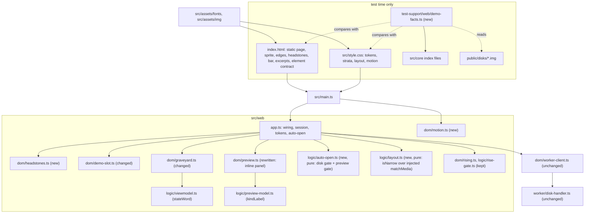
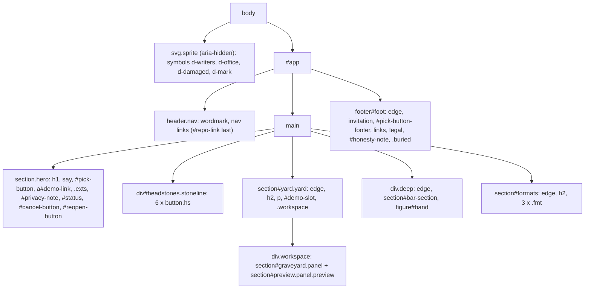

# Design Document

## Overview

This design turns the Spec 9 page into the approved mockup (`docs/design/redesign/mockup.html`) while keeping the CSP, the `textContent` rule, the worker protocol and every behaviour of the existing app. Scope is `index.html`, `src/style.css`, `src/web/` (and its tests), the web test helpers under `src/test-support/web/`, new static assets under `src/assets/`, and a short `README.md` update. Nothing in `src/core/`, `src/mcp/`, `power/`, `scripts/`, `src/demo-disks/`, `public/disks/` or the worker protocol changes. `package.json` is untouched.

What was read to ground the design:

- `docs/SPEC_BRIEFS.md` (Spec 11), `docs/design/redesign/README.md`, all of `mockup.html` (CSS, markup, both script blocks), the approved `requirements.md`, and the three steering files.
- `index.html` (element contract comment), `src/style.css` (880 lines), `src/main.ts`, `vite.config.ts`, `vitest.config.ts`, `vitest.dom.config.ts`, `package.json`.
- `src/web/app.ts`; `dom/` modules `preview.ts`, `graveyard.ts`, `demo-slot.ts`, `effects.ts`, `rising.ts`, `intake.ts`, `h.ts`, `blob-urls.ts`, `download.ts`, `status.ts`, `focus-trap.ts`, `preview-content.ts`; `logic/` modules `viewmodel.ts`, `session.ts`, `preview-model.ts`, `rise-gate.ts`, `requests.ts`, `protocol.ts`, `limits.ts`, `size.ts`, `text.ts`, `contrast.ts`; `demos.ts`, `worker/disk-handler.ts`, `worker-client.ts`.
- Tests and helpers: `page.static.test.ts`, `app.dom.test.ts`, `dist.build.test.ts`, `sources.scan.test.ts`, `keyboard.dom.test.ts`, `preview.dom.test.ts`, and the helpers `css-scan.ts`, `html-scan.ts`, `scan.ts`, `csp.ts`.
- `.kiro/specs/ui-polish/design.md` and `.kiro/specs/graveyard-ui` for the document style.

### What the test environment can and cannot verify

The repo has Vitest 3.2.4, fast-check 4.3.0 and happy-dom 21.0.4 and no real browser tool. happy-dom has no layout engine and only partial media-query support. So:

| Kind of claim | Automated check | Manual check |
|---|---|---|
| Markup, text, attributes, focus, `aria-*`, event flow | happy-dom DOM tests; `parseHtml` over `index.html` | none |
| CSS rules (values, selectors, `@media`, keyframes) | `parseCss` and new rule checks in `css-scan.ts` | none |
| Facts that come from the demo disks (headstones, bar figures, excerpts, logo) | pure tests that open the committed `public/disks/*.img` with `src/core` and compare with `index.html` and `style.css` | none |
| Rendered layout: wrap of six stones, no horizontal scroll, centred buried name, no flat band, clipping | **cannot be verified automatically**; only rule-level proxies | headless Chromium screenshots at 1440×900, 768×1024, 390×844 |
| Console errors and CSP violations at run time | **cannot be verified automatically** (the CSP meta is checked statically) | the same screenshot run, with the console and `securitypolicyviolation` events recorded |

Requirements 5.8, 6.5, 6.7, 11.6 and 13.5 describe rendered results. Each gets an automated rule proxy and a manual measurement. A passing proxy does not prove the rendered result.

### Decisions at a glance

| Topic | Decision |
|---|---|
| Page shell | `index.html` becomes static markup for the whole mockup: nav, hero, headstone row, yard, bar, band, formats, footer, SVG sprite and edges. All text that comes from our own demo disks is static markup, **verified by tests against the committed disks** (no runtime conversion, no extra fetch). |
| Styling | One `src/style.css`, rewritten. No inline style anywhere; widths of bar segments are literal `flex` values in CSS that a test compares with the Byte_Totals. |
| Fonts and images | Under `src/assets/fonts/` and `src/assets/img/`, referenced by `url()` in CSS and by root-relative `src` in `index.html`, bundled by Vite (`assetsInlineLimit: 0` already means no `data:` URLs). Only the two shipped faces; no italic file. |
| Inline preview | `dom/preview.ts` is rewritten as a panel mounted in `#preview`. No dialog, no `inert`, no focus trap, no Close button. `focus-trap.ts` and `logic/focus-order.ts` are deleted. |
| Effects | `#fx-host`, `dom/effects.ts`, `logic/effects-math.ts`, their tests, the `FX_*` limits and `checkFxLayers` are deleted. |
| Headstones | Six static `button`s in `index.html`, bound by a small `dom/headstones.ts`. A pure test helper checks them against the Writer_Disk report. |
| Auto_Open | Two quiet steps after start: (1) open the Writer_Disk through `runDemo` in quiet mode and the normal intake; (2) quietly preview `CHAPTER1.WS` (no rise animation, no focus move, no scroll, no `#status` text, row marked `aria-current`). Pure gates in `logic/auto-open.ts` decide, at the end of each step, whether the result may still be applied; any User_Open or other user action makes both gates false. Every User_Open clears the preview to its empty state. |
| Layout width | One pure helper `logic/layout.ts` (`isNarrow`) over an injected `matchMedia`-like function. `app.ts` receives it through its start options, so happy-dom tests use a test double. |
| Grain opacity | `--grain-opacity` is the highest of 0.22, 0.20, … 0.10 for which every text pair passes over the real grain; the test picks it and the CSS must equal it. Fallback below 0.10: grain moves into section backgrounds. |
| Logo scale | `LOGO.PCX` PNG shown at 7× above 760 px and 4× at or below, integer scales only, pixelated. |
| State words | `viewmodel.ts` gets one `stateWord(state)` ("Alive", "Recovered", "Partly back", "Lost"); Grave_Rows, Headstones and the bar use it. |
| Motion | Hero effects are pure CSS keyframes that only name their start state in `from`. Scroll entrances use a `.js` class set by `dom/motion.ts`, so no-JS shows everything. |
| Excerpts | Static markup compared with converter output by test (decided; no runtime conversion and no mirror line). |

## Architecture



The line between runtime and test time is the core of the design. At run time the page shows what the static markup says and what the worker reports for the disk the user opened. The static markup that describes the *demo* disks (six stones, four bar figures, three excerpts, one logo) is never computed in the browser. A test computes the same facts from the committed disks and fails when the markup or the CSS disagrees, as Requirements 5.7, 9.7 and 10.6 demand.

### Page structure (document order = visual order = Tab order)



## Components and Interfaces

### 1. `index.html` (Requirements 1, 2, 4, 5, 6, 7, 9, 10, 11, 13)

The CSP meta element stays byte for byte as it is (Requirement 1.1). A static test keeps the captured string and also runs `checkCsp`. The page has no `<style>`, no `style` attribute, no inline script and no `on*` attribute. The mockup's `style="position:absolute"` on the sprite and its `hs` positions move to CSS classes.

Sections, in order (ids are for the element contract and tests):

| Part | Content | Notes |
|---|---|---|
| `svg.sprite` | `<symbol>` for `d-writers` (blue 3.5"), `d-office` (red 5.25"), `d-damaged` (damaged, torn label), `d-mark` (nav disk mark) | `aria-hidden="true"`, `focusable="false"`; hidden by a CSS class (zero size, absolute). |
| `header.nav` | wordmark link `href="#app"`; `nav[aria-label="Page"]` with `Demo disks` → `#yard`, `How it works` → `#bar-section`, `Formats` → `#formats`, `GitHub` → `https://github.com/tsang326/exhume` with `id="repo-link"`, `aria-label="Exhume on GitHub"`, `rel="noopener noreferrer"` | 4.9, 4.10. Visible text "GitHub" is contained in the accessible name. |
| `section.hero` | one `h1#hero-heading`: `<span class="w">Dig up</span><span class="disk-glyph"></span><span class="w">lost files.</span>`; `p.say`; `button#pick-button.btn` "Open a disk image"; `a#demo-link` "or try a demo disk" → `#yard`; `small.exts` (the five extensions and "up to 2.88 MB"); `p#privacy-note`; `p#status`; hidden `#cancel-button`, `#reopen-button`; hidden `input#file-input` **without** `accept` | The accessible name of the `h1` is "Dig up lost files." because the image has `alt=""` (4.2). No `ul` in the hero (4.11). The extensions are listed, not enforced (2.8). |
| `div#headstones.stoneline` | `aria-label="Files on the writer's disk"`, `data-demo="writers-disk"`, six `button.hs` (see 3) | 5.6. |
| `section#yard` | top `svg.edge`; `h2#yard-heading` "No disk? Open one of ours."; `p` intro; `div#demo-slot` (the slot renders the cards into it); `p.demo-note` stating that the disks are generated by `scripts/make-demo-disks.ts` (7.3); `div.workspace` | The slot's group is labelled by `#yard-heading`. |
| `section#graveyard.panel` | filled by `dom/graveyard.ts` | `aria-label` "Graveyard" on the section (the view's own heading is inside). |
| `section#preview.panel.preview` | filled by `dom/preview.ts` | Empty state text in the panel from first render. |
| `div.deep` / `section#bar-section` | edge; `h2#bar-heading` "Deleted is not the same as gone."; `div#disk-bar.bar-track[role="img"][aria-label="…"]` with four `div.seg` (figure in `strong`); `div.clauses[aria-hidden="true"]` | 9.1–9.5. The segments inside a `role="img"` are presentational. |
| `figure#band` | `img` (`alt` non-empty, `loading="lazy"`, `width`/`height` set), `figcaption` with `h2` "From 8 to 3½ inches." and the FAT12 160 KB–2.88 MB line | 10.1 |
| `section#formats` | torn-paper edge; `h2` "Files from 1989, readable today."; three `.fmt` rows with `h3`, a proof block (`div.proof[tabindex="0"][role="region"][aria-label]`) and a caption naming disk and file | 10.2–10.8. The proof blocks scroll horizontally on narrow screens, so they are focusable regions. |
| `footer#foot` | edge; `h2` "Found an old disk in a drawer?"; `button#pick-button-footer.btn` "Open a disk image"; list of links; `p.legal` with the photo credit and the font credit; `p#honesty-note`; `div.bury` with `p.buried[aria-hidden]` and the soil edge | 11.x |
| `noscript` | one sentence: Exhume needs JavaScript to read a disk | Small addition, not required. |

**Element contract.** The comment in `index.html` is rewritten. It lists every id with its role, and records retired ids.

```
Retained: app, drop-zone, pick-button, file-input, status, cancel-button, reopen-button,
          demo-slot, graveyard, privacy-note, honesty-note, repo-link
Added:    yard (demo section + graveyard section), yard-heading, demo-link, headstones, preview,
          bar-section, bar-heading, disk-bar, band, formats, foot, pick-button-footer
Retired:  intro (replaced by the hero), fx-host (effects removed), preview-root (dialog removed)
```

`#drop-zone` stays as a retained id (Requirement 2.1). It becomes the `section.hero` itself (`aria-label="Drop a floppy image here"` is dropped from the visible design but kept as an accessible name), because the document-level drag and drop listeners already accept a drop anywhere (2.7), and `createIntake` only needs the element for its type. `.content` leaves the contract (it was a Spec 9 wrapper, not in the Retained_Ids); `page.static.test.ts` and `app.dom.test.ts` are updated.

**Tab order** (8.13) follows document order with no positive `tabindex`: nav anchors, `#pick-button`, `#demo-link`, `#cancel-button`/`#reopen-button` (when shown), six Headstones, six Demo_Cards (rendered in `#demo-slot`), Grave_Rows, Preview buttons and regions, footer button and links. A DOM test computes the tabbable list of the real `index.html` body plus a rendered graveyard and preview and checks the relative order of these groups.

### 2. `src/style.css` (Requirements 3, 5.3–5.4, 5.8, 6, 8.1, 8.5, 9, 12, 13)

The file is rewritten in this order, with the contrast-pair table and the layer notes at the top (replacing the Spec 9 header):

1. Pair table and tokens (`:root`): the mockup palette (`--bg #0b0f10`, `--surface #1b1915`, `--surface-2 #26231d`, `--soil1 #12110e`, `--soil2 #16130f`, `--soil3 #0e0c0a`, `--ink #e6e6e1`, `--muted #a9b3a6`, `--accent #ffbf5e`, `--accent-ink`, `--field #e4e4df`, `--field-ink #121514`, `--field-muted #4c524d`, `--ok #9ad49c`, `--part #e8b65a`, `--lost #ee8b72`, `--alive #d4cdb9`), the type scale (`--step-*`), spacing (`--m`), `--ease`, and the font stacks.
2. `@font-face` (two faces, `font-display: swap`) and base rules (`html` ground, `body`, `:focus-visible`, `[hidden]`).
3. Grain and strata (`.edge`, `.stratum`, `.yard`, `.deep`, `.foot`, `.soil`).
4. Nav, hero, `.disk-glyph`, buttons.
5. Headstone row.
6. Yard: demo cards, `.workspace`, panels, graveyard (`.graveyard-*`, `.grave*`), preview (`.preview-*`, `.paper`, `.csv-table`, `.hex-*`).
7. Disk bar, photo band, formats, footer.
8. Motion: keyframes, `.js` entrance rules.
9. `@media (max-width: 760px)` block (the single narrow breakpoint, matching the mockup).
10. `@media (prefers-reduced-motion: reduce)` block.

Class names that the DOM modules create with `h()` keep their Spec 9 names (`grave`, `grave-action`, `grave-art`, `grave-state`, `preview-*`, `csv-*`, `hex-*`, `graveyard-*`, `demo-slot-*`) so the existing test "styles every static class that the DOM modules create" keeps working; the rules are restyled to the mockup. New hook classes are added to that test's inputs only when a DOM module creates them.

**Typography (3.1, 3.2, 3.6, 3.8).**

```css
--sans:  'Hanken Grotesk', -apple-system, BlinkMacSystemFont, 'Segoe UI', Roboto, Arial, sans-serif;
--serif: 'Instrument Serif', 'Iowan Old Style', Georgia, serif;
--mono:  ui-monospace, 'SFMono-Regular', Menlo, Consolas, monospace;   /* used only by .preview-text and .hex-view */
```

`h1, h2, h3` and `.buried` use `--serif`; everything else inherits `--sans`. A static check parses every `font-family` declaration and requires: `--serif` only on `h1,h2,h3` selectors and `.buried`; `--mono` only on `.preview-text`, `.hex-view` and their descendants. The mockup's `h1 em` italic rule is **not** carried over, so no italic Instrument Serif file ships (3.3). `em` inside converted Markdown renders in Hanken Grotesk, which has no italic file in the variable font we ship, so the browser synthesises an oblique. That is acceptable for a preview and is noted under risks.

**Contrast pairs (3.7, 13.2).** Pairs are literal hex values `--pair-<id>-fg` / `--pair-<id>-bg` so `readPairs` and `checkPairs` read them. Ids ending `-ui` or `-large` need 3:1, all others 4.5:1. Ratios below were computed from the mockup values while writing this design:

| Pair id | fg on bg | Ratio | Where |
|---|---|---|---|
| `body` | `#e6e6e1` on `#0b0f10` | 15.4 | body text, nav |
| `body-soil` | `#e6e6e1` on `#12110e` | 15.1 | yard text |
| `body-surface` | `#e6e6e1` on `#1b1915` | 14.0 | panels |
| `body-surface2` | `#e6e6e1` on `#26231d` | 12.5 | current row, pressed card |
| `muted` / `muted-soil` / `muted-soil2` / `muted-soil3` / `muted-surface` / `muted-surface2` | `#a9b3a6` on `#0b0f10` / `#12110e` / `#16130f` / `#0e0c0a` / `#1b1915` / `#26231d` | 8.9 / 8.7 / 8.5 / 9.0 / 8.1 / 7.2 | secondary text |
| `accent` | `#ffbf5e` on `#0b0f10` | 11.8 | links, underline accents |
| `button` | `#0b0f10` on `#ffbf5e` (hover `#ffcd7f`: 13.1) | 11.8 | amber button |
| `field` / `field-proof` | `#121514` on `#e4e4df` / `#d5d6d0` | 14.4 / 12.6 | paper text |
| `field-muted` / `field-muted-proof` | `#4c524d` on `#e4e4df` / `#d5d6d0` | 6.3 / 5.5 | paper captions |
| `field-cut` | `#9a3b2c` on `#e4e4df` | 5.4 | the "content stops here" note |
| `field-accent` | `#8a4b12` on `#e4e4df` / `#d5d6d0` | 5.3 / 4.6 | heading accent on paper |
| `state-ok-soil`, `state-part-soil`, `state-lost-soil`, `state-alive-soil` | `#9ad49c`, `#e8b65a`, `#ee8b72`, `#d4cdb9` on `#12110e` | 11.0 / 10.1 / 7.7 / 11.9 | state words in rows |
| `state-*-surface2` | same colours on `#26231d` | 9.2 / 8.4 / 6.4 / 9.9 | state words on the current row |
| `state-part-warn` | `#e8b65a` on `#2a1f12` | 8.7 | warnings banner |
| `hs-alive` | `#1a1814` on `#8d877a` | 5.0 | Headstone label, alive |
| `hs-recovered` | `#10200f` on `#9ad49c` | 9.9 | Headstone label, recovered |
| `hs-partial`, `hs-lost` (text) | `#e8b65a` on `#12110e`, `#a08a7e` on `#12110e` | 10.1 / 5.8 | dashed stones; labels sit on soil |
| `seg-*` | `#121514` on `#d4cdb9`, `#9ad49c`, `#e8b65a`, `#ee8b72` | 11.6 / 10.7 / 9.9 / 7.5 | bar segments |
| `focus-ui-ground`, `focus-ui-panel` | `#ffbf5e`-family on `#0b0f10`, `#1b1915` | 11.8 / 10.8 | focus rings on dark |
| `focus-ui-field` | `#8a4b12` on `#e4e4df` | 5.3 | focus ring on the paper field |
| `border-ui` (save button) | value chosen at implementation, ≥ 3:1 on `#1b1915` (for example `#8a8274`: 4.6) | – | download buttons |
| `hs-lost-border-ui` | `#a08a7e` on `#12110e` (5.8) | – | dashed outline of a lost stone |
| `buried-ui` | `#6b6355` on `#0e0c0a` | 3.3 | decorative, `aria-hidden`; declared so the check covers it |

Two mockup values fail and are changed here: the lost-stone border `#6e5a50` is 2.9:1 on soil (3:1 needed), and the mockup's amber focus outline on the paper field is 1.3:1 (so `.paper`, `.proof` and `.formats` regions use the dark `focus-ui-field` outline). The test also checks that each pair id used in the table above is declared, so a pair cannot be dropped without the check failing.

**Strata and grain (6.1–6.5).** `.edge` is an inline `svg` with `fill="currentColor"` (color set in CSS per section) and `preserveAspectRatio="none"`; pebbles are `ellipse` shapes with a flat `fill` attribute. There is no `linearGradient`, `radialGradient`, `filter`, `box-shadow`, `text-shadow`, `drop-shadow(` or `blur(` anywhere in CSS or the markup (static check). The Spec 9 `body::before` radial glows are removed.

The grain is a fixed full-viewport layer `body::after { position: fixed; inset: 0; background: url('./assets/img/grain.png'); pointer-events: none; opacity: var(--grain-opacity); z-index: 60 }` as in the mockup. Because it sits above text, a helper decodes `grain.png` once in the test (`node:zlib`, 8-bit non-interlaced PNG only, about 50 lines in `src/test-support/web/png-read.ts`) to find the brightest and darkest effective layer (`pixel alpha × opacity`) and runs the existing `overTextContrast` over every text pair with those layers.

**How the shipped opacity is determined (6.8).** The opacity is not chosen by hand. The test `grain-opacity.test.ts` (pure config) tries whole-percent steps 22, 20, 18, 16, 14, 12, 10 (integers, divided by 100 only at the end, so there is no float drift) and picks the highest step for which every text Contrast_Pair passes over the real texture. The CSS declares the result once, as `--grain-opacity: 0.NN` in `:root`, and the test fails unless that declaration equals the picked value. Nothing else in the CSS may hard-code the grain opacity. If no step from 0.22 to 0.10 passes, the fallback applies: `body::after` is not defined, the strata sections (`.yard`, `.deep`, `#formats`, `footer`) carry the grain as their own `background-image` under the text, `--grain-opacity` is absent, and the test asserts exactly that. The mockup's 0.22 is expected to fail for some pairs, so the likely outcome is a lower step.

*Recording the result for the owner.* The test prints one line when run with `EXHUME_REPORT=1`: `grain-opacity: 0.NN` or `grain-opacity: fallback-section-backgrounds`, plus the worst pair and its ratio at that step. The implementation task copies this line into the log text (`docs/KIRO_LOG.md` or the commit message) so the owner can report it. 6.4 asks for Decorative_Layers not to sit above text; the overlay is the one layer that does, which is why 6.8 requires the measurement and the fallback.

`html` keeps the solid ground colour; every top-level section (`.yard`, `.deep`, `#formats`, `footer`) has an opaque background; `body` has no fixed height. `checkBackground` is replaced by `checkStrata(css, html)`: `html` ground set, each stratum selector has an opaque background, edges and `.soil` have `pointer-events: none`, no forbidden constructs, grain rule present. Rendered coverage at the three sizes is a manual check.

**Decorative layers (6.4).** The list is explicit in the check: `.edge`, `.soil`, `.sprite`, `.buried`, `.clauses`, `body::after`, `.rise-ghost`. Each has `pointer-events: none` in CSS (or, for `svg` and `p` elements, `aria-hidden="true"` in the markup, which the markup test verifies). No content container (`.stoneline`, `.hs`, `.panel`) has `pointer-events: none` (12.5); the mockup's `pointer-events: none` on `.stoneline` is dropped because the row now sits in normal flow.

**Layout.**

- Hero and ground line: `.stoneline` is in normal flow after the hero, `z-index: 1`. The yard's top `.edge` is `position: absolute; top: -63px; z-index: 2`, so the soil covers the lower part of the stones ("ground line") and nothing needs the mockup's `margin-top: 300px` and absolute `left: N%` positions.
- Workspace: `display: grid; grid-template-columns: minmax(0, 5fr) minmax(0, 7fr); gap: 8px` above 760 px; one column below, preview after the list (8.1). `.preview` is `position: sticky; top: 24px` on wide screens and `static` on narrow.
- Narrow block (`max-width: 760px`): hero headline 17vw, `.hero-foot` single column, nav hides every anchor except `#repo-link` (`.nav .links a:not(#repo-link) { display: none }`, 13.6), cards single column, bar becomes a column of blocks with captions inside the blocks, formats stack, footer stacks, `.buried` 33.5vw, logo image at 4× (see next bullet).
- Logo scale (10.5): `.proof--pcx img { width: 448px; image-rendering: pixelated }` (64 px × 7) outside the narrow block and `width: 256px` (64 px × 4) inside it. A static check requires both widths to be integer multiples of the `img` `width` attribute (64) and `image-rendering: pixelated` to be set; at 390 px the 256 px image fits the content box, so no horizontal scroll. The `@media (max-width: 760px)` string is the same one `NARROW_QUERY` uses (see section 5).
- Hit areas: buttons, cards, rows, stones and the nav links have `min-height: 40px` (13.4); a CSS check lists them.

**Headstone row (5.3, 5.4, 5.8).** Replaces absolute positioning with a wrapping flex row so six stones can wrap:

```css
.stoneline { display: flex; flex-wrap: wrap; justify-content: center; align-items: flex-end;
             gap: 0 clamp(8px, 2vw, 32px); padding: 0 var(--m); position: relative; z-index: 1; }
.hs { width: var(--w); height: var(--h); transform: translateY(var(--sink)) rotate(var(--tilt));
      border-radius: 999px 999px 4px 4px; }
.stone-0 { --w: 128px; --h: 176px; --sink: 46px; --tilt: -1.5deg; }  /* … one rule per stone */
.hs--partial { background: transparent; border: 2px dashed var(--part); }   /* dashed + sunk (--sink larger) */
.hs--recovered { animation: raise 1.6s .7s var(--ease) 1 both; }            /* once, 'from' only */
@media (max-width: 760px) { .hs { --w: 26vw; --h: 34vw; } }                  /* three per row, two rows */
```

Tilt and sink are transforms, so they do not change the wrapped layout. The loss compared with the mockup is its hand-scattered horizontal spacing; the per-stone height, tilt and sink variety stays. No rule sets `display: none` on any `.hs` in any media block (5.8), which a static check enforces.

**Motion (12.x).** All keyframes and transitions use only `opacity`, `transform` and `clip-path`. A static check walks every `animation*`/`transition*` declaration and every `@keyframes` body and rejects other properties (this removes the mockup's `transition: background` on `.btn`, `.hs` and `.grave`; hover feedback becomes a colour change without a transition). Start states:

- Hero words, shutter, recovered stone: the hidden state exists only in `from { … }` of the keyframes with `animation-fill-mode: both`. With animation disabled or unsupported, the element is simply visible.
- Scroll entrances and bar fill: the hidden state is under `.js` only, for example `.js .rise:not(.in) { opacity: 0; transform: translateY(24px) }` and `.js .bar-track:not(.in) .seg { transform: scaleX(.001) }`. `dom/motion.ts` adds `js` to `<html>`. If the module never runs, nothing is hidden (12.3). A static check requires that any rule outside keyframes that sets `opacity: 0` or a scale-down transform has `.js` in its selector.
- Staggered delays use `:nth-child` rules, not inline `transition-delay`.
- The reduced-motion block sets `animation: none !important; transition: none !important` for all elements, `clip-path: none` on `.disk-glyph`, and makes `.js .rise` and `.js .bar-track .seg` fully visible (12.2). `checkReducedMotion` (existing) still applies.
- Preview change fade: the panel body is a new element on each `show`, with `animation: fade .32s var(--ease) both` (`opacity`, `transform`), so the animation restarts without scripting.

**Disk bar (9.2).** Segment widths are literal CSS: `.seg--alive { flex: 10600 }`, `.seg--recovered { flex: 3468 }`, `.seg--partial { flex: 2048 }`, `.seg--lost { flex: 1024 }`, **without** the mockup's `min-width: 12%` (which would break proportionality). A segment shows only its figure ("1 KB"); the words come from the caption row on wide screens and from an `em` line inside the block on narrow ones, so a 6 % segment never has to hold text. On narrow screens the bar is a column of blocks with fixed heights (as in the mockup) and the proportional-width rule applies to wide screens only; the test states this.

### 3. Headstones (`index.html`, `dom/headstones.ts`) (Requirement 5)

A Headstone activation always ends with focus on the Preview_Panel heading and the panel scrolled into view, at any width (5.5, 7.6, 8.19). `dom/headstones.ts` itself only reports the click; the focus and scroll work is in `app.ts` (section 8).

Markup (generated once from the Demo_Report and then maintained by hand under test):

```html
<button type="button" class="hs hs--recovered stone-1" data-path="/_RAFT1.WS">
  <span class="sn">_RAFT1.WS</span><span class="st">Recovered</span>
</button>
```

`data-path` is the report path (`/CHAPTER1.WS`, `/_RAFT1.WS`, `/CHAPTER2.WS`, `/_RAFT2.WS`, `/CHAPTER3.WS`, `/README.TXT`). The visible name is the last path segment as `toLabel` shows it; the label is `stateWord(state)`; the class is `hs--<state>`.

```ts
// dom/headstones.ts
export function bindHeadstones(root: HTMLElement | null, onOpen: (path: string) => void): void
```

It finds `button.hs[data-path]` inside `root` and calls `onOpen(path)` on click. It reads nothing from the disk. A missing root is a no-op.

Verification helper in `src/test-support/web/demo-facts.ts`:

```ts
export function checkHeadstones(html: HtmlDocument, report: DiskReport): string[]
```

It returns problems (count not six, order, name, state word, class, `data-path`). The Demo_Report comes from `openDisk(readFileSync('public/disks/writers-disk.img'))` through the two allowed core index files. Property 2 below runs the checker over the real report (must return `[]`) and over mutated reports (must return a non-empty list), which is how Requirement 5.7 is tested.

### 4. State words (`logic/viewmodel.ts`) (Requirements 5.2, 8.3, 8.5, 9.4)

```ts
export const STATE_WORDS: Record<GraveState, string> = {
  alive: 'Alive', recovered: 'Recovered', partial: 'Partly back', lost: 'Lost',
};
export function stateWord(state: GraveState): string
```

`ItemViewModel.stateLabel` becomes `stateWord(g.state)` (it was the raw state). `state` and `visual` are unchanged, so CSS classes (`grave--partial`) and logic that branches on `state` do not change. Decided: `stateWord()` is the only source of state text on every surface (Grave_Row, Headstone label, Disk_Bar captions). The existing tests whose expectations change, found by searching `src/web/`:

| Test | Current expectation | New expectation |
|---|---|---|
| `logic/viewmodel.test.ts` (item property, `it.stateLabel === g.state`) | label equals the raw state | `it.stateLabel === stateWord(g.state)`; plus a table test of the four words |
| `dom/graveyard.dom.test.ts` (rows example, lines checking `.grave-state` text `'alive'`, `'recovered'`, `'partial'`) | raw lowercase state | `'Alive'`, `'Recovered'`, `'Partly back'` |
| `dom/graveyard.dom.test.ts` (hostile-state property, `stateText !== vm.stateLabel \|\| stateText !== vm.state`) | text equals both label and raw state | text equals `vm.stateLabel` and `vm.stateLabel === stateWord(vm.state)`; the `=== vm.state` clause is dropped; the `grave--<state>` class check stays on the raw state |
| `logic/preview-model.test.ts` (item fixture, `stateLabel: r.state`) | fixture copies the raw state | fixture uses `stateWord(r.state)` so the type `StateWord` holds |
| `page.static.test.ts` (`.grave--<state> .grave-state::before` glyph rule) | glyph per state in CSS | unchanged in meaning; the restyled CSS keeps one distinct glyph per non-alive state (8.5) |
| `app.dom.test.ts`, `dom/keyboard.dom.test.ts` | any assertion on state text or on a row's accessible name | found by `grep` for the raw words at implementation time and moved to the State_Word; none was found by the search above |

The state word is also checked in the new headstone and bar tests (Properties 2, 3 and 8), so no surface can drift from the function.

### 5. Demo slot and auto-open (Requirement 7)

**`dom/demo-slot.ts`** keeps `selectValidDemos`, `runDemo`, the `aria-pressed` handling and the per-slot status line. Changes:

- The slot no longer renders a heading. Its group is labelled by the page's `#yard-heading`: `createDemoSlot(onBytes, registry, load, options)` with `options = { labelledBy?: string; onIntent?: () => void }`.
- Each card is `button.demo-slot-button` with `aria-pressed`, containing `span.demo-art[aria-hidden]` with an SVG `use`, `strong.demo-slot-title`, `span.demo-slot-description`. The SVG is built by a new `dom/svg-art.ts`:

```ts
export function demoArt(id: string): SVGSVGElement | null   // createElementNS; href is '#d-…' from a fixed map
const DEMO_ART: Readonly<Record<string, string>> = {
  'writers-disk': 'd-writers', 'office-disk': 'd-office', 'damaged-disk': 'd-damaged',
};
```

An unknown id gives `null` and the card has no art. `h()` stays free of `svg`, and the symbol id is never taken from untrusted text (registry ids are fixed and validated by `demo-validate`).
- `DemoSlot` gains `openDemo(id: string, opts?: { quiet?: boolean; accept?: () => boolean }): Promise<boolean>` (runs the same `runDemo` path as a click and reports whether bytes were handed on) and `has(id): boolean`. `onIntent` fires synchronously on a card click before the load starts.
- `DemoRunDeps` gains `quiet?: boolean` (no busy state, no loading text; a failure still goes to the slot's status) and `accept?: () => boolean` (checked after the load and before `onBytes`; false drops the result).
- `DEMO_REGISTRY` descriptions in `demos.ts` are shortened to the mockup's one-liners ("Novel chapters, two deleted drafts" and so on); `demos.registry.test.ts` is updated. Titles, ids and urls do not change. Decided: the shortened descriptions ship.

**`logic/layout.ts`** (pure, no DOM), so the wide/narrow behaviour of 8.17 and 8.18 is testable in happy-dom, which has no layout engine:

```ts
export const NARROW_QUERY = '(max-width: 760px)';              // same string as the CSS narrow block
export type MatchMediaLike = (query: string) => { matches: boolean };
export function isNarrow(mm: MatchMediaLike | undefined): boolean   // false when mm is missing or throws
```

`startApp(options)` gains `options.matchMedia?: MatchMediaLike` (default: `window.matchMedia` bound to `window`, when present). Both `isNarrow` and the existing `prefersReducedMotion` read it, so a test double (`(q) => ({ matches: q === NARROW_QUERY && narrow })`) switches the layout per test with no resize. A static test checks that `NARROW_QUERY`'s width equals the `max-width` of the CSS narrow block.

**`logic/auto-open.ts`** (pure, no DOM). The Auto_Open has two steps, and each has its own gate, so the user always wins (7.8, 8.14):

```ts
export interface AutoOpenInput {            // step 1: may the quietly loaded Writer_Disk be applied?
  phase: SessionPhase; intentSeen: boolean; tokenAtStart: number; tokenNow: number;   // tokens = openToken
}
export function mayApplyAutoOpen(i: AutoOpenInput): boolean {
  return i.phase === 'empty' && !i.intentSeen && i.tokenNow === i.tokenAtStart;
}

export interface AutoPreviewInput {         // step 2: may the quiet CHAPTER1.WS preview be applied?
  phase: SessionPhase; intentSeen: boolean;
  shownDiskIsAuto: boolean;                 // the displayed disk is the one step 1 applied (its openToken is unchanged)
  exhumeTokenAtStart: number; exhumeTokenNow: number;
}
export function mayApplyAutoPreview(i: AutoPreviewInput): boolean {
  return i.phase === 'open' && i.shownDiskIsAuto && !i.intentSeen && i.exhumeTokenNow === i.exhumeTokenAtStart;
}
```

**In `app.ts`:** `intentSeen` becomes true on a click of `#pick-button`, `#pick-button-footer`, a Demo_Card (`onIntent`), a Headstone or a Grave_Row (and its Show more button), on `change` of `#file-input`, and on `drop` at the document. It is not set by keys, focus, scrolling or Tab, so a user who only tabs around does not cancel the Auto_Open. `intentSeen` never goes back to false. At the end of `startApp`, after `refreshControls()`:

```ts
const tokenAtStart = openToken;
// step 1: quiet load of the Writer_Disk
void slot.openDemo('writers-disk', {
  quiet: true,
  accept: () => mayApplyAutoOpen({ phase: session.phase, intentSeen, tokenAtStart, tokenNow: openToken }),
});
```

*Step 1, disk.* The result goes through `intake.intakeBytes` and `openBytes(bytes, { source: 'writers-disk', quiet: true, autoPreview: 'CHAPTER1.WS' })`. `quiet` means: no `reveal` (no focus move, no scroll), and `status.clear()` instead of "Opened a disk with N entries" so a screen reader is not interrupted at page load (7.5). Pressed state is set as for any demo (7.4). If the load fails, `runDemo` writes the failure to the slot's status and `#status` (7.7), and the cards stay usable.

*Step 2, preview.* Right after `graveyard.show(...)` in the same `ok` branch, `app.ts` records `autoOpenToken = openToken` and `exhumeTokenAtStart = exhumeToken`, finds the item whose report path is `/CHAPTER1.WS`, and calls `previewQuiet(item)`. `previewQuiet` is the normal exhume request without the rise animation, the busy state, the Cancel button, the status text and any focus or scroll call. When the worker answers it checks `mayApplyAutoPreview({ phase: session.phase, intentSeen, shownDiskIsAuto: openToken === autoOpenToken, exhumeTokenAtStart, exhumeTokenNow: exhumeToken })`; only if true does it call `preview.show(buildPreviewModel(item, outcome))` and `graveyard.setCurrent(item.id)`. It makes no `status.set` call, no `focus` call and no `scrollIntoView` call (7.5, 8.8). If the item is missing, the worker answer is an error, or the gate is false, the preview simply stays in its empty state; no message is shown, because the visitor did not ask for the file.

*Why the user always wins (7.8, 8.14).* Every user action sets `intentSeen`, and `abandonRise()` (called by every user exhume and every open) increments `exhumeToken` and `openToken` changes on every open. A user action before step 1 settles makes `accept()` false, so the disk is dropped. A user action between step 1 and the end of step 2 makes `mayApplyAutoPreview` false (by intent, by `exhumeToken` or because the shown disk is no longer the auto one), so the preview is dropped, and the user's own result is shown. A User_Open that starts *after* both steps replaces the disk through the normal `openToken` guard and **clears the preview to its empty state** (see section 7, "Disk change"); the automatic preview is not an exception.

### 6. Graveyard (`dom/graveyard.ts`) (Requirement 8.2–8.5, 8.7, 13.8)

The module keeps its structure (guidance, heading, stats, message, warnings, list, Show more) and these changes:

- The heading is an `h3#graveyard-heading` (heading order h1 → h2 "No disk?…" → h3) whose text is the volume label (for example "WRITER DEMO"); `aria-describedby` still points to the summary ("6 files, 0 directories, 2 deleted"). The summary text is built from `summarize` plus a deleted count (`state !== 'alive'` over files), computed in `summarize()` as a new `deletedCount` field.
- Warnings render as an always visible banner (`div.graveyard-warnings[role="group"][aria-label="Warnings"]` with a `p` "Warnings (n)" and a `ul`), replacing the collapsed `details`.
- Each row keeps the `h()` structure (art, name, hint, path, meta, state, reason, marker). `.grave-state` text is `stateWord`. Directory and lost rows stay non-interactive `div`s.
- New API:

```ts
setCurrent(id: number | null): void   // aria-current="true" on the matching row's button, removed from all others
```

`aria-current` is set on the interactive element (`button.grave-action`). The `h()` allow-list gains `aria-current` and `aria-pressed` (the slot currently uses `setAttribute` directly); it loses `aria-modal` and `inert`, which nothing uses any more (8.12). `h.test.ts` is updated.
- `reveal(reducedMotion)` is unchanged (focus the heading with `preventScroll`, then `scrollIntoView` with `instant`/`smooth`, `block: 'start'`). The heading has `scroll-margin-top` in CSS.
- `show()` clears the current marker (a new disk has no open file).
- Activation callback: the view's `onActivate(item)` is called for a click or key press on a row button. `app.ts` sets `intentSeen` first, then starts the exhume with `origin: 'row'`. The view itself never moves focus on activation, so on a wide layout focus stays on the row button (8.17). `setCurrent` only sets an attribute.
- The view exposes `rowButton(id): HTMLButtonElement | null` for tests and for the Headstone path to find the row of a path.

### 7. Inline preview (`dom/preview.ts`, `logic/preview-model.ts`) (Requirement 8.6–8.16)

The dialog module is replaced. Same file name, new contract:

```ts
export interface PreviewPanel {
  show(model: PreviewModel): void;   // replace content; revoke previous Blob URLs; no focus change
  clear(): void;                     // empty state; revoke Blob URLs
  isShowing(): boolean;
  focusHeading(): void;              // heading.focus({ preventScroll: true })
  reveal(reducedMotion: boolean): void; // focusHeading(), then heading.scrollIntoView({ behavior: instant|smooth, block: 'start' })
  headingElement(): HTMLElement;
}
// show() and clear() never move focus and never scroll: the Auto_Open relies on that (7.5).
// Only app.ts decides, per origin and layout, whether to call focusHeading() / reveal().
export interface PreviewDeps { blobs: BlobUrlManager; downloader: Downloader }
export function createPreviewPanel(root: HTMLElement, deps: PreviewDeps): PreviewPanel
```

Layout inside `#preview` (all built with `h()` and Text nodes):

```
div.preview-top
  div: h3#preview-title[tabindex=-1]   p.preview-kind
  div.preview-actions: button.preview-download (converted)  button.preview-download (raw)
p.preview-partial | p.preview-error[role=alert] | ul.preview-warnings
div.paper > (body from buildBody: markdown | text | csv | png | hex)
p.preview-status[role=alert]          // download failure text
```

The empty state is `h3` "Preview" plus `p.preview-empty` "Choose a file to read it here." and no buttons. `buildBody` and `buildDownload` move over from the dialog code unchanged, so the markdown, text, csv, png and hex rendering, the shortened notes (8.16), the sanitized alt text and the fixed MIME types stay as they are. The body sits in `div.paper` (Paper_Field); `.paper` and each scroll region keep `tabindex="0"` and a label. PNG gets `image-rendering: pixelated` in CSS (8.9). The partial/lost note is `p.preview-partial` placed above the content and a `.cut` line after it for `partial` items (8.10): the cut line is a static sentence ("The rest of this file was overwritten. Exhume stops here instead of guessing.") built from `model.partialNote !== null`.

`PreviewModel` gains `kindLabel: string`, computed by `buildPreviewModel`: markdown → "Read as Markdown", csv → "Read as CSV", text → "Plain text", png → "Read as PNG", hex → "Raw bytes", none → "Nothing to read"; for a `partial` item ", partly" is appended. It is pure and tested.

**State and lifecycle.** The panel owns one record `{ urls: string[] } | null`. `show` revokes the previous record's URLs, builds the new content, then stores the new record. `clear` revokes and renders the empty state. `blobs.revokeAll()` in `openBytes` remains the safety net. A PNG preview creates exactly one Blob URL; every other body creates none. Downloads create their own short-lived URLs through the downloader (revoked after `DOWNLOAD_REVOKE_MS`).

**What `app.ts` does around it.**

```mermaid
sequenceDiagram
  participant U as User
  participant A as app.ts
  participant W as worker client
  participant P as preview panel
  participant G as graveyard view
  Note over A: on load, Auto_Open step 2 (no user involved)
  A->>W: exhume(CHAPTER1.WS), quiet
  W-->>A: settled
  A->>A: mayApplyAutoPreview(...)? false: drop, nothing shown
  A->>P: show(model)  (true only)
  A->>G: setCurrent(item.id)
  Note over A: no status, no focus, no scroll
  Note over U,G: user flow
  U->>A: activate Grave_Row or Headstone
  A->>A: intentSeen = true; abandonRise(); token = ++exhumeToken
  A->>G: playRise on row (ghost) / status "Rising: name"
  A->>W: exhume(graveId)
  W-->>A: settled (ok | failed | lost | superseded)
  A->>A: stepRise gate (animation end + result)
  A->>P: show(buildPreviewModel(item, outcome))
  A->>G: setCurrent(item.id)
  A->>A: status "Opened name." (ok / read-failed) or error text
  alt origin = Headstone (any width)
    A->>P: reveal(reduced): focus heading + scroll into view
  else origin = Grave_Row and isNarrow(matchMedia)
    A->>P: reveal(reduced): focus heading + scroll into view
  else origin = Grave_Row and wide
    Note over G: focus stays on the row button
  end
```

Rules:

- **Stale requests.** The existing guards stay: `exhumeToken` is incremented by `abandonRise()` on every new exhume and every open; `applyGate` and the settled handler return when `token !== exhumeToken`; the worker client resolves superseded requests as `superseded`; `openToken` guards opens. So a preview for file *X* of disk *A* can only appear if its token is still the latest and no newer open has started (8.14, Property 5).
- **Disk change (8.14).** In the `ok` branch of `openBytes` (after the guards), for every open whether started by the Open_Button, the footer button, a drop, the chooser, a Demo_Card, a Headstone, Reopen or the Auto_Open itself: `preview.clear()`, `graveyard.setCurrent(null)` (done by `show`), `blobs.revokeAll()`, then `graveyard.show(...)`. So the Preview_Panel is in its empty state right after any open, and a preview only appears afterwards if (a) the Headstone path activates its file, or (b) the Auto_Open step 2 is still allowed. A User_Open that follows the Auto_Open therefore always clears the automatic preview. A failed open leaves the old disk and its preview untouched. The old code's `previewWasOpen` special case disappears: with no dialog, `reveal` always runs on a user open (7.6).
- **Focus, scroll and announcement on show, by origin.** `activate(item, origin)` with `origin` in `'row' | 'headstone'` (the quiet Auto_Open preview is a separate path and does none of this). After `preview.show` and `graveyard.setCurrent(item.id)`:
  - `status.set('Opened ' + name + '.')` for `ok` and `read-failed` outcomes, where `name` is the name as the row shows it (for `lost-disk` the lost message set by `markLost` stays, as today) (8.8, 8.17, 8.18).
  - `origin === 'headstone'`: `preview.reveal(reduced)` at every width, so focus ends on the preview heading (7.6, 8.19).
  - `origin === 'row'` and `isNarrow(matchMedia)`: `preview.reveal(reduced)` (8.18).
  - `origin === 'row'` and wide: nothing; focus stays on the row button (8.17).
  Under Reduced_Motion the scroll behaviour is `instant`, otherwise `smooth`. The width test is the injected `isNarrow` from section 5, evaluated when the preview is shown (not when the click happens), so a resize between click and result uses the current layout.
- **No file selected by default.** A disk that a user opens starts with the empty preview. The only automatic selection is the quiet `CHAPTER1.WS` preview of the Auto_Open (section 5); it never moves focus and is dropped if the user acts first.
- **No dialog code.** `inert`, `background`, `fallbackFocus`, opener bookkeeping and Escape handling leave `app.ts`.

### 8. `app.ts` changes (Requirements 2, 5.5, 6.6, 7, 8, 11.1)

- Remove: `createEffects`, `fxHost`, `effectsStarted`, `background` / `appEl` inert plumbing, the `opener` field of the rise record.
- Add lookups: `#preview`, `#headstones`, `#pick-button-footer`. Missing ones are pushed to `missing` and replaced with detached elements as the existing code does for `#graveyard`.
- `startApp(options)` takes `options.matchMedia` (see section 5) for both `isNarrow` and the reduced-motion check; `main.ts` passes nothing and gets `window.matchMedia`.
- `openBytes(bytes, opts)`: consumes a small `pending` record set synchronously around the intake call by the demo or headstone paths: `{ source: string | null; quiet: boolean; after: string | null; autoPreview: string | null }`. `after` is a report path for a Headstone; `autoPreview` is the report-relative name for Auto_Open step 2 (only the Auto_Open sets it). After a successful open (and the clear described in section 7): `openSource = source`; if `autoPreview !== null`, run `previewQuiet` (section 5); if `after !== null`, find the grave with that path in `report.files`, find its item in `items`, `graveyard.reveal(reduced)` (focus the graveyard heading and scroll, 7.6) and then `activate(item, 'headstone')`, which ends with `preview.reveal(reduced)` so focus finishes on the preview heading. If the path is not found, the disk is still shown and a status line says the file was not found. `Reopen disk` passes `source: openSource` so the pressed card is kept.
- Headstone handler `onHeadstone(path)`: set `intentSeen`. If `session.phase === 'open' && openSource === 'writers-disk'`, find the item and call `graveyard.reveal(reduced)` then `activate(item, 'headstone')`. Otherwise set `pending.after = path` and `await slot.openDemo('writers-disk')`; if it returns false, clear `pending.after`, so a failed load cannot leak into a later open. In both cases the final focus is on the preview heading at any width (8.19).
- Grave_Row handler: `graveyard`'s `onActivate(item)` sets `intentSeen`, then calls `activate(item, 'row')`.
- The only code that sets `intentSeen` is: Open_Button and footer button clicks, `#file-input` `change`, document `drop`, `onIntent` of a Demo_Card, the Headstone handler and the Grave_Row handler. The module-private `intentSeen` is read by the two Auto_Open gates only.
- Footer button: `pickFooter.addEventListener('click', () => input.click())`. The intake listens on `#pick-button` only; both buttons end in the same `change` handler.
- Intake status: `createIntake` receives a wrapper `StatusRegion` whose `set` also calls `statusEl.scrollIntoView({ block: 'nearest' })` (instant under reduced motion). Intake only writes failures and the "several files" notice, so a failed open from the footer button is visible. Other status writes use the plain region, so progress text never drags the page upward.
- `#status` sits in the hero next to the Open button; the slot has its own status line next to the cards for demo load failures.

### 9. `dom/motion.ts` (new) (Requirements 6.6, 9.6, 12)

```ts
export interface MotionEnv {
  doc: Document;
  reduced: boolean;
  observerCtor: typeof IntersectionObserver | undefined;
}
export function initMotion(env: MotionEnv): void
```

It adds `js` to `doc.documentElement`, selects `.rise` and `.bar-track`, and either adds `in` to all of them at once (reduced motion, or no `IntersectionObserver`) or observes them (threshold 0.2) and adds `in` once on first intersection, then unobserves. It uses `classList` only: no style API (the source scan forbids `.style.`). `main.ts` calls `initMotion` in a `try` so a failure cannot stop `startApp`. Order in `main.ts`: `initMotion` first, then `startApp()`.

### 10. Assets and Vite (Requirements 3.3, 3.4, 10.5, 10.9, 1.3–1.4)

```
src/assets/fonts/hanken-grotesk-latin-wght-normal.woff2
src/assets/fonts/instrument-serif-latin-400-normal.woff2
src/assets/fonts/OFL-hanken-grotesk.txt
src/assets/fonts/OFL-instrument-serif.txt
src/assets/img/disk35.jpg
src/assets/img/disks-band.jpg
src/assets/img/grain.png
src/assets/img/logo-pcx.png        (regenerated from the converter, see 12)
```

The italic Instrument Serif file is **not** copied. Nothing is placed under `public/fonts/`. CSS references use relative `url('./assets/fonts/…')` (inside `src/style.css`, so Vite resolves them); `index.html` uses root-relative `/src/assets/img/…` for `img src`, which Vite rewrites to hashed `dist/assets/…` files. `vite.config.ts` needs no change: `assetsInlineLimit: 0` already stops `data:` inlining, and `dist.build.test.ts` already scans emitted CSS and JS for `data:`. I did not add `<link rel="preload">` for the fonts: I have not confirmed that Vite rewrites a preload `href` to the hashed path, and `font-display: swap` plus the system fallback stacks cover the first paint (decided: no preload).

The existing `checkUrls` runs on the new CSS. `dist.build.test.ts` gains: every `img src` in `dist/index.html` resolves to a file in `dist/`; no `/src/` path remains; exactly two `.woff2` files are emitted; `dist/assets` holds `grain`, `disk35`, `disks-band`, `logo-pcx`.

### 11. Disk bar and demo facts (Requirements 9, 10)

`src/test-support/web/demo-facts.ts` (test-only, imports only the two core index files) exports:

```ts
export interface ByteTotals { alive: number; recovered: number; partlyBack: number; lost: number }
export function byteTotals(report: DiskReport, readLength: (g: Grave) => number): ByteTotals
export function loadDemo(id: 'writers-disk' | 'office-disk' | 'damaged-disk'): { handle: DiskHandle; report: DiskReport }
export function demoByteTotals(): ByteTotals            // uses handle.readBytes(g).bytes.length for partial files
export function checkBar(html: HtmlDocument, css: string, totals: ByteTotals): string[]
export function checkExcerpts(html: HtmlDocument, disks: {...}): string[]
export function checkHeadstones(html: HtmlDocument, report: DiskReport): string[]
```

`byteTotals` implements the Glossary definition exactly: alive = Σ declared sizes of alive files; recovered = Σ declared sizes of recovered files; partlyBack = Σ over partial files of `readLength(g)`; lost = Σ over partial files of `size − readLength(g)` plus Σ declared sizes of lost files. Directories are excluded. `checkBar` compares: the `aria-label` text, the four `strong` figures (through `formatBytes`), the four `flex` values in CSS. For the current Writer_Disk the expected totals are 10,600, 3,468, 2,048 and 1,024 bytes (shown as 10.4 KB, 3.4 KB, 2.0 KB and 1.0 KB by `formatBytes`). The mockup shows "10.6 KB", which is `10600 / 1000`, not `/1024`; the test uses the same formatter as the Grave_Row, so the markup is written from the formatter's output (9.4). When the test fails it prints the expected strings so the markup can be corrected by hand.

**Formats (10.3–10.6).** The three proof blocks are static markup. `checkExcerpts`:

- *WordStar.* Converts `CHAPTER1.WS` from the Writer_Disk with `convertAuto`, parses the Markdown with the existing pure `parseMarkdown`, takes block texts with `plainText`, and requires the shown blocks to be, in order, the first N blocks of the output where each shown block (after removing an optional trailing "…") is a prefix of the converted block.
- *dBase.* Converts `CUSTOMER.DBF` from the Office_Disk, parses with `parseCsv`, and requires the shown header cells to be an ordered subset of the converted header, and every shown row to equal some converted row restricted to those columns, in the original order.
- *PCX.* `src/assets/img/logo-pcx.png` must be byte-equal to `convertAuto(LOGO.PCX).output`; the `img` `width`/`height` attributes equal the PNG's IHDR size (64×40); the CSS has the 7× width rule (448 px) outside the narrow block and the 4× rule (256 px) inside it, both integer multiples of 64, with `image-rendering: pixelated` (10.5). The file is regenerated once from the converter and committed (the mockup's PNG may come from another encoder, so I do not assume it is byte-equal). The `alt` is non-empty.
- Each proof has a caption naming the disk and the file (10.8); the test requires the file name and the disk label in the caption text.

### 12. README (Requirements 4.12, 14.7)

`README.md` gets one short paragraph that backs the hero and meta claims: 1980s-era DOS floppy images, extensions `.img .ima .vfd .flp .dsk` as the usual ones (the reader works by content), the accepted size range (up to 2.88 MB per `safety.md`, FAT12 from 160 KB), and a sentence on the page layout. The prior-art credit and the demo-disk paragraph stay. A test extracts every digit sequence from the hero text, `.exts` and the meta description and requires each to occur in the README.

### 13. Deletions and tightening

| Deleted | Reason |
|---|---|
| `dom/effects.ts`, `dom/effects.test.ts`, `dom/effects.dom.test.ts`, `logic/effects-math.ts`, `logic/effects-math.test.ts` | Canvas fog and lantern layer retired (6.6). |
| `dom/focus-trap.ts`, `dom/focus-trap.test.ts`, `logic/focus-order.ts`, `logic/focus-order.test.ts` | Only the dialog used them. |
| `FX_MAX_FPS`, `FX_MAX_SHAPES`, `FX_MAX_BACKING` in `logic/limits.ts` | Only effects used them. |
| `checkFxLayers` and its use in `checkCss` | Replaced by `checkStrata`. |
| `#fx-host`, `#preview-root`, `#intro` and the Spec 9 intro list in `index.html` | Retired ids. |
| `aria-modal`, `inert` in the `h()` attribute allow-list | No longer used. |

## Data Models

```ts
// logic/viewmodel.ts
export type StateWord = 'Alive' | 'Recovered' | 'Partly back' | 'Lost';
export interface ItemViewModel { /* as today */ stateLabel: StateWord; /* … */ }
export interface VolumeSummary { label: string; fileCount: number; directoryCount: number; deletedCount: number; empty: null | 'unreadable' | 'no-files' }

// logic/preview-model.ts
export interface PreviewModel { title: string; kindLabel: string; partialNote: string | null; error: string | null;
                                warnings: string[]; body: PreviewBody; downloads: DownloadSpec[] }

// logic/auto-open.ts
export interface AutoOpenInput { phase: SessionPhase; intentSeen: boolean; tokenAtStart: number; tokenNow: number }
export interface AutoPreviewInput { phase: SessionPhase; intentSeen: boolean; shownDiskIsAuto: boolean;
                                    exhumeTokenAtStart: number; exhumeTokenNow: number }

// logic/layout.ts
export type MatchMediaLike = (query: string) => { matches: boolean }

// app.ts (module-private)
type ActivateOrigin = 'row' | 'headstone'
interface PendingOpen { source: string | null; quiet: boolean; after: string | null; autoPreview: string | null }   // set synchronously, consumed by openBytes
let openSource: string | null                                                             // demo id of the displayed disk, or null
let intentSeen: boolean

// test-support/web/demo-facts.ts
interface ByteTotals { alive: number; recovered: number; partlyBack: number; lost: number }
```

No change to `DiskReport`, `Grave`, the worker protocol or `Session`.

The facts about the demo disks that live in markup, with their single source of truth:

| Fact | Where it is written | What it must equal (checked by `demo-facts` tests) |
|---|---|---|
| Six Headstones | `index.html` `#headstones` | Writer_Disk report files, in order: path, name, `stateWord`, state class |
| Four bar figures and `aria-label` | `index.html` `#disk-bar` | `formatBytes` of `byteTotals` |
| Four `flex` numbers | `src/style.css` `.seg--*` | `byteTotals` (bytes) |
| WordStar excerpt | `index.html` first `.fmt` | prefix of converted `CHAPTER1.WS` blocks |
| dBase rows | `index.html` second `.fmt` | row subset of converted `CUSTOMER.DBF` |
| Logo PNG | `src/assets/img/logo-pcx.png` | bytes of converted `LOGO.PCX` |
| Credit text | `index.html` footer | `docs/design/redesign/assets/credits.json` |

## Correctness Properties

*A property is a characteristic or behavior that should hold true across all valid executions of a system-essentially, a formal statement about what the system should do. Properties serve as the bridge between human-readable specifications and machine-verifiable correctness guarantees.*

Most criteria in this spec are fixed markup, CSS values or one-off focus and scroll events, so they are covered by example tests. Properties are used where input varies: disk reports, names, texts, schedules of requests and counts. Property callbacks return a boolean (or nothing) and never call `expect`. Prework reflection: 1.7 and 14.3 are one property; 5.1, 5.2 and 5.7 merge into one checker property; 9.2, 9.4 and 9.7 merge into one totals property; 10.3, 10.4 and 10.6 merge into one excerpt property; 8.14 and 8.15 merge; 8.3 and 13.8 merge; 7.4 and 8.7 stay separate because they test different views.

### Property 1: Disk text never becomes elements

*For any* disk report whose names, labels, reasons and warnings, and *for any* preview body (text, CSV cells, hex rows) contain arbitrary strings including `<`, `>`, `&`, quotes, backticks and `<script>`, the Graveyard_Panel and the Preview_Panel contain the same number of elements per tag, with the same attribute names, as the same structure rendered with plain `x` strings of equal length; and no element exists whose tag is not in the module's fixed tag set.

**Validates: Requirements 1.6, 1.7, 14.3**

### Property 2: Headstone checker accepts the real report and rejects every mutation

*For any* single mutation of the Writer_Disk report (a file renamed, a state changed, a file dropped, two files swapped, a path changed), `checkHeadstones(html, mutated)` returns at least one problem, and `checkHeadstones(html, report)` for the committed report returns none; and for every entry of the committed report the rendered Headstone name equals the view model name and the label equals `stateWord(state)`.

**Validates: Requirements 5.1, 5.2, 5.7**

### Property 3: Byte totals partition the declared sizes, and the bar shows them

*For any* report with file entries of any state and *for any* read length `len` with `0 ≤ len ≤ size` for each partial file, `alive + recovered + partlyBack + lost` equals the sum of declared sizes of all file entries (directories excluded), and every one of the four values is ≥ 0; and *for any* `ByteTotals`, the figure text for each segment equals `formatBytes` of its total. On the committed Writer_Disk the four totals appear in the bar's `aria-label`, in the four figures and as the four `flex` values; `checkBar` returns a problem for any single changed total.

**Validates: Requirements 9.2, 9.4, 9.5, 9.7**

### Property 4: Shown excerpts are prefixes or row subsets of converter output

*For any* converter output text and *for any* excerpt made by keeping the first N blocks and cutting the last block at any position (with an optional trailing "…"), the WordStar excerpt check accepts; *for any* excerpt with one changed character, an extra block or reordered blocks, it rejects. *For any* CSV and *for any* choice of ordered column subset and row subset, the dBase check accepts; any changed cell or an unknown column is rejected. The committed excerpts pass against the committed disks.

**Validates: Requirements 10.3, 10.4, 10.6**

### Property 5: A superseded request never shows a preview

*For any* sequence of operations from {open disk A, open disk B, activate file i, activate file j} and *for any* order in which the scripted worker answers the pending requests (including answering after newer requests were issued), once all answers are delivered the Preview_Panel is either empty or shows a file of the currently displayed disk that was requested by the **most recent** activation issued after that disk was displayed; the file name in `#preview-title` never belongs to a superseded request or to a disk that is no longer shown.

**Validates: Requirements 8.6, 8.14, 14.4**

### Property 6: Live Blob URLs match the shown preview

*For any* sequence of disk opens, file previews (of any body kind) and clears, after each step `blobs.liveCount()` equals 1 if the Preview_Panel shows a PNG and 0 otherwise (downloads excluded, or with the download scheduler flushed), and after every disk change it is 0 until a new PNG is shown.

**Validates: Requirements 8.14, 8.15**

### Property 7: The open row tracks the preview

*For any* sequence of `show(file)`, `clear` and new-disk actions on the Graveyard and Preview, the number of rows with `aria-current="true"` is 1 when the Preview_Panel shows a file and 0 otherwise, and that row's item id equals the id of the shown file.

**Validates: Requirements 8.7**

### Property 8: Every row carries its state, size and date as text

*For any* report, every rendered Grave_Row contains the `stateWord` of its state, its size text and its date text in its own text content, contains the reason text when the item has one, and shows the underscore hint exactly when the entry is not alive and its displayed name starts with `_`.

**Validates: Requirements 8.3, 8.4, 13.8**

### Property 9: Exactly one demo card is pressed, and every card has known art

*For any* demo registry of one or more valid entries and *for any* id (a registry id, `null` or an unknown string), after `setPressed(id)` the cards with `aria-pressed="true"` are exactly the one whose id matches (none for `null` or unknown), and the number of cards equals the number of valid registry entries; every registry id in the shipped registry maps to a symbol defined in the sprite in `index.html`.

**Validates: Requirements 7.1, 7.2, 7.4**

### Property 10: Auto_Open never overrides the user, in either step

*For any* interleaving of {Auto_Open disk load resolves, Auto_Open preview answer arrives, user starts an open (pick, footer button, drop, card, Headstone), user's open completes, user activates a Grave_Row, user's file answer arrives}, with `intentSeen`, `openToken`, `exhumeToken` and the session phase tracked as the app tracks them:

- the disk finally displayed is the last completed User_Open when one exists, and the Writer_Disk otherwise;
- the Preview_Panel finally shows either nothing, or the file of the user's last file activation on the displayed disk, or `CHAPTER1.WS` of the Writer_Disk **only if** no user action of any kind happened at any point after load, and in that case it was applied without a `status.set`, `focus` or `scrollIntoView` call;
- after any User_Open completes, the Preview_Panel is in its empty state until a later user file activation (or the Headstone's own file) shows a file;
- `mayApplyAutoOpen` is true only when the phase is `empty`, no intent was seen and `openToken` did not change since the start; `mayApplyAutoPreview` is true only when the phase is `open`, the shown disk is the auto-opened one, no intent was seen and `exhumeToken` did not change since the preview request started.

**Validates: Requirements 7.5, 7.8, 8.8, 8.14**

### Property 11: Downloads use fixed types and sanitized names

*For any* item name (including hostile or very long ones) and *for any* exhume outcome, every `DownloadSpec` in the preview model has a MIME in {`text/markdown`, `text/csv`, `text/plain`, `image/png`, `application/octet-stream`}, a file name that matches `^[A-Za-z0-9._-]{1,64}$`, the first download is labelled `Download <ext>` with the converter's extension when the result is convertible, and the last is `Download raw bytes`.

**Validates: Requirements 8.11**

### Property 12: Panel summary counts are real

*For any* report, the Graveyard summary shows the label (or "(no label)"), `fileCount` equal to the number of entries of kind `file`, `directoryCount` equal to the number of directories, and `deletedCount` equal to the number of file entries whose state is not `alive`.

**Validates: Requirements 8.2**

## Error Handling

- **Failed Auto_Open preview** (item missing, worker error, gate false): the preview stays in its empty state and nothing is announced; the disk stays open and usable.
- **Failed first open or auto-open.** `runDemo` shows the failure text in the slot's status line and `#status` (7.7) and clears the busy state; the cards stay enabled. The graveyard keeps its guidance line "Open a disk to see its files." and the preview its empty state (7.7, 7.9).
- **Failed later open.** `show`, `clear`, `reveal` and `setPressed` are not called; the old disk and preview stay; the existing message goes to `#status`.
- **Headstone load failure.** `slot.openDemo` returns `false`; `pending.after` is cleared; the failure text is in the slot's status line.
- **Headstone path not found** (disk changed under it). The disk opens, the preview stays empty, `#status` says the file was not found on the disk.
- **Superseded or stale answers.** `openToken` / `exhumeToken` guards drop them silently; `abandonRise` cancels a running rise.
- **Lost reader or cancel during an exhume.** Unchanged: the preview shows the error text and a lost-disk message, `markLost` runs, Reopen appears.
- **Image decode failure in the preview** keeps the existing alert text "The image could not be shown." and revokes the URL created for it.
- **Missing page elements.** `#preview`, `#headstones`, `#pick-button-footer` and `#demo-slot` are optional at run time in the same way `#graveyard` is today: a detached replacement is created and `MISSING_ELEMENTS_MESSAGE` is shown.
- **`matchMedia` or `IntersectionObserver` missing or throwing.** `prefersReducedMotion()` already returns `false` on error; the narrow check does the same; `initMotion` adds `in` to every entrance element when there is no observer, so nothing stays hidden.
- **`initMotion` throws.** `main.ts` catches it; no `js` class is set (or it is set after the entrances are visible), so content is visible.
- **Fonts fail to load.** `font-display: swap` shows the system stacks immediately; widths use `minmax(0, …)`, `overflow-wrap: anywhere` and `clamp()` so a wider fallback face causes no horizontal scroll.
- **Hostile disk text.** All names, labels, reasons, warnings, hints, converted text, CSV cells and hex go through `h()` text children or `createTextNode`. No sink is added (source scan). The only `svg` created at run time is `demoArt`, whose symbol id comes from a fixed map.
- **Demo disk or markup drift.** A changed committed disk makes the `demo-facts` tests fail with the expected strings, so the markup is corrected instead of silently shipping a stale figure.

## Testing Strategy

### Tooling that exists

Vitest 3.2.4, fast-check 4.3.0 and happy-dom 21.0.4 in two configs: `npm test` (`vitest.config.ts`, excludes `*.dom.test.ts`) and `npm run test:dom` (`vitest.dom.config.ts`, files opt into happy-dom). Property tests use fast-check with `numRuns(100)` from `src/test-support/runs` and carry the tag comment `Feature: page-redesign, Property N: …`. Each property is one `fc.assert(fc.property(...))`; callbacks return booleans. No Playwright and none is added. The `demo-facts` tests run in the pure config and read `public/disks/*.img` with `node:fs`, which the existing static tests already do for `index.html`.

### Automated tests by requirement

| Req | Test | Where | Kind |
|---|---|---|---|
| 1 | CSP string equals the captured original and passes `checkCsp`; no inline style/script/`on*`; `checkUrls` on CSS; every `src`/`href` in `index.html` is same-origin or the two allowed external hosts; `public/fonts` absent; `package.json` dependency keys unchanged; source scans (no sinks, fetch only in `demos.ts`) | `page.static.test.ts`, `sources.scan.test.ts` | example |
| 1.7 | Property 1 on `createGraveyardView` and `createPreviewPanel` | `graveyard.dom.test.ts`, `preview.dom.test.ts` | property |
| 2 | Each Retained_Id exactly once; contract comment lists every id in the markup, with Retired ids recorded and not looked up in `src/web` non-test sources; `#status` attributes; Cancel/Reopen hidden at start; `#file-input` has no `accept`; drop anywhere still opens; Cancel/Reopen behaviour | `page.static.test.ts`, `app.dom.test.ts` | example |
| 3 | Font-family rule check (serif only on h1–h3 and `.buried`, mono only in preview text and hex); font files and OFL texts exist, exactly two `@font-face`, all with `font-display: swap`, no italic face; palette tokens equal the mockup list; every pair in the table declared and passing `checkPairs`; grain measured via `png-read.ts`: highest passing step from 0.22 down in 0.02 steps equals `--grain-opacity` in the CSS (or the documented section-background fallback below 0.10), 6.8 | `page.static.test.ts`, `css-check.test.ts`, `grain-opacity.test.ts` | example |
| 4 | Hero: one `h1` with the exact words and `img[alt=""]`, accessible name "Dig up lost files."; sentence; button text; `#demo-link` and nav hrefs resolve to ids; `.exts` text; privacy note ≤ 140 chars; no `ul` in hero; GitHub href/name; title and meta description ≤ 160; digits in hero/meta found in README; click on `#pick-button` calls `input.click` | `page.static.test.ts`, `app.dom.test.ts` | example |
| 5 | Property 2; stone buttons are native; row `aria-label`; partial stone CSS (dashed, larger sink); recovered stone `animation-iteration-count: 1`; no `display: none` on `.hs` in any media block; `flex-wrap: wrap` on `.stoneline`; click opens the Writer_Disk and previews that file (fake worker); already-open disk is not reopened; after a Headstone click, `document.activeElement` is the preview heading and `scrollIntoView` was called on it, with the layout double set to wide and to narrow (5.5, 8.19) | `demo-facts.test.ts`, `page.static.test.ts`, `app.dom.test.ts` | property + example |
| 6 | `checkStrata`: no gradient/blur/shadow constructs in CSS or markup, edges `aria-hidden`, decorative selectors have `pointer-events: none`, strata opaque; `src/web/dom/effects*` and `logic/effects-math*` absent and not referenced by `app.ts` | `page.static.test.ts`, `css-background.test.ts` (rewritten) | example |
| 7 | Property 9; cards carry art; the generated-by-script sentence; Auto_Open: after load the Writer_Disk is open, `CHAPTER1.WS` is shown in the preview and its row has `aria-current="true"`, with `document.activeElement` unchanged, no `focus`/`scrollIntoView` call and `#status` empty (7.5, 8.8); a user action during step 1 or step 2 wins (Property 10), including a Grave_Row click, a card click and a drop while the quiet preview is pending (worker double answers late); every User_Open (pick, drop, card, Headstone) leaves the preview empty (8.14); failed Auto_Open shows the message in `#status` with usable cards; after a User_Open the graveyard heading has focus and is scrolled to with `instant`/`smooth`; guidance before open | `demo-slot.dom.test.ts`, `app.dom.test.ts`, `auto-open.test.ts` | property + example |
| 8 | Properties 5–8, 11, 12; two-column rule and stacked rule in the right media blocks; stone shapes differ per state in CSS; `aria-current`; status "Opened …"; each body kind renders (markdown, csv, png with `image-rendering: pixelated`, text, hex); partial note and cut line; both download buttons with the right labels through the real downloader; no `role="dialog"`/`aria-modal`/`inert` anywhere in DOM or sources; tab order groups; text cap note; **row activation by layout** with the `matchMedia` test double: wide (`isNarrow` false) → `document.activeElement` stays the row button, no `reveal`, status "Opened NAME." (8.17); narrow → focus on `#preview-title`, `scrollIntoView` called with `block: 'start'` and `behavior` `smooth` (or `instant` when the double reports reduced motion), status "Opened NAME." (8.18); `isNarrow` unit tests (missing, throwing and matching doubles) and a static check that `NARROW_QUERY` and the CSS narrow block share the same width | `preview.dom.test.ts` (rewritten), `graveyard.dom.test.ts`, `viewmodel.test.ts`, `preview-model.test.ts`, `layout.test.ts`, `app.dom.test.ts`, `keyboard.dom.test.ts` | property + example |
| 9 | Property 3; `aria-label` equals the four figures; segments and clauses are presentational; fill animation rule exists and the reduced block shows it filled | `demo-facts.test.ts`, `page.static.test.ts` | property + example |
| 10 | Property 4; band `alt` non-empty and heading text; three rows in order; captions name disk and file; logo bytes equal converter output; 7× rule (448 px) outside and 4× rule (256 px) inside the narrow block, integer multiples of the 64 px intrinsic width, `image-rendering: pixelated`; assets exist in `src/assets/img` and in `dist` | `demo-facts.test.ts`, `dist.build.test.ts` | property + example |
| 11 | Footer text; second button calls `input.click`; links and their hrefs; "Kiroween 2026" is not an anchor; credit equals `credits.json`; honesty note names disk-peek and passes the forbidden-phrase scan; every `http` link has `rel="noopener noreferrer"`; font licence line; `.buried` is `aria-hidden` and has equal side margins in CSS | `page.static.test.ts`, `app.dom.test.ts` | example |
| 12 | Animated-property walk (only `opacity`, `transform`, `clip-path`); hidden start states only in `from` or under `.js`; reduced block; `initMotion` with reduced motion, without an observer, and with a fake observer; no `pointer-events: none` or `disabled`/`inert` on content selectors; during `playRise` the row button stays enabled | `page.static.test.ts`, `motion.dom.test.ts` | example |
| 13 | One `h1`, heading order without skips, one `main`, `lang`; focus-ring pairs; native `button`/`a` for interactive elements; `min-height ≥ 40px` on the listed selectors; narrow nav rule | `page.static.test.ts` | example |
| 14 | The commands below, the Demo_Check, README text checks | commands, `page.static.test.ts` | smoke |

### Existing tests that must change, with their cause (Requirement 2.9)

| File | Change | Replacement coverage |
|---|---|---|
| `page.static.test.ts` | Element contract list, title kept, description digit rule dropped, intro-list tests removed, `.content`/`fx-host`/`preview-root` assertions replaced, `checkFxLayers` test replaced by `checkStrata`, "demo slot empty with SLOT comment" kept | New hero, nav, footer, strata, motion and font checks |
| `app.dom.test.ts` | Builds its page from the real `index.html` body (script tag removed) instead of a hand-written `CONTRACT`; the contract-vs-markup test becomes "all ids used by `startApp` exist in the markup"; dialog tests (Escape, close, focus return) become inline-preview tests; "replaces graveyard and closes the preview" becomes "clears the preview"; `startApp` is called with a `matchMedia` double so the wide/narrow tests need no resize; state-text assertions move to State_Words | Auto_Open (both steps), headstone, footer button, focus/scroll/status tests |
| `dom/preview.dom.test.ts` | Dialog, inert, Escape, Close, Tab wrap and opener tests removed; body-kind, notes, downloads, hostile text and blob tests ported to the inline panel | Properties 1, 6 |
| `dom/keyboard.dom.test.ts` | "Escape and focus return" and "focus trap" groups replaced by "no trap, Tab leaves the panel; wide: Enter on a row keeps focus on the row; narrow: Enter on a row moves focus to the preview heading; Enter on a Headstone always moves focus to the preview heading"; Show more group kept; grave activation group kept with the focus expectation made layout-dependent | Same file |
| `dom/graveyard.dom.test.ts` | Heading is now the volume label `h3`; warnings banner instead of `details`; `setCurrent`; state words | Properties 1, 7, 8, 12 |
| `dom/demo-slot.dom.test.ts` | Cards contain art; group labelled by `labelledBy`; `openDemo`, `quiet`, `accept`, `onIntent` | Properties 9, 10 |
| `dom/h.test.ts`, `h.dom.test.ts` | Allow-list: `aria-pressed`, `aria-current` added; `aria-modal`, `inert` removed | Same files |
| `logic/viewmodel.test.ts` | `stateLabel` is the state word (the `it.stateLabel === g.state` clause); `deletedCount` | Property 8, 12 |
| `logic/preview-model.test.ts` | `kindLabel`; fixture `stateLabel` uses `stateWord()` | Property 11 |
| `dom/graveyard.dom.test.ts` (state text lines) | `'alive'`, `'recovered'`, `'partial'` become `'Alive'`, `'Recovered'`, `'Partly back'`; the property clause `stateText !== vm.state` is dropped (see section 4) | Properties 8, 12 |
| `demos.registry.test.ts` | Shortened descriptions | Same file |
| `test-support/web/css-background.test.ts`, `css-check.test.ts`, `css-narrow-demo.test.ts`, `helpers.test.ts` | `checkFxLayers` and the `body::before` background rules replaced by `checkStrata`; narrow demo layout check rewritten for the one-column card list; helper self-tests updated | New helper self-tests |
| `dist.build.test.ts` | Additive checks for fonts and images | Same file |
| Deleted with their module | `effects*.test.ts`, `effects-math.test.ts`, `focus-trap.test.ts`, `focus-order.test.ts` | Dialog behaviour is replaced by the inline-preview tests; effects by the strata and motion tests |

No assertion is removed or loosened without a matching new one.

### Commands (Requirement 14.5)

`npm run typecheck`, `npm test`, `npm run test:dom`, `npm run build`, `npm run make:demos -- --check` (the committed disks must be unchanged; this spec does not touch the generator). `npm run test:fuzz` is not affected.

### Manual verification (Requirements 14.6, 14.8; not part of `npm test`)

**This verification belongs to the project owner. The agent does not run it, does not claim it passed and does not tick it off.** It is the last task of the task list (14.8). The agent's own work ends with the automated suite and the commands above; the screenshot-dependent claims in "What is not verified automatically" stay open until the owner reports.

The owner uses a locally installed Chrome or Chromium in headless mode against `npm run dev` or `npm run preview` (no dependency added), at 1440×900, 768×1024 and 390×844:

1. Load the page and open each demo disk and one dropped file. Record `document.documentElement.scrollWidth <= window.innerWidth`.
2. Capture viewport screenshots at top, middle and bottom scroll positions (a full-page capture paints the fixed grain once). Check no flat band, six stones visible and wrapped on 390 px, the buried name centred, formats rows not clipped.
3. Record console errors and `securitypolicyviolation` events during load and use.
4. Tab through the page once and compare with the Tab order in section 1.
5. With the OS "reduce motion" setting on, confirm nothing animates and everything is visible.
6. Tune the Headstone row wrap from the 390 px screenshot (the owner decides the final tilt, sink and sizes; 5.8 only requires wrap, visibility and no horizontal scroll).
7. Check the Auto_Open on load: filled preview, no focus ring on the page, no scroll jump.
8. The owner records the result, together with the shipped `grain-opacity` line from `EXHUME_REPORT=1`, in `docs/KIRO_LOG.md` or the commit message.

### What is not verified automatically

Rendered pixels, overflow, clipping, the look of the strata and stones, console and CSP runtime behaviour, scroll smoothness, and font fallback layout. The suite checks the CSS and markup structure those results depend on, plus all DOM behaviour.


## Resolved decisions and remaining risks

All earlier open questions are resolved by the owner. They are recorded here so the design and the tests can be traced to them.

| # | Decision |
|---|---|
| 1 | `stateWord()` is the state text on every surface (rows, stones, bar). Tests that change are listed in section 4 and in the Testing Strategy. |
| 2 | The grain overlay stays and is measured: the highest step from 0.22 down in 0.02 steps (not below 0.10) that passes every text pair is the shipped `--grain-opacity`; the test enforces equality with the CSS. Below 0.10 the grain moves into section backgrounds under the text. The result is reported through `EXHUME_REPORT=1` for the owner's log (section 2). |
| 3 | The logo is shown at 7× above 760 px and 4× at or below, integer scales, pixelated (10.5). |
| 4 | The Auto_Open also previews `CHAPTER1.WS` quietly. Every User_Open clears the preview. Grave_Row activation keeps focus on the row on wide layouts and moves it to the preview heading on narrow ones; Headstone activation always moves it to the preview heading. Gates and width detection are described in sections 5, 7 and 8. |
| 5 | Excerpts are static markup verified against converter output. There is no mirror line for `#status`; demo load failures show in the slot's own line. |
| 6 | The Headstone row wrap is tuned by the owner from the 390 px screenshot. The bar shows 10.4 KB (the formatter's output). Card descriptions are shortened. No font preload. The narrow layout is as designed. |
| 7 | The final manual verification is the owner's and is not run by the agent (Testing Strategy). |

Remaining risks, not questions:

- **Synthesised italic.** With no italic font file, `em` in Markdown previews uses a browser-generated oblique of Hanken Grotesk. Acceptable for a preview.
- **Entrance flash.** The `.js` class is added by the module script after first paint, so below-the-fold elements that start hidden may flash visible for a moment. The hero is unaffected (CSS keyframes). An inline script would avoid it but the CSP forbids it.
- **Hero numbers need the README.** "2.88 MB" and "1980s" are not in the README today (4.12). The README paragraph in section 12 adds the supported facts; the test compares digits to the README.
- **Tiny `lost` segment.** At 1,024 of 17,140 bytes the segment is about 6 % wide. It shows only "1 KB" with no `min-width`, so proportionality holds; the words are in the caption row.
- **Grain overlay above text.** It is the one decorative layer above text (6.4); it is kept only while the measurement in 6.8 passes.
