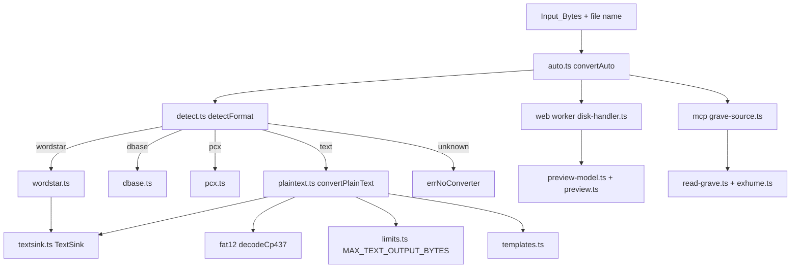

# Design Document

## Overview

`README.TXT` on every demo disk currently opens as a red "no converter for this format" line above a hex dump. This feature adds a fourth converter, `convertPlainText`, so DOS text files open as text. It is a small follow-up to `format-resurrection` and reuses that module's limits, warning collector, input guard, result constructors and test infrastructure.

The change touches five areas:

- `src/core/formats/`: one new converter module, a new `text` value in the detector, one new limit, one new template, a wider result type, and an extension of the existing text sink so it can hold CP437 characters and cap by UTF-8 byte length.
- `src/web/`: a new `text` result kind through the worker protocol, validator, preview model, preview dialog and download allowlist.
- `src/mcp/`: `read_grave` and `exhume` learn the `text` format and the `.txt` extension; the committed bundle is rebuilt.
- `src/demo-disks/checks/`: the "no converter" expectations become "converts as text" expectations.
- Docs and rules: `README.md`, `power/POWER.md` and `.kiro/steering/safety.md`.

Research for this design was done in the repository, not on the web. The facts the design rests on (all read from source):

- `decodeCp437` in `src/core/fat12/cp437.ts` maps `0x00..0x7F` to the same code point and `0x80..0xFF` through one table. It is exported from `src/core/fat12/index.ts`. The formats purity test (`src/test-support/formats-purity.test.ts`) allows exactly one import from outside `src/core/formats`: `import { decodeCp437 } from '../fat12'`.
- `makeAsciiSink` in `src/core/formats/textsink.ts` stores into a `Uint8Array(TEXT_CHUNK_BYTES)` and converts chunks with `String.fromCharCode.apply`. Its only user is `src/core/formats/wordstar.ts`, which reads `sink.length` as a byte count for its output cap.
- The purity test also forbids repeating any limit value of 4,096 or more outside `limits.ts`, forbids regular expressions in `src/core/formats` (non-test files) and forbids `any`.
- `convertAuto` in `src/core/formats/auto.ts` switches on `detectFormat(...).format` and returns `errNoConverter` for everything else.
- The web worker (`src/web/worker/disk-handler.ts`) maps a `ConversionResult` to an `ExhumeResult` by `mime` and falls through to the PNG branch in its last `else`, so a new string-output mime would be miscast unless a branch is added.

### Design decisions

| Decision | Choice | Reason |
|---|---|---|
| Output sink | Extend the existing sink in `textsink.ts` (rename to `TextSink`, `makeTextSink`), do not add a sibling | One chunked builder, one place for the cap logic. WordStar behavior is unchanged because for ASCII one code unit is one UTF-8 byte. |
| DEL (`0x7F`) | Control_Byte: dropped and counted in `control-codes-dropped` | Matches `dbase-cells.ts` and `dbase-header.ts`, which also treat `0x7F` as a control. |
| Empty file | Detected as `text` only through a Text_Extension_Set extension; with no known extension it stays `unknown` | An empty sample has no evidence of text. `EMPTY.TXT` converts to an empty string. |
| Download mime | `text/plain` joins the web allowlist and the safety rules | Required by Requirement 4.10. The exact steering change is in "Rules change". |
| Converter shape | `convertPlainText` plus a `runPlainText(input, outputCap)` test seam | Same pattern as `convertWordStar` and `runWordStar`. It lets the cap be tested without 4 MiB inputs. |
| CP437 use | Normalize to a scratch byte buffer, decode each full buffer with `decodeCp437` | No second table (Requirement 1.3). Decoding is per byte, so decoding in slices equals decoding the whole. |
| Content rule order | Text content rule is last, after the extension rule | Required by Requirement 2.2. Any all-printable file with no stronger signal opens as text, whatever its extension. |
| Preview element | A `div` with `white-space: pre-wrap`, filled with one Text node | `pre` is not in the `AllowedTag` set of `src/web/dom/h.ts`. Not widening that set keeps the DOM helper closed. |

## Architecture



### Detection order

`detectFormat` applies, in order: PCX content, dBase content, WordStar content, file name extension, plain text content, unknown. Only the last two are new behavior; the first three are untouched.


### Conversion pass

One pass over at most `MAX_CONVERT_INPUT_BYTES` bytes. Each step consumes one input byte.

1. Read a byte `b`.
2. `0x1A`: stop.
3. `0x0D`: emit `0x0A` and remember "last was CR".
4. `0x0A`: skip it when the last byte was CR, otherwise emit `0x0A`.
5. `0x09`, `0x0C`, `0x20..0x7E`, `0x80..0xFF`: emit as is.
6. Any other byte (below `0x20`, or `0x7F`): count it as dropped.
7. When the scratch buffer is full or the input ends, decode it with `decodeCp437` and append the string with `TextSink.pushStringCapped`. A short append means the cap was hit: stop reading.

## Components and Interfaces

### `src/core/formats/limits.ts`

```ts
export const MAX_TEXT_OUTPUT_BYTES = MAX_MARKDOWN_OUTPUT_BYTES; // 8,388,608 bytes of UTF-8
```

`LimitName` gains `'MAX_TEXT_OUTPUT_BYTES'`. `TEXT_CHUNK_BYTES` keeps its name and value (8 KiB) and its comment (today `// AsciiSink chunk`) becomes `// TextSink chunk, in UTF-16 code units; also the scratch byte buffer of the plain text converter`. The name is kept on purpose (decision, no rename): it avoids churn in `textsink.test.ts`, and for the scratch buffer it is literally bytes. The comment is what resolves the "bytes or code units" ambiguity.

The cap is reachable. The input is at most 4 MiB and a CP437 character can take 3 UTF-8 bytes (for example `0xC4` is U+2500), so the worst case is about 12 MiB before the cap.

### `src/core/formats/templates.ts`

```ts
outputCappedText: 'output capped at {0} bytes (MAX_TEXT_OUTPUT_BYTES)',
```

`LIMIT_EXCEEDED_TEMPLATES` gains `MAX_TEXT_OUTPUT_BYTES: 'MAX_TEXT_OUTPUT_BYTES exceeded'` because it is typed `Record<LimitName, string>`. `TEMPLATES.controlCodesDropped` (`'{0} control bytes dropped'`) is reused. `templates.test.ts` iterates every entry, and `src/test-support/formats/invariants.ts` builds its known-message set from both tables, so both pick the new entries up without edits.

### `src/core/formats/types.ts`

```ts
export type OutputMime = 'text/markdown' | 'text/csv' | 'text/plain' | 'image/png';
export type OutputExtension = '.md' | '.csv' | '.txt' | '.png';
export type TextResult = ConversionSuccess<string, 'text/plain', '.txt'> | ConversionFailure;
export type ConversionResult = MarkdownResult | CsvResult | TextResult | PngResult;
export type DetectedFormat = 'wordstar' | 'dbase' | 'pcx' | 'text' | 'unknown';
```

`ConversionWarningCode` is unchanged: `control-codes-dropped`, `output-capped` and `input-truncated` already exist.

### `src/core/formats/textsink.ts` (extended in place)

The sink keeps its purpose, a chunked builder, and gains two abilities: it stores any UTF-16 code unit, and it counts and caps UTF-8 bytes. `makeAsciiSink` becomes `makeTextSink` and `AsciiSink` becomes `TextSink`. The only importers are `wordstar.ts` and `textsink.test.ts`; both change one identifier.

```ts
export interface TextSink {
  /** UTF-8 bytes of the text written so far. Equal to the unit count while only ASCII is written. */
  readonly length: number;
  /** Append one UTF-16 code unit (0..U16_MAX). Callers that write ASCII behave exactly as before. */
  push(code: number): void;
  /** Append every UTF-16 unit of `s`. */
  pushString(s: string): void;
  /**
   * Append the longest prefix of `s` that keeps `length <= maxBytes`, never splitting a surrogate pair.
   * Returns the number of UTF-16 units appended; a result below `s.length` means the cap was hit.
   */
  pushStringCapped(s: string, maxBytes: number): number;
  /** Return the whole text. */
  finish(): string;
}
export function makeTextSink(): TextSink;
```

Changes inside:

- The chunk becomes `new Uint16Array(TEXT_CHUNK_BYTES)`. `String.fromCharCode.apply(null, view)` accepts a `Uint16Array` view, so `flush()` does not change. The stored value is masked with `U16_MAX` from `limits.ts` (a literal `0xffff` would trip the purity scan).
- UTF-8 cost per unit: `< 0x80` costs 1, `< 0x800` costs 2, any other BMP unit costs 3. A high surrogate costs 4 and a low surrogate that follows a high surrogate costs 0, so a well-formed pair costs exactly 4. The sink keeps one boolean ("previous unit was a high surrogate") for this. A lone high surrogate is counted 4 and a lone low surrogate 3, so the count is never below the real UTF-8 length. CP437 never produces surrogates; the rule exists so the cap is a hard bound for any caller.
- `pushStringCapped` computes the room left (`maxBytes - length`), walks `s` once, and stops before the first code point that does not fit. A surrogate pair is taken whole or not at all. It has no recursion and its loop advances one unit per step.
- `push` and `pushString` do not check a cap. WordStar keeps its own checks against `sink.length`, which for ASCII is the same number as before.

WordStar behavior is unchanged: it pushes only `0x20..0x7E` and `0x0A`, each cost 1, so `length` is identical, `finish()` is identical, and its cap arithmetic (`sink.length + groupLen + reserve > outputCap`) is untouched.

### `src/core/formats/plaintext.ts` (new)

```ts
import { decodeCp437 } from '../fat12';

/** Public converter: cap is MAX_TEXT_OUTPUT_BYTES. */
export function convertPlainText(input: Uint8Array): TextResult;
/** Test seam: same code with a caller-chosen cap (<= MAX_TEXT_OUTPUT_BYTES). */
export function runPlainText(input: Uint8Array, outputCap: number): TextResult;
```

Structure (mirrors `wordstar.ts`):

```ts
export function runPlainText(input: Uint8Array, outputCap: number): TextResult {
  assertUint8Array(input);
  const w = makeWarningCollector();
  return guarded(() => convert(limitInput(input, w), outputCap, w), w);
}
```

`convert` holds `scratch = new Uint8Array(TEXT_CHUNK_BYTES)`, `used`, `dropped`, `lastWasCr` and `capped`. The byte rules are the numbered list in "Conversion pass". Local constants (`CR = 0x0d`, `LF = 0x0a`, `TAB = 0x09`, `FF = 0x0c`, `EOF = 0x1a`, `DEL = 0x7f`, `SPACE = 0x20`, `TILDE = 0x7e`, `HIGH = 0x80`) carry no value of 4,096 or more.

Flush: `const text = decodeCp437(scratch.subarray(0, used)); if (sink.pushStringCapped(text, outputCap) < text.length) capped = true; used = 0;`. When `capped` is set the loop stops. Warnings are added in the order `input-truncated` (from `limitInput`), `control-codes-dropped`, `output-capped`. The result is `okResult(sink.finish(), 'text/plain', '.txt', w)`.

The scratch holds only emitted bytes (`0x09`, `0x0A`, `0x0C`, `0x20..0x7E`, `0x80..0xFF`), so decoding is per byte and the concatenation of slices equals decoding all emitted bytes at once. That is what Requirement 1.1 states.

### `src/core/formats/detect.ts`

- `formatFromExtension` gains the cases `TXT`, `BAT`, `ASC`, `LOG`, `NFO`, `DIZ`, `1ST`, `ME`, returning `'text'`. It already folds with `asciiUpper`, which leaves digits unchanged.
- A new `isTextSample(s: Uint8Array): boolean`: false when `s.length === 0`, otherwise one loop returning false on the first byte outside `0x09`, `0x0A`, `0x0C`, `0x0D`, `0x1A`, `0x20..0x7E`. It runs on the existing `sample = input.subarray(0, DETECT_SAMPLE_BYTES)`.
- `detectFormat` ends with `if (isTextSample(sample)) return { format: 'text', source: 'content' }` before the `unknown` return. The file name guard (`typeof fileName === 'string' && fileName.length <= MAX_FILE_NAME_CHARS`) is unchanged.

An empty `Uint8Array` with no known extension returns `{ format: 'unknown', source: 'none' }`. With `TXT` it returns `{ format: 'text', source: 'extension' }`.

### `src/core/formats/auto.ts` and `src/core/formats/index.ts`

`convertAuto` gets `case 'text': return convertPlainText(input);`. `index.ts` exports `convertPlainText` and the `TextResult` type. `runPlainText` is not exported from the barrel, like `runWordStar` (the existing test "does not export the internal runners" gains it).

### `src/web/`

| File | Change |
|---|---|
| `logic/protocol.ts` | `ExhumeResult` gains `{ kind: 'text'; text: string; warnings: ConversionWarning[] }`. `OUTPUT_BY_KIND` gains `text: { mime: 'text/plain', extension: '.txt' }`. |
| `worker/disk-handler.ts` | New branch `else if (converted.mime === 'text/plain') result = { kind: 'text', text: converted.output, warnings: converted.warnings }` before the PNG `else`. |
| `logic/validate.ts` | `readResult` handles `case 'text'` with the `markdown` and `csv` cases: `text` must pass `asStr`, warnings pass `readConversionWarnings`. The message carries no mime or extension. |
| `logic/filename.ts` | `DownloadExtension` gains `'.txt'`. |
| `logic/preview-model.ts` | `DownloadMime` gains `'text/plain'`. `PreviewBody` gains `{ kind: 'text'; text: string; shortened: boolean }`. `buildPreviewModel` handles `case 'text'` with `truncateForPreview` and the same download code path: `OUTPUT_BY_KIND.text`, `data: result.text`. |
| `dom/preview.ts` | `buildBody` handles `case 'text'`: a `div` with class `preview-scroll preview-text`, `tabindex="0"`, `role="region"`, `aria-label="Document text"`, holding one Text node, followed by the existing `SHORTENED_NOTE` when `shortened`. |
| `dom/download.ts` | `ALLOWED_MIME` gains `'text/plain'`. |
| `src/style.css` | `.preview-text { white-space: pre-wrap; overflow-wrap: anywhere; }`. It reuses the `--pair-*` colors of `.preview-scroll`, so no new color pair is added and the contrast scan is unaffected. |

The preview text goes into the DOM through `h()` with a string child, which creates a Text node. No `innerHTML`, no new tag, no new attribute. The CSP and `index.html` do not change.

### `src/mcp/`

| File | Change |
|---|---|
| `grave-source.ts` | New helper `formatOf(extension)` returning `'markdown' \| 'csv' \| 'text' \| 'png'` from a lookup on the extension. It replaces the nested ternaries in both tools. |
| `tools/read-grave.ts` | `format: formatOf(conversion.extension)` in the string-output branch. The branch already sanitizes with `sanitizeCapped(conversion.output, { multiline: true }, MAX_TEXT_CHARS)`. |
| `tools/exhume.ts` | `format: formatOf(conversion.extension)`. |
| `exhume-writer.ts` | `exhumeBase(gravePath, extension: '.md' \| '.csv' \| '.txt' \| '.png')`. The writer already encodes a string output with `Buffer.from(output, 'utf8')`, which is at most `MAX_TEXT_OUTPUT_BYTES`. |
| `errors.ts` | `NO_CONVERTER` text becomes `'No converter matches this file. Supported formats are WordStar, dBase III, PCX and plain text.'` It holds no disk text. |
| `power/server/exhume-mcp.mjs` | Rebuilt with `npm run build:mcp`. `power/mcp.json` and `.kiro/settings/mcp.json` are not changed. |

`prepareGrave` needs no change: a successful text conversion falls into the `ok` path, and a text conversion can only fail through the guarded internal error, which maps to `CONVERSION_FAILED` because `detectFormat` returns `text`, not `unknown`.

### `src/demo-disks/checks/`

- `expected.ts`: the field `noConverter: string[]` is renamed `textFiles: string[]` (reader paths expected to convert as plain text). Values: writers `['/README.TXT']`, office `['/INVOICES/INV8903.TXT', '/README.TXT']`, damaged `['/README.TXT']`. Every other field is unchanged.
- `reads.ts`: in the sweep, a path in `textFiles` must convert `ok` with `mime === 'text/plain'` and `warnings.length === 0`; the old "a plain text file must not convert" branch is removed. For `/README.TXT` the converted text must include `MARKER_GENERATED` and `MARKER_WRITTEN` (imported from `../content/readme`, the same constants `markers.ts` uses). The other files keep the "must convert" branch.
- The demo disk images are not touched. The READMEs hold only printable ASCII and CR LF, no line starts with `.` plus two letters, and they hold no WordStar style byte, so they reach the `TXT` extension rule (and would also pass the text content rule).

### Rules change

File: `.kiro/steering/safety.md`, section "Web page", the second bullet (lines 18 to 19 today).

Before:

```markdown
- Downloads use Blob URLs with a fixed safe MIME type (`text/markdown`, `text/csv`, `image/png`,
  `application/octet-stream`) and a sanitized file name.
```

After:

```markdown
- Downloads use Blob URLs with a fixed safe MIME type (`text/markdown`, `text/csv`, `text/plain`, `image/png`,
  `application/octet-stream`) and a sanitized file name.
```

No other line of the file changes. The same sentence appears in the "Included Rules" copy that the workspace injects from this file, so the steering file is the single source to edit.

`.kiro/specs/graveyard-ui/requirements.md` (criterion 10.1) and its `design.md` (`DownloadMime`) state the four-mime list. They are the record of an earlier spec and are left as they are. This spec supersedes them for the mime list, and the drift is noted here so it is not mistaken for a bug.

### `README.md`

Line 6 becomes: "WordStar documents rise as Markdown, dBase tables as CSV, PCX pictures as PNG, plain text files as `.txt` text." The `read_grave` bullet (line 65) changes "(Markdown or CSV text, or PNG dimensions)" to "(Markdown, CSV or plain text, or PNG dimensions)". The second edit goes slightly beyond Requirement 7.1 but keeps the tool description true.

### `power/POWER.md`

`POWER.md` carries the same older wording in its `read_grave` bullet (line 22, "Markdown or CSV text, or PNG dimensions"). It changes in the same way as the README bullet, one line: "(Markdown, CSV or plain text, or PNG dimensions)". The frontmatter `description` and the introduction line name the three formats; they are left as they are, because they describe the format resurrections and not the `read_grave` preview. No other line of `POWER.md` changes, including the "NOT WORKING YET" notice. This keeps the shipped power docs true next to the rebuilt bundle (Requirement 7.2).

## Data Models

```ts
// Result shape (no new fields)
type TextResult =
  | { ok: true; output: string; mime: 'text/plain'; extension: '.txt'; warnings: ConversionWarning[] }
  | { ok: false; error: string; warnings: ConversionWarning[] };

// Web worker message (kind selects mime and extension; the message never carries them)
type ExhumeResult =
  | { kind: 'markdown'; text: string; warnings: ConversionWarning[] }
  | { kind: 'csv'; text: string; warnings: ConversionWarning[] }
  | { kind: 'text'; text: string; warnings: ConversionWarning[] }
  | { kind: 'png'; png: Uint8Array; warnings: ConversionWarning[] }
  | { kind: 'raw'; error: string; warnings: ConversionWarning[] };

// MCP read_grave text result: same members as markdown/csv, with format 'text'
{ grave, format: 'text', mime: 'text/plain', extension: '.txt', text, totalChars, truncated, warnings, warningsOmitted }
```

Test-only models in `src/test-support/formats/oracles.ts` (it imports only `decodeCp437`, and the new code keeps that rule):

```ts
/** Independent model: cut at first 0x1A, normalize line ends, drop controls, decode. */
export function plainTextOracle(bytes: Uint8Array): { text: string; dropped: number };
/** The text content rule, written separately from detect.ts. */
export function isTextSampleOracle(bytes: Uint8Array): boolean;
/** All five rules in order. Uses detectOracle for the three content rules. */
export function detectFullOracle(bytes: Uint8Array, fileName?: unknown): { format: string; source: string };
/** Inverse of decodeCp437, built by decoding each byte value once. Returns null for a character with no byte. */
export function encodeCp437(text: string): Uint8Array | null;
```

`detectOracle` and its `OracleFormat` are unchanged, so `oracles.test.ts` and the dBase and PCX oracles are untouched. `encodeCp437` derives its map from `decodeCp437`, so no second table exists anywhere.

## Correctness Properties

*A property is a characteristic or behavior that should hold true across all valid executions of a system-essentially, a formal statement about what the system should do. Properties serve as the bridge between human-readable specifications and machine-verifiable correctness guarantees.*

Prework reflection: 1.4 to 1.6 are covered by the model property but get their own generator-driven property because the model could share a bug with the converter. 1.7, 1.8 and 1.10 fold into the model property. 1.2, 1.13, 3.4 and 3.8 fold into the output contract property. 2.3, 2.5, 2.7 and 2.8 fold into the rule-order property. Smoke items (1.3, 2.11, 3.1, 3.5, 3.9, 3.12, 4.12, 5.5, 5.8, 5.9, 6.5, 6.6) are covered by existing static tests and are not properties.

### Property 1: Plain text matches the independent model

*For any* byte array, `convertPlainText` returns `ok: true` with `output` equal to `plainTextOracle(bytes).text` and with exactly one `control-codes-dropped` warning whose message is `fill(TEMPLATES.controlCodesDropped, dropped)` when `dropped > 0` and no such warning otherwise, for inputs at most `MAX_CONVERT_INPUT_BYTES` and below the output cap.

**Validates: Requirements 1.1, 1.4, 1.5, 1.6, 1.7, 1.8, 1.9, 1.10, 1.11, 3.11**

### Property 2: Output contract

*For any* byte array, the result of `convertPlainText` satisfies `checkResultInvariants` with mime `text/plain` and extension `.txt` (known warning templates, at most `MAX_WARNINGS + 1` warnings, UTF-8 length at most `MAX_TEXT_OUTPUT_BYTES`), and a successful `output` contains no CR, no `0x1A`, and no code point below `0x20` other than LF, TAB and FF, and no `0x7F`.

**Validates: Requirements 1.2, 1.13, 3.4, 3.8**

### Property 3: Nothing after the first EOF byte matters

*For any* byte array `head` that contains no `0x1A` and *any* byte array `tail`, `convertPlainText(head ++ [0x1A] ++ tail)` equals `convertPlainText(head ++ [0x1A])`, and its output equals that of `convertPlainText(head)` (warnings of `head` alone do not change either, because the EOF byte is not a Control_Byte).

**Validates: Requirements 1.9, 1.11**

### Property 4: Line ending forms are equivalent

*For any* list of lines made of printable ASCII and *any* choice of CRLF, lone CR or lone LF between lines, the output equals the lines joined by LF, with a trailing LF when the input ended with a line ending.

**Validates: Requirements 1.4, 1.5, 1.6**

### Property 5: Idempotence through the CP437 encoding

*For any* byte array whose conversion succeeds, `convertPlainText(encodeCp437(output))` returns the same `output` with no warnings.

**Validates: Requirements 1.15**

### Property 6: Determinism and Buffer equivalence

*For any* byte array, repeated calls to `convertPlainText`, calls interleaved with other converters, and calls on a `Buffer` copy or a pooled `Buffer` view all return equal results, and the input bytes are unchanged. The same holds for `detectFormat`.

**Validates: Requirements 1.14, 2.12**

### Property 7: Output cap at a character boundary

*For any* byte array and *any* cap passed to `runPlainText`, the UTF-8 length of `output` is at most the cap; `output` is a prefix of the uncapped output; an `output-capped` warning naming the cap is present exactly when the output is shorter than the uncapped output; and when it is shorter, appending the next character of the uncapped output would exceed the cap.

**Validates: Requirements 3.3**

### Property 8: Totality on hostile input

*For any* hostile byte array (random bytes, bytes with no `0x1A`, control-only bytes, CR-only bytes, mutated text fixtures, grammar-built text with `0x1A`, NUL, DEL and high bytes, and inputs at and above `MAX_CONVERT_INPUT_BYTES`), `convertPlainText` and `convertAuto` neither throw nor exceed `CONVERT_TIME_BUDGET_MS`, leave the input unchanged and return a result that satisfies the contract.

**Validates: Requirements 2.9, 3.2, 3.5, 3.7, 3.10**

### Property 9: Sink UTF-8 accounting and ASCII compatibility

*For any* sequence of `push`, `pushString` and `pushStringCapped` calls over ASCII, BMP and astral text, `finish()` equals the concatenation of the appended units; `length` is at least the real UTF-8 length of that text and equals it when the text is well-formed; every `pushStringCapped(s, max)` appends a prefix of `s` that never splits a surrogate pair, leaves `length <= max`, and is maximal for well-formed `s`. *For any* ASCII-only sequence, `length` equals the number of units written and `finish()` equals the old one-byte-per-character result, including across chunk boundaries.

**Validates: Requirements 3.3** (the sink mechanism), and the unchanged WordStar output of Requirements 1.2 of `format-resurrection`

### Property 10: Detection follows the rule order

*For any* byte array and *any* file name (string of any length, or a non-string value), `detectFormat(bytes, name)` equals `detectFullOracle(bytes, name)`: the PCX, dBase and WordStar content rules first, then the extension rule (with `TXT`, `BAT`, `ASC`, `LOG`, `NFO`, `DIZ`, `1ST`, `ME` giving `text` in any case mix), then the text content rule for a non-empty all-text sample, then `unknown` with source `none`.

**Validates: Requirements 2.2, 2.3, 2.5, 2.7, 2.8**

### Property 11: Strong content rules beat every extension

*For any* byte array matched by the PCX, dBase or WordStar content rule and *any* file name, including `TXT` names, `detectFormat` returns that content format with source `content`. *For any* other byte array and a name ending in `WS`, `WS4` to `WS7`, `WSD`, `DBF` or `PCX`, it returns that format with source `extension` and never `text`.

**Validates: Requirements 2.4, 2.6**

### Property 12: Detection reads only the sample window

*For any* byte array longer than `DETECT_SAMPLE_BYTES` and *any* edit at an index of `DETECT_SAMPLE_BYTES` or later, `detectFormat` returns the same result. A file whose first `DETECT_SAMPLE_BYTES` bytes are text and whose later bytes are not is detected as `text`; a non-text byte at index `DETECT_SAMPLE_BYTES - 1` makes it not text.

**Validates: Requirements 2.10**

### Property 13: Auto conversion follows detection

*For any* byte array and file name, `convertAuto(bytes, name)` equals the result of the converter chosen by `detectFormat(bytes, name)` (`convertPlainText` for `text`), and for `unknown` it is the no-converter failure with no warnings.

**Validates: Requirements 2.1, 2.9**

### Property 14: Text preview model

*For any* `ExhumeResult` of kind `text` and *any* item, `buildPreviewModel` returns a body of kind `text` whose text is `truncateForPreview(result.text).text` with `shortened` set exactly when the text is longer than `MD_PREVIEW_CHARS`; the first download has mime `text/plain`, a file name ending in `.txt` that equals `sanitizeFileName(item.name, '.txt')`, and data equal to `result.text`; the last download is the raw `application/octet-stream` `.bin` download; and every download mime is in the allowed set of five.

**Validates: Requirements 4.3, 4.4, 4.5, 4.6**

### Property 15: Worker message validation for text

*For any* well-formed `exhumed` response with a result of kind `text`, `parseResponse` accepts it; *for any* such response with `result.text` replaced by a non-string value, it rejects it; and no accepted message carries a mime or extension.

**Validates: Requirements 4.10, 4.11**

### Property 16: `read_grave` returns sanitized, capped text for text files

*For any* text file content on a disk, `read_grave` returns `format: 'text'`, `mime: 'text/plain'`, `extension: '.txt'`, and a `text` member equal to `sanitizeCapped(convertAuto(bytes, name).output, { multiline: true }, MAX_TEXT_CHARS).text`, with `truncated` and `totalChars` matching.

**Validates: Requirements 5.1, 5.2**

### Property 17: `exhume` writes one safe `.txt` file

*For any* text file on a disk and *any* Grave name, `exhume` creates exactly one new file in `exhumed/` whose name matches `[A-Za-z0-9._-]{1,64}` and ends in `.txt`, whose bytes equal the UTF-8 encoding of the converter output, never replaces an existing file, and returns `format: 'text'`.

**Validates: Requirements 5.3, 5.4**

## Error Handling

- Non-`Uint8Array` input: `assertUint8Array` throws the existing `TypeError('invalid input type: expected Uint8Array')`, as for the other converters.
- Input above `MAX_CONVERT_INPUT_BYTES`: `limitInput` cuts it and adds `input-truncated`.
- Cap reached: the converter keeps the text written so far, adds one `output-capped` warning whose message names the limit through `TEMPLATES.outputCappedText`, and stops reading. Because reading stops, the dropped-byte count covers only the bytes read up to that point. The count is exact for what was read, and the cap warning tells the reader the file was not fully read.
- Unexpected internal throw: `guarded` returns `{ ok: false, error: TEMPLATES.errInternal, warnings }`. The MCP layer maps that to `CONVERSION_FAILED` and the worker to a `raw` result with the error text.
- Control bytes: dropped and counted, never an error.
- Unknown format: unchanged. `convertAuto` returns `errNoConverter`; the page keeps its "no converter" line and hex view; MCP returns `NO_CONVERTER`.
- Web: a worker message with kind `text` and a non-string `text` fails `parseResponse` the same way a bad `markdown` message does. A download with a mime outside the allowlist still fails with `DOWNLOAD_FAILED_MESSAGE`.
- Known limitation, stated in the README only if the reviewer wants it: a file that holds CP437 box-drawing or accented bytes, has no text extension and no other signal is `unknown`, because the content rule accepts ASCII text only. With a text extension it converts.

## Testing Strategy

Tools: Vitest and fast-check, as in the rest of the repository (`src/**/*.test.ts`). Property tests run at least 100 iterations through `numRuns(100)` from `src/test-support/runs`. Each property test carries the comment `Feature: plain-text, Property N: <title>`. A fast-check callback returns a boolean or nothing and never calls `expect` (enforced by `formats-purity.test.ts`). Each property is one property test.

Property-based testing applies to the converter, the detector and the sink (pure functions), and to the preview model and validator (pure logic). It does not apply to the DOM rendering, the CSS, the README line, the demo-disk expectations or the committed bundle; those use example tests, snapshot-style DOM assertions and the existing static checks.

### Tests to extend (no parallel files)

| File | Extension |
|---|---|
| `src/core/formats/textsink.test.ts` | Keep the four existing tests unchanged apart from the renamed import. Add: Unicode round trip across chunk boundaries; Property 9 (UTF-8 accounting, cap maximality, surrogate pairs, ASCII compatibility); `pushStringCapped` returning less than `s.length` at the cap; cost of 1, 2, 3 and 4 bytes by example. |
| `src/core/formats/wordstar.output.test.ts` and `wordstar.regress.test.ts` | No edit. They are the proof that WordStar output is unchanged. They must pass without change. |
| New cases in `src/core/formats/formats.targeted.hostile.test.ts` | A `targeted hostile plain text` block: 4 MiB with no `0x1A`; 4 MiB of control bytes; 4 MiB of CR; 4 MiB of `0xC4` (3 bytes each in UTF-8) that hits the real cap with `output-capped`; input of `MAX_CONVERT_INPUT_BYTES + 1` with `input-truncated`; 4 MiB of high bytes. Each uses the file's existing `run()` helper. |
| `src/core/formats/formats.hostile.test.ts` | `FORMATS` and `CONVERTERS` gain `text`; Property 8. |
| `src/core/formats/contract.test.ts` | `CASES` gains a `convertPlainText` entry (`text/plain`, `.txt`, text fixture arbitrary); `converterFor` gains `case 'text'`; Property 3 (determinism) covers it through `ALL_CONVERTERS`; Property 2 and Property 13 run here. |
| `src/core/formats/detect.test.ts` | Properties 10, 11, 12 (see the change table below for the existing properties that are edited). |
| `src/core/formats/limits.test.ts` | `MAX_TEXT_OUTPUT_BYTES` equals 8,388,608 and equals `MAX_MARKDOWN_OUTPUT_BYTES`. |
| `src/core/formats/index.test.ts` | `convertPlainText` joins `converters` (bad-input table and Buffer equivalence); `TextResult` joins the type tuple; `runPlainText` joins "does not export the internal runners". |
| `src/web/logic/preview-model.test.ts` | Property 14; `ALLOWED_MIMES` gains `text/plain`; the `ExhumeResult` arbitrary gains a `text` branch. |
| `src/web/logic/validate.test.ts` | Property 15; the response arbitrary gains a `text` branch. |
| `src/web/logic/filename.test.ts` | One example with `'.txt'`. |
| `src/web/dom/download.test.ts` | One example: a `text/plain` Blob is created for a `text/plain` spec. |
| `src/web/dom/preview.dom.test.ts` | A text body renders in a focusable labeled region as one Text node (hostile markup shows as text, no child elements); shortened notice; both download buttons. |
| `src/web/worker/disk-handler.test.ts` | New fixture `NOTE.TXT` with ASCII bytes expecting kind `text`. |
| `src/mcp/read-grave.test.ts`, `src/mcp/read-grave.props.test.ts` | Examples and Property 16. |
| `src/mcp/exhume.test.ts`, `src/mcp/exhume.props.test.ts` | Examples and Property 17 (`.txt`, name allowlist, no overwrite). |
| `src/demo-disks/shared-checks.test.ts` | New mutation (g): a control byte planted in a `README.TXT` is reported by the `reads` group. Mutation (c) still passes because it asserts `toContain('markers')`. |
| `src/demo-disks/readme.test.ts` | One example: the README names plain text among the conversions. |
| `src/mcp/config.test.ts` | One example: the `read_grave` bullet of `power/POWER.md` names plain text (it already reads `POWER.md`). |
| `src/test-support/formats/*` | `oracles.ts`: `plainTextOracle`, `isTextSampleOracle`, `detectFullOracle`, `encodeCp437`. `oracles.test.ts`: examples for each (CRLF, lone CR, EOF cut, DEL, empty, `0xFF`). `invariants.ts`: `MIME_EXTENSION` gains `'text/plain': '.txt'` and the cap switch gains `MAX_TEXT_OUTPUT_BYTES`. `hostile.ts`: `HostileFormat` gains `'text'`; `PREFIXES.text`, `FIXTURE_BY_FORMAT.text`, a text grammar generator and a text header patch; the `auto` mix includes text fixtures. `arbitraries.ts`: `plainTextBytesArb`. `arbitraries.test.ts`: the `formats` array gains `'text'`. |

### Existing tests that must change

These tests assert behavior that this feature removes. Each change is a fixture or expectation edit, not a weakening.

| File | Test or location | Why it breaks | Change |
|---|---|---|---|
| `src/core/formats/auto.test.ts` | "returns the no-converter failure for unknown input" | `ascii('hello')` is now text by content | Unknown inputs become the empty array and `[1..8]`; `hello` moves to a new text-routing test |
| `src/core/formats/auto.test.ts` | "returns a fresh warnings array on every call" | Uses `ascii('hello')` expecting the failure | Use the `[1..8]` input |
| `src/core/formats/auto.test.ts` | "ignores a hostile non-string file name" | `ascii('hello world')` now converts as text | Expect `convertPlainText(ascii('hello world'))` |
| `src/core/formats/detect.examples.test.ts` | `plain = "hi"` and "unknown/none for a name with no dot" | `hi` is now text | Make the sample non-text (add a `0x01`); keep the extension examples; add text examples |
| `src/core/formats/detect.test.ts` | `noContentBytes` filter | Strong-unknown bytes can now be text | Filter on `detectOracle === 'unknown' && !isTextSampleOracle` |
| `src/core/formats/detect.test.ts` | `contentBytes` filter and "lets content win" | Text-content bytes lose to an extension by design | Restrict to the three strong rules (`detectOracle !== 'unknown'`) |
| `src/core/formats/detect.test.ts` | `EXTENSION_FORMATS` | Missing the text extensions | Add the eight text extensions mapped to `text` |
| `src/core/formats/detect.test.ts` | `noExtensionMatchNames` | Contains `file.ws.txt`, which is now text | Remove it |
| `src/core/formats/detect.test.ts` | "does not fold Unicode look-alike letters" | Bytes `[0x41, 0x42]` are now text | Use `[0x01, 0x02]` |
| `src/core/formats/detect.test.ts` | "lets a hostile file name change the result only through the extension rule" | A name can now also change a content-text result | Also allow the change when the plain result is `text`; replace the `[0x41]` probe with `[0x01]` |
| `src/core/formats/detect.test.ts` | `fillerWith` (filler `0x41`) in the sample window tests | Filler is now text | Filler `0x01` |
| `src/core/formats/detect.test.ts` | `matchesOracle` and the length 0 to 12 sweep | Oracle has no text | Compare with `detectFullOracle` (no file name) |
| `src/core/formats/contract.test.ts` | `converterFor` and the convertAuto property | `text` falls into `default` and expects a failure | Add `case 'text'` |
| `src/core/formats/formats.hostile.test.ts` | `CONVERTERS: Record<Exclude<HostileFormat, 'auto'>, ...>` | `HostileFormat` gains `text` | Add the entry |
| `src/web/worker/disk-handler.test.ts` | Property at line 230: `grave.size === 0 && kind !== 'raw'` | `EMPTY.TXT` is empty with a text extension, so it is `text` | Accept `raw` or `text` for size 0 |
| `src/web/logic/preview-model.test.ts` | `ALLOWED_MIMES` | Four mimes | Five |
| `src/web/app.dom.test.ts` | "falls back to a hex view with an error for unknown bytes" | `NOTES.BIN` holds `'JUNKDATA' x 8`, which is text | Change the `NOTES.BIN` content to bytes with a `0x01` and `0xFE`. The other `NOTES.BIN` tests only need a dialog |
| `src/mcp/read-grave.test.ts` | "reports NO_CONVERTER for unknown content" | `PLAIN.TXT` is text | Use a binary `DATA.BIN`; add a text success example |
| `src/mcp/read-grave.test.ts` | "keeps duplicate-path ids stable on the provided duplicate disk" | `_EPORT.TXT` entries now convert | Expect success with `format: 'text'` for both ids |
| `src/mcp/read-grave.props.test.ts` | `r.out.format === (extension === '.csv' ? 'csv' : 'markdown')` | Third string format | Compare with the new extension lookup |
| `src/mcp/server.handshake.test.ts` | `PLAIN.TXT` expecting `NO_CONVERTER` | Text now converts | Use a binary file name for the `NO_CONVERTER` case |
| `src/demo-disks/checks/expected.ts`, `reads.ts` | `noConverter` field and the "must not convert" branch | The old expectation | Replace as described in "demo-disks/checks" |

Tests to re-run and read, because they touch `.TXT` fixtures and may need an assertion update: `src/mcp/injection.test.ts`, `src/mcp/injection.props.test.ts` (their `INJECT*.TXT` files now convert, so the sanitizer and containment assertions are exercised on real text results, which is a stronger test, but any assertion that counts converted files may need its number updated), `src/mcp/server.hostile.test.ts`, and `src/web/app.dom.test.ts` (`HOSTILE.TXT`).

### Verification commands

`npm run typecheck`, `npx vitest run`, `npm run test:dom`, `npm run build:mcp` (then confirm `src/mcp/build.test.ts` passes against the new bundle), and `npm run make:demos -- --check` (the three images must still match).
