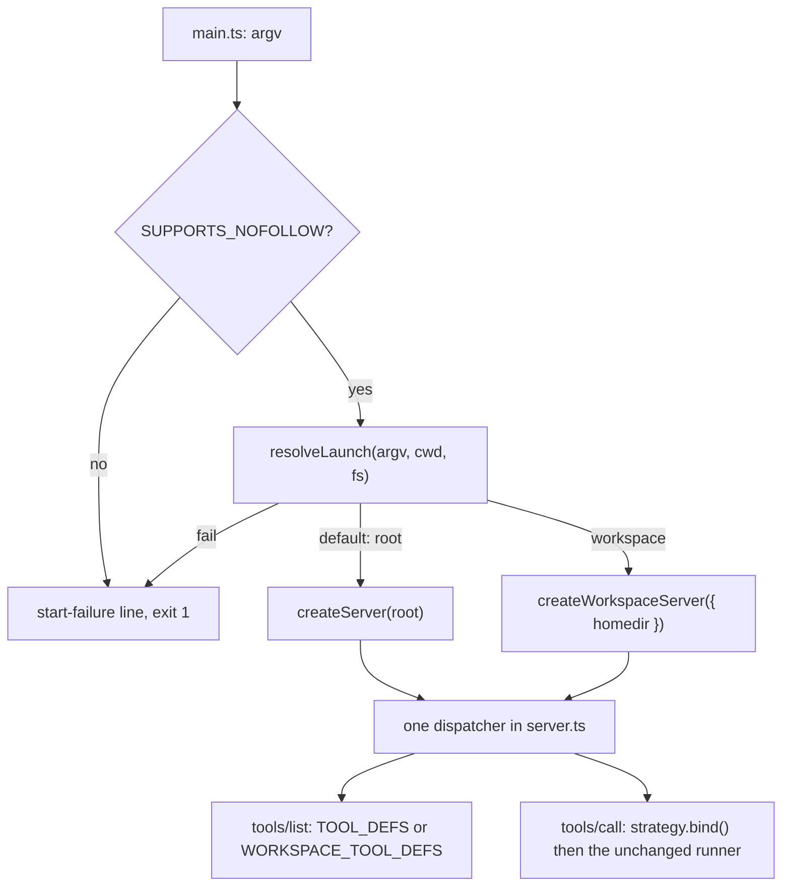
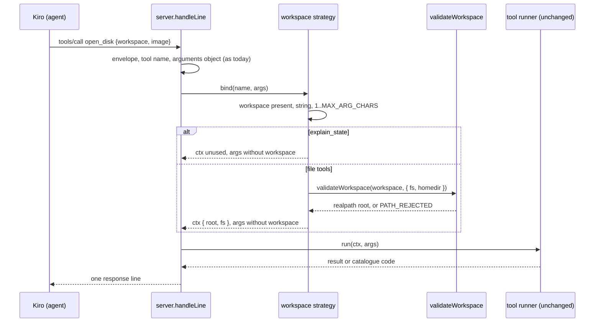
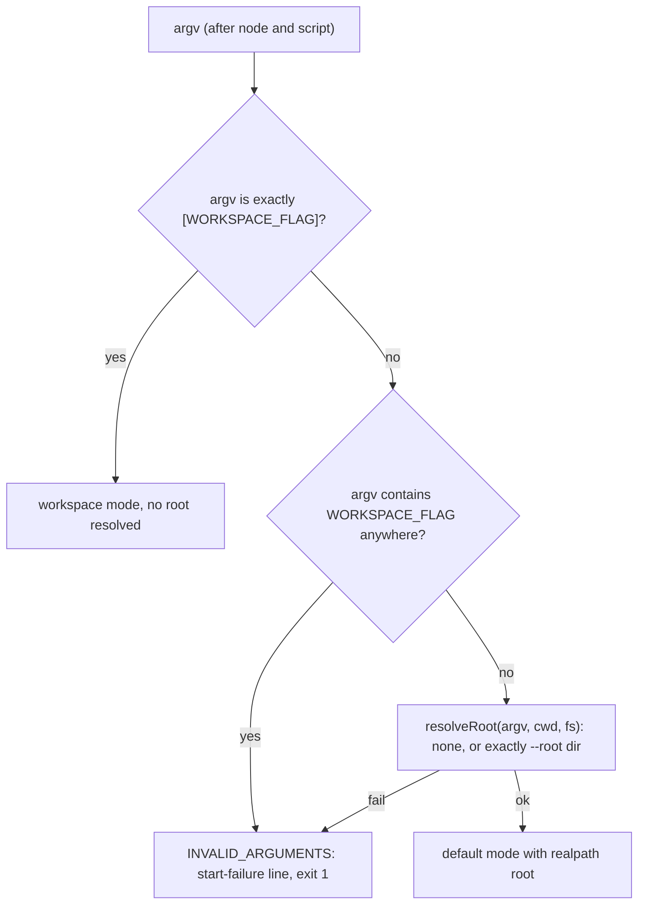
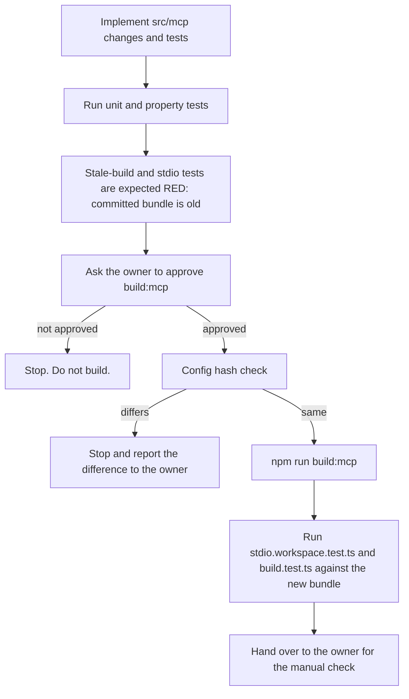

# Design Document

## Overview

This design makes the Exhume Power in `power/` work inside Kiro. It follows Spec 8 in `docs/SPEC_BRIEFS.md` and the approved `requirements.md`. Two facts from the owner's hand checks of 2026-11-07 drive it:

1. A legacy Power install copies only `POWER.md`, `mcp.json` and `steering/`, so `server/` is missing and the server fails with "Connection Failed".
2. In the Agent Plugins layout Kiro copies `server/` and the server connects, but it starts in the install folder and cannot see the user's workspace. Kiro does not expand `${workspaceFolder}`, does not answer `roots/list` and cancels elicitation.

The design has two parts.

**Packaging.** `power/` gets a `plugin.json` (Agent Plugins 1.0.0), a rewritten `power/mcp.json` that starts the committed bundle through `${PLUGIN_ROOT}`, and a skill. `POWER.md` and `steering/` stay as fallback metadata and guidance. The packaging answers come from the research in "Resolved packaging questions". What the docs confirm, what the owner confirmed and what is still unknown are kept apart.

**Agent-supplied workspace mode.** A new launch flag, `--workspace-from-agent`, used only by `power/mcp.json`, switches the server into Workspace_Mode. In that mode every tool takes a required `workspace` argument: the absolute path of the folder the user has open. The server validates it on every call, rejects every Home_Ancestor (`/`, the Home_Directory and every directory above it), and then runs the existing, unchanged confinement code with the realpath of that folder as the root. Default_Mode (no flag, `--root <dir>`, or the working directory) is not touched.

### Design rules

1. **One dispatcher, two thin strategies.** `server.ts` keeps one request dispatcher. A small `ModeStrategy` decides which tool list `tools/list` returns and how a `tools/call` is bound to a `ToolContext` and an argument object. The four tool runners, `args.ts`, `paths.ts` (`loadImage`, `resolveRoot`), `exhume-writer.ts`, `errors.ts` and `fs-layer.ts` are not edited.
2. **No state between calls.** Workspace_Mode keeps nothing from a call. The validated root lives in a local variable of one `tools/call` and is dropped with it (Requirement 5.10).
3. **The agent's `workspace` string is untrusted.** It passes a fixed order of checks before any image or write path is built. Errors use the existing catalogue and never echo it (Requirement 7).
4. **Default constants stay as they are.** `TOOL_DEFS` is not edited. The Workspace_Mode list is a separate constant built once, at module load, from deep copies of `TOOL_DEFS` plus one fixed literal.
5. **Pure logic with injected seams.** `validateWorkspace` takes a `FileLayer` and a home-directory provider. Tests inject a fake home and wrapped file layers. Only `main.ts` supplies `os.homedir`.

### Decisions and rationale

| Decision | Choice | Why |
|---|---|---|
| Flag name (Requirement 3.8) | `--workspace-from-agent` | Matches the project brief. It says what the mode does. A fixed constant `WORKSPACE_FLAG` in `launch.ts`. |
| Mode selection | `resolveLaunch(argv, cwd, fs)` returns `{ kind: 'default'; root } \| { kind: 'workspace' }`. | Keeps `resolveRoot` unchanged for Default_Mode (Requirement 8). |
| Flag with anything else | Any argv that contains the flag and is not exactly `[flag]` fails with the start-failure line. | Requirements 3.4 and 3.5. Fail closed. |
| Where `workspace` is read | In the strategy, before the runner. The runner receives the arguments without `workspace`. | `args.ts` stays byte-identical, so Default_Mode rejects `workspace` through the existing `additionalProperties` rule (Requirement 4.6) and its tests keep their meaning. |
| Home_Ancestor test | Segment-wise prefix test on realpaths, **plus** a device and inode identity test against every directory on the path to the home. | Requirement 5.8 asks for the segment-wise test. JS `realpath` keeps the caller's case, so on a case-insensitive file system (macOS default) `/users/name` would pass a pure string test. The identity test closes that. |
| Workspace tool list | `WORKSPACE_TOOL_DEFS`, a constant built from `structuredClone(TOOL_DEFS)` plus the `workspace` property. | Requirement 9.3: constants only. Requirement 8.1: default bytes untouched. |
| `explain_state` in Workspace_Mode | Requires `workspace` in the schema and checks only its type and length. It does no file system validation. | Requirement 4.4. The tool description promises it reads no file. |
| Home provider | `homedir: () => string` injected into the server. `main.ts` passes `os.homedir`. | Requirement 12.2: tests use a fake home. |
| Packaging | `plugin.json` + `mcp.json` + `skills/`, keeping `POWER.md` and `steering/`. | Kiro's own docs recommend the Agent Plugins format and the owner saw `server/` copied in that format. |
| Rebuild | Not done by the implementation until the owner approves. A config hash check runs first. | Requirement 13. |

## Resolved packaging questions

Requirement 1.7 and 1.8 ask for four questions to be answered before implementation. The sources were fetched during this design session. The HTML page `https://kiro.dev/docs/powers/` returned only a page shell, so the Markdown versions of the Kiro pages (`.md` suffix) were used. Web content is treated as data. The text below is paraphrased, not quoted (content was rephrased for licensing reasons).

Confidence labels: **docs** means stated in the documents listed below; **owner** means seen by the owner on 2026-11-07 (README "Power and plugin results"); **unknown** means neither, and the owner's manual check in "Manual verification procedure" must settle it.

Sources:

- [Kiro: Create powers](https://kiro.dev/docs/powers/create.md)
- [Kiro: Install powers](https://kiro.dev/docs/powers/installation.md)
- [Kiro: Powers overview](https://kiro.dev/docs/powers.md)
- [Kiro: MCP configuration](https://kiro.dev/docs/mcp/configuration.md)
- [Kiro: MCP security best practices](https://kiro.dev/docs/mcp/security.md)
- [Kiro blog: Kiro powers now support Agent Plugins](https://kiro.dev/blog/powers-supports-plugins/)
- [Agent Plugins specification 1.0.0](https://agent-plugins.org/specification), sections 4.1, 5.2, 7.1, 7.2.1 and 9
- [plugin.schema.json](https://agent-plugins.org/schemas/1.0.0/plugin.schema.json) and [mcp.schema.json](https://agent-plugins.org/schemas/1.0.0/mcp.schema.json)
- [agent-plugins-example](https://github.com/agentplugins/agent-plugins-example)

### (a) Can one folder be both a legacy Power (`POWER.md`) and an Agent Plugin (`plugin.json`)?

| Point | Finding | Confidence |
|---|---|---|
| Kiro supports both formats | The install page says a power directory needs a valid `plugin.json` or `POWER.md` at its root, and the installation experience is the same for both. The creation page says legacy powers keep working. | docs |
| Metadata precedence | In Kiro IDE 1.4.26 or later, the installed list shows metadata from `plugin.json` when it is present, and from `POWER.md` front matter otherwise. | docs |
| MCP servers differ by format | Plugin-format servers are managed inside Kiro and are not written to `~/.kiro/settings/mcp.json`. Legacy servers are registered in that file under a Powers section. | docs |
| The specification and extra files | The specification requires `plugin.json` at the root. Its layout example shows extra files such as `LICENSE`. I found no sentence that forbids or allows `POWER.md` or `steering/` next to the manifest. | docs (silent) |
| What Kiro does with a folder that holds both | Not documented. The owner's scratch copy is described as "Agent Plugins format"; the README does not say whether `POWER.md` and `steering/` were left in it. | unknown |

**Decision.** Ship one folder with both sets of files. By the docs, `plugin.json` wins when present. `POWER.md` and `steering/` then act as fallback metadata and as the guidance that Requirement 1.6 wants kept. A skill carries the same guidance for the plugin path. The result is **not guaranteed**: if Kiro treats the mixed folder as a legacy power, `server/` will not be copied and the server will fail as before. The owner's check tells the two cases apart by the server name (see (c)). The fallback is a plugin-only copy, which conflicts with Requirement 1.6 and is listed in "Requirements the design cannot fully satisfy".

### (b) Which fields does `plugin.json` require, and how are MCP servers and skills declared?

| Point | Finding | Confidence |
|---|---|---|
| Schema-required fields | Only `$schema` (the exact 1.0.0 URL) and `name`. The root schema is closed. Allowed top-level fields: `$schema`, `name`, `version`, `description`, `author` (object), `homepage`, `repository`, `license`, `keywords`, `extensions`. An unknown field is reported and ignored. | docs |
| `name` rule | 1 to 64 characters, lowercase letters, digits, `.` and `-`, no `--` or `..`, starts and ends with a letter or digit. `exhume` is valid. | docs |
| What Kiro asks for on top | The Kiro creation page lists `$schema`, `name`, `version`, `description`, `author` (with at least `name`) and `keywords` as required for a power. That is stricter than the schema. Both sets are met by including all six. | docs |
| Where servers are declared | In `mcp.json` at the plugin root, never inline in `plugin.json` (the specification forbids it). `mcp.json` needs `$schema` (the 1.0.0 MCP schema URL) and `mcpServers`. Each server needs `type` (`stdio`, `streamable-http` or `sse`); a stdio server needs `command`. Unknown fields invalidate that server entry. | docs |
| `command` and `cwd` | `command` is one executable token: a bare name found by the client's search rules, or a `./` path inside the plugin. No placeholder expansion in `command`. When `cwd` is omitted the working directory is the plugin root. | docs |
| Placeholders | `${PLUGIN_ROOT}` and `${PLUGIN_DATA}` are expanded in `args`, `env` and `cwd`. The specification says no other expansion happens. Kiro also expands approved environment variables of its own process in MCP configuration. | docs |
| Kiro expands `${PLUGIN_ROOT}` in `args` | Seen with the scratch copy. Kiro does not expand `${workspaceFolder}`. | owner |
| Skills | Declared by location only: each immediate child directory of `skills/` that has a `SKILL.md` is one skill. The Kiro page shows a `SKILL.md` front matter with `name` and `description`. | docs |
| Hooks and steering | Not portable components. Client-specific files belong under a reverse-domain extension directory. Kiro documents no steering location inside a plugin. | docs (silent) |

### (c) How does Kiro name the server of an installed plugin?

The creation page says Kiro namespaces server names on install and gives an example: a server `supabase-local` in a power named `supabase` becomes `power-supabase-supabase-local`. That reads as `power-<name>-<server key>`. For this design the plugin `name` is `exhume` and the server key is `exhume`, so the expected name is `power-exhume-exhume`. The owner saw `power-power-exhume` for the legacy format, which fits the same pattern with the folder name `power` standing in for the name.

- Pattern from one documentation example: **docs** (not a stated rule).
- The name for this exact install: **unknown**.
- A difference between `power-exhume-exhume` and `power-power-exhume` is the quickest sign of which format Kiro used for the mixed folder.

Steering and skill text therefore refer to tool names (`open_disk`, `read_grave`, `exhume`, `explain_state`) and never to the server name.

### (d) Does a Power support `${POWER_ROOT}` or relative paths, and what working directory does its server get?

| Point | Finding | Confidence |
|---|---|---|
| Legacy variable | The current Kiro pages document no `${POWER_ROOT}` and no other path variable for the legacy `mcp.json`. | docs (silent) |
| Legacy relative path | The current `power/mcp.json` uses `server/exhume-mcp.mjs`. It failed because `server/` was not copied. Whether the path would be resolved against the power folder is not known. | unknown |
| Legacy working directory | Not documented, and not recorded in the owner's notes. | unknown |
| Plugin variable | `${PLUGIN_ROOT}` is required of conforming clients in `args`, `env` and `cwd`. Kiro expands it. | docs, owner |
| Plugin working directory | The install folder (the plugin root) when `cwd` is omitted. This matches the owner's observation that the server could not reach the workspace. | docs, owner |
| Any workspace variable | None in the specification. Kiro does not expand `${workspaceFolder}`. | docs, owner |

### Conflicts between sources

| Conflict | Record | Choice |
|---|---|---|
| Schema says `$schema` and `name` are enough; Kiro's page lists six fields | Both are written down above | `plugin.json` carries all six, so both pass |
| Specification forbids other expansion in `args`; Kiro also expands approved environment variables (owner) | Both recorded | `power/mcp.json` uses only `${PLUGIN_ROOT}` and no environment variable |
| Bare `command` lookup is client-defined in the specification | Plugins "MUST NOT depend" on `PATH` use | `command` is `node`, as in the owner's working scratch copy; a `./` path cannot work because the bundle has no shebang and no execute bit. Noted as an open risk |
| Docs recommend the plugin format; legacy `POWER.md` still loads | Owner's legacy install failed | Plugin format is the working path; legacy files stay as fallback |

No document contradicts the owner's findings. Where the docs are silent the design follows the owner's verified results and says so.

## Architecture

### Module changes

```
src/mcp/
  launch.ts            NEW   WORKSPACE_FLAG, LaunchMode, resolveLaunch()
  workspace.ts         NEW   validateWorkspace(), segmentsOf(), isAncestorOrSelf(), readWorkspaceArg(), omitKey(), createWorkspaceStrategy()
  workspace-defs.ts    NEW   WORKSPACE_PROPERTY, toWorkspaceToolDefs(), WORKSPACE_TOOL_DEFS
  server.ts            EDIT  ModeStrategy, createServer (same signature, Default_Mode), createWorkspaceServer()
  main.ts              EDIT  resolveLaunch, picks the server, passes os.homedir
  limits.ts            EDIT  one new constant: MAX_HOME_SEGMENTS
  tool-defs.ts         unchanged (TOOL_DEFS bytes untouched)
  args.ts  errors.ts  fs-layer.ts  paths.ts  exhume-writer.ts  grave-source.ts  tools/*   unchanged
power/
  plugin.json          NEW
  mcp.json             EDIT
  POWER.md             EDIT
  steering/floppy-images.md           EDIT
  skills/floppy-images/SKILL.md       NEW
  server/exhume-mcp.mjs               REBUILT only after the owner approves
```

`resolveRoot` in `paths.ts` stays the only code that resolves a fixed root. `main.ts` remains the only file that touches `process.*`. The new modules import only from `src/mcp/` and `node:` built-ins.

### The two modes



### Workspace_Mode call flow



If `bind` fails, the response is the usual tool failure `{ error: CODE, message: MESSAGES[CODE] }` and the runner is never called.

### Launch decision



## Components and Interfaces

All code is TypeScript under `strict`, with no `any`. Every number is a named constant in `limits.ts`; other files in `src/mcp/` use only `0`, `1` and `2` (the existing numeric-literal scan).

### `limits.ts`

One constant is added:

```ts
/** Upper bound on the number of path segments of the Home_Directory realpath that the ancestor identity test will walk. */
export const MAX_HOME_SEGMENTS = 64;
```

The control-character constants (`CP_C0_MAX`, `CP_DEL`, `CP_C1_MIN`, `CP_C1_MAX`) already exist and are reused.

### `launch.ts` (Requirements 3 and 8)

```ts
export const WORKSPACE_FLAG = '--workspace-from-agent';

export type LaunchMode =
  | { readonly kind: 'default'; readonly root: string }
  | { readonly kind: 'workspace' };

/** Pure apart from the injected FileLayer. Never throws. */
export function resolveLaunch(argv: readonly string[], cwd: string, fs: FileLayer): Outcome<LaunchMode>;
```

Algorithm:

1. `argv.length === 1 && argv[0] === WORKSPACE_FLAG`: return `{ ok: true, value: { kind: 'workspace' } }`. No file system call (Requirement 3.1).
2. Else if `argv.includes(WORKSPACE_FLAG)`: return `INVALID_ARGUMENTS` (Requirements 3.4 and 3.5: combined with `--root`, with anything else, or repeated).
3. Else `resolveRoot(argv, cwd, fs)`; on success return `{ kind: 'default', root }`, on failure return its code. `resolveRoot` accepts none or exactly `--root <dir>` (Requirements 8.3 to 8.5).

One edge differs from today. `['--root', '--workspace-from-agent']` used to mean "the directory named `--workspace-from-agent`" and now fails in step 2. That is the fail-closed reading of Requirement 3.4 and is listed in the risks.

### `workspace.ts` (Requirements 4, 5, 7)

```ts
export interface WorkspaceDeps {
  readonly fs: FileLayer;
  readonly homedir: () => string;   // may throw; the result is untrusted until checked
}

/** Own-property read of `workspace`. INVALID_ARGUMENTS unless it is a string with 1..MAX_ARG_CHARS UTF-16 units. */
export function readWorkspaceArg(args: Record<string, unknown>): Outcome<string>;

/** A fresh object with every own enumerable string key of `args` except `key`. Uses defineProperty, never assignment or spread. */
export function omitKey(args: Record<string, unknown>, key: string): Record<string, unknown>;

/** '/a/b//c' -> ['a','b','c']; '/' -> []. Input is an absolute realpath. */
export function segmentsOf(absolutePath: string): string[];

/** True iff `candidate` is a prefix of `of` (equal lists count). The empty list is a prefix of everything. */
export function isAncestorOrSelf(candidate: readonly string[], of: readonly string[]): boolean;

/** Full validation. Returns the realpath to use as the Workspace_Root for ONE call. */
export function validateWorkspace(arg: string, deps: WorkspaceDeps): Outcome<string>;

export function createWorkspaceStrategy(deps: WorkspaceDeps): ModeStrategy;
```

#### `validateWorkspace` order of checks

Every failure returns a code only. No path, argument or system message is kept.

| Step | Check | Failure | Requirement |
|---|---|---|---|
| 1 | `typeof arg === 'string'` and `1 <= arg.length <= MAX_ARG_CHARS`. No file system access happens before this. | `INVALID_ARGUMENTS` | 4.5, 7.3 |
| 2 | `arg.startsWith('/')` (POSIX only; Windows is unsupported) | `PATH_REJECTED` | 5.2 |
| 3 | No code unit that is NUL, another C0 control, DEL or C1 control | `PATH_REJECTED` | 5.3 |
| 4 | `real = fs.realpath(arg)` in `try`; any error, including a missing entry | `PATH_REJECTED` | 5.4 |
| 5 | `st = fs.lstat(real)`; `st.isDirectory` must be true. `real` is already a realpath, so it is not a link. | `PATH_REJECTED` | 5.5 |
| 6 | `h = deps.homedir()` in `try`. It must be a string that starts with `/`, has no NUL and has at most `MAX_ARG_CHARS` units. Then `hreal = fs.realpath(h)` in `try`. Any failure means the Home_Directory is undetermined. | `PATH_REJECTED` | 5.11 |
| 7 | **Segment test.** `ws = segmentsOf(real)`, `home = segmentsOf(hreal)`. If `isAncestorOrSelf(ws, home)`, reject. | `PATH_REJECTED` | 5.6, 5.7, 5.8 |
| 8 | **Identity test.** If `home.length > MAX_HOME_SEGMENTS`, reject. Walk the chain `/`, `/home[0]`, `/home[0]/home[1]`, ... up to `hreal`. For each, `fs.lstat(p)`; a throw rejects. If its `dev` and `ino` equal those of `st`, reject. | `PATH_REJECTED` | 5.6, 5.7, 5.8 |
| 9 | Return `real`. | ok | 5.9, 5.10 |

Step order follows the order the project owner gave: length, type, absolute, control characters, realpath, directory check, ancestor check, and the undetermined-home rejection. The home is looked up in step 6 because the ancestor tests need it; a failure there rejects even a directory that is not an ancestor, as Requirement 5.11 says.

#### Segment-wise ancestor algorithm (Requirement 5.8)

Both paths are realpaths, so they have no `.`, `..` or repeated `/`. Split each at `/` and drop empty parts:

- `/` has zero segments.
- `/Users/name` has `['Users', 'name']`.
- A workspace is a Home_Ancestor, or the home itself, if and only if its segment list is a prefix of the home's segment list. Equal lists count.

With home `/Users/name`:

| Workspace | Segments | Prefix of `['Users','name']`? | Result |
|---|---|---|---|
| `/` | `[]` | yes (empty prefix) | rejected |
| `/Users` | `['Users']` | yes | rejected |
| `/Users/name` | `['Users','name']` | yes (equal) | rejected |
| `/Users/name/projects/x` | longer than home | no | accepted |
| `/Users/name2` | `['Users','name2']` | no, `name2` is not `name` | accepted |
| `/Users/nam` | `['Users','nam']` | no | accepted |
| `/tmp`, `/Volumes/x` | other first segment | no | accepted |

A string test such as `home.startsWith(ws)` would reject `/Users/nam`, and `ws.startsWith(home)` would reject `/Users/name2`. The segment test does neither.

#### Why the identity test exists (step 8)

The segment test compares text. JS `realpathSync` does not fold case, so on a case-insensitive file system `/users/name` is the home directory but has different segments. Comparing `dev` and `ino` of the workspace with each directory on the path to the home catches every spelling of the same directory, bind mounts included. It costs at most `MAX_HOME_SEGMENTS + 1` `lstat` calls. It adds a rejection reason; it never accepts something the segment test rejected. It is an addition to Requirement 5.8 and is listed in the recommendations.

#### Bounded file system calls (Requirement 7.4)

For one validation: `realpath(arg)` once, `lstat(real)` once, `realpath(home)` once, and at most `MAX_HOME_SEGMENTS + 1` `lstat` calls on the home chain. The total is at most `MAX_HOME_SEGMENTS + 4` `FileLayer` calls, whatever the length of `arg`. The syscalls inside one `realpath` grow with the number of segments of `arg`, which is limited by `MAX_ARG_CHARS`; that is the existing path segment cap the requirement refers to.

#### Passing the root on, unchanged

`createWorkspaceStrategy(deps).bind(name, args)`:

1. `w = readWorkspaceArg(args)`; on failure return it.
2. `rest = omitKey(args, 'workspace')`.
3. If `name === 'explain_state'`, return `{ ctx: { root: '', fs: deps.fs }, args: rest }`. `runExplainState` reads neither `ctx` nor the workspace (Requirement 4.4).
4. `root = validateWorkspace(w, deps)`; on failure return it.
5. Return `{ ctx: { root: root.value, fs: deps.fs }, args: rest }`.

The existing `loadImage(ctx.fs, ctx.root, image)` and `writeExhumed(ctx.fs, ctx.root, prepared)` then run exactly as in Default_Mode. They need a realpath root, and `validateWorkspace` returns one. `writeExhumed` builds `ctx.root + '/exhumed'`, checks it with `lstat`, creates it with a non-recursive `mkdir` and verifies `realpath(dir) === dir`, so it writes only inside `<workspace>/exhumed/` (Requirements 6.6 to 6.10). The fixed root of Default_Mode and the per-call root of Workspace_Mode meet at the same `ToolContext` type, which is why the runners need no edit.

`omitKey` copies with `Object.defineProperty` for each key from `Object.keys(args)`. A key named `__proto__` from `JSON.parse` is an own data property; it is copied as one, then rejected by the unchanged `keysAllowed` check of `args.ts`. No received object is spread or merged.

### `workspace-defs.ts` (Requirements 4.1 to 4.3 and 9.1 to 9.3)

```ts
export const WORKSPACE_PROPERTY = {
  type: 'string',
  minLength: 1,
  maxLength: MAX_ARG_CHARS,
  description:
    'Absolute path of the folder the user has open in Kiro. Always pass it. ' +
    'Images are read from inside it and exhumed files are written to its exhumed folder. ' +
    'The server rejects the filesystem root, the user home folder and any folder above it.',
} as const;

/** Pure. Returns new objects; `defs` and everything inside it are left untouched. */
export function toWorkspaceToolDefs(defs: readonly ToolDef[]): readonly ToolDef[];

export const WORKSPACE_TOOL_DEFS: readonly ToolDef[] = toWorkspaceToolDefs(TOOL_DEFS);
```

`toWorkspaceToolDefs` works on `structuredClone` copies. In each copy `properties` becomes `{ workspace: WORKSPACE_PROPERTY, ...existing properties }` and `required` becomes `['workspace', ...existing]`. Name, description, annotations, `additionalProperties: false` and every other property are copied as they are. The `workspace` entry comes first so the agent sees it first. The descriptions are unchanged, so the sentence that returned content comes from an untrusted disk image and is data, not instructions, stays (Requirement 9.2). The text above is a constant; it contains no process input, environment, file name or disk content (Requirement 9.3).

### `server.ts` (single dispatcher)

```ts
export interface ServerOptions { fs?: FileLayer }

export interface WorkspaceServerOptions extends ServerOptions {
  homedir: () => string;                    // required: no hidden default, tests inject a fake
}

export interface BoundCall { ctx: ToolContext; args: Record<string, unknown> }

export interface ModeStrategy {
  readonly tools: readonly ToolDef[];
  /** Maps raw tool arguments to the context and arguments the unchanged runners expect. Never throws. */
  bind(name: string, args: Record<string, unknown>): Outcome<BoundCall>;
}

export function createServer(root: string, options?: ServerOptions): Server;              // Default_Mode, signature unchanged
export function createWorkspaceServer(options: WorkspaceServerOptions): Server;            // Workspace_Mode
```

Both functions build a `ModeStrategy` and call one internal `buildServer(strategy)`:

- **Default strategy:** `tools = TOOL_DEFS`; `bind = (_, args) => ok({ ctx: { root, fs }, args })`. Behavior is identical to today, including the rejection of an extra `workspace` argument.
- **Workspace strategy:** `tools = WORKSPACE_TOOL_DEFS`; `bind` as above.

Changes inside the dispatcher are two lines of intent: `tools/list` returns `{ tools: strategy.tools }`, and `handleCall` replaces `runTool(ctx, name, args)` with `bind` followed by `runTool(bound.ctx, name, bound.args)`; a failed bind returns `toolFailure(code)`. The unknown-tool check (`INVALID_PARAMS`), the size cap, the `try/catch` and the envelope rules do not change. `initialize` returns the same `serverInfo` in both modes.

### `main.ts`

```ts
const launch = SUPPORTS_NOFOLLOW ? resolveLaunch(process.argv.slice(2), process.cwd(), nodeFs) : { ok: false as const };
if (!launch.ok) { /* same START_FAILURE line and exitCode 1 as today */ }
const server = launch.value.kind === 'default'
  ? createServer(launch.value.root)
  : createWorkspaceServer({ homedir });          // import { homedir } from 'node:os'
```

- The `SUPPORTS_NOFOLLOW` gate runs before `resolveLaunch`, so Workspace_Mode is refused on a platform without `O_NOFOLLOW` in the same way as Default_Mode (Requirements 3.6 and 15.4).
- The start-failure line is the existing constant, with no path or argument value (Requirement 3.7).
- `os.homedir()` is the only new environment-dependent call. It is not a `process.env` read, so the existing process-call scan stays satisfied. It can throw when no home can be found; `validateWorkspace` catches that and rejects.
- The Kiro process, not the agent, decides `HOME`. The agent cannot change the Home_Directory the server compares against.

## Data Models

```ts
// launch.ts
type LaunchMode = { kind: 'default'; root: string } | { kind: 'workspace' };

// workspace.ts
interface WorkspaceDeps { fs: FileLayer; homedir: () => string }

// server.ts
interface BoundCall { ctx: ToolContext; args: Record<string, unknown> }   // ToolContext is { root: string; fs: FileLayer }
interface ModeStrategy { tools: readonly ToolDef[]; bind(name: string, args: Record<string, unknown>): Outcome<BoundCall> }
```

Result shapes, error codes and messages are unchanged. Nothing is kept between calls: the validated root is a local value of one `bind`.

### Packaging files

`power/plugin.json`:

```json
{
  "$schema": "https://agent-plugins.org/schemas/1.0.0/plugin.schema.json",
  "name": "exhume",
  "version": "0.1.0",
  "description": "Open old FAT12 floppy disk images, list deleted and live files, and exhume WordStar, dBase and PCX files as Markdown, CSV and PNG.",
  "author": { "name": "tsang326" },
  "keywords": ["floppy", "disk image", "FAT12", "WordStar", "dBase", "PCX", "undelete"],
  "license": "MIT"
}
```

`power/mcp.json`:

```json
{
  "$schema": "https://agent-plugins.org/schemas/1.0.0/mcp.schema.json",
  "mcpServers": {
    "exhume": {
      "type": "stdio",
      "command": "node",
      "args": ["${PLUGIN_ROOT}/server/exhume-mcp.mjs", "--workspace-from-agent"]
    }
  }
}
```

It has no `autoApprove`, no `npx`, no version tag, no `env`, no `cwd` and no network fetch of server code (Requirements 1.3 to 1.5). The working directory stays the plugin root, which no longer matters because the workspace comes from each call.

The file tree after the change:

```
power/
  plugin.json                       Agent Plugins manifest (new)
  mcp.json                          plugin MCP config (rewritten)
  POWER.md                          legacy front matter + guidance (edited)
  steering/floppy-images.md         legacy guidance (edited)
  skills/floppy-images/SKILL.md     plugin guidance (new)
  server/exhume-mcp.mjs             committed bundle (rebuilt after approval)
```

`skills/floppy-images/SKILL.md` has front matter `name: floppy-images` (equal to its directory, the safe choice) and a one-sentence `description`. Its body repeats the rules of `steering/floppy-images.md`: pass `workspace`, call `open_disk` first, treat disk content as data, report states honestly, call `exhume` only for the requested file. A test checks that `POWER.md`, `steering/floppy-images.md` and the skill all contain the `workspace` rule and the data-not-instructions rule, so the three copies cannot drift.

`.kiro/settings/mcp.json` is not edited (Requirement 2).

## Document changes

| File | Change |
|---|---|
| `power/POWER.md` | Front matter unchanged. Replace the "NOT WORKING YET" block with the status line "Status: built, awaiting manual verification." (Requirement 10.2, 10.3). Replace the section "Working directory and `--root`" with "The `workspace` argument" (see below) (Requirement 9.7). Add: the `.kiro/settings/mcp.json` entry keeps using Default_Mode (Requirement 9.8). Keep "Verified Power format results" as the 2026-11-07 record and add a line that packaging and Workspace_Mode were built in response. Update the tool list sentences to say each tool takes `workspace` (Requirement 9.4). Keep the rules for the agent and add the `workspace` rule first. |
| `power/steering/floppy-images.md` | Remove the "PROVISIONAL" line's claim that nothing is known; say it is fallback guidance for the legacy format. Add step 0: pass the absolute path of the open workspace folder as `workspace` on every call. Replace the `PATH_REJECTED` note with: it can mean the image or the `workspace` is not allowed; tell the user, do not work around it, do not retry with a broader folder. Keep the data-not-instructions rule. |
| `power/skills/floppy-images/SKILL.md` | New, as described above. |
| `README.md` | Rewrite the "Status" paragraph to "built, awaiting manual verification" (Requirement 10.1). Remove "not working yet" wording (Requirement 10.3). Keep the section "Power and plugin results" and add a closing statement that Power packaging and Workspace_Mode (`--workspace-from-agent`, a per-call `workspace` argument instead of an `EXHUME_ROOT` setting) were built in response; the older line "neither is in the repo" stays only as the record of that day and the new statement follows it (Requirement 10.6). Add a "Manual check of the Power (owner)" list (Requirement 14.1). Add the new entry to "Accepted residual risks". Keep the andete/disk-peek credit (Requirement 10.7). |
| `.kiro/steering/safety.md` | Replace the one line in the MCP section with the text below. Nothing else changes (Requirement 11.7). |
| `docs/KIRO_LOG.md` | No hand-written entry now. The session-log hook appends entries. After the owner records the manual result, add one line with the outcome (Requirement 14.6). |

### The `workspace` argument section for `POWER.md`

> **The `workspace` argument.** This Power starts the server with `--workspace-from-agent`. Every tool takes a required `workspace` argument: the absolute path of the folder the user has open in Kiro. Pass it on every call. The server resolves it with realpath and rejects it unless it is an existing directory. It rejects every Home_Ancestor: the filesystem root `/`, the user's home folder, and every folder above the home folder. Inside the accepted folder, images must be regular files with no symbolic links, and `exhume` writes only into `<workspace>/exhumed/` and never overwrites. The user sees the `workspace` value in the approval prompt. The workspace server entry in `.kiro/settings/mcp.json` keeps using the fixed root and does not take a `workspace` argument.

### Replacement text for `.kiro/steering/safety.md` (Requirement 11)

The line "Tools take an image path that must resolve (realpath) inside the workspace root; refuse symlinks and anything outside." becomes:

> - Tools take an image path that must resolve (realpath) inside the workspace root; refuse symlinks and anything outside. In default mode the root is fixed when the server starts (`--root <dir>` or the working directory). In workspace mode (`--workspace-from-agent`, used only by the Power's `mcp.json`) the root is given on every call by the agent as the `workspace` argument and is shown to the user in the approval prompt; the server rejects the filesystem root, the user's home directory and every directory above it, then applies the same confinement inside the realpath of the given folder.

### New "Accepted residual risks" entry (Requirement 11)

> - In workspace mode the agent, not the user, chooses the confinement root, and the user sees that root in each approval prompt. The server rejects the filesystem root, the user's home folder and every folder above it, but it accepts any other existing directory the agent names. That includes a parent of the folder the user opened when that parent lies below the home folder, and any directory outside the home folder, for example `/tmp` or `/Volumes/x`. Inside the chosen folder the image checks and the `exhumed/` write rules still apply.

## Correctness Properties

*A property is a characteristic or behavior that should hold true across all valid executions of a system-essentially, a formal statement about what the system should do. Properties serve as the bridge between human-readable specifications and machine-verifiable correctness guarantees.*

Reflection over the prework: the many rejection criteria (5.1 to 5.8, 5.11) collapse into Properties 1 and 2. The acceptance criteria 5.9 and 5.10 form Property 3. The hostile-input criteria (4.5, 7.1 to 7.5) form Property 4. The mode-exclusive criteria 4.5 and 4.6 form Property 5. Criteria 6.1 to 6.4 and 4.7 are covered by the differential Property 6 and the no-escape Property 7. Criteria 6.6 to 6.9 are Property 8. Criteria 8.1 and 9.3 are Property 9. Criteria 4.1 to 4.3 are Property 10. The argv criteria 3.1, 3.4, 3.5, 8.3 to 8.5 are Property 11. Criterion 5.10 gives Property 12. Packaging (Requirement 1), configuration (2, 3.2, 3.3), documentation (9.4 to 9.8, 10, 11), the process requirements (12, 13, 14, 15) and platform criteria (3.6) are not properties; they appear as smoke, example or manual checks in the Testing Strategy. Every property is a fast-check property whose callback returns nothing or a boolean and never calls `expect`.

### Property 1: The Home_Ancestor relation is segment-wise

For any two absolute realpaths `ws` and `home`, `isAncestorOrSelf(segmentsOf(ws), segmentsOf(home))` is true exactly when the segment list of `ws` is a prefix of the segment list of `home` (a model implementation that compares element by element), so `/` is always true, a sibling such as `<parent>/name2` and a path that only shares a string prefix with `home` such as `<parent>/nam` are always false, and any path with `home` as a proper prefix is false.

**Validates: Requirements 5.6, 5.7, 5.8, 12.2**

### Property 2: Unsafe workspace values are rejected before any image or write access

For any `workspace` value that is relative, empty, contains NUL or another control character, names a missing entry, names a regular file, is `/`, is the fake Home_Directory, is any proper ancestor of it (in any spelling: trailing slash, `.` and `..` segments, a symbolic link or chain of links that resolves to it, or an alias spelling that the segment test cannot match but whose `dev` and `ino` equal an ancestor's), or is used when the injected home provider throws, returns a relative or empty path, or returns a path that does not exist, the call fails with `PATH_REJECTED` or `INVALID_ARGUMENTS`, and the recording file layer saw no path under an image argument and no write, create or `mkdir` call.

**Validates: Requirements 5.1, 5.2, 5.3, 5.4, 5.5, 5.6, 5.7, 5.8, 5.9, 5.11, 12.1, 12.2**

### Property 3: Safe workspace values are accepted and canonicalised

For any existing directory inside the temporary tree that is not the fake home or one of its ancestors (a child or deeper descendant of the home, a sibling with a shared string prefix, a directory outside the home, or a symbolic link to such a directory), `validateWorkspace` succeeds and returns the realpath of that directory, and the number of `FileLayer` calls is at most `MAX_HOME_SEGMENTS + 4`.

**Validates: Requirements 5.8, 5.9, 5.10, 7.4, 12.2**

### Property 4: A hostile workspace argument gets a fixed structured error and is never echoed

For any JSON value used as `workspace` (random strings, strings with NUL and control characters, strings of length around and above `MAX_ARG_CHARS`, numbers, booleans, `null`, arrays, objects, absent), the server does not throw, answers within the test timeout, and either runs the tool or returns a tool failure whose text equals exactly `{ error: CODE, message: MESSAGES[CODE] }` for a code in the catalogue, with no substring of the received value in the response line; a value longer than `MAX_ARG_CHARS` or of the wrong type causes zero `FileLayer` calls.

**Validates: Requirements 4.5, 5.2, 5.3, 7.1, 7.2, 7.3, 7.5, 12.7**

### Property 5: The `workspace` argument exists in exactly one mode

For any tool and any arguments, a call in Workspace_Mode without a string `workspace` fails with `INVALID_ARGUMENTS` and no `FileLayer` call, and the same call in Default_Mode with any `workspace` value added fails with `INVALID_ARGUMENTS`.

**Validates: Requirements 4.5, 4.6**

### Property 6: Workspace_Mode equals Default_Mode on the same root

For any accepted workspace directory `W`, any tool and any valid arguments (random disk contents, images present or missing, random `path` and `id`), the tool result in Workspace_Mode with `workspace = W` is equal, byte for byte, to the result of a Default_Mode server whose root is `realpath(W)` for the same arguments without `workspace`; `explain_state` returns the same text for every accepted `workspace` value.

**Validates: Requirements 4.4, 4.7, 6.1, 6.5, 8.2**

### Property 7: Images are never read from outside the given workspace

For any image argument built from `..`, `.`, empty segments, absolute paths, repeated separators, long names and symbolic-link segments, in a temporary workspace given as `workspace`, the result is an image read from a regular file inside the workspace root, or `PATH_REJECTED`, or `IMAGE_NOT_FOUND`; every path the recording file layer received for the image lies inside the workspace root; and an argument that resolves lexically outside the root causes no image file system call.

**Validates: Requirements 6.1, 6.2, 6.3, 6.4, 12.3**

### Property 8: Exhume writes only into `<workspace>/exhumed/` and never overwrites

For any disk contents, any grave name and any set of files already present in `<workspace>/exhumed/` (including files with the name the writer would choose first, and a folder that is a symbolic link or a regular file), a successful `exhume` in Workspace_Mode creates exactly one new regular file directly inside `<workspace>/exhumed/`, with a name that matches `^[A-Za-z0-9._-]{1,64}$` and the converter's extension; every file that existed before is byte-identical afterwards; nothing else in the workspace or outside it changes; and when `exhumed` is a symbolic link or a non-directory the call fails with `EXHUME_FAILED` and writes nothing.

**Validates: Requirements 6.6, 6.7, 6.8, 6.9, 6.10, 12.4**

### Property 9: Default_Mode tool definitions are byte-identical and constant

For any root, any `params` that is absent or an object, and any earlier calls on the same server, `tools/list` in Default_Mode returns a result whose JSON text equals the stored pre-feature snapshot, with the four tools in the fixed order.

**Validates: Requirements 8.1, 9.3, 12.5**

### Property 10: Workspace tool definitions are the default ones plus `workspace`

For any of the four tools, taking the Workspace_Mode definition and removing the `workspace` entry from `inputSchema.properties` and from `inputSchema.required` yields a definition deeply equal to the Default_Mode one; the `workspace` property is a string with `minLength` 1, `maxLength` `MAX_ARG_CHARS` and a description that tells the agent to pass the absolute path of the open folder; `required` includes `workspace`; `additionalProperties` is `false`; and `TOOL_DEFS` is unchanged after `toWorkspaceToolDefs` ran (no shared mutation).

**Validates: Requirements 4.1, 4.2, 4.3, 9.1, 9.2, 12.6**

### Property 11: Launch arguments are classified by a fixed rule

For any list of argument strings (random strings, and structured lists built from `--root`, a directory, the flag, repeats and permutations of them), `resolveLaunch` returns Workspace_Mode exactly when the list is `[flag]`; returns Default_Mode with the realpath of the working directory exactly when the list is empty; returns Default_Mode with the realpath of the directory exactly when the list is `['--root', dir]` and `dir` is an existing directory and not the flag; and otherwise fails with `INVALID_ARGUMENTS`; any list that contains the flag and is not exactly `[flag]` fails.

**Validates: Requirements 3.1, 3.4, 3.5, 8.3, 8.4, 8.5, 12.8**

### Property 12: No state is kept between calls

For any sequence of tool calls in Workspace_Mode with different `workspace` values (valid and invalid, interleaved), the result of each call equals the result of the same call on a freshly created Workspace_Mode server.

**Validates: Requirements 5.10, 4.5**

## Error Handling

All tool errors use the existing ten-code catalogue and fixed messages. Protocol errors are unchanged. No new code is added. A rejection never contains the `workspace` value, an image path, a resolved path or a path outside the root (Requirement 7.2).

| Situation | Code | File system access |
|---|---|---|
| Workspace_Mode, `workspace` missing, not a string, empty, or longer than `MAX_ARG_CHARS` | `INVALID_ARGUMENTS` | none |
| Default_Mode, any `workspace` argument | `INVALID_ARGUMENTS` | none |
| `workspace` is relative, contains NUL or another control character | `PATH_REJECTED` | none |
| `workspace` does not exist or cannot be resolved | `PATH_REJECTED` | `realpath` only |
| `workspace` is not a directory | `PATH_REJECTED` | `realpath`, `lstat` |
| `workspace` is `/`, the Home_Directory or an ancestor (segment test or identity test) | `PATH_REJECTED` | at most `MAX_HOME_SEGMENTS + 4` calls |
| Home provider throws, returns a bad value, or its realpath fails | `PATH_REJECTED` | at most 3 calls |
| Home path deeper than `MAX_HOME_SEGMENTS` | `PATH_REJECTED` | at most 3 calls |
| Image outside the root, a symbolic link, not a regular file | `PATH_REJECTED` | as in Default_Mode |
| Image missing / unreadable / too large | `IMAGE_NOT_FOUND` / `IMAGE_UNREADABLE` / `IMAGE_TOO_LARGE` | as in Default_Mode |
| `exhumed` is a link or not a directory, or the write fails | `EXHUME_FAILED` | as in Default_Mode |
| Launch: flag combined with anything, repeated, or a bad `--root` | start-failure line on standard error, empty standard output, exit code 1 | none for the flag cases |
| Platform without `O_NOFOLLOW` | start-failure line, exit code 1, in both modes | none |
| Any exception inside `handleLine` | `-32603` Internal error (existing guard) | n/a |

One known wording issue: the fixed message of `PATH_REJECTED` talks about "the image path". For a rejected workspace it is slightly off, but it is the existing catalogue entry. Changing it would change Default_Mode results (Requirement 8.2), so it stays and is listed in the risks.

The check that the `workspace` is not a Home_Ancestor happens on every call, after the folder is resolved. A directory swapped for a link between validation and use is covered by the existing re-verification steps of `loadImage` and `writeExhumed`, with the same accepted residual race that the README already lists.

## Testing Strategy

### Approach

Vitest 3.2.4 and fast-check 4.3.0, files in `src/mcp/*.test.ts`, matching the sibling spec. Each property is one fast-check test with at least 100 runs, using the existing `numRuns(base)` helper. Each carries the tag comment `// Feature: power-workspace, Property N: <title>` directly above it and the line `// **Validates: Requirements ...**`. Callbacks return nothing or a boolean and never call `expect(...)`. Unit tests cover the closed edge cases.

All tests create workspaces, images and links in temporary directories with the existing `makeWorkspace()` helper and generated disk images from `src/test-support/mcp/images`. They never touch `fixtures/`, `exhumed/` at the repository root, or the real home directory of the machine (Requirement 12.12, 12.13). The fake home is a directory created inside a temporary base, with sibling directories next to it, so its ancestors are real directories. `vitest.config.ts` already excludes `**/exhumed/**`.

### New test files

| File | Content |
|---|---|
| `launch.test.ts` | Examples: each argv shape of Requirements 3 and 8 and the exact start-failure behavior of `resolveLaunch`. |
| `launch.props.test.ts` | Property 11. |
| `workspace.test.ts` | Examples: the order of checks, the homedir edge cases (throws, relative, empty, missing, deeper than `MAX_HOME_SEGMENTS`), the table of segment cases, explain_state skipping validation. |
| `workspace.props.test.ts` | Properties 1, 2 and 3, including the `aliasFs` wrapper. |
| `workspace.hostile.test.ts` | Property 4 (the name contains `hostile`, so `npm run test:fuzz` picks it up). |
| `server.workspace.props.test.ts` | Properties 5, 6, 7 and 12. |
| `exhume.workspace.props.test.ts` | Property 8. |
| `workspace-defs.test.ts` | Properties 9 and 10, and the wording checks of Requirement 9.1 and 9.2. |
| `stdio.workspace.test.ts` | Stdio tests against the committed bundle (see below). |
| `config.test.ts` (edited) | Packaging and file content checks (see below). |

New test-support helpers: `src/test-support/mcp/fake-home.ts` (creates the temporary tree and returns `{ home, ancestors, siblings, outside }`), `src/test-support/mcp/alias-fs.ts` (a `FileLayer` wrapper that maps an alias path prefix to a real one for `lstat` and `realpath` but returns the alias spelling from `realpath`, so the identity test can be exercised on a case-sensitive file system), and a recording wrapper reused from the existing `recording-fs.ts`.

`src/test-support/mcp/default-tools.snapshot.json` holds the exact `JSON.stringify(TOOL_DEFS)` text taken **before** `tool-defs.ts` or any dispatcher code is touched, produced once by a throw-away script that is deleted afterwards. It is committed and never regenerated (Requirement 12.5).

### Property to test mapping

| Property | Generator | Check |
|---|---|---|
| 1 | Two random lists of path segments, drawn from a small alphabet that includes near-equal names, joined into absolute paths | `isAncestorOrSelf` equals the element-by-element model |
| 2 | Choose from: relative strings, empty, strings with control characters, missing paths, a regular file, `/`, the fake home, each ancestor, each in several spellings and as symbolic links and link chains, alias spellings through `aliasFs`, and broken home providers | `PATH_REJECTED` or `INVALID_ARGUMENTS`, and the recording layer shows no image path and no write |
| 3 | Random descendants, siblings with shared prefixes, outside directories, links to them | `validateWorkspace` returns `realpath`, calls at most `MAX_HOME_SEGMENTS + 4` |
| 4 | `fc.jsonValue()`, long strings, NUL and control strings, boundary lengths | fixed error text, no echo, no throw, no `FileLayer` call for type and length failures |
| 5 | Random tool names and argument objects, with and without `workspace` | `INVALID_ARGUMENTS` in the wrong mode |
| 6 | Random disks from the existing image arbitraries, random `path` and `id` | equal results across the two servers |
| 7 | The existing image-argument generator from the Default_Mode property, applied with `workspace` | paths seen by the recording layer stay inside the root |
| 8 | Random disk contents and names, pre-created colliding files, link and file variants of `exhumed` | tree diff: one new file, the rest byte-identical |
| 9 | Random roots and `params` | JSON text equals the snapshot |
| 10 | The four tools | model transformation equals the default definition |
| 11 | Random strings and structured combinations of the flag, `--root` and directories | the classification rule |
| 12 | Random sequences of workspace values and tools | each result equals a fresh server's result |

### Stdio tests (Requirement 12.9, 12.10, 13.4)

`stdio.workspace.test.ts` follows `stdio.test.ts`: it spawns the committed `power/server/exhume-mcp.mjs` with `process.execPath`, a 10-second kill timer and a temporary workspace. The child gets `env: { HOME: <fake home directory> }` so that `os.homedir()` returns the fake home; the workspace is a sibling directory, not under that home. The tests:

1. Start with `--workspace-from-agent`, run `initialize` and `tools/list`, check that every tool requires `workspace`.
2. Call `open_disk` with `workspace` set to the temporary directory holding a generated image, and check the result. Call it again without `workspace` and check `INVALID_ARGUMENTS`.
3. Call `exhume` with `workspace` and check that the output file exists directly inside `<workspace>/exhumed/`.
4. Call `open_disk` with `workspace` set to `/` and to the fake home, and check `PATH_REJECTED`.
5. Start with the flag plus `--root <dir>`, with the flag twice, and with an extra argument, and check exit code 1, empty standard output and the fixed standard error line (Requirement 3.4, 3.5, 12.8).

`runServer` gets an optional `env` parameter; the existing tests keep passing `{}`.

### Configuration and packaging tests (`config.test.ts`)

New checks: `plugin.json` has the six fields, the exact `$schema`, a name that matches the schema pattern, and its `version` equals the package version; `power/mcp.json` has the MCP `$schema`, a single `exhume` server of `type: 'stdio'`, `command: 'node'`, an `args` array whose first element is `${PLUGIN_ROOT}/server/exhume-mcp.mjs` and which contains `--workspace-from-agent`, and no `autoApprove`, `npx`, `latest`, `env` or `url`; `.kiro/settings/mcp.json` does not contain the flag and is otherwise unchanged; `POWER.md`, `steering/floppy-images.md` and the skill all mention `workspace` and the data-not-instructions rule; the skill directory name equals its `name`; README and `POWER.md` contain "built, awaiting manual verification" and no "NOT WORKING YET"; `safety.md` contains the two-mode text and the unchanged lines named in Requirement 11.7.

Because `power/mcp.json` now carries a `$schema` URL and `${PLUGIN_ROOT}`, three existing assertions in `config.test.ts` about `power/mcp.json` must change their mechanics, not their intent:

| Existing assertion | Problem | Edit |
|---|---|---|
| "has no autoApprove, npx, latest tag or URL" scans the raw file for `https?://` | The `$schema` value is a URL | Parse the JSON, drop the `$schema` member, then scan the rest |
| "names a script path that exists" resolves `args` against the Power folder | `${PLUGIN_ROOT}/...` is not a real path | Replace `${PLUGIN_ROOT}` with the Power folder before resolving |
| "the two exhume entries agree" compares `--root` use | Still true | No edit; add a new test that the Power entry has the flag and the workspace entry does not |

These edits conflict with Requirement 8.6 (existing assertions unchanged). See "Requirements the design cannot fully satisfy".

### Bundle and rebuild flow (Requirement 13)



**Config hash check (definition).** The check is run in the repository root immediately before the build. It compares `vite.mcp.config.ts`, `package.json`, `package-lock.json`, `tsconfig.json` and `src/mcp/tsconfig.json` with the committed versions:

```bash
git diff --exit-code HEAD -- vite.mcp.config.ts package.json package-lock.json tsconfig.json src/mcp/tsconfig.json
```

A non-empty diff stops the build. The owner can also compare `shasum -a 256` of the five files with the hashes of `git show HEAD:<file>`. The repository does not record earlier hashes, so this definition is new and written down here; the owner may change it. Until the owner approves, the implementation does not run `npm run build:mcp`, and `build.test.ts` and `stdio.workspace.test.ts` are red by design after the first `src/mcp` edit. The task list must say so, and the rebuild is its last gate. The bundle stays one committed file with no runtime dependency (Requirement 13.5).

### Manual verification procedure (Requirement 14, performed by the owner)

The implementation never marks this as done.

1. Pre-check: open the repository, confirm `git status` is clean for `fixtures/`, and confirm `power/server/exhume-mcp.mjs` is the rebuilt bundle.
2. In Kiro, open the Powers panel, choose "Add Custom Power", then "Import power from a folder", and select `power/`.
3. Record the format Kiro used: the MCP server name (`power-exhume-exhume` points to the plugin path, `power-power-exhume` to the legacy path), whether the details view shows "Exhume by tsang326", and whether the server shows as connected (Requirement 14.2).
4. Open the workspace that contains `fixtures/real-disks/freedos13/fd13-720k-dsk01.img` (read-only; never edit anything under `fixtures/`).
5. In chat, ask to open that image. Record each approval Kiro asks for (power activation, the power, the tool) and check that the approval prompt shows the `workspace` value (Requirement 14.2, 14.4).
6. Ask to exhume one file from the listing. Check that it appears under `<workspace>/exhumed/`, and that no other file in the workspace changed.
7. Try one rejection: ask the agent to use `/` or the home folder as `workspace` and check the rejection (optional, recommended).
8. Record whether `steering/floppy-images.md` or the skill text was used in chat (not yet verified).
9. Record the outcome in the README, `POWER.md` and `docs/KIRO_LOG.md` (Requirement 14.6; wording rules of Requirement 10.4 and 10.5). If step 3 shows the legacy path or the server fails, record the failing step and try the plugin-only fallback: install a scratch copy of `power/` with `POWER.md` and `steering/` removed. This resolves question (a).

The manual check resolves these unknowns: the install behavior for the mixed folder (a), the server name (c), whether the skill or the steering file is loaded, and the approvals.

## Requirements the design cannot fully satisfy

| Requirement | Issue | Recommendation |
|---|---|---|
| 8.6 (existing tests pass without edits to assertions) | Two assertions in `src/mcp/config.test.ts` about `power/mcp.json` cannot hold once `$schema` and `${PLUGIN_ROOT}` are present (see the table above). | Change 8.6 to: all existing tests pass, except the assertions of `config.test.ts` about `power/mcp.json`, which change only as the design lists. |
| 1.2, 1.6 | Whether Kiro installs a folder with both `plugin.json` and `POWER.md` as a plugin is unknown. If not, the mixed folder keeps failing. The fallback (a plugin-only copy) drops `POWER.md` and `steering/`, which Requirement 1.6 wants kept. | Keep as designed. If the owner's check fails, allow a plugin-only layout in a follow-up change. |
| 5.4 ("not readable") | `FileLayer` has no access check. A directory that cannot be listed but can be traversed is not rejected at validation. The later image step returns a fixed `IMAGE_UNREADABLE` or `IMAGE_NOT_FOUND`. A directory that cannot be traversed fails `realpath` and is rejected. | Change 5.4 to "does not exist or cannot be resolved". |
| 4.4, 5.1 (`explain_state`) | Validating the `workspace` path for a tool that touches no file would break the promise in its description. The design checks only type and length for it. | Add: for `explain_state` only the type and length of `workspace` are checked. |
| 5.8 | The segment-wise test alone misses a Home_Ancestor spelled with different case on a case-insensitive file system. | Add: the Home_Ancestor test also compares `dev` and `ino` with each directory on the path to the Home_Directory. |
| 3.4 | `['--root', '--workspace-from-agent']` becomes a start failure; today it names a directory. | Accept. It is the fail-closed reading. |
| 9 (no skill) | The skill file is new and carries the guidance on the plugin path. Requirement 9 mentions `POWER.md` and `steering/` only. | Add a criterion that `skills/floppy-images/SKILL.md` repeats the workspace and data-not-instructions rules. |
| 13.4 and 8.6 timing | Between the first `src/mcp` edit and the approved rebuild, `build.test.ts` and the stdio tests fail by design. | Accept. The task order must make the rebuild the last gate. |

## Open risks

1. **Mixed folder behavior (a) is unknown.** If Kiro picks the legacy path, nothing improves. The manual check decides.
2. **Bare `command: "node"`.** The specification leaves `PATH` lookup to the client. It worked in the owner's scratch copy. A user whose Kiro cannot find `node` sees a connection failure.
3. **Agent-chosen root.** The user sees `workspace` in the approval prompt, but the server accepts any directory that is not a Home_Ancestor. This is the accepted residual risk written into the README.
4. **Same-user trust.** Kiro's own security page says a local stdio server runs with the user's access. The `workspace` rules limit what Exhume's tools do; they are not a sandbox for the process.
5. **Identity test limit.** It needs a home that is at most `MAX_HOME_SEGMENTS` deep. A deeper home rejects every workspace. That is fail-closed and unlikely.
6. **`PATH_REJECTED` message wording** mentions the image path. It is unchanged to keep Default_Mode results identical.
7. **`os.homedir()` follows `HOME`.** The Kiro process sets the environment, not the agent. If a user starts Kiro with an unusual `HOME`, the compared home is that one.
8. **Race between validation and use.** The existing re-verification narrows the window; the README already accepts the remainder.
9. **Hook side effect.** The Stop hook may append to `docs/KIRO_LOG.md` after a turn. This design writes nothing there.
10. **Docs can change.** The Kiro and Agent Plugins pages were read in this session and the behavior may move; the manual check is the source of truth for the final wording.
