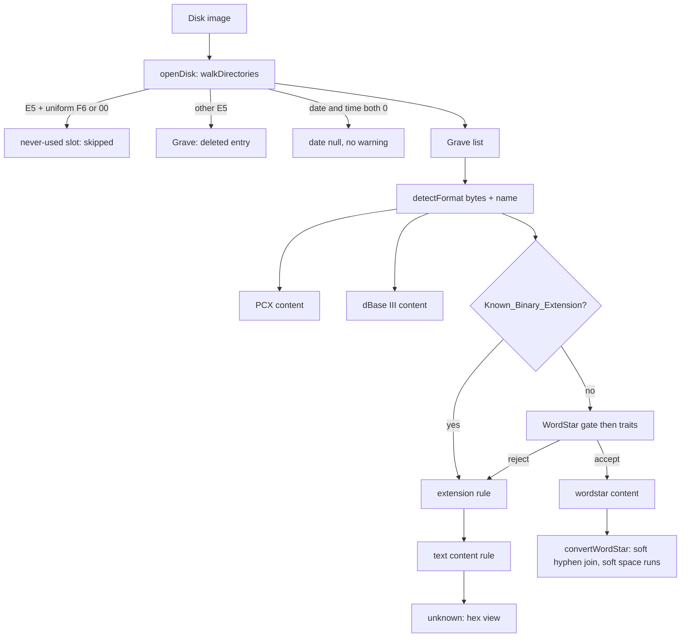
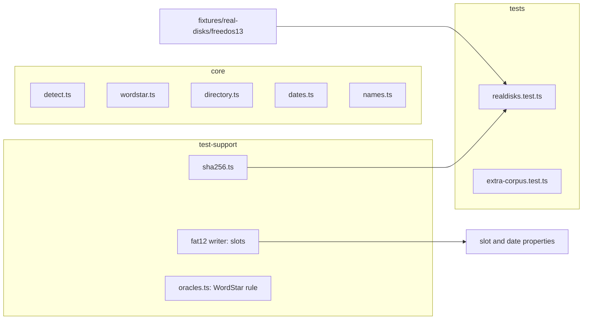

# Design Document

## Overview

Exhume was run on 35 real DOS disks and four bugs made real disks look broken (see `requirements.md` and Spec 7 of `docs/SPEC_BRIEFS.md`). This design fixes them in the smallest places that own them, keeps third-party real disks as regression input, and records the result in the README.

| # | Bug | Owner of the fix |
|---|---|---|
| 1 | `isWordStar` fires on binaries | `src/core/formats/detect.ts` |
| 2 | `0xE5` + 31 fill bytes read as phantom graves | `src/core/fat12/directory.ts` |
| 3 | Zero date and time word give `date-invalid` | `src/core/fat12/directory.ts`, `dates.ts` |
| 4 | Soft hyphen and soft space in WordStar output | `src/core/formats/wordstar.ts` |
| 5 (optional) | Deleted entries lose the long name | `src/core/fat12/names.ts`, `directory.ts` |

The rest is test and doc work: a manifest-driven test on the three FreeDOS images, an optional local corpus test, a test-only SHA-256 helper, a small additive extension of the test-only image writer, and one README paragraph.

### Basis and limits of this design

Read for this design: `detect.ts`, `wordstar.ts`, `directory.ts`, `dates.ts`, `names.ts`, `disk.ts`, `limits.ts`, the test-only writer (`src/test-support/fat12/`), `oracles.ts` and its users, `detect.test.ts`, the WordStar tests, the demo-disk CLI and checks, the purity tests, the manifest and the two earlier designs (`plain-text`, `format-resurrection` conventions). Research was done in the repository, not on the web: the facts the design rests on are in source.

Not done: I did not run the test suite, the fixtures, `make:demos --check`, or any measurement. Two kinds of numbers appear below and must not be confused:

- Thresholds in the WordStar rule are chosen by reasoning about byte distributions (shown in the text). This design did not measure them on real files; the project owner later did, outside the repo (see Risk 1). The first implementation task that touches them is the Realdisks_Test; if a fixture file is still detected as WordStar, the thresholds are tightened there, not argued here.
- Counts such as 942 files, 63 of 63 PCX and 39 of 39 dBase tables come from Spec 7 and Requirement 9 as supplied by the project owner. The design copies them into the README text and does not re-verify them.

### Design decisions

| Decision | Choice | Reason |
|---|---|---|
| WordStar traits | Keep today's three traits verbatim (soft return pair, dot command at line start, style toggle next to a hard return). Add a gate in front of them. | Fixture_Writer and demo documents are detected by exactly these traits today. Changing the traits risks Requirement 2. The false positives come from missing gates, not from the traits. |
| Gate inputs | Low 7 bits of each byte; an MZ/ZM prefix veto; a NUL budget; an "odd byte" budget. No high-bit density test. | The brief asks for text-likeness after clearing the high bit. A high-bit density cap would reject legitimate documents of single-letter words (every letter ends a word, so the high bit is set on most bytes) and adds little over the odd-byte budget. |
| Extension veto | Closed list, checked only against the WordStar content rule. PCX and dBase content rules still run first. | Requirement 1.13: dBase III tables keep their path. The veto removes only WordStar. |
| `.DBF` that is not dBase III | The WordStar rule is vetoed, then the existing extension rule reports `dbase` by extension, so `convertDbase` returns its "unsupported version" error. | Requirement 1.6 says "unknown" only when no other rule matches, and the extension rule is a rule. Consequence: a dBase II table shows a conversion error instead of a bare hex view. See Risks. |
| Never-used slot check | Inside the walker, right after the end-marker test, before the long-name branch. The slot is skipped and nothing else changes. | The slot still consumes one read from the 4,096-record budget, so loops stay bounded exactly as before. Long-name state is left alone. |
| Zero date | A new helper `isZeroDosDateTime(date, time)` in `dates.ts`; `decodeDosDateTime` is not changed. | Requirement 4.5(b) and (c) say every other pair behaves exactly as before. Leaving the decoder untouched makes that true by construction. |
| Soft space model | Run-level: within one run of pending spaces, soft spaces count only when the run has no ordinary space. | Streaming, deterministic, and it fits the converter's existing `pendingSpaces` counter. |
| Soft hyphen high-bit form | `0x9F` is treated as a soft hyphen too. | The converter already masks the high bit for every byte that is not part of a return pair, and an existing test treats `0x1F` and `0x9F` alike. Requirement 5 names `0x1F` only; this is a small, flagged widening. |
| Writer extension for slots | Additive optional `slots` on `FileTree` and `DirNode`. | When absent, layout is byte-for-byte the same, so the demo disks keep their bytes. |
| SHA-256 in tests | `src/test-support/sha256.ts` using `node:crypto` | Core stays free of Node APIs. Root `tsconfig.json` has the Node types; `src/core/tsconfig.json` excludes `*.test.ts`. |
| Item 5 | Designed in full, built last, droppable | See "Optional: long names of deleted entries". |

## Architecture



### Detection order

Unchanged, with one added condition on the third rule:

1. PCX content.
2. dBase III content.
3. WordStar content, only if the name is not a Known_Binary_Extension, and the sample passes the gate, and a trait is present.
4. Extension rule.
5. Plain text content rule.
6. `unknown`.

### Scope of change



## Components and Interfaces

### `src/core/formats/detect.ts`: the WordStar rule

New named constants (small numbers, so the formats purity scan for limit literals is not involved):

```ts
const ODD_BYTE_SHIFT = 4;  // odd bytes allowed: floor(n / 16), 6.25 %
const NUL_BYTE_SHIFT = 6;  // NUL bytes allowed: floor(n / 64), about 1.56 %
const TEXT_C0_STYLE_BOLD = 0x02, TEXT_C0_STYLE_UNDERLINE = 0x13, TEXT_C0_STYLE_ITALIC = 0x19, TEXT_C0_SOFT_HYPHEN = 0x1f;
const MZ_FIRST = 0x4d, MZ_SECOND = 0x5a;
```

Text-like set, evaluated on `low = b & 0x7f`: `0x20..0x7E`, TAB `0x09`, LF `0x0A`, FF `0x0C`, CR `0x0D`, EOF `0x1A`, the three style toggles `0x02 0x13 0x19`, and the soft hyphen `0x1F`. Every other low value (including `0x00` and `0x7F`) is an odd byte. A byte whose low value is `0x00` is also counted as NUL (this includes `0x80`).

Rule, one pass over the sample (`n <= DETECT_SAMPLE_BYTES`):

```ts
function isWordStar(s: Uint8Array): boolean {
  const n = s.length;
  if (n >= 2 && ((s[0] === MZ_FIRST && s[1] === MZ_SECOND) || (s[0] === MZ_SECOND && s[1] === MZ_FIRST))) return false;
  const oddBudget = n >> ODD_BYTE_SHIFT;
  const nulBudget = n >> NUL_BYTE_SHIFT;
  let odd = 0, nul = 0, trait = false;
  // existing state: toggle, hard, atLineStart
  for (let i = 0; i < n; i++) {
    const b = s[i];
    const low = b & 0x7f;
    if (!isTextLow(low)) {
      odd++;
      if (low === 0) nul++;
      if (odd > oddBudget || nul > nulBudget) return false;   // early exit, still one pass
    }
    // existing trait logic, copied verbatim, with `return true` replaced by `trait = true`
  }
  return trait;
}
```

Why these numbers:

- Uniformly random bytes (compressed archives, split `.001` files) fall in the text-like set with probability 104/128, so about 18.75 % are odd. The budget is 6.25 %. On a 4,096-byte sample the standard deviation of that count is about 25 bytes against a gap of about 500, so random data is rejected with near certainty.
- Executables, overlays, fonts and indexes are dense in `0x00..0x1F` values, and NUL padding is the typical case. The NUL budget (about 1.56 %) is much stricter than the odd budget because legitimate WordStar text has almost no NULs, while binaries have long NUL runs.
- For short inputs the shifts make the budgets zero. A 15-byte file with one odd byte is rejected. A 2-byte soft return (`0x8D 0x0A`) has both low values text-like and is still accepted, which keeps the existing short-input detection tests meaningful.
- A WordStar document's own control codes (print controls) fall in the odd set. The 6.25 % budget tolerates a handful per screenful. This is the weakest point of the choice and the reason it is checked on real files first (see Risks).

Because the trait logic is copied verbatim, any input accepted today with an empty odd set and an empty NUL set is accepted tomorrow. That includes every Fixture_Writer document and every demo document (printable ASCII, toggles, `0x0D 0x0A`, `0x8D 0x0A`, word-final high bits).

The loop never runs more than `n` iterations: the trait logic's `i++` skip after a hard return only shortens it.

### `src/core/formats/detect.ts`: the extension veto

```ts
/** True for names whose extension is in the closed Known_Binary_Extension list, or is made only of digits. */
function hasKnownBinaryExtension(fileName: unknown): boolean
```

It applies the same guards as the extension rule (`typeof fileName === 'string'` and at most `MAX_FILE_NAME_CHARS`), takes the text after the last dot, folds ASCII case with the existing `foldAscii`, and switches over `COM EXE SYS OVR BIN DLL DRV BGI CHR FON CPI NDX NTX MDX DBF ZIP ARC LZH`. A non-empty extension made only of `0..9` also counts. A name with no dot, or a non-string, is not vetoed. `detectFormat` becomes:

```ts
if (isPcx(sample)) return { format: 'pcx', source: 'content' };
if (isDbase(sample, input.length)) return { format: 'dbase', source: 'content' };
if (!hasKnownBinaryExtension(fileName) && isWordStar(sample)) return { format: 'wordstar', source: 'content' };
// extension rule, text rule and unknown: unchanged
```

`.TXT`, `.DOC` and no extension are not in the list, so a document with traits and one of those names is still `wordstar` by content (Requirement 1.11). `formatFromExtension` is not changed, so `X.DBF` still maps to `dbase` by extension.

### `src/core/fat12/directory.ts`: never-used slots and zero dates

```ts
const NEVER_USED_FILL_F6 = 0xf6;
const NEVER_USED_FILL_ZERO = 0x00;

/** E5 followed by 31 bytes that are all F6 or all 00: a slot DOS never used. One pass over at most 31 bytes. */
export function isNeverUsedSlot(rec: Uint8Array): boolean {
  if (rec.length < DIR_ENTRY_BYTES || rec[0] !== DELETED_MARK) return false;
  const fill = rec[1];
  if (fill !== NEVER_USED_FILL_F6 && fill !== NEVER_USED_FILL_ZERO) return false;
  for (let i = 2; i < DIR_ENTRY_BYTES; i++) if (rec[i] !== fill) return false;
  return true;
}
```

In `walkDirectories`, directly after `const deleted = first === DELETED_MARK;`:

```ts
if (deleted && isNeverUsedSlot(rec)) continue;   // before the long-name branch
```

What this leaves untouched, deliberately:

- `recordsRead` was already incremented and `frame.index` already advanced, so the 4,096-record budget and the outer iteration cap still bound the loop. Slots are not free for the budget.
- The long-name state (`frame.lfn`) is not reset and not flushed. A never-used slot raises no warning of its own. Long-name records cannot sit next to a never-used slot on a real disk, so this choice has no practical effect; it is the choice that guarantees "no Warning from the slot" literally (Requirement 3.2).
- The end marker (`0x00` as first byte) is tested before this line and still ends the directory. A real DOS 1.x directory is filled with `E5 F6...` slots through to the last entry and has no end marker; the walker then runs to the end of the source as it does for any full directory.

Zero dates, replacing the two lines that decode the date:

```ts
const dateWord = u16(rec, 24);
const timeWord = u16(rec, 22);
let date: string | null = null;
if (!isZeroDosDateTime(dateWord, timeWord)) {
  date = decodeDosDateTime(dateWord, timeWord);
  if (date === null) sink.add(WarningCode.DateInvalid, 'modification date or time is invalid', entryPath);
}
```

`dates.ts` gains only `export function isZeroDosDateTime(dateWord: number, timeWord: number): boolean { return dateWord === 0 && timeWord === 0; }`. This applies to deleted entries and directories too, because the lines sit before grading. A pair with exactly one zero word goes through `decodeDosDateTime` as before, so only the double zero is exempt (Requirement 4.4). The decoder returns `null` for a zero date anyway (month 0), so the new branch is the only behavior change.

### `src/core/formats/wordstar.ts`: soft hyphen and soft space

Today the `convert` loop treats `0x1F` as a silent drop (`c === 0x00 || c === 0x1f`), a soft return as "one pending space unless already at a break", and every space-like byte (`0x20`, `0xA0`, `0x09` after masking) as one pending space. New state, all local to `convert`:

```ts
let prevHyphen = false;   // the previous token was a soft hyphen
let runOrdinary = 0;      // ordinary spaces, tabs and soft-return spaces in the current pending run
let runSoft = 0;          // soft spaces (raw 0xA0) in the current pending run
```

`readToken` also records whether the token is a soft space: `tokSoftSpace = raw === 0xa0` for a single-byte token (a return pair is never a soft space).

Edits, in the order they occur in the loop:

1. After `readToken(i)`: `const afterHyphen = prevHyphen; prevHyphen = false;`. Every token clears the flag, so only a soft hyphen immediately before a soft return can join. A style toggle or space between them clears it.
2. Soft return branch (`KIND_SOFT`):
   ```ts
   if (!atBreak) {
     if (!afterHyphen) { pendingSpaces++; runOrdinary++; atBreak = true; }
     // afterHyphen: join. No space, and atBreak stays false, so the next letter follows directly.
   }
   ```
3. Soft hyphen: `if (c === 0x00) continue; if (c === 0x1f) { prevHyphen = true; continue; }`. Elsewhere the hyphen is dropped as before and is not counted, as before.
4. Space-like branch (`c === 0x09 || c === 0x20`):
   ```ts
   if (tokSoftSpace) {
     if (runOrdinary === 0) { pendingSpaces++; runSoft++; }   // else: next to an ordinary space, emit nothing
   } else {
     if (runOrdinary === 0) { pendingSpaces -= runSoft; runSoft = 0; }  // ordinary space cancels earlier soft ones
     pendingSpaces++; runOrdinary++;
   }
   atBreak = true;
   ```
5. `writeChar` and `writeHard`, where `pendingSpaces = 0` today, also set `runOrdinary = 0; runSoft = 0`.

Exact interaction with existing handling:

| Case | Result |
|---|---|
| `cor` `1F` `8D 0A` `rected` | `corrected`. The soft return found `atBreak === false` after `r` and `afterHyphen`, so it emits nothing. |
| `cor` `1F` `rected` | `corrected` (hyphen dropped, as today). |
| `cor` `1F` `20` `8D 0A` `rected` | `cor rected`. The space between clears the flag. |
| `word ` `1F` `8D 0A` `next` | `word next`. `atBreak` is true after the space, so the soft return adds nothing (as today) and the hyphen is dropped. |
| `1F` `8D 0A` at the start | Nothing; `atBreak` is true at start (as today). |
| `a` `20` `A0` `b` | `a b` (soft space next to ordinary space adds nothing). |
| `a` `A0` `20` `b` | `a b` (the ordinary space cancels the soft one already counted). |
| `a` `A0` `A0` `b` | `a  b` (run has only soft spaces: each is one space, as today). |
| `a` `A0` `8D 0A` `b` | `a b`. After the soft space `atBreak` is true, so the soft return adds nothing (as today). |
| `a` `8D 0A` `A0` `b` | `a b`. The soft return's space counts as ordinary, so the soft space adds nothing. |
| A hard return after any run | `writeHard` writes the run's `pendingSpaces` as trailing spaces, as today, then resets the counters. |
| Document with no `1F`/`9F` and no `A0` | Identical to today: `afterHyphen` is always false, `runSoft` is always 0, so `pendingSpaces -= 0` and `runOrdinary` is never read. |

Cap arithmetic is unchanged: the cap checks use `pendingSpaces`, which only gets smaller. Loops still consume at least one input byte per step.

### `src/test-support/fat12/` : never-used slots in the writer

Additive fields in `types.ts`:

```ts
export interface NeverUsedSlot {
  /** Insert the slot before this child (0..children.length; children.length puts it after the last child). */
  beforeChild: number;
  /** 'f6': E5 then 31 bytes of 0xF6. 'zero': E5 then 31 zero bytes. */
  fill: 'f6' | 'zero';
}
// FileTree and DirNode each gain:  slots?: NeverUsedSlot[];
```

Changes:

- `measure.ts`: the root entry count and the directory record count add `slots.length`, so `FitError('root-entry-count')` still fires before any byte is written.
- `layout.ts`: the cluster need of a directory (`records = 2 + children.reduce(...)`) adds `slots.length`. In the record writing loop (the `index` counter and `recordAt(index)`), before writing child `i` (and after the last child) write each slot whose `beforeChild` matches: byte 0 `DELETED_MARK`, bytes 1 to 31 the fill, `index++`. A long-name group of a child is never split by a slot.
- Validation throws `RangeError` for a non-integer or out-of-range `beforeChild` or an unknown fill, like the other writer validators.
- With `slots` absent nothing changes, so existing layouts and the committed demo disks are byte-identical. `make:demos --check` is the proof (Risks).

### `src/test-support/sha256.ts`

```ts
import { createHash } from 'node:crypto';
export function sha256Hex(bytes: Uint8Array): string {
  return createHash('sha256').update(bytes).digest('hex');
}
```

Used only by `realdisks.test.ts` and its own tiny test (NIST vectors for the empty input and `abc`). It is outside `src/core`, outside the writer's reachable files, and imports nothing from the project.

### `src/test-support/formats/oracles.ts`

`detectOracle` is rewritten as an independent model of the new rule, structured differently from the loop: first compute the text-like and odd counts with array methods over the low-7 view, apply the MZ/ZM and budget checks, then evaluate the traits with the existing line-based description. `detectFullOracle(bytes, fileName)` gains the extension veto using its own copy of the closed list. The expectation helpers for the existing properties (`noContentBytes`, `contentBytes` in `detect.test.ts`) keep using `detectOracle`.

### `src/core/realdisks.test.ts` (new): manifest-driven grading

Location: `src/core/realdisks.test.ts`. It uses `openDisk` and `detectFormat` through the module indexes, `readFileSync` and `resolve` from `node:*` for the fixtures only, and `sha256Hex`. The vitest include glob already picks it up, so it runs under `npm test`.

Shape:

```ts
interface ManifestFile { path: string; size: number; sha256: string }
interface ManifestImage {
  file: string; bytes: number; sha256: string; volumeLabel: string;
  directories: string[]; files: ManifestFile[]; deletedEntries: { path: string; size: number }[];
}
interface Manifest { images: ManifestImage[] }
```

A hand-written `parseManifest(json: unknown): Manifest` checks the shape and throws a plain `Error` naming the first bad field (no `any`, no schema library). Unknown extra fields such as `note_wordstarFalsePositivesBeforeFix` are ignored; they are notes, not expectations.

A pure function does the grading so that it can be tested against itself:

```ts
function gradeImage(entry: ManifestImage, image: Uint8Array): string[]   // returns problems, empty when all good
```

It performs, in this order, and returns early after step 1 if the image itself is wrong:

1. Image integrity: `image.length === entry.bytes` and `sha256Hex(image) === entry.sha256`, before any reading (Requirement 6.2).
2. `const handle = openDisk(image)`. Zero warnings (6.7).
3. Alive files: graves with `kind === 'file'` and `state === 'alive'`, keyed by `foldAscii(path)`. Duplicate folded keys, on either side, are reported as problems. Missing and extra keys are reported (6.3, 6.5). For each expected file: same `size`, and `sha256Hex(bytes)` of `handle.readBytes(grave)` equals the manifest value (6.4). The bytes are kept for step 5.
4. Directories: alive graves of kind `directory`, folded, equal the folded `entry.directories` as sets (6.6).
5. Detection: for every alive file, `detectFormat(bytes, lastSegment(path)).format !== 'wordstar'` (6.8). `lastSegment` is a local helper like the one used by the MCP and web callers, which pass the base name.
6. Deleted entries: graves with `state !== 'alive'`, as folded `(path, size)` pairs, equal the manifest `deletedEntries`, with no others (6.9). If item 5 is implemented, an entry is also accepted under a test-local table of long-name alternatives: `/_reedos.012` may appear as `/freedos.012`, and `/_reedos.020` as `/freedos.020` (Requirement 10.5). The table lives in the test file; the manifest is not edited.

`foldAscii` maps only `A` to `Z`; everything else is unchanged (6.10), matching the lower-case paths of the macOS mount.

Tests in the file:

- `describe.each(manifest.images)`: reads `fixtures/real-disks/freedos13/<file>` and expects `gradeImage(...)` to return `[]`.
- Negative controls on in-memory copies only: change one expected hash, one size, drop one expected file, add an unexpected `deletedEntries` row, and flip one image byte. Each must make `gradeImage` return at least one problem. This guards against a vacuous test.
- `foldAscii` examples, `sha256Hex` vectors (in `sha256.test.ts`).
- Existence of `NOTICE.md` next to the images (7.2), and that no file under `public/` has the SHA-256 of a fixture (7.3). The `public/` scan is bounded by the small `public/disks` folder.

The test never writes, never touches the network, and takes every expected value from the manifest (Requirement 6.11 and 6.12). Runtime: three images of at most 1.4 MB and a few hundred files; the global `testTimeout` of 60 s is ample.

### `src/core/extra-corpus.test.ts` (new, optional corpus)

```ts
const dir = process.env.EXHUME_EXTRA_DISKS;
describe.skipIf(dir === undefined || dir === '')('extra corpus (local only)', () => { ... });
```

- Lists the folder non-recursively, keeps names ending in `.img` (ASCII case-insensitive), sorted for stable output.
- For each entry: `lstatSync`; skip anything that is not a regular file (symlinks included) or is larger than `MAX_IMAGE_BYTES` (2,949,120, imported from the FAT12 limits, not repeated), print a note, continue. The read is inside `try/catch`; any error prints a note and continues (Requirement 8.5).
- For each readable image: `openDisk`, count `files` (graves of kind `file`), `graves` (state not `alive`), `warnings`, and, for every file whose bytes read, `detectFormat(bytes, lastSegment(path)).format` counts by format.
- A pure `summarise(rows)` builds the printed table and totals. It is unit-tested with fabricated rows in the same file (outside the skipped block), including a "note" row.
- The only assertion is that the test body completed; content never fails it (Requirement 8.4). Nothing is written or copied, nothing is fetched, and the folder is only read.

### Optional: long names of deleted entries (item 5)

Status: OPTIONAL. Build last, in its own task, after everything else is green. Drop it if any step is not clean; every other requirement holds without it and `realdisks.test.ts` accepts the underscore form.

What the bytes look like (derived from the writer and from the manifest note): when a file with a long name is deleted, each long-name record keeps its attribute `0x0F` and its checksum byte but its first byte becomes `0xE5`, so the sequence numbers are gone. The 8.3 entry also starts with `0xE5`. The long-name records appear in reverse order (highest part first) right before the 8.3 entry. The VFAT checksum was computed over the original 11 bytes, including the first character that is now lost.

Key fact that makes recovery checkable: the checksum is `ROR1(sum) + byte` per byte, so the first byte reaches the end through ten more rotations and additions. For fixed other bytes, `first byte -> checksum` is a bijection (a rotation by ten of an 8-bit value is a rotation by two; adding a constant is a bijection). So the checksum determines the lost first byte uniquely, and a 256-step search over `lfnChecksum` finds it. To keep a random match from naming a file, the recovered byte must also equal the ASCII-uppercased first UTF-16 unit of the assembled long name.

Components:

```ts
// names.ts
export interface DeletedLfnState {
  count: number;          // records seen, in physical order
  overflow: boolean;      // more than MAX_LFN_ENTRIES
  checksum: number;       // from the first record
  consistent: boolean;    // all records carry the same checksum
  units: Uint16Array;     // record j at j * 13, physical order
}
export function makeDeletedLfnState(): DeletedLfnState;
export function resetDeletedLfn(s: DeletedLfnState): void;
export function feedDeletedLfn(s: DeletedLfnState, rec: Uint8Array): void;   // never throws
/** Name for the 8.3 entry `rec` (first byte E5), or undefined when anything does not fit. */
export function takeDeletedLfn(s: DeletedLfnState, rec: Uint8Array): string | undefined;
```

`takeDeletedLfn` requires `1 <= count <= MAX_LFN_ENTRIES`, `consistent`, no overflow. It assembles the units in sequence order (physical index `count - 1` down to `0`), stops at the first `0x0000`, requires `1 .. MAX_NAME_UTF16` units, finds the first byte by looping `b` from `0` to `255` over `lfnChecksum`, checks the recovered byte against the uppercased first unit, and returns `sanitizeComponent(...)` of the name (the same sanitiser as live names). Otherwise it returns `undefined` and the caller keeps the underscore form. All loops are bounded (at most 20 records, 256 candidates, 255 units).

Wiring in `directory.ts`: `DirFrame` gains `dlfn: DeletedLfnState | undefined`, created on the first deleted long-name record. The long-name branch becomes `if (deleted) feedDeleted(frame, rec) else lfnFeed(frame.lfn, rec)`. In the deleted 8.3 branch, `takeDeletedLfn` supplies the path component if defined. Every non-long-name record resets `dlfn`. No new warning code: debris from deleted long names is normal.

Cost, honestly: about 70 lines in `names.ts`, about 15 in `directory.ts`, no writer change (the writer already writes deleted long-name records with the checksum of the original name, see `layout.ts`), one example test, one property, and a changed deleted-grave path for any existing test that has a deleted node with a long name. The grep I ran found long names only in live nodes of `names.test.ts`. I did not check the web and MCP tests for deleted long names, so that check is the first step of this task.

### README

One paragraph and a heading, inserted after the demo-disks section and before `## MCP server and Kiro Power`. The demo text above it is not edited. Proposed text, with the numbers as supplied in Requirement 9:

```markdown
## Tested on real disks

Exhume was tested on 35 real DOS disks that are not part of the demo disks: 24 FreeDOS 1.3 floppy images and 11 disks from the PCjs archive (160 KB to 1.44 MB). The FreeDOS files were checked against the macOS msdos driver (read-only mount) and the PCjs files against the per-file MD5 table that PCjs publishes with each disk. All 942 files matched that independent reference byte for byte. 63 of the 63 PCX images that Pillow could open matched pixel for pixel; Pillow refused the other 25, which Exhume renders. 39 of 39 dBase III tables matched `dbfread`, with dates and logicals compared after normalising Exhume's ISO date and TRUE/FALSE output. The page does not offer these disks. Three unmodified FreeDOS images are kept in `fixtures/real-disks/freedos13/` as read-only test input, with their own license notice.
```

The last two sentences keep the honesty rule: the FreeDOS images are in the repository as fixtures (so the paragraph does not say they are absent), and nothing says PCjs or FreeDOS files are part of Exhume or offered by the page. `readme.test.ts` gets examples for the heading, the five numbers, the two source names and the absence of the forbidden claims.

## Data Models

```ts
// formats/detect.ts: no new exported type. DetectResult is unchanged.

// fat12/directory.ts: no new exported type besides the isNeverUsedSlot function.

// test-support/fat12/types.ts
export interface NeverUsedSlot { beforeChild: number; fill: 'f6' | 'zero' }

// fat12/names.ts (optional item 5)
export interface DeletedLfnState { count: number; overflow: boolean; checksum: number; consistent: boolean; units: Uint16Array }

// realdisks.test.ts (test-local)
interface ManifestFile { path: string; size: number; sha256: string }
interface ManifestImage { file: string; bytes: number; sha256: string; volumeLabel: string;
  directories: string[]; files: ManifestFile[]; deletedEntries: { path: string; size: number }[] }

// extra-corpus.test.ts (test-local)
type CorpusRow =
  | { kind: 'image'; name: string; files: number; graves: number; warnings: number; formats: Record<string, number> }
  | { kind: 'note'; name: string; note: string };
```

`DiskReport`, `Grave`, `Warning` and `DetectResult` keep their shapes. `Grave.date` is already `string | null`.

## Correctness Properties

*A property is a characteristic or behavior that should hold true across all valid executions of a system-essentially, a formal statement about what the system should do. Properties serve as the bridge between human-readable specifications and machine-verifiable correctness guarantees.*

Prework reflection. Redundant or merged items: 1.6, 1.10, 1.13 fold into Property 1 (detection equals an independent oracle for all bytes and names). 1.4 folds into Property 2 (the gate decides on the low 7 bits) and into Property 1. 1.12 folds into Property 3 (`DBF` is in the list). 1.11 and 2.1 fold into Property 4. 3.2 and 3.5 fold into Property 6. 3.7 is Property 6. 4.1 to 4.4 fold into Property 8. 5.5 and 3.8 and 10.3 fold into Property 12 (totality). 2.5 and 5.6 are carried by the existing WordStar properties for inputs without the new bytes plus a golden test, and are not restated as a new property: a "same as before" statement needs the old code as a reference, and keeping a frozen copy of the old converter would be a second implementation to maintain. Items classified SMOKE, EXAMPLE or INTEGRATION in the prework (fixtures, README, loops and regex bounds, optional corpus) are covered in the Testing Strategy, not as properties.

### Property 1: Detection equals the independent oracle

*For any* byte array and *any* file name value (a string of any length or a non-string), `detectFormat(bytes, name)` returns the same `format` and `source` as `detectFullOracle(bytes, name)`, where the oracle applies PCX content, dBase III content, WordStar content (unless the name has a Known_Binary_Extension), the extension rule, the text rule and `unknown`, in that order, and `detectFormat` never throws.

**Validates: Requirements 1.4, 1.6, 1.10, 1.13**

### Property 2: The gate rejects binary-looking samples

*For any* sample that begins with `MZ` or `ZM`, or whose NUL count (low 7 bits `0x00`) exceeds `floor(n/64)`, or whose odd-byte count exceeds `floor(n/16)`, and *for any* WordStar trait placed anywhere in it and any file name, `detectFormat` does not return `wordstar`. Setting or clearing the high bit of any byte that is not part of a trait pair does not change this verdict.

**Validates: Requirements 1.2, 1.3, 1.4**

### Property 3: Known binary extensions are never WordStar

*For any* byte array, including WordStar documents, and *any* name whose extension is in the closed list in any ASCII case mix, or is made only of digits, `detectFormat` does not return `wordstar`. For dBase III content with such a name (including `.DBF`) the result is still `dbase` by content.

**Validates: Requirements 1.5, 1.12, 1.13**

### Property 4: WordStar documents are still detected, whatever the text extension

*For any* document produced by `writeWordStar` (printable ASCII, styles, soft wraps) and *for any* hand-built document of text-like bytes with a trait, including `0xA0` and `0x1F` bytes, and *for any* name that is absent, has no extension, or has the extension `TXT`, `DOC` or `WS`, `detectFormat` returns `wordstar`; for the first three name classes the source is `content`.

**Validates: Requirements 1.7, 1.11, 2.1**

### Property 5: Detection reads only the sample window

*For any* byte array longer than `DETECT_SAMPLE_BYTES` and *any* edit at an index of `DETECT_SAMPLE_BYTES` or later, `detectFormat` returns the same result; a WordStar marker that starts at or straddles the window edge is not seen, and the same marker fully inside the window is, when the surrounding sample passes the gate.

**Validates: Requirements 1.8**

### Property 6: Never-used slots are invisible

*For any* file tree and *any* placement of Never_Used_Slots of either fill at any position in the root directory or in any subdirectory (before, between or after real entries), the DiskReport for the tree with slots has the same list of `(path, size, date, state, kind)` for its graves, the same list of warning `(code, path)` pairs, and contains no Grave or Warning whose origin is a slot.

**Validates: Requirements 3.1, 3.2, 3.5, 3.7**

### Property 7: Other `0xE5` slots are still graves

*For any* 31-byte tail that is neither all `0xF6` nor all `0x00`, a root slot made of `0xE5` followed by that tail yields exactly one more Grave than the same image without the slot, and the reader's result for that slot equals what it was before this spec (the slot is graded and named as a deleted entry).

**Validates: Requirements 3.3**

### Property 8: Date and time word pairs

*For any* pair of 16-bit words (date, time), applied to a directory entry: when both are zero the Grave has `date: null` and no warning is added; when the pair is not both zero and `decodeDosDateTime` returns a string, the Grave has that string and no warning; when the pair is not both zero and `decodeDosDateTime` returns `null`, the Grave has `date: null` and exactly one `date-invalid` warning naming the entry's path.

**Validates: Requirements 4.1, 4.2, 4.3, 4.4, 4.5**

### Property 9: Soft hyphen joins at a soft return and is dropped elsewhere

*For any* two non-empty strings `a` and `b` of letters, `convertWordStar(a ++ [0x1F] ++ [0x8D, 0x0A] ++ b)` has output `a + b`, also with the high-bit form `0x9F`; and *for any* byte array without a return pair after a soft hyphen, removing every `0x1F` and `0x9F` does not change the output.

**Validates: Requirements 5.1, 5.2**

### Property 10: Soft spaces are justification padding

*For any* text of words separated by runs of space bytes drawn from `0x20` and `0xA0`, the converter's output equals the output for the normalised input in which every run that contains at least one `0x20` keeps only its `0x20` bytes, and every run made only of `0xA0` is replaced by the same number of `0x20` bytes.

**Validates: Requirements 5.3**

### Property 11: Deleted long names (optional, item 5)

*For any* writer tree with a deleted node that has a long name, the Grave path ends with the sanitised long name; when the checksum byte of its deleted long-name records is changed, or the long name's first character does not match the recovered first byte, the path is the underscore form; and the path never contains a separator or control character.

**Validates: Requirements 10.1, 10.2, 10.4**

### Property 12: Totality on hostile input

*For any* hostile byte array (random bytes, bytes with `0xE5` and `0xF6` or `0x00` fill in directory regions, mutated images, WordStar-like grammars with `0x1F`, `0xA0` and `MZ` prefixes), `openDisk`, `detectFormat`, `convertWordStar` and `convertAuto` return results that satisfy the existing contracts, neither throw nor exceed the time budget, and leave the input unchanged.

**Validates: Requirements 1.10, 3.8, 5.5, 10.3, 11.4**

## Error Handling

- Non-`Uint8Array` input to `detectFormat` and the converters still throws the existing `TypeError`. That is outside Requirement 1.10, which concerns any `Uint8Array`.
- Gate rejection is not an error: the WordStar rule returns false and detection continues with the extension and text rules. A rejected file with no other signal is `unknown`, so `convertAuto` returns the existing no-converter failure and the page shows the hex view; the MCP server returns `NO_CONVERTER`.
- A `.DBF` file that is not dBase III is reported as `dbase` by extension and `convertDbase` returns its existing unsupported-version failure. The MCP server maps this to `CONVERSION_FAILED`, and the page shows the error with the raw bytes. This is the honest answer for a dBase II table, but it differs from the bare hex view that 1.6 suggests for other files.
- A never-used slot raises no warning and no grave. A slot that looks like one except for a single different byte is a normal deleted entry, graded as before.
- A zero date and time is not a warning. Any other invalid pair keeps `date-invalid` with the entry's path.
- Limits (record budget, depth, chain length, sizes) behave as before: stop the item, warn, continue.
- Converter: no new warning code. A soft hyphen stays silent: it is not counted in `control-codes-dropped`, as before.
- Test side: `parseManifest` throws a plain error on a malformed manifest, which fails the test with the field name. The corpus test catches every per-image error and prints a note.
- Item 5: any mismatch returns `undefined` and the underscore form stays. No new warning code.

## Testing Strategy

Tools: Vitest and fast-check, as in the rest of the repository (`src/**/*.test.ts`). Property tests run at least 100 iterations through `numRuns(100)` from `src/test-support/runs`. Each property test carries the comment `Feature: real-disk-hardening, Property N: <title>`. A fast-check callback returns a boolean or nothing and never calls `expect` (enforced by `formats-purity.test.ts`). Each property is one property test. The hostile suites keep running under `npm run test:fuzz` (its pattern is `hostile`), so the new fill families go into files whose names contain `hostile`.

Property-based testing applies to detection, the reader's slot and date handling, and the converter (pure functions over bytes). It does not apply to the fixture grading, the corpus test, the README, the `make:demos --check` run, or the committed bundle: those use example tests and the existing static checks.

### New and extended tests

| File | Content |
|---|---|
| `src/core/formats/detect.test.ts` | Properties 1 to 5, extending the existing blocks (see the change table). |
| `src/core/formats/detect.examples.test.ts` | Examples: `MZ` prefix with a trait; a COM-named WordStar document; a TXT-named WordStar document; `.DBF` with dBase III content; `.DBF` with a dBase II header (extension rule, no WordStar); `FREEDOS.001` with random bytes; a 15-byte file with one odd byte; the 2-byte soft return. |
| `src/core/fat12/directory.unit.test.ts` | Examples: `E5` plus 31 `F6` in root; `E5` plus 31 `00`; a slot mixing both fills is a grave; slots in a subdirectory; slots before and after a real entry; the 4,097th record still stops the scan; zero date and time; zero date only; zero time only; invalid month still warns. |
| `src/core/fat12/reader.roundtrip.test.ts` (or a new `reader.slots.test.ts`) | Properties 6 and 7 with writer trees and `slots`. Property 8 by patching the two words of one writer entry (same technique as `reader.examples.test.ts`). |
| `src/core/fat12/reader.hostile.test.ts` | Property 12: directory regions filled with `E5 F6...` and `E5 00...` patterns, mixed with real entries and with noise. |
| `src/core/formats/wordstar.examples.test.ts` | Examples from the interaction table, including all the edge rows. |
| `src/core/formats/wordstar.text.test.ts` | New properties 9 and 10 (see the change table for the edit of the existing one). |
| `src/core/formats/wordstar.golden.test.ts` (new) | Markdown of the committed demo WordStar documents and ten fixed writer documents, recorded before the converter change and compared after. Carries Requirements 2.5 and 5.6. |
| `src/test-support/fat12/layout.test.ts`, `measure.test.ts` | Examples: slot bytes at known offsets for both fills in root and subdirectory, a subdirectory that needs an extra cluster because of slots, `FitError` when slots overflow the root, bad `beforeChild`. |
| `src/test-support/sha256.test.ts` (new) | NIST vectors for the empty input and `abc`. |
| `src/test-support/formats/oracles.test.ts` | Examples for the new `detectOracle` and the veto in `detectFullOracle`. |
| `src/core/realdisks.test.ts` (new) | As designed above, including negative controls. |
| `src/core/extra-corpus.test.ts` (new) | Skipped unless `EXHUME_EXTRA_DISKS` is set; `summarise` unit tests always run. |
| `src/demo-disks/readme.test.ts` | README examples listed above. |
| Item 5 files | Names tests for `takeDeletedLfn`; Property 11 in `reader.roundtrip.test.ts`; hostile generator with `E5` plus attribute `0x0F` records. |

### Existing tests that must change

Found by reading. Each change is a fixture or expectation edit that follows from a requirement, not a weakening. I did not run the suite, so the first implementation task is a full run to find any other dependent.

| File | Test | Why it breaks | Change |
|---|---|---|---|
| `src/core/formats/detect.test.ts` | `never detects WordStar from a marker placed only after the window`, `does not see a dot command that starts at index 4096...`, `does not see a two-byte marker that straddles the window edge`, `detects the same markers when they sit fully inside the window` | `fillerWith` fills with `0x01`, an odd byte. The gate now rejects an all-odd sample, so the "inside the window" cases no longer detect. The "after the window" cases would still pass, but because the gate rejects the filler, not because the window works, so they would stop testing the window. | Use `0xC1` (letter `A` with the high bit) as filler: text-like for the gate, not text for the plain text rule. Expectations stay as they are (`unknown/none` after the window, `wordstar/content` inside). |
| `src/core/formats/detect.test.ts` | `lets content win over any file name, including a conflicting extension`, and Property 11 `Strong content rules beat every extension` | They assert that WordStar content wins over every name. A Known_Binary_Extension name now vetoes it. | Restrict the "any name" generator to names without a binary extension for WordStar content (PCX and dBase content still use any name), and add Property 3. |
| `src/test-support/formats/oracles.ts` | `detectOracle`, `detectFullOracle` | They encode the old rule. | Rewritten as above. `oracles.test.ts` expectations for `A 8D 0A` and `.PA\r\nhi` still hold. |
| `src/core/formats/wordstar.text.test.ts` | `gives the same output when the high bit is set on non-return characters` | `plainLine` includes the space byte, and a space with the high bit set (`0xA0`) next to an ordinary space is now dropped. | Apply the random high bit to every byte except `0x20`. Property 10 covers `0xA0`. |
| `src/core/formats/wordstar.styles.test.ts` | `Property 14: un-escaping recovers the 7-bit text of the input` | `plainTextArb` sets the high bit randomly on `0x20`, and the expected text keeps every space. | Do not set the high bit on `0x20` in `plainTextArb`. Update the model comment near line 30 about spaces. |
| `src/test-support/formats/hostile.ts` | `WS_TOKENS` | Not broken. Widened so the hostile grammar reaches the new paths. | Add `[0xa0]`, `[0x1f, 0x8d, 0x0a]` and an `MZ` prefix token. |
| `src/mcp/build.test.ts` | `matches the committed power/server/exhume-mcp.mjs` | The bundle embeds `src/core`. | Run `npm run build:mcp` and commit the bundle. That command is a manual step for the user, as the README says. |

Tests I read that stay unchanged and are expected to pass: `reader.examples.test.ts` and `directory.unit.test.ts` date cases (invalid month still warns), the `format-resurrection` converter properties for inputs without the new bytes, `detect.examples.test.ts` (its writer documents have no odd bytes), and the demo-disk shared checks (the demo `.WS` files are also rescued by the `WS` extension rule if a content gate ever disagreed).

### Demo disk byte identity

`make:demos --check` rebuilds the three images from `scripts/make-demo-disks.ts` through the test-only writer and compares them with `public/disks/`. The images depend on the writer and the generator, not on detection or conversion. The writer change is additive and inert without `slots`, so the bytes must not change. The shared checks that run inside the command read the fresh images with the reader, detector and converter; they must keep passing, which exercises Requirement 2.2 on the demo documents.

## Risks

1. **Thresholds are chosen, not measured.** The 1/16 and 1/64 budgets are reasoned from byte distributions. If a fixture file is still detected as WordStar, or a real WordStar document with many print controls is rejected, the budgets move. The Realdisks_Test catches the first case on the three fixtures. The second case has no fixture in the repository (no WordStar disk is committed), so it is covered only by synthetic documents and by the optional corpus test run on the project owner's local PCjs disks. The WordStar 3.20 `EXAMPLE.TXT` case in Requirement 1.11 is therefore tested with synthetic input, not with the real file.

   Measured afterwards. The project owner (not this design, and outside the repo) ran the proposed rule on all 35 real disks: MZ/ZM veto, NUL budget `n >> 6`, odd budget `n >> 4` on the low 7 bits, plus the Known_Binary_Extension veto. Of the 197 files detected as WordStar before, 186 are no longer WordStar: 169 by the extension veto and 17 by the gate, all binaries (`.v8f` code pages, `freedos.saf`, a `.MEM` file, a `.LIB`). On the three fixtures the count drops to 0. The 11 still detected are 10 real WordStar documents (WordStar 3.20 `EXAMPLE.TXT` at 1.07 % odd bytes, several `.WS` files, a `READ.ME`, a `.PAT` and a `.DIR` with dot commands) plus one Intel HEX text file (`DATETEST.H86`, exactly 6.25 % odd bytes, harmless, deliberately left). No real WordStar document was lost. Decision: the thresholds stay as designed. These numbers are reported by the owner; this design did not reproduce them.
2. **`.DBF` that is not dBase III becomes a conversion error, not hex.** See Error Handling. Accepted because it is truthful; the alternative is to return `unknown` for a `DBF`-named file after a WordStar veto, which needs a special case in the extension rule.
3. **Existing tests change.** Listed above. The edits are small, but `wordstar.text` and `wordstar.styles` express "a high-bit space is a space" as a property, and that statement is deliberately no longer true for spaces next to ordinary spaces (Requirement 5.3).
4. **Stale MCP bundle.** `mcp/build.test.ts` fails until `npm run build:mcp` is run and the bundle is committed. Until then the committed Power would still contain the old detector.
5. **Demo disk byte identity.** Low risk by construction (additive writer option), verified by `make:demos --check`. Not run here.
6. **Fixture licensing.** The three images are GPL and other licenses. They stay unmodified next to `NOTICE.md`, outside `public/`. Requirement 7 is checked by the SHA-256 comparison and the `public/` scan. Commit them with this spec.
7. **Never-used slots count against the record budget.** A 1.44 MB disk has a 224-entry root, far below 4,096, so real disks are not affected. A hostile image with a huge root and subdirectory chain hits the existing limit and warning, as before.
8. **Soft hyphen high-bit form.** `0x9F` joins like `0x1F` because the converter masks the high bit. If the project owner wants the literal reading of Requirement 5, a single comparison on `raw` changes it.
9. **Item 5 (optional) touches grave paths.** Any consumer that keys on a deleted grave's path sees the long name instead of the underscore form. Web and MCP tests for this were not read. Drop the item if they object.
10. **Property 6 compares a projection.** Slots can push a directory into one more cluster, which shifts later start cluster numbers and therefore `Grave.startCluster` and the text of some deleted-entry reasons. The property compares path, size, date, state and kind, and uses live nodes, so it does not depend on cluster numbers. Deleted-entry behavior is covered by the examples.
