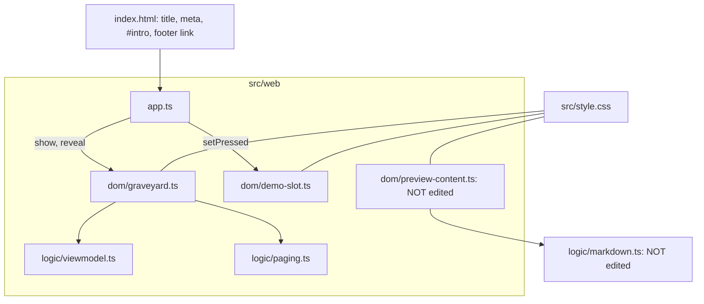
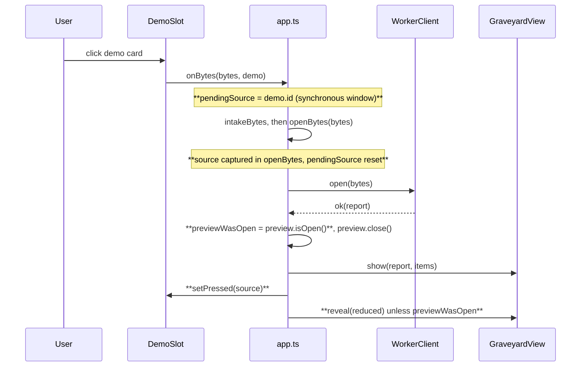

# Design Document

## Overview

This design implements the nine items of the `ui-polish` requirements. Every change is in `index.html`, `src/style.css`, `src/web/` (and its tests) and the test helpers under `src/test-support/web/`. Nothing in `src/core/`, `src/mcp/`, `power/`, `scripts/` or `public/disks/` changes, and `package.json` is untouched.

What was read to ground the design:

- `index.html`, `src/style.css` (750 lines), `src/main.ts`, `src/web/app.ts`, all of `src/web/dom/*` and `src/web/logic/*` that matter here (`paging.ts`, `viewmodel.ts`, `contrast.ts`, `limits.ts`), `README.md`.
- Tests: `page.static.test.ts`, `app.dom.test.ts`, `graveyard.dom.test.ts`, `demo-slot.dom.test.ts`, `markdown-dom.dom.test.ts`, `contrast.test.ts`, and the helpers `css-scan.ts` and `html-scan.ts`.
- `package.json`: the only dev dependencies are `@types/node`, `fast-check`, `happy-dom`, `typescript`, `vite`, `vitest`. **There is no Playwright, Puppeteer or other real-browser tool, and no `jsdom`.** Tests run in two Vitest configs: `vitest.config.ts` (pure, no DOM) and `vitest.dom.config.ts` (`*.dom.test.ts`, each file opts into `happy-dom`).

### What the test environment can and cannot verify

happy-dom has no layout engine: `getBoundingClientRect()` returns zeros, there are no pixels, and media queries and stylesheet cascades are only partly supported. So:

| Kind of claim | Automated check | Manual check |
|---|---|---|
| Markup, text, attributes, focus, `aria-*`, event flow | happy-dom DOM tests | none |
| CSS rules (values, selectors, media blocks) | the existing text parser `parseCss` in `src/test-support/web/css-scan.ts`, which already reports `@media` context | none |
| Rendered height, "no visible band", "no horizontal scroll" | **cannot be verified automatically**; only rule-level proxies | headless Chromium at 1440×900 and 390×844 (see "Manual verification") |

Requirements 3.2, 3.5 and 5.8 describe rendered results. The design gives each one an automated rule check and a separate manual measurement, and says which is which. A passing automated proxy does not prove the rendered result.

### Decisions at a glance

| Item | Decision |
|---|---|
| 1, 2 | Static markup in `index.html`: `section#intro` before `main`, a repo link in the footer, new title and meta description. |
| 3 | The gradient glows leave `#fx-host` and become `body::before`, absolutely positioned over the whole body, with fixed-size ellipses. The ground colour moves to `html`. `#fx-host` keeps only the fixed canvas. |
| 4 | `createGraveyardView` renders a guidance line first. The heading, summary, progress and "Show more" are hidden until the first successful `show()`. |
| 5 | New `GraveyardView.reveal(reducedMotion)` focuses the heading (`tabindex="-1"`) and scrolls it into view. `app.ts` calls it on a successful open unless the preview was open. |
| 6 | CSS only: `.preview-markdown` line height 1.5 and `.preview-markdown p` bottom margin 0.75em, plus tests. `markdown.ts`, `preview-content.ts` and `src/core` are not edited. The deeper cause (hard returns do not become paragraph breaks) belongs to the bugfix spec `mcp-root-and-flaky` (see "Markdown preview"). |
| 7 | New `nameHint` field on `ItemViewModel`; shape cues through CSS glyphs; a larger open-grave icon with a new contrast pair. |
| 8 | `progressText` becomes "Showing N of M items", moved into a stats block under the heading. `DemoSlot.setPressed(id)` drives `aria-pressed`. |
| 9 | Already met by item 3's `body::before` glow plus the existing canvas. No new animation or code. |

## Architecture



Data flow for a successful open (changes in bold):



On `failed`, `lost` or `superseded` none of the bold steps run, which gives requirements 4.3, 4.4, 5.5 and 8.8 for free.

## Components and Interfaces

### 1. `index.html` (Requirements 1, 2)

Changes:

- `<title>Exhume - read old floppy disks in your browser</title>`.
- `<meta name="description" content="Open old DOS floppy disk images in your browser. Read WordStar, dBase III and PCX files and see deleted files. Nothing is uploaded.">` (about 125 characters, no digits). Placed after the CSP meta; the CSP meta itself is not edited.
- The `header` becomes:

```html
<header>
  <h1>Exhume</h1>
  <section id="intro" class="intro" aria-label="About Exhume">
    <p class="intro-lead">Exhume opens old DOS floppy disk images in your browser, so you can read what is on them.</p>
    <ul class="intro-list">
      <li>WordStar documents are read as Markdown.</li>
      <li>dBase III tables are read as CSV.</li>
      <li>PCX pictures are read as PNG.</li>
      <li>Plain text files are read as text.</li>
      <li>Deleted files are shown as open graves, with how much of each can come back.</li>
    </ul>
    <p id="privacy-note" class="note">Your files stay in this browser. Nothing is uploaded.</p>
  </section>
</header>
```

- The footer keeps `#honesty-note` and gains `<a id="repo-link" class="repo-link" href="https://github.com/tsang326/exhume" rel="noopener noreferrer" aria-label="Exhume on GitHub">Exhume on GitHub</a>`. It is an `<a>`, not a `<link>`, so the existing "no remote link element" test is unaffected; it adds one Tab stop at the end of the page, which is intended.
- The element-contract comment gains `#intro` and `#repo-link`. Every existing id stays (1.9).
- The text uses only claims in the README ("WordStar documents rise as Markdown, dBase tables as CSV, PCX pictures as PNG, plain text files as `.txt` text", deleted files, graded). It has **no digits**, which is the concrete form of "no figure that the README lacks" (1.6, 2.4). "Open graves" and "how much can come back" come from the README's "open graves you can dig up" and the recovered/partial/lost grading.
- `src/style.css` comment line 2 ("REVENANT.OS / Exhume: …") is rewritten to "Exhume: …" (2.3). A grep of `src/web/` for the string is part of the task list.

### 2. `src/style.css` background (Requirement 3)

Current state, from the file: `html, body` have a solid `--pair-body-bg`; `#fx-host` is `position: fixed; inset: 0` and carries two gradient pseudo-elements (`::before` lantern glow, `::after` static fog) plus the fixed canvas. Everything painted by `#fx-host` is therefore exactly one viewport tall and tied to the viewport.

Honest note on the cause: a fixed layer follows the viewport when the user scrolls, so in a live browser it should not end mid-page. The reported band is seen in full-page screenshots (which paint fixed layers once, in the first viewport) and can also appear on mobile browsers whose toolbars change the viewport height. I cannot tell which of these the reviewer saw. The design removes the dependence on viewport-sized gradient layers in both cases.

New rules:

```css
html { background: var(--pair-body-bg); }            /* solid ground paints the whole canvas */
body {
  position: relative;                                 /* containing block for body::before */
  margin: 0;
  min-height: 100vh;
  min-height: 100dvh;
  background: transparent;
  color: var(--pair-body-fg);
  overflow-x: hidden;
}
/* Document-tall glow. Fixed-size ellipses, so the gradient does not stretch with the page height. */
body::before,
.fx-glow {
  content: '';
  position: absolute;
  inset: 0;
  z-index: 0;
  opacity: 0.45;
  pointer-events: none;
  background:
    radial-gradient(ellipse 60rem 40rem at 15% 0, rgb(255 191 94 / 0.45), transparent 100%),
    radial-gradient(ellipse 60rem 40rem at 85% 100%, rgb(255 191 94 / 0.25), transparent 100%),
    radial-gradient(ellipse 50rem 30rem at 30% 55%, rgb(169 183 168 / 0.09), transparent 100%);
}
#fx-host { position: fixed; inset: 0; z-index: 0; pointer-events: none; overflow: hidden; }
```

- `#fx-host::before` and `#fx-host::after` are deleted; their gradients move into `body::before` (the old fog fallback is folded into the third gradient; its alpha is the old 0.3 layer opacity times the old alpha).
- One glow sits at the document top, one at the document bottom, and a faint one in the middle. Each ends in `transparent`, so no gradient edge is cut by a box boundary (3.2).
- `.fx-glow` stays in the selector list so `checkFxLayers` keeps its `.fx-*` rules: it needs `pointer-events: none`, a numeric `opacity` ≤ 0.6, and an integer `z-index` below `.content` (10). All three hold.
- `z-index: 0` on `body::before` and `#fx-host` is below `.content` at 10 (3.3), and `pointer-events: none` is set on both (3.4).
- The canvas stays fixed and sized by `canvasBacking(innerWidth, innerHeight, dpr)` in `effects.ts`. It is viewport-bound on purpose: stretching it over a 20,000 px document would distort the blobs. A fixed canvas covers the visible viewport at every scroll position.
- Contrast: all pairs are literal `--pair-*` hex values and `body::before` is behind text at `opacity: 0.45`, so no pair changes. `checkPairs` keeps running unchanged (3.6).

#### How 3.1 and 3.2 are checked

**Automated (rule-level proxy, cannot prove pixels).** New helper `checkBackground(css: string): CssProblem[]` in `src/test-support/web/css-scan.ts`, run from `page.static.test.ts`. It parses the CSS with the existing `parseCss` and fails unless all of these hold:

1. A rule for `html` declares `background` or `background-color` as `var(--pair-body-bg)` or the literal ground hex.
2. A rule for `body` declares `position: relative` and a `min-height` of `100vh` or `100dvh`.
3. A rule for `body::before` declares `position: absolute`, `inset: 0` (or all four of top/right/bottom/left as `0`), `pointer-events: none`, and an integer `z-index` lower than `.content`.
4. Every `radial-gradient(` in the `body::before` background uses an explicit two-length ellipse size (`ellipse <len> <len> at …`) and ends in `transparent`. This guarantees no gradient is sized in percentages of the document height.
5. No rule for `#fx-host`, `#fx-host::before`, `#fx-host::after` or `.fx-glow` has a `gradient` in its `background` while `#fx-host` is `position: fixed`. In other words, viewport-tall gradient layers are gone.
6. No `.content`, `#app`, `main`, `header`, `footer` rule paints an opaque `background` (no flat panel that ends mid-page). `.note` already uses `transparent`.

Passing this proves the stylesheet has the structure that cannot produce a viewport-tall band. It does not prove the rendering.

**Manual (headless Chromium, owner).** See "Manual verification" below.

### 3. `src/web/dom/graveyard.ts` (Requirements 4, 5.1, 5.2, 5.9, 7, 8.1–8.4)

New public method and new element structure.

```ts
export interface GraveyardView {
  show(report: DiskReport, items: ItemViewModel[]): void;
  showMore(): void;
  setActionsEnabled(enabled: boolean): void;
  itemElement(id: number): HTMLElement | null;
  headingElement(): HTMLElement;
  /** Focus the heading (no jump) and scroll it into view. Behavior 'smooth' unless reducedMotion. */
  reveal(reducedMotion: boolean): void;
}
```

Element tree built in `createGraveyardView(root, onActivate)` (all via `h()` and Text nodes):

```
#graveyard
  p.graveyard-guidance        "Open a disk to see its files."        (visible until first show)
  h2#graveyard-heading[tabindex=-1][aria-describedby=graveyard-summary][hidden]  "Graveyard"
  div.graveyard-stats[hidden]
    p#graveyard-summary.graveyard-summary      "<label>: <n> files, <m> directories"
    p.graveyard-progress                       "Showing <shown> of <total> items"
  p.graveyard-message[hidden]
  div.graveyard-warnings[hidden]
  ul.graveyard-list[aria-labelledby=graveyard-heading]
  button.graveyard-more[hidden]
```

- **Empty state (4.1, 4.6).** On creation the heading and `.graveyard-stats` carry the `hidden` attribute, which `[hidden] { display: none !important }` already enforces; `hidden` removes the heading from the accessibility tree. The guidance paragraph is visible. The `ul` is empty and `aria-labelledby` still points at a valid id (4.5).
- **First `show()` (4.2).** Sets `guidance.hidden = true`, removes `hidden` from heading and stats. Later `show()` calls keep that state. A failed open never calls `show()`, so 4.3 and 4.4 hold with no extra code.
- **Progress moves into the stats block (8.1).** Today `progress` sits after the list. It now sits directly under the summary inside `.graveyard-stats`. `renderUpTo()` still rewrites its text on every render. The `setHidden(progress, total === 0)` call stays.
- **`reveal(reducedMotion)` (5.1–5.4).**

```ts
reveal(reducedMotion) {
  heading.focus({ preventScroll: true });
  if (typeof heading.scrollIntoView === 'function') {
    heading.scrollIntoView({ behavior: reducedMotion ? 'instant' : 'smooth', block: 'start' });
  }
}
```

  `preventScroll` stops the browser doing its own instant jump before the smooth scroll. `'instant'` is a valid `ScrollBehavior` in the DOM lib shipped with TypeScript 5.9. The `typeof` guard keeps tests in environments without the method from throwing.

- **`tabindex="-1"` (note 2).** `heading` already has `tabindex: '-1'`; the design keeps it and adds a test so nobody removes it. A `-1` tabindex makes an element focusable by script but leaves it **out of the Tab sequence**, so the keyboard order is unchanged: after the change it is Choose-a-disk button → demo cards → grave buttons → "Show more" → repo link (the new anchor is the only added stop). Test: compute tabbable elements with `button:not([disabled]), a[href], input:not([hidden]), [tabindex]` filtered by `tabIndex >= 0` and `!hidden`; assert the heading is absent from the list while `heading.getAttribute('tabindex') === '-1'` and `document.activeElement === heading` after `reveal()`. The existing ordering assertions in `keyboard.dom.test.ts` are re-run; only the repo link may extend the order.
- **Announcing the summary (5.9).** `aria-describedby="graveyard-summary"` on the heading. When the focused heading is announced, the description (label and counts) is read with it. Test: the attribute value equals the id of the element whose text matches the summary.
- **Grave item changes (7).** `buildItem` adds, when `item.nameHint !== null`, `h('span', { class: 'grave-hint' }, item.nameHint)` after the name. Existing `grave-art`, `grave-state` and `grave--<state>` classes stay. All strings are Text nodes via `h()`. No `innerHTML` anywhere.

### 4. `src/web/logic/viewmodel.ts` and `paging.ts` (Requirements 7, 8)

```ts
export interface ItemViewModel {
  /* all existing fields unchanged */
  /** Set for a deleted entry whose displayed name starts with '_'; null otherwise. */
  nameHint: string | null;
}
export const UNDERSCORE_HINT =
  'When the file was deleted, DOS overwrote this name\u2019s first letter.';
// Reworded during implementation: the forbidden-phrase scan rejects "the first".
export function underscoreHint(state: GraveState, name: string): string | null {
  return state !== 'alive' && name.startsWith('_') ? UNDERSCORE_HINT : null;
}
```

`toItemViewModels` sets `nameHint: underscoreHint(g.state, name)` using the displayed name. `stateLabel` stays the raw state word: the requirement is "a visible text label plus a shape", and the label is still the state. The shape and the extra meaning come from CSS (below), which avoids changing the field that consumers read (7.9).

```ts
export function progressText(visible: number, total: number): string {
  return `Showing ${visible} of ${total} items`;
}
```

### 5. `src/style.css` graveyard visuals (Requirement 7)

- **Larger, visible open-grave icon (7.1).** `.grave--open-grave .grave-art` goes from 3.5×2 rem to 5×3.5 rem, with a lighter slab (`var(--raised)` fill, `3px dashed var(--pair-grave-art-ui-fg)` top edge) instead of the near-black `--earth` fill. New contrast pair added to `:root`: `--pair-grave-art-ui-fg: #8fa5aa; --pair-grave-art-ui-bg: #141c1e;` (a `-ui` id, so the minimum is 3:1; the computed ratio is well above that). `checkPairs` reads it automatically (7.10).
- **State cues by shape (7.2, 7.4).** Each state gets its own glyph through `::before` on `.grave-state`, in addition to the text label that stays visible on every item (7.3):

```css
.grave--recovered .grave-state::before { content: '\25CF\00A0'; }  /* solid circle */
.grave--partial   .grave-state::before { content: '\25D0\00A0'; }  /* half circle */
.grave--lost      .grave-state::before { content: '\2715\00A0'; }  /* cross */
.grave--alive     .grave-state::before { content: '\25A0\00A0'; }  /* square */
```

  and the icon itself differs: `recovered` solid slab; `partial` slab filled to half height through a hard-stop `linear-gradient`; `lost` an outline only (transparent fill, dashed on all sides). Grayscale distinction therefore comes from glyph, fill amount and outline, not hue. Hue colours stay as a redundant cue.
- **`.grave-hint`** uses `color: var(--pair-muted-fg)` on the panel (an existing 4.5:1 pair), `font-size: 0.875rem`.
- The "styles every static class created with `h()`" test in `page.static.test.ts` requires CSS for each new class: `graveyard-guidance`, `graveyard-stats`, `grave-hint`, `md-*` is not used (see item 7 below). All are added.

### 6. `src/web/dom/demo-slot.ts` (Requirement 8.5–8.9) and narrow layout (5.7, 5.8)

```ts
export interface DemoSlot {
  readonly element: HTMLElement;
  readonly count: number;
  /** aria-pressed="true" on the card with this id, "false" on every other. null or unknown id: all "false". */
  setPressed(id: string | null): void;
}
```

- Cards are created with `aria-pressed="false"`. They remain native `button`s containing `strong` title and `span` description (8.9). `aria-pressed` on a button makes it a toggle button for assistive tech; clicking still just opens the disk, and the value is controlled only by `setPressed`.
- `setPressed` loops over the buttons; it never touches `disabled`, so `setBusy` is unaffected.
- **`app.ts` wiring.** The demo callback becomes:

```ts
const slot = createDemoSlot((bytes, demo) => {
  pendingSource = demo.id;               // intakeBytes calls onBytes synchronously (checked in intake.ts)
  try { (intakeBytes ?? onBytes)(bytes, demo.title); } finally { pendingSource = null; }
});
```

  `openBytes` reads `const source = pendingSource` first thing. In the `ok` branch it calls `slot.setPressed(source)`, where `source` is `null` for a dropped or chosen file (8.6). A size-rejected demo never reaches `openBytes`, and `finally` clears `pendingSource`, so a stale id cannot attach to a later drop. A failed or superseded open does not call `setPressed` (8.8). The `mine !== openToken` guard already in `openBytes` means a superseded open never sets pressed.
- **Visible pressed cue not relying on colour (8.7):**

```css
.demo-slot-button[aria-pressed='true'] { border-width: 3px; border-style: double; }
.demo-slot-button[aria-pressed='true'] .demo-slot-title::after { content: ' \2013 open now'; }
```

  Border style and added words differ from the unpressed card without any hue change.
- **Narrow layout (5.7, 5.8).** One new block, checked by rule (see "How 5.7 and 5.8 are checked").

```css
@media (max-width: 600px) {
  .demo-slot { padding: 0.75rem; }
  .demo-slot-list { grid-template-columns: 1fr; gap: 0.5rem; }
  .demo-slot-button { padding: 0.5rem; gap: 0; }
  .demo-slot-description {
    font-size: 0.8125rem;
    line-height: 1.3;
    display: -webkit-box;
    -webkit-box-orient: vertical;
    -webkit-line-clamp: 2;
    line-clamp: 2;
    overflow: hidden;
  }
}
```

  The three cards stay on the page, visible, native buttons, in tab order (5.7). The description is clamped to two lines visually; the full text remains in the DOM for assistive tech and is still in the card. `max-width: 600px` is the Narrow_Viewport definition.

#### How 5.7 and 5.8 are checked

**Automated (a rule check, not a measurement).** New helper `checkNarrowDemoLayout(css: string): CssProblem[]` in `css-scan.ts`. It uses `parseCss` and looks only at rules inside the `@media (max-width: 600px)` block. It fails unless all of these hold:

1. `.demo-slot-list` declares `grid-template-columns: 1fr` (one column).
2. `.demo-slot-description` declares `-webkit-line-clamp` and `line-clamp`, each a number of 2 or less.
3. `.demo-slot-button` declares `padding` of 0.75rem or less.
4. No rule for `.demo-slot`, `.demo-slot-list` or `.demo-slot-button` sets `display: none`, `visibility: hidden` or a `hidden`-related rule (5.7).

This proves the stylesheet has the compact structure the requirement asks for. It does not measure rendered height and does not prove that the stack is lower. The real height measurement is in "Manual verification" only.

### 7. Markdown preview (Requirement 6)

Item 6 is CSS only, plus tests. `src/web/logic/markdown.ts`, `src/web/dom/preview-content.ts` and everything under `src/core/` are not edited. The preview keeps one `br` per `line-break` node and one `p` per blank-line-separated Paragraph, so 6.1, 6.4, 6.5 and 6.6 hold as they do today.

**CSS (6.2, 6.3).** In `src/style.css`:

```css
.preview-markdown { line-height: 1.5; overflow-wrap: anywhere; }
.preview-markdown p { margin: 0 0 0.75em; }
```

(0.75em instead of the current 0.75rem, to match the requirement's unit; line height explicit instead of inherited from `:root`.)

**Known limit, not fixed here.** `parseMarkdown` ends a paragraph only on a blank line. The WordStar converter writes one `\n` per hard return and no blank lines (`exhumed/CHAPTER1.md` has 11 lines and 0 blank lines), so a converted WordStar document shows as one `p` full of `br` elements, and the paragraph margin has nothing to separate there. The fix is in the converter and belongs to the bugfix spec `mcp-root-and-flaky`, whose Item C makes hard returns paragraph breaks in the Markdown output. ui-polish does not touch `src/core`, `markdown.ts` or `preview-content.ts`. Once that fix lands, this CSS spaces the resulting paragraphs with no further change.

### 8. `src/web/app.ts` (Requirement 5)

In the `ok` branch, replacing the first lines:

```ts
const previewWasOpen = preview.isOpen();
preview.close();
blobs.revokeAll();
graveyard.show(report, items);
session = applyOpened(session, bytes, report, items);
slot?.setPressed(source);
status.set(`Opened a disk with ${items.length} entries.`);
if (!previewWasOpen) graveyard.reveal(prefersReducedMotion());   // 5.6
```

`prefersReducedMotion()` already exists in `app.ts` and is wrapped in try/catch. If the preview was open, `preview.close()` runs as it does today (restoring focus to its opener or the heading), and the new focus/scroll is skipped (5.6). `slot` becomes a variable in the outer scope (`let slot: DemoSlot | null = null`).

### 9. Spooky layer (Requirement 9)

No separate code. After item 3 the page already has translucent lantern light (`body::before` gradients, CSS only) and the existing canvas fog (`effects.ts`, `FX_MAX_FPS` 30 and `FX_MAX_SHAPES` 60 unchanged). It uses no image, font, library or network request (9.2), sits behind text with `pointer-events: none` (9.3), and is static under reduced motion because `effects.ts` already stops animation and the CSS reduced-motion block removes CSS animation (9.4). Existing `checkFxLayers`, `checkUrls` and `checkPairs` cover 9.5–9.6. If visual review shows the glow lowers readability, 9.7 applies: reduce the `opacity` of `body::before` or drop the middle gradient; requirements 1–8 do not depend on it. Per 9.8 it is done after 1–8.

## Data Models

- `ItemViewModel` gains one field, `nameHint: string | null`. All other fields keep name, type and meaning (7.9).
- `GraveyardView` gains `reveal(reducedMotion: boolean): void`.
- `DemoSlot` gains `setPressed(id: string | null): void`.
- No change to `DiskReport`, `Grave`, the worker protocol, or any type in `src/core`.
- New CSS custom properties: `--pair-grave-art-ui-fg`, `--pair-grave-art-ui-bg`.
- New test helpers (test-only): `checkBackground`, `checkNarrowDemoLayout` in `src/test-support/web/css-scan.ts`.

## Correctness Properties

*A property is a characteristic or behavior that should hold true across all valid executions of a system-essentially, a formal statement about what the system should do. Properties serve as the bridge between human-readable specifications and machine-verifiable correctness guarantees.*

Most criteria in this spec are fixed markup, CSS values, or one-off focus events, so they are covered by example tests. Properties are used where input varies: disk reports, names, counts, ids and Markdown text. Property callbacks return a boolean (or nothing) and never call `expect`.

Prework reflection: 4.1/4.2 merge into one empty-then-shown property; 7.2, 7.3 and 7.8 merge into one per-item rendering property; 7.5 and 7.7 are two halves of one iff property; 8.2, 8.3 and 8.4 merge into one paging property; 6.1 and 6.6 are the same property, extended with 6.4.

### Property 1: Guidance until a disk is shown

*For any* disk report and item list, a freshly created Graveyard view shows the guidance line and hides the heading, stats block and "Show more" button; after `show(report, items)` it hides the guidance line and shows the heading; a second `show` keeps that state.

**Validates: Requirements 4.1, 4.2**

### Property 2: Every item shows its state as text with a state class, and disk text stays text

*For any* report whose entries have arbitrary names, paths and reasons (including strings containing `<`, `>`, `&` and quotes), every rendered `li.grave` has a non-empty `.grave-state` whose text equals the item's state word, has the class `grave--<state>`, and contains no element other than the expected `span`, `button` or `div` elements; the visible name equals the view model name exactly.

**Validates: Requirements 7.2, 7.3, 7.8**

### Property 3: Underscore hint if and only if a deleted entry's name starts with `_`

*For any* grave state and any name string, `underscoreHint(state, name)` is the fixed hint text exactly when `state !== 'alive'` and `name` starts with `_`, and `null` otherwise; and for any report, the rendered item has a `.grave-hint` exactly when its view model `nameHint` is non-null.

**Validates: Requirements 7.5, 7.6, 7.7**

### Property 4: Progress line reports real counts after every render

*For any* item total from 0 to well past `PAGE_SIZE` and any number of "Show more" activations, after each render the progress text equals `Showing ${visibleCount(total, pages)} of ${total} items`; when `visibleCount` equals `total` it reads `Showing ${total} of ${total} items`; and the text changes after each activation that rendered more items.

**Validates: Requirements 8.2, 8.3, 8.4**

### Property 5: Exactly one demo card is pressed

*For any* demo registry of one or more valid entries and any id (a registry id, `null`, or an unknown string), after `setPressed(id)` the cards with `aria-pressed="true"` are exactly the one whose id matches (none when `id` is `null` or unknown), and every other card has `aria-pressed="false"`.

**Validates: Requirements 8.5, 8.6**

### Property 6: Markdown paragraphs map one to one, line breaks map to one br, and text is preserved

*For any* list of N non-empty lines-groups made of safe characters (no blank line, not `---`), joined by blank lines, the rendered fragment holds exactly N `p` elements; within each `p` the number of `br` elements is exactly one per single-newline break in that group; and the fragment's `textContent` equals the concatenated line text with no markup characters and no elements other than `p`, `br`, `strong`, `em`, `hr`.

**Validates: Requirements 6.1, 6.4, 6.6**

## Error Handling

- **Failed open.** `show()` is not called, so the Graveyard is unchanged (guidance if nothing was open, the earlier disk otherwise); `reveal` and `setPressed` are not called; the existing error text goes to `#status` (4.3, 4.4, 5.5, 8.8).
- **Superseded open.** The `mine !== openToken` guard stops all new side effects.
- **Missing elements.** `reveal` guards `scrollIntoView` with `typeof`. `slot` may be `null` when `#demo-slot` is missing, so `slot?.setPressed` is used. Existing "missing element" handling in `startApp` is kept.
- **Stale demo source.** `pendingSource` is set only inside the synchronous demo callback and cleared in `finally`, so a rejected image cannot leak its id into a later open.
- **`matchMedia` throws.** `prefersReducedMotion()` already returns `false` on error; scrolling is then smooth.
- **Hostile disk text.** Names, paths, reasons, labels and hint all enter through `h()` text children or `document.createTextNode`. No `innerHTML`, `outerHTML` or `insertAdjacentHTML` is added (10.7), checked by a source scan. The only new `fetch` use is none (10.6).
- **Preview open during an open.** `previewWasOpen` is captured before `preview.close()`; focus/scroll are skipped (5.6).

## Testing Strategy

### Tooling that exists

Vitest 3.2.4, fast-check 4.3.0 and happy-dom 21.0.4, in two configs (`npm test` runs `vitest.config.ts`, which excludes `*.dom.test.ts`; `npm run test:dom` runs those). No Playwright, no screenshot tooling, and none is added (10.5). Property tests use fast-check with `numRuns(100)` from `src/test-support/runs`, and carry the tag comment `Feature: ui-polish, Property N: …`.

### Automated tests by requirement

| Req | Test | Where | Kind |
|---|---|---|---|
| 1 | Intro precedes `#drop-zone` in document order; lead sentence; five `li` with the keywords; contains `#privacy-note`; `#repo-link` has href `https://github.com/tsang326/exhume` and an `aria-label` with "GitHub"; intro and meta have no digit; each keyword (WordStar, Markdown, dBase, CSV, PCX, PNG) appears in `README.md`; `#honesty-note` kept; contract ids kept | `page.static.test.ts` | example |
| 2 | Exact title; one meta description 1–160 chars; no `REVENANT.OS` in `index.html`, `src/main.ts`, `src/style.css` or `src/web/**` (non-test); CSP equals `EXPECTED_CSP` | `page.static.test.ts` | example |
| 3 | `checkBackground(css)` returns `[]`; `checkFxLayers`, `checkLayout`, `checkPairs` still return `[]` | `page.static.test.ts`, helper self-tests in the same file | example (rule-level) |
| 4 | Property 1; failed open keeps guidance (no earlier disk) and keeps the earlier disk (earlier disk); `aria-labelledby` target exists; heading `hidden` while guidance shows | `graveyard.dom.test.ts`, `app.dom.test.ts` | property + example |
| 5 | After a good open: `document.activeElement` is the heading; `scrollIntoView` spy called once with `{behavior:'smooth', block:'start'}` (matchMedia false) and `'instant'` (true); failed open: focus and spy untouched; preview open: focus untouched; heading `tabindex="-1"` and not in the tabbable list, and `aria-describedby` points to the summary; narrow CSS: `checkNarrowDemoLayout(css)` returns `[]`; cards are not hidden | `app.dom.test.ts`, `graveyard.dom.test.ts`, `keyboard.dom.test.ts`, `page.static.test.ts` | example |
| 6 | Property 6; `.preview-markdown p` margin-bottom is `0.75em` or more and line-height is `1.4` or more (parsed CSS); existing hostile and fixture tests re-run | `markdown-dom.dom.test.ts`, `page.static.test.ts` | property + example |
| 7 | Property 2, Property 3; CSS: three different glyph rules for recovered/partial/lost; open-grave icon size larger than before (width ≥ 5rem, height ≥ 3.5rem); new `--pair-grave-art-ui` pair passes `checkPairs`; hint text content | `graveyard.dom.test.ts`, `viewmodel.test.ts`, `page.static.test.ts` | property + example |
| 8 | Property 4; Property 5; stats block contains summary then progress; demo click → good open sets pressed on that card; drop after a demo clears all; failed demo load keeps previous values; pressed CSS uses border style and added words | `paging.test.ts`, `graveyard.dom.test.ts`, `demo-slot.dom.test.ts`, `app.dom.test.ts`, `page.static.test.ts` | property + example |
| 9 | Existing `checkFxLayers`, `checkUrls`, `checkPairs`, `FX_MAX_*` tests unchanged | existing | example |
| 10 | Source scan: no new `innerHTML`/`outerHTML`/`insertAdjacentHTML` in `src/web` non-test files, `fetch` only in `src/web/demos.ts`; `package.json` unchanged; `git diff --stat` shows nothing under the protected dirs; `npm run make:demos -- --check` passes; `npm test` and `npm run test:dom` pass | `page.static.test.ts` + commands | example + smoke |

### Existing tests that must change, with their cause (10.2)

- `paging.test.ts`: `progressText` expectations become "Showing … of … items" (item 8).
- `page.static.test.ts`: any assertion on the old title (item 2).
- `markdown-dom.dom.test.ts`: no change needed. `preview-content.ts` is not edited, so `br` counts, the tag-set and the zero-attribute assertions stay as they are.
- `graveyard.dom.test.ts`: tests that expect the heading visible or the progress after the list before any disk (items 4, 8); tests comparing whole view models gain `nameHint`.
- `demo-slot.dom.test.ts`: cards now carry `aria-pressed="false"` at creation.

No assertion is removed or loosened without a matching new one.

### Manual verification (not part of `npm test`)

The repo has no browser tool, so these checks are run by the owner with a locally installed Chrome or Chromium in headless mode (for example `chrome --headless=new --screenshot=out.png --window-size=1440,900 http://localhost:5173/` against `npm run dev`; no dependency is added to the project). Result is noted in the commit message or `docs/KIRO_LOG.md`.

1. **3.2 background edge.** At 1440×900 and 390×844, open the writers disk and the damaged disk. Take viewport screenshots at scroll positions top, middle and bottom (full-page captures paint fixed layers only once, so they are not enough on their own). Confirm no flat band or hard edge at any position and that the glow is visible at the top and bottom of the document.
2. **3.5 no horizontal scroll.** At both sizes, evaluate `document.documentElement.scrollWidth <= window.innerWidth` after opening each demo disk. The automated side is only `checkLayout` plus `overflow-x: hidden` on `html, body`.
3. **5.8 narrow demo height.** At 390×844, record `.demo-slot` height before (check out the previous commit) and after; the after height must be lower than the stacked height of three cards on the previous design. This measurement is the only check of 5.8's height claim.
4. **5.1–5.4 on a phone-sized viewport.** Tap a demo card; the page should scroll to the Graveyard heading, and with the OS "reduce motion" setting on, jump without animation.

### What is not verified automatically

Rendered pixels (3.2), horizontal overflow (3.5), actual card height (5.8), the smoothness of scrolling and the legibility of the glow can only be judged in a real browser. The automated suite checks the CSS structure that those results depend on, plus all DOM behavior.
